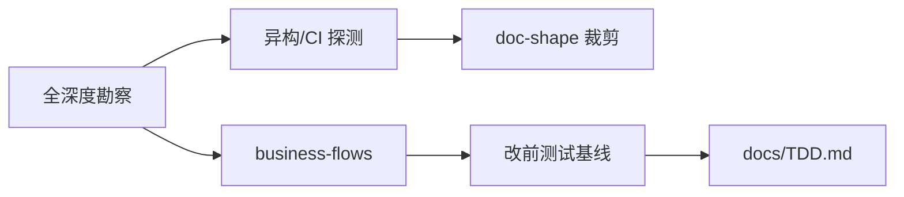

# v9 B4a：存量异构仓通用勘察、外来文档隔离、business-flows 与改前基线 — 功能设计规范（SPEC）

## 文档信息与变更概览

| 项目 | 内容 |
| --- | --- |
| 当前状态 | `draft`（`draft \| approved \| implementing \| in_review \| implemented \| superseded`） |
| 规划级别 | `L3`（通用扩展存量异构仓只读勘察、外来文档隔离、文档形态裁剪与高层次业务流映射；未 `approved` 前不编码） |
| 创建 / 更新 | `2026-11-18` / `2026-11-18` |
| 分支 / Issue / PR | 待启动 Wave 3 认领 / `#74` / 未关联 |
| 负责人 / 内审状态 | `plan-stage-b` / `pending` |
| 关联 PRD / Todo | [v9 总控 PRD](../prd/261118-v9-stageb-adaptive-architecture-prd.md) / [B4a Todo](../todo/261118-issue74-b4a-heterogeneous-survey-todo.md) |
| 认领的验收标准 | `C9`、`C10`、`C21` |

- **变更一句话**：通用升级异构仓库只读探测与文档共存边界——消除深目录截断与非 GitHub CI 误报、保护目标仓非本工具 `docs/` 文档不被误审、复用 `doc-shape.mjs` 拒绝强套模板章节、新增 `business-flows` 业务流分片并强制 `S1 -> S3` 改前既有测试基线校验，同时补全 `A7` 存量异构盲点（区分非隐藏 `skills/*` 源技能与 `.agents/skills/*`/宿主镜像并扫描 `*/AGENTS.md`、泛化多语配对文件名识别、补充 Python/Go 入口解析、`profile-sniffer.mjs` 重型 `e2e/`/`webtest/` 隔离与多 workflow 聚合）。

## 系统变更全景

| 模块 / 文件 | 变更性质 | 核心职责 |
| --- | --- | --- |
| `scripts/lib/survey-docs.mjs`、`scripts/lib/survey-reentry.mjs`、`scripts/lib/agents-defaults.mjs`、`kit/skills/lib/skill-discovery.mjs`、`scripts/survey.mjs` | 改造 | 探测非标设计目录、非 `.md` README、中性 CI；识别受管与外来 `docs/specs/`/`docs/todo/` 原样 `preserve`；区分非隐藏 `skills/*`（含 `*/skills/*`）源技能、`.agents/skills/*` 与深层宿主镜像并扫描子目录 `*/AGENTS.md`（及 `*/CLAUDE.md`）；泛化多语公开面识别；从 `scripts/survey.mjs`（`758` 行）抽离 TDD/符号汇总、CLI 解析与 `judgeRole` 封装至 `scripts/lib/survey-docs.mjs` 压回 `<= 730` 行 |
| `scripts/lib/survey-workspace.mjs`、`scripts/lib/survey-ecosystem.mjs` | 改造 | 解除 `depth > 6` 硬截断，支持自定义深度包 glob、容器/自动化脚本及 `package.json#exports` 对象映射 |
| `scripts/lib/survey-plan.mjs`、`kit/skills/lib/profile-sniffer.mjs` | 改造 | 在 `computeExplorationStrategy` 新增 `business-flows` 高层次业务理解分片；`profile-sniffer.mjs` 隔离重型 `e2e/`/`webtest/` 包不混入 `quick-test` 并聚合去重多 workflow |
| `kit/skills/lib/doc-shape.mjs`、`kit/skills/lib/doc-requirements.mjs`、`kit/skills/lib/doc-templates.mjs`、`kit/skills/dev-plan/scripts/doc-audit-repo.mjs`、`kit/skills/dev-govern/scripts/release-prep-lib.mjs`、`govern-docs.mjs`、`kit/skills/dev-review/scripts/review-gates.mjs` | 改造 | 复用 `doc-shape.mjs` 证据跳节并兼容非标异构模板；`doc-audit-repo.mjs` 跳过未带本工具 Frontmatter/标记的非受管外来 `docs/`；泛化 `README.*.md`/`CONTRIBUTING.*.md`/`SECURITY*.md` 及 `*.zh-CN.md` 等价双语配对与同步检查（`release-prep-lib.mjs <= 795`） |
| `kit/skills/dev-explore/scripts/repo-map.mjs`、`kit/skills/dev-explore/SKILL.md` | 改造 | 输出高层次 `business-flows`（服务对象、核心入口路由/CLI/UI/作业面、文档源码差异）只读视图，并补充解析 `pyproject.toml` `[project.scripts]` 与 Go `cmd/*/main.go` 入口 |
| `kit/skills/lib/tdd-facts.mjs`、`kit/skills/lib/tdd-scaffold.mjs` | 改造 | 将复杂异构仓业务流、自定义脚本与改前基线结果写入 `docs/TDD.md`，维持 `AGENTS.md` 薄指针与体积上限 |
| `SKILL.md`、`references/survey.md`、`references/docs-set.md` | 改造 | 规定 `S1 -> S3` 改仓前必须只读实跑对方既有测试与入口命令记录基线 |
| `scripts/dev/fixtures-stageb-onboarding.mjs` (new) | 修改 | 补齐 `C9`、`C10`、`C21` 正反双向用例（非标文档、原生 `docs/specs/*` 防误报、中性 CI、`business-flows`、改前基线、`A7` 非隐藏/镜像技能与子目录 `*/AGENTS.md`、多语等价配对、`pyproject.toml`/`cmd/*/main.go` 入口、`e2e/` 隔离与多 workflow 聚合） |

## 一、背景与边界声明

- **要改什么**：异构仓库的只读探测范围（非标目录、深层工作区、多形态脚本、`exports` 对象、中性 CI）、目标仓既有 `docs/` 与本工具规划文档的边界识别、`doc-shape.mjs` 异构兼容、`business-flows` 探索分片、`S1 -> S3` 改前既有测试实跑基线，以及 `A7` 存量异构盲点（非隐藏 `skills/*`/`*/skills/*` 与 `.agents/skills/*`/镜像区分、`*/AGENTS.md` 探测、`README.*.md`/`CONTRIBUTING.*.md`/`SECURITY*.md`/`*.zh-CN.md` 泛化配对、`pyproject.toml` `[project.scripts]` & `cmd/*/main.go` 入口、`profile-sniffer.mjs` 重型 `e2e/`/`webtest/` 隔离与多 workflow 聚合）。
- **不改什么**：不改动外部仓库自身文档格式与目录结构（全部 `preserve`）；不把重型架构分析或全仓入口清单直接塞进 `AGENTS.md`（防超 14KB/24KB/30KB 预算）；不改动 `TaskBackend` 与本地工单文件（与 Wave 3 左列 `B3` 源码写域 0 重叠）。
- **本期不做**：不在产品规则层写死任何具体外部项目目录名或特定 CI 供应商专有逻辑；保持通用文件形态与证据规则。
- **复用既有模块**：复用 `kit/skills/lib/profile-sniffer.mjs` 中性 CI 规则、`kit/skills/lib/doc-shape.mjs` 证据跳节、`kit/skills/lib/doc-requirements.mjs` 最小主干三节校验与 `kit/skills/lib/tdd-facts.mjs`。
- **架构基线关系**：遵循 `dev-explore` 严格只读不变量（`repo-map.mjs` 只读出图不写业务与文档，落地由 `S3` / `tdd-scaffold.mjs` 执行）；保持 `AGENTS.md` 薄指针与 `docs/TDD.md` 厚架构分层。
- **替代方案与否决理由**：若在 `doc-audit-repo.mjs` 要求用户仓原有 `docs/specs/` 全部补本工具 Frontmatter 会导致大规模历史文档红灯报错；改为「仅认本工具标记/`docs-*` 规范才纳入受管审查，其余 `preserve`」实现无损共存。

## 二、设计方案与契约变更

### 接口 / 数据结构变更

1. **`scripts/lib/survey-docs.mjs` 与 `scripts/lib/survey-workspace.mjs` / `survey-ecosystem.mjs`**：
   - 识别通用非标设计目录/文档（`doc/`、`documentation/`、`rfcs/`、`adr/`、`RUNBOOK.md`、`SECURITY.md`、OpenAPI/`proto`、非 `.md` README）及常见中性 CI 配置目录/文件（复用 `profile-sniffer`），消除误报 `ci.absent`。
   - 解除 `depth > 6` 硬截断（改用安全环检测 + 可配置高上限防止符号链接死循环）；完整展开多包 workspace glob、`Makefile`/`justfile`/容器配置/`package.json#exports` 对象。
2. **外来文档隔离与 `doc-shape.mjs` 兼容**：
   - `survey-reentry.mjs` 与 `kit/skills/dev-plan/scripts/doc-audit-repo.mjs` 增加 `isManagedPlanDoc(rel, text)` 判断（检测标准 YAML Frontmatter `kind:` / 本工具注释标记 `<!-- section:` / 标准命名前缀），非受管原有用户文档在 `S1–S4` 标记为 `preserve` 并被 `doc-plan.mjs audit .` 安全略过，不误报 `FRONTMATTER_INVALID`。
   - 规划与审计流程复用 `kit/skills/lib/doc-shape.mjs`（`analyzeDocShapeFromPaths`、`resolveDocShapePolicy`）及 `doc-requirements.mjs`，根据仓库真实形态自适应裁剪/兼容用户模板章节，不强套多余模板节。
3. **`business-flows` 分片与改前基线**：
   - `survey-plan.mjs` `computeExplorationStrategy` 固定输出 `business-flows` 分片（对存在代码或入口的项目）；`repo-map.mjs` 只读提取业务流概况（入口路由、CLI/任务面、主要实体与现有文档差异），并补充解析 Python `pyproject.toml` `[project.scripts]` 与 Go `cmd/*/main.go` 入口。
   - `SKILL.md` 与 `references/survey.md` 规定：在 `S3` 首次写入任何治理文件之前，必须以只读方式执行目标仓既有测试与主入口命令并记录改前基线（失败/缺失条目单独归因，避免改完后把对方原有失败误算在本工具头上），详情写入 `docs/TDD.md`。
4. **存量异构盲点补全（`A7`）**：
   - **技能容器边界与子目录约定**：`survey-reentry.mjs`、`kit/skills/lib/skill-discovery.mjs`、`scripts/lib/agents-defaults.mjs` 与 `survey-docs.mjs` 区分非隐藏 `skills/*`（含子目录 `*/skills/*`）手写源技能、`.agents/skills/*` 托管技能及带宿主生成镜像标记的嵌套技能目录（既不误删也不重复混入自有技能路由），并递归/层级扫描子目录 `*/AGENTS.md`（及 `*/CLAUDE.md`）。
   - **多语公开面泛化配对**：`survey-docs.mjs`、`doc-shape.mjs`、`kit/skills/dev-govern/scripts/release-prep-lib.mjs`（仅扩展正则 `+2` 行控制在 `<= 795` 行，保持 `injections-data-core.mjs` 目标稳定）、`govern-docs.mjs`、`kit/skills/dev-review/scripts/review-gates.mjs` 与 `kit/skills/lib/doc-templates.mjs` 泛化识别 `README.*.md`、`CONTRIBUTING.*.md`、`SECURITY*.md` 与 `*.zh-CN.md` 等价双语配对与同步检查（不限于写死 `README.en.md` / `CONTRIBUTING.md`）。
   - **重型测试隔离与多 workflow 聚合**：`kit/skills/lib/profile-sniffer.mjs` 识别需浏览器/外部设施的重型 `e2e/`、`webtest/` 目录/子包并做语义隔离，不混入默认 `quick-test`；聚合多个 CI workflow 文件中的真实 `run` 验证命令并去重。

### 数据与状态变更

- `survey.mjs --json` `docs` 切面新增 `preservedForeignPlanDocs` 与 `nonStandardDocs` 摘要字段。
- `tdd-facts.mjs` / `tdd-scaffold.mjs` 新增可选 `businessFlows` 与 `preForgeBaseline` 事实槽位落入 `docs/TDD.md`。

### 异常、回退与安全边界

- 对非标目录或深目录递归严格跳过 `node_modules`/`.git`/`.worktrees`/symlink 循环保护与文件数量上限保护，避免 I/O 超时。
- 对受管但格式受损文档（如已带 `kind: spec` 却缺关键字段）仍严格报错，防止借隔离漏洞豁免本工具自身文档检查（正反双向用例覆盖）。
- `scripts/survey.mjs` 当前已为 `758` 行（合入 `B2` 后），须先把 TDD 形状/符号覆盖汇总、CLI 解析与 `judgeRole` 封装辅助迁入 `scripts/lib/survey-docs.mjs`（`381` -> 约 `470` 行）将 `scripts/survey.mjs` 压至 `<= 730` 行，同时保留 `detectReentry`、`computeArtifactPlan` 与 `summarizeRemoteCapabilities` 原实现以兼容既有故障注入。

### 实现顺序

1. 先从 `scripts/survey.mjs`（`758` 行）抽离 TDD/符号汇总、CLI 解析与 `judgeRole` 封装辅助至 `scripts/lib/survey-docs.mjs` 使其压至 `<= 730` 行（保留既有故障注入定位点）；升级 `survey-docs.mjs`、`survey-workspace.mjs`、`survey-ecosystem.mjs`、`survey-reentry.mjs`、`agents-defaults.mjs`、`skill-discovery.mjs` 与 `profile-sniffer.mjs`：非标探测、深层遍历、`isManagedPlanDoc` 隔离判定、`skills/*` vs 镜像区分、`*/AGENTS.md` 探测与 `e2e/`/`webtest/` 隔离及多 workflow 聚合。
2. 对接 `doc-audit-repo.mjs`、`doc-shape.mjs`、`doc-requirements.mjs`、`doc-templates.mjs`、`release-prep-lib.mjs`、`govern-docs.mjs` 与 `review-gates.mjs`：非受管文档略过、异构形态兼容及 `README.*.md` / `CONTRIBUTING.*.md` / `SECURITY*.md` / `*.zh-CN.md` 泛化配对（保持自建空壳或受损受管文档仍判红，且 `release-prep-lib.mjs <= 795`）。
3. 实现 `survey-plan.mjs` `business-flows` 分片、`repo-map.mjs` 业务流提取（含 `pyproject.toml` `[project.scripts]` 与 `cmd/*/main.go`）、`tdd-facts.mjs`/`tdd-scaffold.mjs` TDD 承接及 `SKILL.md`/`references/survey.md`/`references/docs-set.md` `S1 -> S3` 改前基线规范。
4. 在 `scripts/dev/fixtures-stageb-onboarding.mjs` (new) 补充 `C9`、`C10`、`C21` 正反双向用例，并与并行 `B3` 同步完成 `.pf-manifest.json`。

## 三、备选方案与否决理由

| 方案 | 怎么做的 | 为什么没选 | 什么情况下该改回它 |
| --- | --- | --- | --- |
| 按受管 Frontmatter/标记识别 `isManagedPlanDoc`，外来文档 `preserve` + 复用 `doc-shape.mjs` | 无侵入共存，不改用户历史文档，也不放宽本工具文档审计门禁 | 最稳妥且可逆，直接消除真实开源仓误报 | 若用户显式迁移历史文档，可后续手工 `doc-plan link` 纳入托管 |
| 全部写进 `AGENTS.md` | 把业务流、基线命令和目录映射全塞进 `AGENTS.md` | 极易冲破 `14KB`/`24KB`/`30KB` 上限并稀释主调度提示词 | 违背契约轻重分离原则，永远不选 |

## 四、改动清单与影响面

| 文件 / 目录 | 改动性质 | 改什么 | 谁会被影响 |
| --- | --- | --- | --- |
| `scripts/lib/survey-docs.mjs`、`scripts/lib/survey-workspace.mjs`、`scripts/lib/survey-ecosystem.mjs`、`scripts/lib/survey-plan.mjs`、`scripts/lib/survey-reentry.mjs`、`scripts/lib/agents-defaults.mjs`、`kit/skills/lib/skill-discovery.mjs`、`kit/skills/lib/profile-sniffer.mjs`、`scripts/survey.mjs` | 修改 | 非标目录、中性 CI、深目录遍历、外来文档识别、`business-flows` 分片、`skills/*` vs 镜像与 `*/AGENTS.md`、`e2e/` 隔离与多 workflow 聚合，并从 `survey.mjs`（`758` 行）抽离辅助压回 `<= 730` 行 | `survey` 与 `review` 准确度 |
| `kit/skills/lib/doc-shape.mjs`、`kit/skills/lib/doc-requirements.mjs`、`kit/skills/lib/doc-templates.mjs`、`kit/skills/dev-plan/scripts/doc-audit-repo.mjs`、`kit/skills/dev-govern/scripts/release-prep-lib.mjs`、`govern-docs.mjs`、`kit/skills/dev-review/scripts/review-gates.mjs` | 修改 | 异构模板兼容、只审受管文档防误报 `FRONTMATTER_INVALID`，以及多语公开面等价文件名泛化识别（`release-prep-lib.mjs <= 795`） | 存量项目接入、`govern`/`review`/`doc-plan` |
| `kit/skills/dev-explore/scripts/repo-map.mjs`、`kit/skills/dev-explore/SKILL.md`、`kit/skills/lib/tdd-facts.mjs`、`tdd-scaffold.mjs` | 修改 | `business-flows` 只读出图（含 `pyproject.toml` `[project.scripts]` 与 `cmd/*/main.go`）及重资产/改前基线落 `docs/TDD.md` | `dev-explore` 与 TDD 同步 |
| `SKILL.md`、`references/survey.md`、`references/docs-set.md`、`scripts/dev/fixtures-stageb-onboarding.mjs` (new) | 修改 | 固化 `S1 -> S3` 改前基线流程与 `C9–C10`/`C21` 正反夹具 | 入门流程与回归测试 |

- **对外可见的变化**：`survey --json` `explorationStrategy` 包含 `business-flows`；`doc-audit` 与 `survey` 不再对目标仓原有非本工具 `docs/specs/*`/`docs/todo/*` 误报 `FRONTMATTER_INVALID`；`review` 对中性 CI 不再误报 `ci.absent`。
- **需要同步改的地方**：运行 `node scripts/equip.mjs .` 同步 `.agents/skills/` 中 `dev-explore`/`dev-plan`/`lib` 变更。

## 五、冻结的验收标准

- [ ] C9: `scripts/lib/survey-docs.mjs` 通用探测非标设计目录（`doc/`、`documentation/`、`rfcs/`、`RUNBOOK.md`、`SECURITY.md`、OpenAPI/`proto`、非 `.md` README）与中性 CI（消除 `review.mjs` 误报 `ci.absent`）并识别 `.githooks/`；`survey-reentry.mjs` 与 `kit/skills/dev-plan/scripts/doc-audit-repo.mjs` 仅将含受管 Frontmatter/标记/`docs-*` 规范的文件视作受管规划文档，目标仓原有用户 `docs/specs/` 或 `docs/todo/` 原样 `preserve` 不误报 `FRONTMATTER_INVALID`；规划与校验流程复用 `kit/skills/lib/doc-shape.mjs` 证据跳节与异构模板兼容机制，不对非标仓库强套多余章节；`survey-workspace.mjs`、`survey-ecosystem.mjs` 与 `repo-map.mjs` 解除 `depth > 6` 硬截断并识别多包 glob、自动化/容器脚本与 `package.json#exports` 对象映射。
- [ ] C10: `scripts/lib/survey-plan.mjs`（`computeExplorationStrategy`）新增 `business-flows` 高层次业务理解分片，只读 `repo-map.mjs` 输出业务流映射（服务对象、核心入口路由/CLI/UI/作业面、既有文档与源码差异）；`SKILL.md` 与 `references/survey.md` 规定 `S1 -> S3` 在首次写改目标仓前只读实跑对方既有测试与入口命令记录改前基线；业务流、脚本与基线清单沉入 `docs/TDD.md`，`AGENTS.md` 保持薄指针并严守 `lightweight < 14336 B`、`full <= 30720 B` 体积上限。
- [ ] C21: 补齐 `A7` 存量异构盲点且保持与并行 `B3` 源码写域零重叠：先从 `scripts/survey.mjs`（`758` 行）抽离 TDD/符号汇总、CLI 与 `judgeRole` 封装至 `scripts/lib/survey-docs.mjs` 压回 `<= 730` 行并保绿既有故障注入；`scripts/lib/survey-reentry.mjs`、`kit/skills/lib/skill-discovery.mjs`、`scripts/lib/agents-defaults.mjs` 与 `scripts/lib/survey-docs.mjs` 区分非隐藏 `skills/*`（含 `*/skills/*`）手写源技能、`.agents/skills/*` 托管技能与深层宿主生成镜像目录（不误删不混记），并扫描子目录 `*/AGENTS.md`（及 `*/CLAUDE.md`）；`survey-docs.mjs`、`kit/skills/lib/doc-shape.mjs`、`kit/skills/dev-govern/scripts/release-prep-lib.mjs`（正则微调保持 `<= 795` 行且兼容注入）、`kit/skills/dev-govern/scripts/govern-docs.mjs`、`kit/skills/dev-review/scripts/review-gates.mjs` 与 `kit/skills/lib/doc-templates.mjs` 泛化识别 `README.*.md` / `CONTRIBUTING.*.md` / `SECURITY*.md` 及 `*.zh-CN.md` 等价双语配对与同步检查；`kit/skills/dev-explore/scripts/repo-map.mjs` 补充解析 `pyproject.toml` `[project.scripts]` 与 Go `cmd/*/main.go` 入口；`kit/skills/lib/profile-sniffer.mjs` 对重型 `e2e/` / `webtest/` 包做语义隔离（不混入默认 `quick-test`）并聚合多 workflow 去重。

## 六、高风险点、门型与回滚路径

- **门型与回滚路径**：`one-way`（涉及 `doc-audit-repo` 扫描筛选与 `SKILL.md` 主流程步骤）；回滚做法：合入前丢弃分支；合入后单次反向提交并用正反夹具核实未放宽受损受管文档拦截。
- **高风险路径**：`kit/`、`scripts/lib/`、`SKILL.md`（须走独立审查与故障注入）。
- **故障注入预演**：后续在 `B5` 纳入 `I166`（目标仓原生 `docs/specs/*` 被误判 `FRONTMATTER_INVALID`）与 `I167`（非 GitHub CI 误报 `ci.absent`）；本片在 `fixtures-stageb-onboarding.mjs` 写入完整双向夹具。

## 七、上线与兼容策略

- **向后兼容**：既有带标准 `kind:` Frontmatter 的受管规划文档全量照常审计；仅无本工具标识的外来文档被 `preserve` 隔离开来。

## 澄清与补充记录

- （已显式合入 `doc-shape.mjs` 证据跳节复用与异构模板兼容要求，避免向非标仓库强套多余模板节）
- （2026-11-18 · Issue `#83` 增补 `C21`：纳入 LoopForge `A7` 存量异构盲点——`skills/*` 与 `.agents/skills/*`/宿主镜像区分、子目录 `*/AGENTS.md` 探测、`README.*.md`/`CONTRIBUTING.*.md`/`SECURITY*.md`/`*.zh-CN.md` 等价配对、`pyproject.toml` `[project.scripts]` & `cmd/*/main.go` 入口，以及 `profile-sniffer.mjs` `e2e/`/`webtest/` 隔离与多 workflow 聚合）

## 实现说明

- **实际落地摘要**：
- **与草案的差异**：
- **关联同步文件**：
