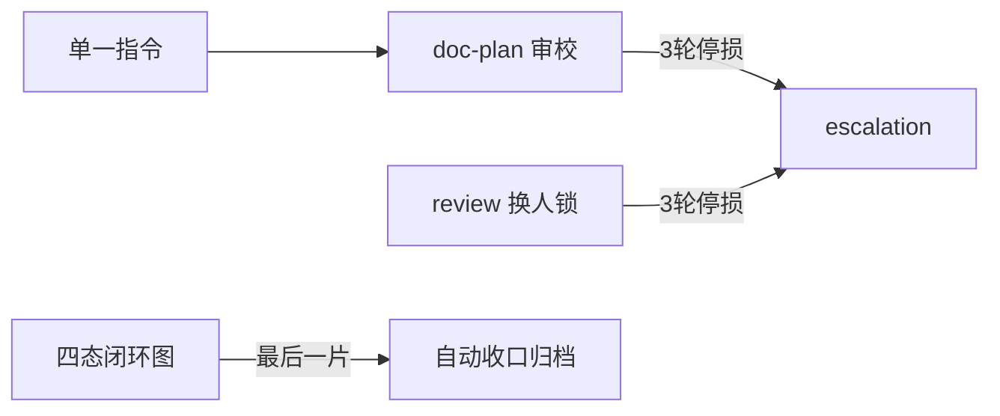

# v9 B4b：纯调度、分级建单、双侧 3 轮停损与 1:N 总控 PRD 自动收口 — 功能设计规范（SPEC）

## 文档信息与变更概览

| 项目 | 内容 |
| --- | --- |
| 当前状态 | `draft`（`draft \| approved \| implementing \| in_review \| implemented \| superseded`） |
| 规划级别 | `L3`（涉及主调度协议、统一分级建单、规划/评审双侧 3 轮停损、总控 PRD 确定性自动收口及 4 份紧文件拆分；未 `approved` 前不编码） |
| 创建 / 更新 | `2026-11-18` / `2026-11-18` |
| 分支 / Issue / PR | 待启动 Wave 4 认领 / `#75` / 未关联 |
| 负责人 / 内审状态 | `plan-stage-b` / `pending` |
| 关联 PRD / Todo | [v9 总控 PRD](../prd/261118-v9-stageb-adaptive-architecture-prd.md) / [B4b Todo](../todo/261118-issue75-b4b-escalation-stoploss-closure-todo.md) |
| 认领的验收标准 | `C11`、`C12`、`C13`、`C14`、`C19` |

- **变更一句话**：固化主会话薄上下文纯调度与单一 `[NEXT STEP]`，以 `escalation.mjs` (new) 统一分级建单，实现代码与规划审核双侧全历史换人 + 3 轮结构化停损，并落地 `1:N` 总控 PRD 四态确定性自动收口使最后一片免额外 PR 一次闭合。

## 系统变更全景

| 模块 / 文件 | 变更性质 | 核心职责 |
| --- | --- | --- |
| `kit/skills/lib/escalation.mjs` (new) | 新增 | 提供 `classifyEscalationTier(item)` 与远端/本地同构自动建单逻辑（含 `probeForWrite` 校验） |
| `kit/skills/lib/critique-rounds.mjs`、`kit/skills/dev-plan/scripts/doc-plan.mjs`、`scripts/dev/injections-data-workflow.mjs` | 改造 | 抽出多轮 Critique 状态机，补全 `critique-reject`、`critique-override`、全历史换人、同 SHA 锁与 3 轮停损（`doc-plan.mjs <= 680` 行）并同步更新 `I64`/`I78` |
| `kit/skills/dev-plan/scripts/doc-audit-helpers.mjs` (new)、`doc-audit.mjs` | 新增 / 改造 | 拆出静态扫描辅助将 `doc-audit.mjs` 压至 `<= 650` 行；纳入 `critique_rounds` / `critique_override` 豁免与清理 |
| `kit/skills/lib/doc-substantive.mjs`、`kit/skills/lib/docs.mjs`、`kit/skills/lib/shared.mjs` | 改造 | 新增单源 `evaluateMasterPrdClosureState` 复用 `collectMasterPrdSpecTexts`；保留 `isSharedMasterPrd` 原实现并压 `docs.mjs <= 755` 行 |
| `kit/skills/dev-flow/scripts/flow-lifecycle-helpers.mjs`、`flow-lifecycle.mjs` | 改造 | 在 `finalize` 与 `verify` 两侧接入 `C19` 四态收口检查（含并行切片 `sync` 后幂等重跑 `finalize`） |
| `kit/skills/dev-review/scripts/review-locks.mjs`、`review-ledger.mjs`、`review-pack.mjs` | 改造 | 落地 `checkDistinctRoundReviewer` 与结构化 `stopLossPacket`（驱动 `review-ledger.mjs <= 600` 行） |
| `kit/skills/dev-govern/scripts/govern-state.mjs`、`kit/skills/lib/ledger.mjs`、`workflow-policy.mjs`、`kit/skills/dev-flow/scripts/flow.mjs`、`flow-batch.mjs`、`flow-next.mjs` | 改造 | 抽离 `buildIssues`/`applyIssuesToBackend` 至 `escalation.mjs` (new)（`govern-state.mjs <= 680` 行）；就绪 `docs/specs/*.md` 默认并行分波与 `parallelDispatch: true`、单一 `[NEXT STEP]` 与 `excludedReviewers` |
| `SKILL.md`、`templates/agents-project.md`、`AGENTS.md`、`references/collaboration.md`、`kit/skills/dev-flow/SKILL.md` | 改造 | 固化薄上下文纯调度、默认并行优先分波约束与 `GIT_EDITOR=true` / `--no-edit` 非交互 Git 文档指令，并控制 `AGENTS.md` 体积预算 |
| `scripts/dev/fixtures-stageb-loop.mjs` (new) | 修改 | 补齐 `C11`（含就绪 SPEC 并行分波）、`C12`、`C13`、`C14`、`C19` 全量正反双向断言（含四态自动收口与并行后重跑幂等 `finalize`） |

## 一、背景与边界声明

- **要改什么**：纯调度与默认并行优先波次调度、单一 `[NEXT STEP]`、统一分级建单、代码与规划双侧全历史换人及 3 轮结构化停损、`1:N` 总控 PRD 四态确定性收口机制，以及 `doc-plan.mjs`、`doc-audit.mjs`、`govern-state.mjs`、`flow-lifecycle.mjs` 行数重构与 `I64`/`I78` 注入迁移。
- **不改什么**：不扩展 `Dev Profile` 7 键名；不改动 `docs.mjs` 中 `isSharedMasterPrd(repoRoot, prdRel, activeSpecRel = null)` 原函数体以兼容既有 `I58` 故障注入；不改 `review-gates.mjs` 通用 E2E 门禁（留归 Wave 5 `B5`）。
- **本期不做**：不自动绕过 3 轮停损（必须由人类显式执行 `override` / `critique-override --human-approved --reason`）；不自动为 `archive_policy: manual` 的总控 PRD 执行免参归档。
- **复用既有模块**：复用 `kit/skills/lib/doc-substantive.mjs`（`collectMasterPrdSpecTexts`、`resolveRelDocTarget`）、`kit/skills/lib/critique-rounds.mjs`、`kit/skills/lib/signals.mjs`（`appendGovernSignal`）、`kit/skills/lib/task-backend.mjs`（16 方法，已于 `B3` 落地）与 `kit/skills/lib/platform-probe.mjs`（`probeForWrite`）。
- **架构基线关系**：所有新增或拆出模块都在 `kit/skills/` 内，零第三方依赖；严守 `AGENTS.md` 渲染体积预算（通过精简模板重复长句抵消新增规则增量）。
- **替代方案与否决理由**：若在 `docs.mjs` 内再复制一份遍历逻辑会把 `docs.mjs`（742 行）直接撑破 `800` 行上限；把 `evaluateMasterPrdClosureState` 置于 `doc-substantive.mjs` 直接复用 `collectMasterPrdSpecTexts` 既零重复又稳守行上限。

## 二、设计方案与契约变更

### 接口 / 数据结构变更

1. **统一分级建单（`kit/skills/lib/escalation.mjs` (new)）**：
   - 导出 `classifyEscalationTier(item)`：若 `severity` 为 `low`/`medium` 且影响单文件非复发（`Case` 为 `1` 或 `2`、`two-way`）返回 `'inline-todo'`；若 `critical`/`high`/跨模块/`Case >= 3`/`one-way`/高风险/复发 `>= 2`/阻塞 E2E 失败返回 `'escalated-issue'`。
   - 导出 `buildEscalationIssuePayload(item)` 与 `escalateToBackend({ backend, targetRepo, item, ... })`（非 `local-only` 分支显式前置 `probeForWrite` 通过 `write-probe-audit.mjs`）。
2. **双侧独立复核与 3 轮停损**：
   - `review-locks.mjs` 新增 `checkDistinctRoundReviewer(rounds, currentReviewerId)`（忽略 `@` 与大小写遍历全历史轮次），`review-ledger.mjs` 对 `Round >= 2` 复用历史审稿人返回退出码 `2`（`BLOCKED_SAME_REVIEWER_REREVIEW`）；触发 `STOP_LOSS_ESCALATE`（退出码 `4`）时输出结构化 `stopLossPacket` 并写入 `signals.jsonl`（`review.stop-loss`）。
   - `critique-rounds.mjs` 与 `doc-plan.mjs` 新增 `critique-reject` 与 `critique-override --human-approved --reason`，Frontmatter 持久化 `critique_rounds`（各轮 `round`/`reviewer`/`sha`/`verdict`/`summary`）与 `critique_override`；拦截 `SELF_CRITIQUE_REJECTED`、全历史同人 `BLOCKED_CRITIQUE_SAME_REVIEWER`、未改稿 `BLOCKED_CRITIQUE_SAME_SHA`（退出码 `2`）及第 3 轮/连轮重复意见 `STOP_LOSS_ESCALATE`（退出码 `4`，写 `plan.critique-stop-loss`）。
3. **`1:N` 总控 PRD 四态确定性自动收口（`C19`）**：
   - 在 `kit/skills/lib/doc-substantive.mjs` 新增 `evaluateMasterPrdClosureState(repoRoot, prdRel, { currentSpecRel = null, currentTodoRel = null } = {})`（由 `kit/skills/lib/shared.mjs` 重导出），复用 `collectMasterPrdSpecTexts` 遍历非 `superseded`/`dropped` 关联切片并按四态返回：
     1. **`hold-manual-or-active`**：`archive_policy === 'manual'` 或除当前切片外仍存在未归档活跃兄弟切片（含并行开发中）-> 总控 PRD 原封不动、零并行写冲突。
     2. **`hold-staged`**：无其余活跃切片、`archive_policy !== 'manual'`，但总控 PRD 存在未被已归档及当前切片覆盖的后续 `C*`（分期未拆完）-> 总控 PRD 保持 `active`，不自动归档也不阻断。
     3. **`ready-auto-close`**：无其余活跃切片、`archive_policy !== 'manual'`、`C*` 100% 已覆盖且全勾 `[x]` -> `archiveCompletedDocsGroup` 与 `flow.mjs finalize` **自动等效启用 `--include-master-prd`** 在当前分支一并归档总控 PRD。
     4. **`blocked-unclosed`**：无其余活跃切片、`archive_policy !== 'manual'`、`C*` 100% 已覆盖但总控 PRD 仍留有 `[ ] C*` 未勾 -> `finalize` 与 `verify` 均硬阻断返回 `BLOCKED_LAST_SLICE_MASTER_PRD_UNCLOSED` 并输出单一 `[NEXT STEP]`。
   - **并行切片先合后重跑幂等设计**：当并行切片 A 先合入 `main` 后，此前已经执行过 `finalize` 的兄弟切片 B（此时 B 自身的 `SPEC`/`Todo` 已提前移入 `docs/archive/`）经 `flow.mjs sync` / rebase 追平 `main` 成为仅剩最后一片时：`verify` 检测到主控 PRD 仍处于 `docs/prd/` 且 `otherActiveSlices === 0`，会拦截并给出 `flow.mjs finalize --task <B>` 单一指令；切片 B 重新执行 `finalize` 时，`archiveCompletedDocsGroup` 自动跳过已处于 `docs/archive/` 的自身 `SPEC`/`Todo` 不再重复移动，仅把总控 PRD 自动归档至 `docs/archive/prd/`、写更新 `archivedPrdFile` 并重算互链相对路径，实现零冲突幂等闭合。
4. **纯调度、默认并行优先波次调度与非交互命令对齐**：
   - `workflow-policy.mjs`（`evaluateNextState` / `buildMultiTaskWavePlan`）与 `flow-batch.mjs`（`handleBatchPlan`，当前 `373` 行）：不仅读已建任务账本，在 `idle` / `ambiguous` 态也统一扫描**尚未 `flow start` 的就绪 `docs/specs/*.md`**（提取 `Depends on #N` 与显式写域文件列表；缺写域声明的保守串行不硬并）。对零未清依赖且写域严格零重叠的就绪任务自动归入可并行 `Wave 1`；当 `Wave 1 >= 2` 个可并行任务时 `flow.mjs next` 确定性返回 `parallelDispatch: true` 与各槽位派发指令/`merge-queue` 合流指引，不再压回单任务 `--task firstTask`；`templates/agents-project.md` 新增 1 句确定性并行约束（严格控字节不超预算）。
   - `flow-next.mjs`、`workflow-policy.mjs` 与 `doc-plan.mjs` 每个阶段只打印 1 条唯一 `[NEXT STEP]` 主命令，备选命令放入次要信息字段。
   - `references/collaboration.md`、`kit/skills/dev-flow/SKILL.md`、`review-ledger.mjs`、`flow-lifecycle.mjs` 与 `flow.mjs` 所有 `git rebase --continue` / `git merge` 指引统一附带 `GIT_EDITOR=true` / `--no-edit`。

### 数据与状态变更

- `PRD`/`SPEC`/`Todo` Frontmatter 支持可选 `critique_rounds`、`critique_override`（`docs.mjs` `DOC_FRONTMATTER_KEY_ORDER` 与 `doc-audit.mjs` `stripCritiqueMeta` 同步兼容）。
- `signals.jsonl` 新增 `plan.critique-stop-loss` 与 `review.stop-loss` 事件。

### 异常、回退与安全边界

- 所有 `git rebase --continue` 与 `git merge` 文案与输出命令均确保在非交互环境中不弹编辑器。
- 严格压减 4 个紧文件：`doc-plan.mjs` `<= 680` 行、`doc-audit.mjs` `<= 650` 行、`review-ledger.mjs` `<= 600` 行、`govern-state.mjs` `<= 680` 行；`docs.mjs` 维持 `<= 755` 行；`flow-lifecycle.mjs` 借助 `flow-lifecycle-helpers.mjs` 维持 `<= 710` 行。
- 更新 `templates/agents-project.md` 后运行 `node scripts/compose-agents.mjs .` 与 `node scripts/dev/preflight.mjs` 实测 `AGENTS.md < 24576 B`（`lightweight < 14336 B`、`full <= 30720 B`）。

### 实现顺序

1. 拆出 `kit/skills/dev-plan/scripts/doc-audit-helpers.mjs` (new)、`kit/skills/lib/escalation.mjs` (new) 与扩展 `kit/skills/lib/critique-rounds.mjs`（同步更新 `scripts/dev/injections-data-workflow.mjs` 中 `I64`/`I78`），确保 `doc-audit` / `doc-plan` / `govern-state` / `review-ledger` 全线降到安全水位。
2. 在 `kit/skills/lib/doc-substantive.mjs` 实现 `evaluateMasterPrdClosureState` 并在 `docs.mjs`、`shared.mjs`、`flow-lifecycle-helpers.mjs`、`flow-lifecycle.mjs` 接入 `C19` 四态闭环与并行重跑幂等逻辑。
3. 落地 `review-locks.mjs` 历史换人锁与 `stopLossPacket`、`doc-plan.mjs` 多轮 Critique、`workflow-policy.mjs`/`flow-batch.mjs` 就绪 SPEC 默认并行分波与 `parallelDispatch: true`、`flow-next.mjs` 单一 `[NEXT STEP]` 与 `excludedReviewers`。
4. 更新 `SKILL.md`、`templates/agents-project.md`、`references/collaboration.md`、`kit/skills/dev-flow/SKILL.md`、`flow.mjs`、`AGENTS.md` 与 `.agents/skills/`，在 `scripts/dev/fixtures-stageb-loop.mjs` (new) 写入 `C11–C14` 与 `C19` 全量正反双向断言并跑通 `merge-gate`。

## 三、备选方案与否决理由

| 方案 | 怎么做的 | 为什么没选 | 什么情况下该改回它 |
| --- | --- | --- | --- |
| `doc-substantive.mjs` 单源 `evaluateMasterPrdClosureState` + `finalize`/`verify` 双侧接管 | 复用既有 `collectMasterPrdSpecTexts`，`docs.mjs` 只增 6 行且不碰 `isSharedMasterPrd` 原函数头 | 零重复代码、兼顾并行先合后 rebase 幂等与 `I58` 兼容性 | 无 |
| 仅在 `finalize` 里检查或靠人工记住传 `--include-master-prd` | 维持现状或只拦截 `finalize` 不拦 `verify` | 并行兄弟在对方合入前已跑 `finalize` 再 rebase 后会直接漏过 `verify` 产生类似漏闭合补开 PR | 已被生产实测证伪 |

## 四、改动清单与影响面

| 文件 / 目录 | 改动性质 | 改什么 | 谁会被影响 |
| --- | --- | --- | --- |
| `kit/skills/lib/escalation.mjs` (new) | 新增 | `classifyEscalationTier`、工单载荷与 `TaskBackend` 创建（含 `probeForWrite`） | `govern-state`、`review-ledger`、`B5` E2E |
| `kit/skills/lib/critique-rounds.mjs`、`kit/skills/dev-plan/scripts/doc-audit-helpers.mjs` (new)、`doc-audit.mjs`、`doc-plan.mjs`、`scripts/dev/injections-data-workflow.mjs` | 新增 / 修改 | 规划审核多轮 `reject`/`override`/历史换人/同 SHA 锁/3 轮停损、拆行并更新 `I64`/`I78` | `dev-plan`、`verify-injections` |
| `kit/skills/lib/doc-substantive.mjs`、`kit/skills/lib/docs.mjs`、`kit/skills/lib/shared.mjs` | 修改 | `evaluateMasterPrdClosureState` 四态判定、`critique_*` 键序与自动归档接线 | `docs` 归档与 `fixtures` |
| `kit/skills/dev-flow/scripts/flow.mjs`、`flow-batch.mjs`、`flow-next.mjs`、`flow-lifecycle-helpers.mjs`、`flow-lifecycle.mjs`、`kit/skills/lib/ledger.mjs`、`workflow-policy.mjs` | 修改 | 就绪 `SPEC` 默认并行分波与 `parallelDispatch: true`、`C19` 双侧拦截/幂等重跑、单一 `[NEXT STEP]`、`excludedReviewers` 与非交互 Git 输出 | `flow`、`batch`、`submit`、`verify` |
| `kit/skills/dev-review/scripts/review-locks.mjs`、`review-ledger.mjs`、`review-pack.mjs`、`kit/skills/dev-govern/scripts/govern-state.mjs` | 修改 | 历史全轮换人锁、`stopLossPacket` 与去重迁移 | `dev-review`、`dev-govern` |
| `SKILL.md`、`templates/agents-project.md`、`AGENTS.md`、`references/collaboration.md`、`kit/skills/dev-flow/SKILL.md`、`scripts/dev/fixtures-stageb-loop.mjs` (new) | 修改 | 纯调度通则、默认并行约束、非交互 Git 文档、体积控制与 `C11–C14`/`C19` 双向测试 | 主会话调度与门禁 |

- **对外可见的变化**：`doc-plan.mjs` 新增 `critique-reject` 与 `critique-override`；`flow.mjs next` 与 `flow.mjs batch plan` 自动扫描就绪 `SPEC` 并输出 `parallelDispatch: true` 与 `excludedReviewers`；1:N 最后一片满足条件免传 `--include-master-prd` 自动归档总控 PRD，未勾选则报 `BLOCKED_LAST_SLICE_MASTER_PRD_UNCLOSED`。
- **需要同步改的地方**：运行 `node scripts/compose-agents.mjs .` 与 `node scripts/equip.mjs .`。

## 五、冻结的验收标准

- [ ] C11: `SKILL.md` 与 `templates/agents-project.md` 固化「主会话薄上下文纯调度（不直接改业务源码或通读全量 diff），只跑 `flow.mjs next --handoff` 按 `ownerRole` 派独立子代理，默认并行优先按依赖与写域分波」；`workflow-policy.mjs`（`evaluateNextState` / `buildMultiTaskWavePlan`）与 `flow-batch.mjs`（`handleBatchPlan`）除已建账本外在 `idle`/`ambiguous` 态统一扫描未 `start` 的就绪 `docs/specs/*.md`（读取 `Depends on` 与写域列表，缺写域声明的保守串行），将零未清依赖且写域互斥任务归入并行 `Wave 1`，`Wave 1 >= 2` 时 `flow.mjs next` 确定性返回 `parallelDispatch: true` 与各槽位派发/`merge-queue` 指令（不压回单任务 `--task firstTask`）；`flow-next.mjs` 与 `doc-plan.mjs` 保证每次只输出单一可执行主命令 `[NEXT STEP]`，结合 `.githooks/pre-push` 防偏航使弱模型不漏步；`references/collaboration.md`、`kit/skills/dev-flow/SKILL.md`、`review-ledger.mjs`、`flow.mjs` 与 `flow-lifecycle.mjs` 中的 `git rebase --continue` / `git merge` 指引统一附带 `GIT_EDITOR=true` / `--no-edit` 非交互保护。
- [ ] C12: 新增 `kit/skills/lib/escalation.mjs` (new) 提供统一 `classifyEscalationTier(item)`：`low`/`medium` 单文件非复发（`Case 1–2`、`two-way`）归入当前或整改 Todo；`critical`/`high`/跨模块/`Case >= 3`/`one-way`/高风险/复发 `>= 2`/阻塞 E2E 失败经 `TaskBackend.createIssue`（支持 GitHub 与 `LocalOnlyBackend`）创建含 `Case`、`C1..Cn`、根因与 `[NEXT STEP]` 的追踪工单并重入 `dev-plan -> dev-flow -> dev-review`；已接入 `govern-state.mjs` 与 `review-ledger.mjs`。
- [ ] C13: `review-locks.mjs` 新增 `checkDistinctRoundReviewer` 并在 `review-ledger.mjs` 强制执行——`Round >= 2` 复用任意历史轮次 `reviewerId`（忽略 `@` 与大小写）退出码 `2` 返回 `BLOCKED_SAME_REVIEWER_REREVIEW`，`flow-next.mjs` 同步输出 `excludedReviewers`；代码审查触发 `STOP_LOSS_ESCALATE`（退出码 `4`）时生成并落盘结构化 `stopLossPacket`（逐轮方向漂移、重复指纹、热点文件、根因假设与 `docPlanBridge` 重规划/建单命令）。
- [ ] C14: `kit/skills/lib/critique-rounds.mjs` 与 `doc-plan.mjs` 落地规划审核多轮对称闭环——新增 `critique-reject` 与 `critique-override` 子命令，frontmatter 持久化 `critique_rounds` 与 `critique_override`（同步纳入 `doc-audit.mjs` `stripCritiqueMeta` 与占位豁免）；`critique-pass`/`critique-reject` 统一拦截 `SELF_CRITIQUE_REJECTED`、全历史轮次 `BLOCKED_CRITIQUE_SAME_REVIEWER`、未改稿重审 `BLOCKED_CRITIQUE_SAME_SHA`（退出码 `2`）及第 3 轮/连轮重复意见 `STOP_LOSS_ESCALATE`（退出码 `4`，产出结构化归因包与 `signals.jsonl` 事件），仅人类 `critique-override --human-approved --reason` 解锁。
- [ ] C19: 在 `kit/skills/lib/doc-substantive.mjs` 新增单源 `evaluateMasterPrdClosureState`（`kit/skills/lib/shared.mjs` 重导出，保持 `docs.mjs` `isSharedMasterPrd` 原函数实现与 `<= 755` 行），接入 `archiveCompletedDocsGroup` 与 `flow-lifecycle-helpers.mjs`/`flow-lifecycle.mjs` 实现 `1:N` 总控 PRD 确定性四态闭环：① `archive_policy: manual` 或仍有活跃兄弟切片（含并行开发）时原封不动（零并行写冲突）；② 无其余活跃切片但总控 PRD 仍含未覆盖后续 `C*` 时保持 `active`；③ 无其余活跃切片、100% 覆盖且全勾 `[x]` 时，`finalize` 无需额外传 `--include-master-prd` 即自动同分支归档（含并行切片 A 先合入、已归档自己 `SPEC/Todo` 的兄弟切片 B 经 `sync`/rebase 追平 `main` 后幂等重跑 `finalize` 自动收口总控 PRD）；④ 100% 覆盖却仍留 `[ ] C*`（含并行分支先后 `sync`/rebase 后成为最后一片）时，`finalize` 与 `verify` 均拦截返回 `BLOCKED_LAST_SLICE_MASTER_PRD_UNCLOSED` 与单一 `[NEXT STEP]`；`scripts/dev/fixtures-stageb-loop.mjs` (new) 与 `scripts/dev/injections-data-stageb.mjs` (new)（`I173`）覆盖全部四态正反断言。

## 六、高风险点、门型与回滚路径

- **门型与回滚路径**：`one-way`（涉及 `SKILL.md`/`AGENTS.md`/停损闸门/文档归档逻辑）；回滚做法：合入前丢弃隔离工作树；合入后单次反向提交并重跑 `compose-agents.mjs .` 与 `equip.mjs .`。
- **高风险路径**：`kit/`、`templates/`、`SKILL.md`、`AGENTS.md`（须独立审查与故障注入闭环）。
- **故障注入预演**：后续在 `B5` 纳入 `I168`（`Round >= 2` 复用历史审稿人）、`I169`（规划 R3 停损漏拦截）、`I170`（同 SHA 重审漏拦截）与 `I173`（最后一片漏自动归档或放过 `[ ] C*`）；本片在 `fixtures-stageb-loop.mjs` 落盘完整双向测试。

## 七、上线与兼容策略

- **向后兼容**：旧版仅含 `plan_critique` 字符串的文档在读取历史评审人时平顺兼容解析，不要求全仓存量归档文档补填 `critique_rounds`；显式传 `--include-master-prd` 保持向后兼容。

## 澄清与补充记录

- （已合并协调者 #183/#186 要求：明确并行切片 A 先合入后、已归档自己 `SPEC/Todo` 的兄弟切片 B 经 `sync`/rebase 追平 `main` 时可幂等重跑 `finalize` 完成总控 PRD 自动归档）

## 实现说明

- **实际落地摘要**：
- **与草案的差异**：
- **关联同步文件**：
