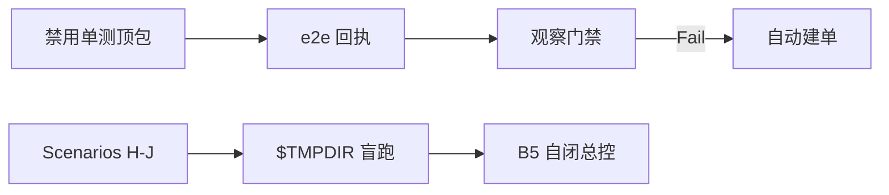

# v9 B5：通用 E2E 门禁、离线 Scenarios H–J、I160+ 注入与 $TMPDIR 盲跑终验 — 功能设计规范（SPEC）

## 文档信息与变更概览

| 项目 | 内容 |
| --- | --- |
| 当前状态 | `draft`（`draft \| approved \| implementing \| in_review \| implemented \| superseded`） |
| 规划级别 | `L3`（通用运行+观察 E2E 硬门禁、Stage B 全量 `I160+` 故障注入、离线 Scenarios `H–J`、`$TMPDIR` 多生态开源仓盲跑终验与全仓文档校准；未 `approved` 前不编码） |
| 创建 / 更新 | `2026-11-18` / `2026-11-18` |
| 分支 / Issue / PR | 待启动 Wave 5 认领 / `#76` / 未关联 |
| 负责人 / 内审状态 | `plan-stage-b` / `pending` |
| 关联 PRD / Todo | [v9 总控 PRD](../prd/261118-v9-stageb-adaptive-architecture-prd.md) / [B5 Todo](../todo/261118-issue76-b5-e2e-blind-run-gate-todo.md) |
| 认领的验收标准 | `C15`、`C16`、`C17`、`C18` |

- **变更一句话**：修补 `GATE_TIER_RANK` 与 `assessBehavioralGate` 的端到端门禁旁路，接入通用「运行 + 观察」回执与 E2E 失败自动建单，补全 `I160–I173` 注入与离线 Scenarios `H–J`，并以 `$TMPDIR` 真实开源仓盲跑及本仓最后一片 `C19` 免参自动收口完成全阶段闭环。

## 系统变更全景

| 模块 / 文件 | 变更性质 | 核心职责 |
| --- | --- | --- |
| `kit/skills/lib/workflow-policy.mjs` | 改造 | 保留 7 键 `Dev Profile`，修复 `GATE_TIER_RANK` 下 `full`/`gate` 跳过 `smoke-verify` 缺陷并强校 `e2eObservation` |
| `kit/skills/dev-flow/scripts/flow.mjs`、`kit/skills/dev-flow/scripts/flow-lifecycle-helpers.mjs`、`flow-lifecycle.mjs` | 改造 | 在 `flow.mjs` 严格 `parseStandardCli` 注册 `--e2e-evidence` 与帮助文案，支持 `verify --e2e-evidence`（兼容 `--visual-checked`），E2E 运行失败自动写 `signals.jsonl`（`e2e.runtime-fail`）与入账 |
| `kit/skills/dev-review/scripts/review-gates.mjs`、`review-empirical.mjs`、`review-empirical-state.mjs`、`review-locks.mjs`、`review-pack.mjs`、`kit/skills/dev-review/SKILL.md` | 改造 | 修复 `assessBehavioralGate` `!smokeRequired` 逻辑缺陷，清除既有前端驱动工具硬编码文案；缺 E2E 实证阻断 `--include-diff` 与 `pass` |
| `scripts/dev/preflight-contract-rules.mjs` (new)、`scripts/dev/preflight-contracts.mjs`、`scripts/dev/injections-data-core.mjs` | 新增 / 改造 | 先抽离常量与收尾校验辅助压降 `preflight-contracts.mjs <= 700` 行，同步迁移 `I7`/`I9c`/`I9f` 注入目标，并加入通用 E2E 与零具体工具名合约检查 |
| `scripts/dev/fixtures-stageb-loop.mjs` (new)、`scripts/dev/injections-data-stageb.mjs` (new)、`scripts/dev/injections-data.mjs` | 修改 / 新增 | 写入 `C15` 双向用例及覆盖 `C1..C15`/`C19` 的 `I160–I173` 故障注入集合 |
| `scripts/dev/e2e-scenarios-stageb.mjs` (new)、`scripts/dev/e2e-zip-harness.mjs` | 新增 / 改造 | 在解压 `git archive --format=zip` 黑盒环境下运行 Scenarios `H`、`I`、`J` 全闭环 |
| `scripts/dev/blind-run-harness.mjs` (new) | 新增 | `$TMPDIR` 隔离真实开源仓（含带自有技能与规则已规范仓 `S1–S4` 升级）极简低提示词盲跑验收器（不入用户包，登记 `docs/TDD.md`） |
| `templates/agents-project.md`、`SKILL.md`、`AGENTS.md`、`docs/TDD.md`、`README.md`、`README.en.md` | 改造 | 替换通用 E2E 实证文案、登记 `blind-run-harness.mjs` (new)（防孤儿报错）、同步双语 README 目录与校准全局体积 |

## 一、背景与边界声明

- **要改什么**：端到端门禁与策略引擎（`workflow-policy`、`review-gates`、`review-empirical`、`flow-lifecycle`）、`preflight-contracts.mjs` 行数拆分、Stage B 故障注入集（`I160+`）、离线 `zip` E2E Scenarios `H–J`、`$TMPDIR` 真实开源仓盲跑脚本及全仓文档同步。
- **不改什么**：严禁扩张 `DEV_PROFILE_KEYS` 的 7 个标准键名（复用现有 `smoke-verify:` 键位）；不在任何通用门禁、模板或报错文案中出现具体前端/自动化端到端驱动库或客户端测试框架名称；不在非纯文档仓豁免运行时变更。
- **本期不做**：不将 `scripts/dev/blind-run-harness.mjs` (new) 打进随包分发的 `kit/` 或 `.gitattributes` 导出清单；不在 `$TMPDIR` 盲跑期间向任何外部开源仓库远端执行写操作或推送。
- **复用既有模块**：复用 `kit/skills/lib/profile.mjs`、`kit/skills/lib/signals.mjs`、`kit/skills/lib/escalation.mjs` (new)（`B4b` 交付）、`scripts/dev/e2e-zip-harness.mjs`、`scripts/dev/verify-injections.mjs`。
- **架构基线关系**：同时作为 Stage B（`v9`）最后一片实施任务，`B5` 在自收口时直接通过 `flow.mjs finalize --task b5-e2e-blind-run-gate`（不传 `--include-master-prd`）实证 `C19` 与显式 `--include-master-prd` 的等价自动闭合语义。
- **替代方案与否决理由**：若为了 E2E 门禁新增第 8 个 `Dev Profile` 键位（如 `e2e-verify:`），会迫使 `profile.mjs` 与 6 处单源契约及既有历史仓配置全部失效；复用 `smoke-verify:` + 结构化 `e2eObservation` 回执做到零迁移兼容。

## 二、设计方案与契约变更

### 接口 / 数据结构变更

1. **通用「运行 + 观察」E2E 硬门禁（`C15`）**：
   - **`kit/skills/lib/workflow-policy.mjs`**：当 `runtimeFilesTouched.length > 0`、`riskTier !== 'low'` 且 `Dev Profile` 中 `smoke-verify` 未显式声明 `none` 时：`determineWorkflowPolicy` 与 `validateVerificationEvidence` 禁止以 `full`/`gate`（仅单测）顶替 `smoke`；缺 `smokeVerifiedOnHead` 或缺结构化 `e2eObservation` 时返回 `BLOCKED_INSUFFICIENT_VERIFICATION_TIER` 或 `BLOCKED_E2E_OBSERVATION_REQUIRED`（退出码 `3`）。若用户仓既无真实 `smoke-verify` 命令也未显式写 `smoke-verify: none` 且未传 `--cmd`/`--e2e-evidence`，按 `Q3` 定稿结论阻断并引导补全。
   - **`flow.mjs verify` 与 `review-pack.mjs`**：支持 `--e2e-evidence <text>`（保留 `--visual-checked` 作为别名写入 `e2eObservation`）；E2E 运行失败记录 `e2e.runtime-fail` 事件至 `signals.jsonl` 并由 `escalation.mjs` 创建追踪工单。
   - **`review-gates.mjs` 与 `review-empirical.mjs`**：修复 `assessBehavioralGate` 中 `!smokeRequired` 导致永远不标记 `verified-on-head` 的缺陷，清除既有具体端到端驱动库/工具硬编码文案；在需要 E2E 实证而缺失时阻断 `--include-diff`（`BLOCKED_EMPIRICAL_FIRST`）与 `pass`（`BLOCKED_PASS_WITH_OPEN_BLOCKERS`）。
2. **`I160–I173` 故障注入与双向夹具（`C16`）**：
   - 新增 `scripts/dev/injections-data-stageb.mjs` (new)，注册进 `scripts/dev/injections-data.mjs`，编号从 `I160` 起至 `I173`（覆盖 `C1..C15` 与 `C19` 全部防线被篡改时的必红抓错探针）。
3. **离线黑盒 `e2e-zip-harness` Scenarios `H–J`（`C17`）**：
   - 新增 `scripts/dev/e2e-scenarios-stageb.mjs` (new)，从 `git archive --format=zip` 解压安装包黑盒执行：
     - **Scenario H**：纯无远端 `local-only` 起步建单、推进、评审 -> 新增 `origin` 远端 -> 无痛平滑迁单切回远端 -> PR 合入自动关单；
     - **Scenario I**：代码评审与规划 Critique 双侧跨轮同人拦截、3 轮停损归因包、分级建单与多切片最后一片自动收口；
     - **Scenario J**：Node+Python 异构仓、非标文档与用户既有 `docs/specs/*` 原样保留、自定义脚本、第 6 个临时内置技能与自有 `skills/*` `S1–S4` 升级、`.githooks/pre-push` 拦直推与全零删分支放行、`generic-git` 及真实非 `0` 端到端失败自动建单修复后复绿。
4. **`$TMPDIR` 真实开源仓盲跑终验（`C18`）**：
   - 新增 `scripts/dev/blind-run-harness.mjs` (new)（仅在 `scripts/dev/` 下且登记于 `docs/TDD.md` 防 `checkOrphanScripts` 报错）：克隆隔离真实多生态开源项目（含带项目级自有 Skill 与自定义规范的已规范仓重跑 `S1–S4`）至 `$TMPDIR`（无远端写操作），验证极简低提示词下 `survey -> equip -> compose-agents -> flow -> review` 与实跑对方原生测试全绿；任何新发现的通用架构断点经「建单 -> SPEC/Todo -> 修复 -> 离线夹具/注入沉淀」闭环清零。

### 数据与状态变更

- `tasks/{id}/evidence.json` 新增 `smokeVerifiedOnHead` 与 `e2eObservation` 结构化回执字段（兼容旧 `visualVerifiedHead`/`visualCheckEvidence` 读取）。
- 无新增 `Dev Profile` 键名，无包分发格式改动（`REPO_ONLY` 忽略规则自动排除 `scripts/dev/*`）。

### 异常、回退与安全边界

- 拆分 `scripts/dev/preflight-contracts.mjs`（`793` -> `<= 700` 行）至 `scripts/dev/preflight-contract-rules.mjs` (new) 前先保绿既有全部合约校验，并同步更新 `scripts/dev/injections-data-core.mjs` 中 `I7`/`I9c`/`I9f` 定位。
- 全局检查所有 `.mjs <= 800` 行、本仓 `AGENTS.md < 24576 B`、渲染 `lightweight < 14336 B`、`full <= 30720 B`、`sync-toc.mjs README.md README.en.md --check` 与 `merge-gate` 全链全绿。

### 实现顺序

1. 先从 `scripts/dev/preflight-contracts.mjs` 抽离 `scripts/dev/preflight-contract-rules.mjs` (new)，同步更新 `scripts/dev/injections-data-core.mjs`（`I7`/`I9c`/`I9f`），并验证 `preflight.mjs` 与 `verify-injections.mjs` 绿灯。
2. 修复 `workflow-policy.mjs`、`flow.mjs`（注册 `--e2e-evidence`）、`flow-lifecycle-helpers.mjs`、`flow-lifecycle.mjs`、`review-gates.mjs`、`review-empirical.mjs`、`review-empirical-state.mjs`、`review-locks.mjs`、`review-pack.mjs`、`kit/skills/dev-review/SKILL.md` 及 `templates/agents-project.md`/`SKILL.md` 的通用 E2E 门禁逻辑与文案，并在 `scripts/dev/fixtures-stageb-loop.mjs` (new) 写入 `C15` 双向断言。
3. 实现 `scripts/dev/injections-data-stageb.mjs` (new)（`I160–I173`）与 `scripts/dev/e2e-scenarios-stageb.mjs` (new)（Scenarios `H–J`）并跑通 `verify-injections.mjs` 与 `e2e-zip-harness.mjs`。
4. 实现 `scripts/dev/blind-run-harness.mjs` (new) 并完成 `$TMPDIR` 真实开源仓盲跑闭环（若检出问题则在隔离分支走「建单 -> SPEC/Todo -> 修复 -> 夹具/注入沉淀」清零），更新 `docs/TDD.md`、`README.md`、`README.en.md`、`AGENTS.md` 与 `.agents/skills/`；随后在本分支直接运行 `flow.mjs finalize --task b5-e2e-blind-run-gate`（不传 `--include-master-prd`）实证 `C19` 自动收口与总控 PRD 归档。

## 三、备选方案与否决理由

| 方案 | 怎么做的 | 为什么没选 | 什么情况下该改回它 |
| --- | --- | --- | --- |
| 复用 `smoke-verify:` 7 键 + `e2eObservation` 回执 | 零扩表、零破坏历史仓 `Dev Profile`，强制要求非低危运行态更改执行 `smoke` 与观察回执 | 兼顾零契约膨胀与堵死单测顶替 E2E 漏洞 | 若未来需要按子环境运行多组互异 E2E 命令再考虑映射结构 |
| 新增第 8 个 `Dev Profile` 键 `e2e-verify:` | 把单测和 E2E 拆出两个独立键 | 所有已有工程仓、模板和 6 处单源契约测试都需迁移，收益低于复杂度成本 | 不选 |

## 四、改动清单与影响面

| 文件 / 目录 | 改动性质 | 改什么 | 谁会被影响 |
| --- | --- | --- | --- |
| `kit/skills/lib/workflow-policy.mjs`、`kit/skills/dev-flow/scripts/flow.mjs`、`kit/skills/dev-flow/scripts/flow-lifecycle-helpers.mjs`、`flow-lifecycle.mjs` | 修改 | 在 `flow.mjs` 注册 `--e2e-evidence`、修复 `full`/`gate` 跳过 `smoke-verify` 漏洞、接入 E2E 回执与失败自动建单 | `flow`、`verify`、`submit`、门禁层 |
| `kit/skills/dev-review/scripts/review-gates.mjs`、`review-empirical.mjs`、`review-empirical-state.mjs`、`review-locks.mjs`、`review-pack.mjs`、`kit/skills/dev-review/SKILL.md` | 修改 | 修 `!smokeRequired` 缺陷、清除具体工具硬编码、阻断缺实证 `--include-diff`/`pass` | `dev-review` 双门实证 |
| `scripts/dev/preflight-contract-rules.mjs` (new)、`preflight-contracts.mjs`、`scripts/dev/injections-data-core.mjs` | 新增 / 修改 | 拆分减行、更新 `I7`/`I9c`/`I9f` 定位并增加通用 E2E 工具名静态禁忌校验 | `preflight`、`verify-injections` |
| `scripts/dev/injections-data-stageb.mjs` (new)、`injections-data.mjs`、`scripts/dev/fixtures-stageb-loop.mjs` (new) | 新增 / 修改 | `I160–I173` 全套故障注入与 `C15` 双向断言 | `verify-injections`、`fixtures` |
| `scripts/dev/e2e-scenarios-stageb.mjs` (new)、`e2e-zip-harness.mjs`、`scripts/dev/blind-run-harness.mjs` (new) | 新增 / 修改 | 离线黑盒 Scenarios `H–J` 与 `$TMPDIR` 真实开源仓盲跑终验 | 端到端黑盒质量验收 |
| `templates/agents-project.md`、`SKILL.md`、`AGENTS.md`、`docs/TDD.md`、`README.md`、`README.en.md` | 修改 | 文案对齐、`blind-run-harness` 登记 TDD、双语 README 与体积校验校准 | 全仓一致性与发布前基线 |

- **对外可见的变化**：非低危运行态改动的 `flow.mjs verify` 强制要求通过 `smoke-verify` 并记录 `--e2e-evidence` 观察回执；未配 `smoke-verify` 且未显式写 `none` 时阻断引导补全。
- **需要同步改的地方**：`.agents/skills/` 同步（`equip.mjs .`）、`AGENTS.md`（`compose-agents.mjs .`）、`README.md`/`README.en.md`（`sync-toc.mjs`）。

## 五、冻结的验收标准

- [ ] C15: 保留 7 键 `Dev Profile`，`workflow-policy.mjs`（`determineWorkflowPolicy`、`validateVerificationEvidence`）修复 `GATE_TIER_RANK` 下 `full`/`gate` 绕过 `smoke-verify` 缺陷——当 `runtimeFilesTouched.length > 0`、`riskTier !== 'low'` 且 `smoke-verify` 未显式设为 `none` 时强制校验 `smoke` (`smokeVerifiedOnHead`) 与结构化 `e2eObservation` 回执（缺失返回 `BLOCKED_INSUFFICIENT_VERIFICATION_TIER` 或 `BLOCKED_E2E_OBSERVATION_REQUIRED`，退出码 `3`）；`flow.mjs verify`（已在 `flow.mjs` `parseStandardCli` 注册 `--e2e-evidence`）与 `review-pack.mjs check-empirical`/`record` 支持 `--e2e-evidence`（兼容 `--visual-checked`）；`review-gates.mjs`（修复 `assessBehavioralGate` `!smokeRequired` 缺陷并清除既有前端驱动工具硬编码文案）、`review-empirical.mjs` 与 `review-locks.mjs` 在缺 E2E 实证时阻断 `--include-diff`（`BLOCKED_EMPIRICAL_FIRST`）与 `pass`（`BLOCKED_PASS_WITH_OPEN_BLOCKERS`），E2E 运行失败自动写 `signals.jsonl`（`e2e.runtime-fail`）并接入 `C12` 建单闭环。
- [ ] C16: 新增 `scripts/dev/fixtures-stageb-onboarding.mjs` (new)、`scripts/dev/fixtures-stageb-loop.mjs` (new) 与 `scripts/dev/injections-data-stageb.mjs` (new)（故障注入从 `I160` 起编号），覆盖 `C1..C15`、`C19` 全部正反双向用例与门禁拆解探测，`node scripts/dev/fixtures.mjs` 与 `node scripts/dev/verify-injections.mjs` 100% 通过。
- [ ] C17: 新增 `scripts/dev/e2e-scenarios-stageb.mjs` (new) 接入 `scripts/dev/e2e-zip-harness.mjs`，从 `git archive --format=zip` 解压安装包黑盒执行 Scenario `H`（无远端本地工单起步 -> 新增远端并迁移/切回远端完整闭环至自动关单）、Scenario `I`（评审/规划双侧跨轮同人拦截、3 轮停损归因与分级建单）与 Scenario `J`（Node+Python 异构仓、非标文档、自定义脚本、自有技能 `S1–S4` 升级、`.githooks/pre-push`、`generic-git` 及真实非 `exit 0` 端到端实测失败建单修复复绿），退出码 `0`。
- [ ] C18: 新增 `scripts/dev/blind-run-harness.mjs` (new)（留存 `scripts/dev/` 不进用户包，并登记于 `docs/TDD.md` 通过孤儿脚本审计），在隔离 `$TMPDIR` 克隆副本对多生态真实开源项目（含带自有项目级 Skill 与自定义规则且用新版重跑 `S1–S4` 校准的已规范仓）执行极简低提示词盲跑验收与实跑对方原生测试；发现的阻塞/跨范围问题全部通过「建单 -> SPEC/Todo -> 修复 -> 沉淀夹具与故障注入」清零；全仓所有 `.mjs <= 800` 行、`AGENTS.md` 符合体积预算（本仓 `< 24576 B`），`merge-gate` 全链命令全绿。

## 六、高风险点、门型与回滚路径

- **门型与回滚路径**：`one-way`（涉及最终行为门禁、契约门禁与 E2E 黑盒验证）；回滚做法：合入前丢弃分支；合入后单次反向提交并保留可复现失败样本。
- **高风险路径**：`kit/`、`templates/`、`SKILL.md`、`AGENTS.md`、`scripts/dev/preflight*`（须独立审查与故障注入验证）。
- **故障注入预演**：本片亲自落盘并实测 `I171`（`full-test` 跳过 `smoke-verify` 旁路）、`I172`（缺 E2E 观察回执仍放行 `--include-diff`/`pass`）及 `I160–I173` 全量故障注入捕获率 100%。

## 七、上线与兼容策略

- **向后兼容**：显式配置 `smoke-verify: none` 的纯底层无可执行入口库保留 `full` 放行；保留 `--visual-checked` 作为 `--e2e-evidence` 兼容别名；`v9` 合入 `main` 后遵守「日常合并止步，等待维护者明令再按 `RELEASING.md` 发版」。

## 澄清与补充记录

- （Wave 5 收官切片；本片在 `flow.mjs finalize` 时直接实证 `C19` 免传 `--include-master-prd` 自动闭合总控 PRD）

## 实现说明

- **实际落地摘要**：
- **与草案的差异**：
- **关联同步文件**：
