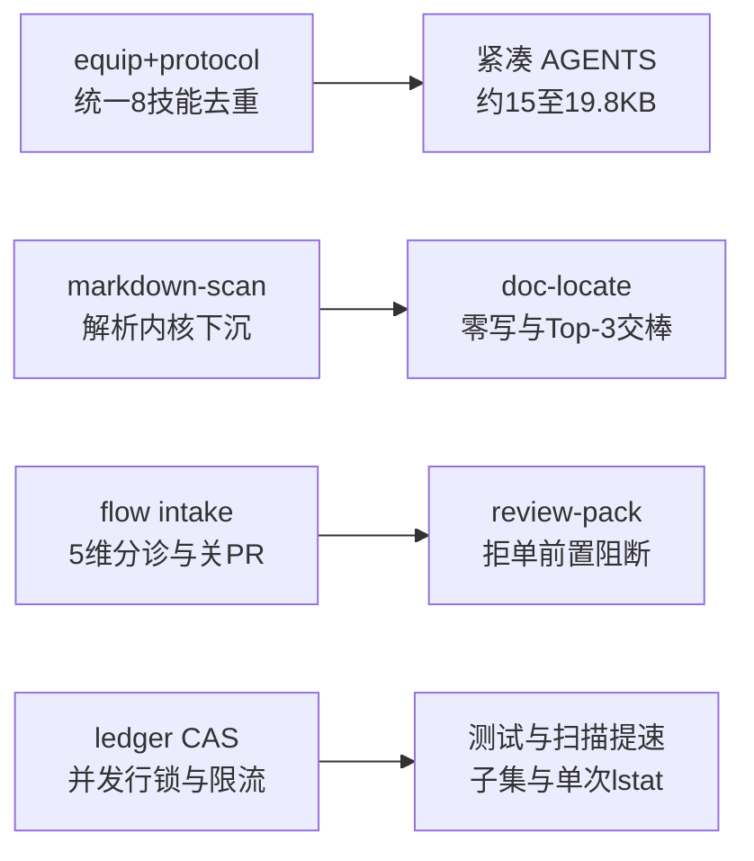

# 变更设计说明书：v10 统一八技能、零写入按需定位、全局业务分诊与性能架构重构（Stage C-1）

## 文档信息与变更概览

- **所属总控 PRD**：[Stage C 总控 PRD](../prd/261119-v10-stagec-unified-architecture-prd.md)（承接验收标准 `C1–C4`，对应 `SC1–SC4`）
- **所属波次与并行约束**：Wave C-1 左翼，与 [Stage C-2 设计规范](../specs/261119-issue91-v10-stagec-c2-dev-edit-pyramid-govern-spec.md) 并行推进、写域严格互斥；依赖 Stage B 全量基线已合入 `main`
- **关联待办**：[Stage C-1 Todo](../todo/261119-issue90-v10-stagec-c1-unified-locate-intake-perf-todo.md)
- Issue: #90

## 系统变更全景

| 主题域 | 改动目标 | 关键载体 |
| --- | --- | --- |
| 统一 8 技能与模板去重 | 废除 `lightweight` 2 技能裁剪与 `14KB` 预算；清五技能字面量 | `scripts/lib/protocol.mjs`、`scripts/lib/agents-defaults.mjs`、`templates/agents-project.md` |
| 零写入按需定位器 | Fenced-code Markdown 下沉并输出精准切片；`handoff` Top-3 注入 | `kit/skills/lib/markdown-scan.mjs` (new)、`kit/skills/lib/doc-locator.mjs` (new)、`kit/skills/dev-explore/scripts/doc-locate.mjs` (new) |
| 全局业务分诊与 `closePr` | 5 维度进件评估、评论打标、`TaskBackend.closePr`、审查门拦截 | `kit/skills/lib/intake-triage.mjs` (new)、`kit/skills/dev-flow/scripts/flow-intake.mjs` (new)、`kit/skills/lib/github-labels.mjs` (new) |
| 状态机纠偏与性能重构 | 原子 CAS 账本、权限/身份/状态统一修复、并行限流与单次卸载/子集沙箱 | `kit/skills/lib/ledger.mjs`、`kit/skills/dev-flow/scripts/flow-lifecycle-hooks.mjs` (new)、`scripts/dev/e2e-zip-harness.mjs` |

## 一、背景与边界声明

1. **当前架构痛点**：
   - `scripts/lib/agents-defaults.mjs` 第 292 行 `excludedSkillsFor` 在 `tier === 'both'` 时漏掉 `'lightweight'` 分支，导致双档边界紊乱；`14KB` 预算强迫轻量仓仅装配 2 个技能且在 `templates/agents-project.md` 重复渲染 `is-lightweight` 与 `is-full` 两套近似文本，同时全仓多处仍硬编码「5 技能 / 五套」。
   - 长篇规划与架构文档缺少零修改原文件的只读行范围定位工具，`scripts/lib/markdown.mjs` 与 `kit/` 内部能力割裂，`handoff` 直接塞入大段原始上下文。
   - `flow` 缺少对外部/内部提案的业务合规分诊命令，`TaskBackend` 无 `closePr`，`github-client.mjs` 的 `getPr` 漏取 `labels` 且缺写后回读校验；`ledger.mjs` 双写函数非统一锁、`flow status` 独立于 `flow-next` 状态机、`hydrateRemotePfState` 未校验写入权限、`verify-injections.mjs` 与 `e2e-zip-harness.mjs` 因反复整仓拷贝与起停子进程导致门禁耗时长。
2. **明确边界**：
   - 本切片**不实现** `dev-edit/` (new) 本体与倒金字塔策略（归 Stage C-2，C1 仅在 `flow-lifecycle-hooks.mjs` (new) 预留条件 CLI 探针以避免 Wave C-1 写冲突）；**不实现** `dev-verify-tools/` (new)、`dev-iterate/` (new) 与 `merge3.mjs` (new)（分别归 Wave C-2 的 C3 与 C4）。
   - 不改动任何 `261118-*` 历史规划文件；保留 `--tier` 旧 CLI 参数作为静默弃用兼容别名并引导迁移至统一 8 技能。

## 二、设计方案与契约变更

### 1. 统一 8 技能模型、去重模板与 Wave-Safe 协议演进（对应 C1 / SC1）
- **协议常量调整（`scripts/lib/protocol.mjs`）**：
  - 定义统一 **8 技能规范名清单** `UNIFIED_SKILL_NAMES`：`dev-explore`、`dev-plan`、`dev-edit`、`dev-flow`、`dev-verify-tools`、`dev-review`、`dev-iterate`、`dev-govern`；同步清理「5 技能 / 五套研发技能」等过时字面量。
  - **废除 `14KB` 软/硬上限与 `lightweight` 技能裁剪**：清空技能裁剪集合并把默认推荐契约目标定为单一紧凑体系（空模板约 `15KB`，自举仓 `AGENTS.md` 目标 `18–19.8KB` 且硬上限维持 `30KB`）；保留 `AGENTS_COMPACT_RECOMMENDED_BYTES = 24576` 提示位；保留 `--tier` 参数解析兼容旧外部脚本，若传入 `lightweight` 则输出迁移提示但**不再删减任何核心技能**。
  - **Wave C-1 渐进门禁安全设计**：由于 `C1` 在 Wave C-1 合并时 `dev-edit`、`dev-verify-tools`、`dev-iterate` 可能尚未全量落地磁盘，`C1` **绝不向 `AGENTS.md` 写入尚未落盘的技能行**（规避 `compose-agents.mjs` 第 524 行 `findMissingIntentRoutingSkills` 失败），`equip.mjs` 按 `kit/skills/` 中已存在的目录执行全量等权装配与 `.pf-manifest.json` 校验、`compose-agents.mjs` 据此动态生成 `意图路由`；后续合入的 `C2`/`C3`/`C4` 各自新增技能并运行 `equip.mjs . && compose-agents.mjs .` 递增补齐（在 Stage B 基线 `scripts/dev/preflight-contract-rules.mjs` (new) 注册阶段兼容及 `C4` exact-8 齐备断言）。
- **修复 `agents-defaults.mjs`、共享 YAML 解析与精简模板**：
  - 修复 `scripts/lib/agents-defaults.mjs` 第 292 行历史遗漏并简化 `excludedSkillsFor` 为仅尊重显式 `disabledSkills`（排除 `lightweight` 默认截断）。
  - **抽取共享 YAML 块标量读取器**：在 `kit/skills/lib/doc-frontmatter.mjs` 统一多行/折叠/字面块标量解析原语，并使 `kit/skills/lib/skill-discovery.mjs` 改为复用同一解析器（消除两处手写 Frontmatter 解析偏差，Wave C-2 再交由 `C4` 做嵌套扩展）。
  - 重构 `templates/agents-project.md`：合并原有 `is-lightweight` 与 `is-full` 的重复流程/规范章节，仅以 `hasRemote`、`hasRelease`、`hasDocs`、`hasMultiLang` 四个实质项目属性开关控制增量路段；精简重复表述并将细粒度执行步沉入对应技能 `SKILL.md` 及按需定位器，确保默认渲染输出稳定在 `~15KB`、本仓 `AGENTS.md` 控制在 `18–19.8KB`。
  - 同步升级 `scripts/lib/{agents-sections.mjs,survey-plan.mjs,survey-questions.mjs,survey-reentry.mjs,render.mjs,equip-bootstrap.mjs}` 与 `scripts/{equip.mjs,compose-agents.mjs,survey.mjs,review.mjs,handoff.mjs}`，清理双档技能裁剪逻辑与提示文案。

### 2. 零修改原文件按需定位器 `doc-locate` 与 Top-3 交棒注入（对应 C2 / SC2）
- **解析内核下沉与去重**：
  - 新增 `kit/skills/lib/markdown-scan.mjs` (new)，完整迁入原 `scripts/lib/markdown.mjs` 的 fenced-code-aware 标题扫描、代码块跨度屏蔽、段落边界识别与精确行号索引能力；将 `scripts/lib/markdown.mjs` 改写为薄重导出层（供 `scripts/` 零改动继续使用，保证单一真相源）。
- **只读定位器架构（`kit/skills/lib/doc-locator.mjs` (new) + `kit/skills/dev-explore/scripts/doc-locate.mjs` (new)）**：
  - 支持输入 `--file {path}`、`--query {terms}`、`--symbol {name}`、`--section {heading}`、`--kind {prd|spec|todo|adr|doc|code}`、`--scope {docs|src|all}`、`--limit {N}`（默认 5，兼容 `--max-slices` 别名）、`--worktree {path}`、`--budget-lines {N}`（默认 220）、`--json`。
  - 内部流程与性能预算：通过 `markdown-scan.mjs` (new) 构建标题-行区间索引；对于**无 Frontmatter/标题的纯文本或无头文档**自动回退至 `Frontmatter 摘要 -> H1 -> 首段非空摘要`；代码文件结合符号导出边界扫描定位；输出均返回**绝对路径**与精确 `startLine..endLine`（单次调用预算 `~40–120ms`、响应体积控制 `~1.5–2.2 KB`）。
  - **绝对只读红线**：定位期间禁止 `writeFileSync`、`appendFileSync`、建临时索引文件或改写原文档/原代码行，由单元测试和 `write-probe-audit.mjs` 联合断言零写入副作用。
- **接入上下文入口**：
  - 升级 `kit/skills/lib/session-orient.mjs` 与 `kit/skills/dev-explore/scripts/repo-map.mjs`：全面识别 `ARCHITECTURE.md`、各子目录 `*/AGENTS.md` 及无头文档，首轮勘察只展示高价值文件的目录摘要与 `doc-locate` 锚点命令，减少上下文浪费。
  - 升级 `kit/skills/lib/handoff-package.mjs`（以及 `scripts/handoff.mjs`）：交棒包根据当前任务变更路径与关键词检索相关性 **Top-3** 文档/规范切片并附精确 `StartLine..EndLine` 及复读命令，替代以往全文塞入；更新 `kit/skills/dev-explore/SKILL.md` 与 `kit/skills/dev-plan/SKILL.md` 将 `doc-locate.mjs` 列为文档定位首选项。

### 3. 全局业务分诊 `flow.mjs intake` 与 `TaskBackend.closePr`（对应 C3 / SC3）
- **统一分诊引擎（`kit/skills/lib/intake-triage.mjs` (new) + `kit/skills/dev-flow/scripts/flow-intake.mjs` (new)）**：
  - CLI 接口：`node .agents/skills/dev-flow/scripts/flow.mjs intake (--pr {M} | --issue {N}) [--feature-ref {id}] [--apply] [--dry-run] [--json]`。
  - **豁免条件**：对本仓内已按 `dev-plan` 审批流核准（`approved: true`）的自研规划任务自动豁免重走分诊阻断，直通执行流程。
  - 5 维度规则引擎（全量支持离线与远端后端）：
    1. **非目标与红线对照**：精准定位 `docs/TDD.md`「不做 / Non-Goals / 关键不变量」及 `SKILL.md` 边界（支持 `--feature-ref` 锚定对应特征或模块）。
    2. **历史提案查重**：扫描 `docs/archive/{prd,specs,todo}/` 与已关闭 Issue 标题/摘要相似度，命中高相似已完成或已拒绝条目判为 `merge-duplicate`。
    3. **冲突面评估**：分析变更影响文件是否命中多条高风险目录或活跃并行分支锁定区。
    4. **依赖与契约兼容性**：检查是否引入禁止的外部包或破坏既定 CLI/Manifest 协议。
    5. **复杂度与价值比评估**：结合改动规模评估是否超预算或缺乏可验证价值，必要时判为 `needs-info` / `defer`。
  - **评论组装与处置动作**：在 `kit/skills/lib/doc-comments.mjs` 新增 `buildIntakeDecisionComments`，统一产出「**结构化决策头 + `pf-state` 机读块 + AI 自由人话技术说明**」三段式评论；`--apply` 时，对 `reject` / `defer` / `merge-duplicate` / `needs-info` 先写出 UTF-8 系统临时正文文件并发布评论、贴标（`wontfix`、`out-of-scope`、`duplicate`、`needs-info`），对 `reject` 或 `merge-duplicate` 的 Issue 调用 `closeIssue`、对 PR 调用 `TaskBackend.closePr`。
- **`TaskBackend` 17 方法扩展、`github-client.mjs` 自动建标与安全门同步**：
  - 将 `kit/skills/lib/task-backend.mjs` `TASK_BACKEND_METHODS` 扩充至 **17 个标准方法**（补齐 `closePr(prNumber, { comment, labels, dryRun })` 等）：`GitHubTaskBackend` 经 `kit/skills/lib/github-labels.mjs` (new) 先评后标再 `PATCH /repos/{owner}/{repo}/pulls/{number}` (`state: "closed"`)；`GenericRemoteBackend` 返回包含评论/标签/关 PR 指引的 `delegatedPayload`；`LocalOnlyBackend` 持久化写入本地分诊结果与关闭状态。
  - 修复 `github-client.mjs`：`getPr` 显式拉取并解析 `labels` 数组；实现 `addLabels(number, labels)` 经 REST `POST /repos/{owner}/{repo}/issues/{number}/labels` 贴标（若仓储缺少该标签则自动调用 REST `createLabel` 建标后重试贴标），贴后立即二次回读 `getIssue`/`getPr` 验证落盘；遇 HTTP `403` 权限不足显式输出原因并降级进返回 JSON（绝不吞错）。
  - 同步更新 `scripts/dev/write-probe-audit.mjs` 第 22 行 `MEMBER_WRITE_CALL_RE`，纳入 `closePr` 与 `closeIssue` 写探测审计。
- **审查前分诊守卫**：
  - 在 `kit/skills/dev-review/scripts/review-pack.mjs`（小幅增量入口守卫，约 10 行调用共享判定）与 `review-pr.mjs` 入口前检查目标 PR 的分诊账本或标签状态，若命中 `reject`/`merge-duplicate` 或标有 `out-of-scope`/`wontfix` 则阻断生成源码审查包（除非显式 `--override-intake` 审计标记）。

### 4. 状态机纠偏、并发原子锁与全链路性能重构（对应 C4 / SC4）
- **原子账本锁、状态统一与 `R1` 三项漏补修复**：
  - 在 `kit/skills/lib/ledger.mjs` 将内部原子读写统一收敛到 `updateTaskLedger(root, taskId, mutatorFn)`（受 `withFileLock` + 临时文件原子 rename 保护），同时**保留 `writeTaskLedger` 作为加锁兼容委托封装**（严禁裸删接口导致 `C2`/`C4` 编译断裂：`C1` 迁移 `docs.mjs` 与 `dev-flow/` 内调用，保留 `review-ledger.mjs` 由 `C2` 迁移、`review-diff.mjs` 由 `C4` 迁移）。
  - 修复 **`R1` 两头落空的 3 处真实源码漏洞**：
    1. `kit/skills/dev-plan/scripts/doc-audit.mjs` 第 7 行补导 `readdirSync`（修复第 48 行缺失导入报错）；
    2. `kit/skills/dev-flow/scripts/flow-batch.mjs` 第 218–223 行在 `assertPreMergeGates` 失败 `break` 前补加 `queue.unshift(taskId)` 并持久化回盘队列；
    3. `kit/skills/lib/docs.mjs` 第 556 行修复 `listTaskLedgers(repoRoot)` 误传 worktree 路径问题，改为显式传入 `ledgerRoot`（`roots.mainRoot`）并在第 578 行改用加锁更新。
  - 在 `kit/skills/dev-flow/scripts/flow-lifecycle.mjs`（拆出 `kit/skills/dev-flow/scripts/flow-lifecycle-hooks.mjs` (new) 保持主文件 `<= 700L`、`flow-lifecycle-hooks.mjs` `<= 280L`）：`claim` 写入 `claimedAt`；`inspect`/`explore` 联动落地 `hasExploredEvidence`（结合 `repo-map`/`doc-locate`）；`assertSubmitOwnership` 强制校验传参 `--agent` 与认领者匹配；在 `flow-lifecycle-hooks.mjs` (new) 内建**条件钩子分发器**（运行期按需探测 `.agents/skills/` 下已装配的第 6 技能 `dev-edit` 入口 `edit-gate.mjs` 并在 `verify` 前置执行，支持 `--skip-edit-gate` 记账；若 `.agents/skills/dev-govern/scripts/` 存在则在 `finalize`/`verify`/`merge`/`cleanup` 触发对应轻量审计/复盘，支持 `--skip-govern` 记账），使 C2 无需触摸 `dev-flow/`。
  - 在 `kit/skills/dev-flow/scripts/flow-inspect.mjs`、`flow.mjs` 与 `flow-next.mjs` 修复 `hydrateRemotePfState`（仅当写入权限 probe 通过才允许远端状态激活）；消除 `flow status` 与 `flow-next` 状态判定分裂，统一由 `flow.mjs status` 调用 `evaluateNextState` 渲染状态。
- **有限并行执行器与性能全面提速**：
  - 在 `kit/skills/lib/github-labels.mjs` (new) / `github-client.mjs` 实现**最大并发度 4** 的有限 Promise 并发工作池，应用于 `listComments` 分页、批量 `getIssue`/`getPr` 及标签校验调用。
  - `kit/skills/dev-govern/scripts/release-prep-lib.mjs`（786L -> 拆出 `release-prep-collect.mjs` (new) 至 `<= 680L`）合并多次递归遍历与 `git log` 调用为单次收集管线。
  - `kit/skills/dev-flow/scripts/worktree-deps.mjs` 改由账本记录的挂载符号/目录清单引导，只对预期槽位执行单次 `lstat` 精准 `unlinkSync`，替代整树递归扫描。
  - `scripts/survey.mjs` 拆出 `scripts/lib/survey-scan.mjs` (new) 合并重复探测遍历。
  - `kit/skills/lib/git.mjs`（794L -> 拆出 `git-worktree-env.mjs` (new)）与 `kit/skills/lib/git-fast.mjs`（796L -> 拆出 `git-index-fast.mjs` (new)）降至各自 `<= 650L`。
  - `scripts/dev/verify-injections.mjs` 改造：构建只读干净基线镜像后按每条规则影响文件精确选择脏文件差异刷新与子集运行，消除重复上百遍全仓拷贝；`scripts/dev/e2e-zip-harness.mjs` 改造：同进程导出直接调用 `survey`/`equip`/`review`/`flow` 引擎函数并预构建可克隆的 seeded bare `.git` 缓存，耗时显著降低（`>= 50%` 降幅由 `scripts/dev/bench.mjs` 实测对照）。
  - `scripts/dev/fixtures.mjs` 与 `scripts/dev/injections-data.mjs` 改造为基于目录前缀自动发现并加载 `fixtures-stagec-*.mjs` 与 `injections-data-stagec-*.mjs`（C1 交付 `scripts/dev/fixtures-stagec-c1.mjs` (new) 与 `scripts/dev/injections-data-stagec-c1.mjs` (new)），确保 C2/C3/C4 新增用例互不碰触索引主文件。

## 三、备选方案与否决理由

1. **否决「在原 Markdown 文件中写入锚点注释实现快速定位」**：在仓库文档插入特殊 HTML 定位注释会持续制造无关 Git diff 并增加用户手动维护成本；因此坚持零写入的运行时解析器 `doc-locate.mjs` (new) + `markdown-scan.mjs` (new)。
2. **否决「保留 `lightweight` 2 技能但仅允许在运行时自动补全」**：双档裁剪本身是认知与工程割裂源头（如 `agents-defaults.mjs:292` 漏配即反复产生边界 bug）；废除裁剪并通过模板去重把基础产物直接压到 `~15KB` 才是一劳永逸的方案。
3. **否决「在 `flow-lifecycle.mjs` 中由 C2 事后打补丁挂载 `dev-edit` 与 `dev-govern`」**：会导致 `C1 || C2` 在 Wave C-1 发生同一核心文件写冲突；改由 C1 在 `flow-lifecycle-hooks.mjs` (new) 按既定 CLI 契约实现可选探测调度，保障并行波次零冲突。

## 四、改动清单与影响面

1. **核心模板与协议层**：
   - `templates/agents-project.md`、`SKILL.md`、`AGENTS.md`、`README.md`、`README.en.md`、`docs/TDD.md`
   - `references/docs-set.md`、`references/handoff.md`、`references/survey.md`、`references/collaboration.md`
   - `scripts/lib/protocol.mjs`、`scripts/lib/agents-defaults.mjs`、`scripts/lib/agents-sections.mjs`、`scripts/lib/survey-plan.mjs`、`scripts/lib/survey-questions.mjs`、`scripts/lib/survey-reentry.mjs`、`scripts/lib/survey-scan.mjs` (new)、`scripts/lib/render.mjs`、`scripts/lib/equip-bootstrap.mjs`、`scripts/lib/markdown.mjs`
   - `scripts/equip.mjs`、`scripts/compose-agents.mjs`、`scripts/survey.mjs`、`scripts/review.mjs`、`scripts/handoff.mjs`
2. **共享库与各技能引擎**：
   - `kit/skills/lib/markdown-scan.mjs` (new)、`kit/skills/lib/doc-locator.mjs` (new)、`kit/skills/lib/intake-triage.mjs` (new)、`kit/skills/lib/github-labels.mjs` (new)、`kit/skills/lib/git-worktree-env.mjs` (new)、`kit/skills/lib/git-index-fast.mjs` (new)
   - `kit/skills/lib/cli.mjs`、`kit/skills/lib/workflow-helpers.mjs`、`kit/skills/lib/doc-comments.mjs`、`kit/skills/lib/doc-frontmatter.mjs`、`kit/skills/lib/doc-toc.mjs`、`kit/skills/lib/skill-discovery.mjs`、`kit/skills/lib/session-orient.mjs`、`kit/skills/lib/handoff-package.mjs`、`kit/skills/lib/task-backend.mjs`、`kit/skills/lib/task-graph.mjs`、`kit/skills/lib/github-client.mjs`、`kit/skills/lib/ledger.mjs`、`kit/skills/lib/workflow-policy.mjs`、`kit/skills/lib/docs.mjs`、`kit/skills/lib/git.mjs`、`kit/skills/lib/git-fast.mjs`、`kit/skills/lib/shared.mjs`
   - `kit/skills/dev-explore/SKILL.md`、`kit/skills/dev-explore/scripts/doc-locate.mjs` (new)、`kit/skills/dev-explore/scripts/repo-map.mjs`
   - `kit/skills/dev-plan/SKILL.md`、`kit/skills/dev-plan/scripts/doc-audit.mjs`
   - `kit/skills/dev-flow/SKILL.md`、`kit/skills/dev-flow/scripts/flow-intake.mjs` (new)、`kit/skills/dev-flow/scripts/flow-lifecycle-hooks.mjs` (new)、`kit/skills/dev-flow/scripts/flow.mjs`、`kit/skills/dev-flow/scripts/flow-inspect.mjs`、`kit/skills/dev-flow/scripts/flow-next.mjs`、`kit/skills/dev-flow/scripts/flow-lifecycle.mjs`、`kit/skills/dev-flow/scripts/flow-lifecycle-helpers.mjs`、`kit/skills/dev-flow/scripts/flow-merge.mjs`、`kit/skills/dev-flow/scripts/flow-sync.mjs`、`kit/skills/dev-flow/scripts/flow-batch.mjs`、`kit/skills/dev-flow/scripts/flow-cleanup.mjs`、`kit/skills/dev-flow/scripts/worktree-deps.mjs`
   - `kit/skills/dev-review/scripts/review-pack.mjs`（intake 门禁接入）、`kit/skills/dev-review/scripts/review-pr.mjs`
   - `kit/skills/dev-govern/scripts/release-prep-lib.mjs`、`kit/skills/dev-govern/scripts/release-prep-collect.mjs` (new)
3. **测试与门禁设施**：
   - 增补规则至 Stage B 基线 `scripts/dev/preflight-contract-rules.mjs` (new)，修改 `scripts/dev/preflight-contracts.mjs`、`scripts/dev/preflight-suite.mjs`、`scripts/dev/preflight-suite-checks.mjs`、`scripts/dev/preflight-e2e.mjs`、`scripts/dev/verify-injections.mjs`、`scripts/dev/e2e-zip-harness.mjs`、`scripts/dev/write-probe-audit.mjs`、`scripts/dev/bench.mjs`
   - `scripts/dev/fixtures.mjs`、`scripts/dev/injections-data.mjs`、`scripts/dev/fixtures-equip.mjs`、`scripts/dev/fixtures-onboarding.mjs`、`scripts/dev/fixtures-skills-hooks.mjs`、`scripts/dev/injections-data-core.mjs`、`scripts/dev/injections-data-gates.mjs`、`scripts/dev/injections-data-workflow.mjs`、`scripts/dev/fixtures-locate-intake.mjs` (new)、`scripts/dev/injections-data-locate-intake.mjs` (new)
   - 执行 `node scripts/equip.mjs . && node scripts/compose-agents.mjs .` 同步 `.agents/skills/` 与 `AGENTS.md`（若后合入 Wave C-1 需 rebase 并重跑该双指令对齐）。

## 五、冻结的验收标准

<!-- criteria:start -->
- [x] C1: （SC1）废除 `lightweight` 技能裁剪与 `14KB` 软/硬字节预算（保留 `--tier` 迁移别名提示），修复 `agents-defaults.mjs` `excludedSkillsFor` 漏洞、抽取共享 YAML 块标量读取器统一 `doc-frontmatter.mjs` 与 `skill-discovery.mjs` 并全域清理五技能字面量升级为统一 8 技能（波次间按实盘技能动态同步 `AGENTS.md`）；完成 `templates/agents-project.md` 去重，使空模板渲染产物约 `15KB` 且本仓 `AGENTS.md` 控制在 `18–19.8KB`（`< 24576 B`）。
- [x] C2: （SC2）将 fenced-code-aware Markdown 解析器下沉至 `kit/skills/lib/markdown-scan.mjs` (new)，交付零写入的 `kit/skills/dev-explore/scripts/doc-locate.mjs` (new)（支持 `--kind`/`--scope`/`--limit`/`--worktree`、无头首段摘要、绝对路径返回与 `~40–120ms`/`~1.5–2.2 KB` 预算）；接入 `session-orient.mjs`（识别 `ARCHITECTURE.md`/`*/AGENTS.md`/无头文档）与 `repo-map.mjs`，且 `handoff` 仅注入相关度 Top-3 定位切片。
- [x] C3: （SC3）落地全局业务分诊 `flow.mjs intake --pr {M} | --issue {N}`（豁免本仓已 `approve` 自研任务，`docs/TDD.md` 定位 + `--feature-ref` 锚点，经 `doc-comments.mjs` `buildIntakeDecisionComments` 输出结构化头 + `pf-state` + 人话评论并打标/关闭）；将 `TASK_BACKEND_METHODS` 扩至 17 方法（补齐 `closePr`、`GenericRemoteBackend` `delegatedPayload`、`LocalOnlyBackend` 持久化），在 `github-client.mjs` 实现 `getPr.labels`、REST 自动建标与 `addLabels` 写后回读及 `403` 降级，`write-probe-audit.mjs` 纳入 `closePr`/`closeIssue`，`review-pack` 前置阻断未分诊或已拒绝 PR。
- [x] C4: （SC4）收敛 `ledger.mjs` 统一原子加锁写入（保留 `writeTaskLedger` 加锁兼容委托），修复 `claimedAt`、`hasExploredEvidence`、`--agent`、`hydrateRemotePfState` 写权限校验与 `R1` 三项漏补（`doc-audit.mjs:7` `readdirSync`、`flow-batch.mjs:218-223` `queue.unshift`、`docs.mjs:556` `ledgerRoot`），统一 `flow status` 委托 `evaluateNextState`；API 批量调用限定并发 4，优化 `release-prep-lib.mjs`、`worktree-deps.mjs`、`verify-injections.mjs` 与 `e2e-zip-harness.mjs`（含 `fixtures`/`injections-data` 模块自动发现）。
<!-- criteria:end -->

## 六、高风险点、门型与回滚路径

1. **门型判定**：`one-way`（高风险）。改动直接触及 `protocol.mjs`、`templates/`、`SKILL.md`、`AGENTS.md`、账本锁、任务后端与 PR/Issue 远端操作，必须经独立审查与双向正反 fixture 实测，严禁仅看静态片段放行。
2. **紧文件拆分布局与行数控制**：
   - `git.mjs`（794L -> 拆出 `git-worktree-env.mjs` (new)，控制 `<= 650L`）
   - `git-fast.mjs`（796L -> 拆出 `git-index-fast.mjs` (new)，控制 `<= 650L`）
   - `github-client.mjs`（拆出 `github-labels.mjs` (new)，控制 `<= 720L`）
   - `release-prep-lib.mjs`（786L -> 拆出 `release-prep-collect.mjs` (new)，控制 `<= 680L`）
   - `flow-lifecycle.mjs`（拆出 `flow-lifecycle-hooks.mjs` (new) `<= 280L`，主文件控制 `<= 700L`）
   - `flow-batch.mjs`（373L -> 补 `queue.unshift` 持久化，控制 `<= 410L`）
   - `scripts/compose-agents.mjs`（682L -> 控制 `<= 720L`）
   - `survey.mjs`（757L -> 拆出 `survey-scan.mjs` (new)，控制 `<= 700L`）
   - `docs.mjs`（维持 `<= 755L`）、`doc-audit.mjs`（维持 `<= 650L`）、`equip.mjs`（维持 `<= 720L`）、`flow-inspect.mjs`（维持 `<= 720L`）、`preflight-contracts.mjs`（新增规则写入 Stage B 基线 `preflight-contract-rules.mjs` (new)，主文件维持 `<= 700L`）。
3. **关键故障点与回滚**：
   - **风险 1**：旧仓库 `--tier lightweight` 触发升级时被硬报错阻断 -> 处理为兼容迁移别名并正常交付 8 技能、同时打印迁移说明。
   - **风险 2**：`flow intake --apply` 误关正常贡献 PR -> 默认不传 `--apply` 仅输出预演判定，且 `apply` 严格输出评估证据摘要及撤销恢复路径。
   - **回滚路径**：所有更改封装在独立 `C1` PR 分支；任意缺陷通过反向 `git revert` 独立还原，用户仓 `equip` 写盘前经 `backup.mjs` 自动产生可回滚快照。

## 七、上线与兼容策略

- **旧仓兼容**：旧仓库原 `.pf-manifest.json` 含 `tier: "lightweight"` 时，`equip`/`update` 自动执行区域升级、去除双档技能限制提示，保持现存受管段落标记向后兼容。
- **Wave C-1 合入协同**：若 `C2` 先合入 `main`，`C1` 合入前 rebase 并保留 `C2` 已落地的新增 `kit/skills/dev-edit/` (new)、重构 `govern-*` 与 `C2` fixture 文件，并执行 `node scripts/equip.mjs . && node scripts/compose-agents.mjs .` 与完整 `merge-gate`。

## 澄清与补充记录

- `2026-11-19`：确认 `C1` 通过 `scripts/dev/fixtures.mjs` 与 `scripts/dev/injections-data.mjs` 模块自动发现机制与 `flow-lifecycle-hooks.mjs` (new) 预留探针，实现与 `C2` 的 100% 写域隔离。

## 实现说明

- **维护者拍板彻底清理零历史包袱**：按维护者最新拍板，彻底移除 `lightweight` 概念、CLI `--tier lightweight` 与迁移别名、`LIGHTWEIGHT_*` / `14336 B` 预算常量及所有双档文案与分支（不再保留旧版迁移分支）；统一完整装配当前在盘技能并保留动态扩展机制（不提前写入未落盘的 `dev-edit`/`dev-verify-tools`/`dev-iterate` 路由行）。
- **架构纠偏——全仓测试脚本按功能域命名并沉入 Tier 2 确定性静态门禁**：将 9 份过程编号命名测试脚本全部改名为功能域命名（`fixtures-doc-closure.mjs`、`fixtures-review-token.mjs`、`fixtures-skills-hooks.mjs`、`fixtures-heterogeneous-survey.mjs`、`fixtures-local-backend.mjs`、`fixtures-escalation-stoploss.mjs`、`fixtures-e2e-gate.mjs`、`injections-data-adaptive.mjs`、`e2e-scenarios-lifecycle.mjs`），本切片新增测试与注入命名为 `fixtures-locate-intake.mjs` / `injections-data-locate-intake.mjs`；升级 `fixtures.mjs`/`injections-data.mjs`/`preflight-suite.mjs` 通用按功能域前缀自动发现；在 `scripts/dev/preflight-contract-rules.mjs` 新增确定性门禁 `checkProcessArtifactFilenames`（扫描除规划/归档/发布说明文档目录外的全仓文件，配双向夹具与 `I179` 故障注入）。
- **PR/Issue 可读性根治与实时自举缺陷修复**：`flow-lifecycle.mjs` + `workflow-helpers.mjs` 实现可读 PR 标题解析（优先 SPEC/Todo/Issue）、剥离模板 `<!-- ... -->` 引导注释与静态独立审查占位段、自动注入含耗时/退出码与 E2E 观察的 Markdown 验证证据表；统一 `escalation.mjs`/`flow-issues.mjs` 紧凑建单与 `doc-comments.mjs` 合并评论（附 `mergeCommit` 短 SHA 与 `claimedBy`）；修复手动 `git rebase origin/main` 后 `ledger.baseSha` 滞后误报（`resolveEffectiveBaseSha` + `flow sync` 快速刷新），并补齐 `isManagedPlanDoc` frontmatter 收窄与 `verify.*.fail` 命令脱敏。
- **渲染字节实测对照**：纯文档模板渲染 `12,637 B`，Node 示例仓渲染 `13,243 B`，本仓 `AGENTS.md` 实测 `21,234 B`（`< 24,576 B` 推荐预算与 `30,720 B` 硬上限）。
- **基准与定位耗时对比**：`doc-locate.mjs` 本仓实测 CLI 97 ms（内核 26 ms）、文本输出 `1,580 B`、零写入；`bench.mjs` 对比基线：`survey(300 files)` `218 -> 187 ms`，`flow inspect(self)` `276 -> 207 ms`，`survey(self)` `425 -> 358 ms`，`review(self)` `389 -> 372 ms`，`preflight(self)` `2008 -> 1907 ms`，`backup.zip(1000 files)` `90 ms`；`verify-injections.mjs` 槽位池复用后 193 条注入全量约 95 s（`193/193` 捕获）。
