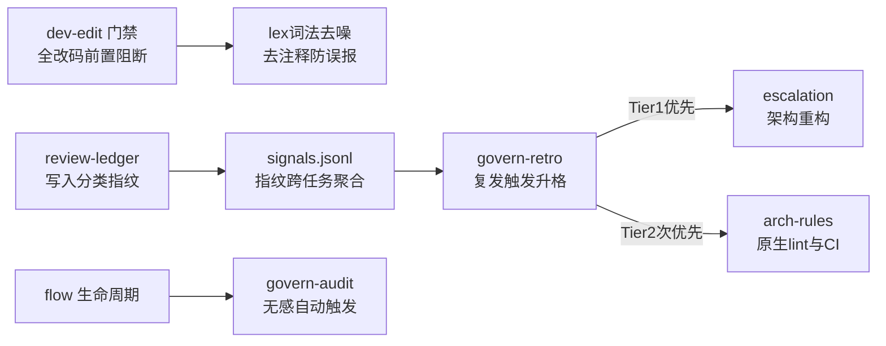

# 变更设计说明书：v10 第六技能 dev-edit、严格三层倒金字塔与 dev-govern 自动触发（Stage C-2）

## 文档信息与变更概览

- **所属总控 PRD**：[Stage C 总控 PRD](../prd/261119-v10-stagec-unified-architecture-prd.md)（承接验收标准 `C5–C8`，对应 `SC5–SC8`）
- **所属波次与并行约束**：Wave C-1 右翼，与 [Stage C-1 设计规范](../specs/261119-v10-stagec-c1-unified-locate-intake-perf-spec.md) 并行开发、写域严格零交叠；依赖 Stage B 合入 `main`
- **关联待办**：[Stage C-2 Todo](../todo/261119-v10-stagec-c2-dev-edit-pyramid-govern-todo.md)

## 系统变更全景

| 主题域 | 改动目标 | 关键载体 |
| --- | --- | --- |
| 第 6 技能 `dev-edit` | 覆全量改码入口并前置入 `verify`；阻断压制/墓碑/反作弊/`>800L` | `kit/skills/dev-edit/` (new)、`kit/skills/dev-edit/scripts/` (new)、`kit/skills/dev-edit/scripts/edit-gate.mjs` (new) |
| 三层纠偏倒金字塔 | 扩展信号指纹、废除默认写 `AGENTS.md`、复发 `>=2` 升 Tier 1/2 | `kit/skills/lib/signals.mjs`、`kit/skills/dev-review/scripts/review-ledger.mjs`、`kit/skills/dev-govern/scripts/govern-retro.mjs` |
| `dev-govern` 自动触发 | `finalize`/`verify`/`merge`/`cleanup` 轻量无感审计与复盘 | `kit/skills/dev-govern/scripts/govern-audit.mjs`、`kit/skills/dev-govern/scripts/govern-state.mjs` |
| 清除测试分层假阳性 | 删去 `qa/`/`sit/` 硬编码误判；适配原生测试分层与小仓 | `kit/skills/dev-govern/scripts/govern-tests.mjs`、`kit/skills/lib/profile-sniffer.mjs` |

## 一、背景与边界声明

1. **当前架构痛点**：
   - 现有 `static-gates` 仅部分挂在事后检查，缺少独立的改码阶段规范技能 `dev-edit/` (new)，导致 `Case 1`、`Case 2`、`rework` 及应急直接改码场景易混入 `HACK`/`@ts-ignore`/死代码/单测凑数/超长文件，到 PR 审查阶段才被迫打回返工。
   - `govern-retro.mjs` 长期把复发教训自动建议写回 `AGENTS.md`（Tier 3 提示词层），违背「信任倒金字塔」，造成契约膨胀却无法在确定性编译或静态层面消灭同类 bug。
   - `dev-govern` 仍靠用户记命令手跑，`merge`/`cleanup` 结束不复盘；`govern-tests.mjs` 硬编码 `qa/`、`sit/` 路径前缀并在小型精简仓库反复误报 `tests.unfiltered-quick-test`。
2. **明确边界**：
   - `dev-edit` 只做改码期边界、工程质量、词法静态门禁与复用前导，不取代 `dev-review` 双门实证或 `dev-iterate` 测试生成。
   - `dev-govern` **严守静态审计与历史信号复盘边界**：绝不主动编写业务/并发测试或启动目标服务（该动态职责专归 Stage C-4 `dev-iterate`）。
   - 本切片不触碰 `dev-flow/`、`templates/`、`SKILL.md`、`AGENTS.md` 等属于 `C1` 的文件；自动触发由 `C1` 预置在 `flow-lifecycle-hooks.mjs` (new) 的 CLI 契约驱动。

## 二、设计方案与契约变更

### 1. 第 6 技能 `dev-edit/` 与 `edit-gate.mjs` 全入口门禁（对应 C5 / SC5）
- **技能定义与装配目录**：
  - 创建目录 `kit/skills/dev-edit/` (new) 与 `kit/skills/dev-edit/scripts/` (new)。
  - 新增 `kit/skills/dev-edit/SKILL.md` (new)（`order: 33`，介于 `dev-plan` `order: 20` 与 `dev-flow` `order: 40` 之间；精简正文 `<= 130` 行），规范所有改码动作前的三件事：确认目标文件未落入 `do-not-edit`、先查相邻复用消除复制粘贴、改后立即执行 `edit-gate.mjs` (new)。
- **`kit/skills/dev-edit/scripts/edit-gate.mjs` (new) 核心引擎（`<= 550L`）**：
  - CLI 契约：`node .agents/skills/dev-edit/scripts/edit-gate.mjs [--mode verify|pre-edit|standalone] [--files a,b] [--changed] [--with-native] [--json]`。
  - **覆盖全部改码入口**：
    - `Case 1–4` 及 `rework` 经 `flow.mjs verify` 前置自动触发 `--mode verify --changed --json`（兼容 `--skip-edit-gate` 记录于任务账本而不放过合并前最终 `verify`）；
    - `dev-iterate` 生成或修补测试后直接调用 `edit-gate.mjs` 校验测试真实断言；
    - 无任务上下文的独立本地急改支持直接运行 `--changed` 或 `--files`。
  - **词法去噪扫描（复用并增强 `kit/skills/lib/static-gates.mjs` 与 `static-gates-lexer.mjs`）**：
    - 必须先经词法器剥离注释与字符串字面量分别构建「纯代码视图」与「注释/文档视图」，从根源杜绝误报和漏报：
      1. **压制注释拦截**：在注释视图中检查无明确正当锚点的 `HACK`、`WORKAROUND`、`TEMP`、`@ts-ignore`、`@ts-nocheck`、`eslint-disable`、`# type: ignore`、`# noqa`、`#[allow(` 等标记（排除测试夹具白名单）。
      2. **履历墓碑与大块死代码注释拦截**：识别代码注释内写变更日期履历或连续被注释掉的逻辑/函数体。
      3. **`arch-rules` 越界导入拦截**：读取项目 `AGENTS.md` `arch-rules` 单向依赖表，在纯代码视图的 `import`/`require`/`use` 中检查非法反向依赖。
      4. **单测反作弊检查**：在新增或变更测试文件中阻断零断言用例、`>= 5` 个 mock 仅校验调用次数的纯 Mock 自证、`>= 1000ms` 硬编码 `sleep`/`setTimeout` 等待，及非无头 UI 测试模式。
      5. **文件膨胀拦截**：单源文件 `> 800` 行硬阻断，进入 `730–800` 行紧文件区输出拆分建议。
    - **原生工具链联动**：结合 `kit/skills/lib/profile-sniffer.mjs` 探测出的目标仓实际 ESLint/TS/Ruff/Clippy/GoVet 配置，在 `--with-native` 或门禁提示中给出确定性执行状态。

### 2. 严格三层纠偏倒金字塔与 `signals.jsonl` 扩展（对应 C6 / SC6）
- **结构化故障指纹流（`kit/skills/lib/signals.mjs` + `kit/skills/dev-review/scripts/review-ledger.mjs`）**：
  - 扩展 `signals.jsonl` 记录字段：`defectClass`（如 `suppression-bypass`、`arch-boundary`、`state-split`、`mock-only-test`、`race-condition`、`stale-contract`、`missing-runtime-proof`）、`pyramidTier`（`tier1-architecture` | `tier2-deterministic-gate` | `tier3-prompt-fallback`）、`fingerprint`（基于 `sha256(ruleId + defectClass + moduleRoot)` 前 12 位稳定指纹）与 `targetArtifact`。
  - 升级 `review-ledger.mjs` 的 `record` 动作：当审查发现任意阻断项或返工项时，自动为每条 finding 追加一条完整指纹事件到运行态状态目录（`.worktrees` 公共状态 `signals.jsonl`），使同源缺陷不再隐没在笼统的 PR 打回次数中。
- **倒金字塔强制升格发动机（`kit/skills/dev-govern/scripts/govern-retro.mjs`）**：
  - **彻底废除默认写回 `AGENTS.md`**：删除原来在复盘总结尾部自动拟写或建议向 `AGENTS.md`「修改守则/项目特有红线」追加自然语言条款的默认路径。
  - **同类复发 `>= 2` 次精确判定与三层路由**：
    1. **Tier 1（结构重构优先）**：若 `defectClass` 指向架构耦合、状态分裂、紧文件超长或跨模块隐式依赖，调用 `kit/skills/lib/escalation.mjs` (new) 生成正式 Tier 1 重构任务单（本地 Issue/Todo 草案），明确待解耦文件、新拆模块边界及依赖方向。
    2. **Tier 2（确定性门禁第二优先）**：若问题可静态识别或通过脚本/lint/CI 验证，结合 `profile-sniffer.mjs` 探测的目标仓技术栈生成具体的 Tier 2 落地补丁建议（如在目标仓 `arch-rules` 增加禁令、向 ESLint/Ruff/Clippy/CI 添加规则、或在 `edit-gate.mjs` (new) 新增检测项），仅在安全范围输出可应用补丁或提案，不破坏无端手写配置。
    3. **Tier 3（仅限显式兜底）**：仅当以上两层确实无法静态捕获且调用者显式传参 `--allow-tier3-fallback --reason "{why}"` 时，方允许产出带 `[TIER-3-FALLBACK]` 标识与到期/淘汰条件的极简提示词条；正常定期 `retro` 同时清理已失效或已被后续 Tier 2 规则接管的陈旧 `[TIER-3-FALLBACK]` 遗留条款。

### 3. `dev-govern` 自动触发与全生命周期挂接（对应 C7 / SC7）
- **无感触发契约与双模式入口**：
  - `kit/skills/dev-govern/scripts/govern-audit.mjs`：新增快速增量模式 `audit . --changed --quiet --json`，聚焦本次待提交变动文件及其直接邻域的死代码、`arch-rules`、四层文档同步锁与 `edit-gate` 基础静态卫士，输出稳定轻量结构供 `flow.mjs verify` 与 `flow.mjs finalize`（经 C1 的 `flow-lifecycle-hooks.mjs` (new)）自动调用；命中严重违规直接阻断，保持全过程无噪声。
  - `kit/skills/dev-govern/scripts/govern-retro.mjs`：新增 `--auto --task {taskId} --json`，供 `flow.mjs merge` 与 `flow.mjs cleanup` 完成后自动触发，总结本任务新增与历史累积信号并在跨任务累计复发 `>= 2` 次时自动激活 Tier 1/Tier 2 升格产物。
  - 扩展 `kit/skills/dev-govern/scripts/govern-state.mjs`：持久化最近 `govern-audit`/`govern-retro` 检查基准与 `[TIER-3-FALLBACK]` 清单指纹，支持 `--skip-govern` 将显式豁免记录写入账本与信号流（保障过程绝对可审计）。
  - 更新 `kit/skills/dev-govern/SKILL.md` 声明「静态分析 + 自动周期复盘 + 严禁动态写测」边界。

### 4. 移除 `govern-tests.mjs` 固定目录假阳性并适配小仓（对应 C8 / SC8）
- **删除目录名硬编码**：移除 `kit/skills/dev-govern/scripts/govern-tests.mjs` 中把 `qa/`、`sit/` 等路径段硬定性为慢速/非单元测试的 `NON_UNIT_TEST_RE` 规则。
- **元数据与栈特征驱动判定**：
  - 扩展 `kit/skills/lib/profile-sniffer.mjs`：识别目标仓 `package.json` 测试脚本（如 `test:unit`、`test:integration`、`test:e2e`）、测试框架配置文件（Vitest/Jest projects、Pytest markers/ini、Cargo `--test` vs `--lib`、Go build tags）与实际测试文件数量。
  - `govern-tests.mjs` 依据上述真实测试层级元数据划分测试类别；当仓库总测试数较少且 `quick-test` 无分层分离必要（如小型仓库仅设单条极速运行指令）时，自动放行而不误报 `tests.unfiltered-quick-test`。

## 三、备选方案与否决理由

1. **否决「在 `govern-retro` 保留默认写 `AGENTS.md`，仅改用人工提醒优先改代码」**：软提醒无法阻止模型顺手写入自然语言补丁导致 `AGENTS.md` 逐代膨胀且同类故障继续复发；必须以代码层硬废除默认回写与 `--allow-tier3-fallback` 显式开关彻底落实倒金字塔。
2. **否决「让 `edit-gate.mjs` 用简单的全文正则匹配 `@ts-ignore` / `HACK`」**：未经词法去噪会把合法字符串示例、正则定义本身（比如本仓自己的规则检测代码）误伤成违禁代码；坚持统一扩展 `static-gates-lexer.mjs` 走先剥离再匹配路径。
3. **否决「把 `qa/`、`sit/` 扩展成更大的目录白名单/黑名单表」**：目录命名千差万别，治标不治本；直接从测试脚本与配置元数据读取分层真相。

## 四、改动清单与影响面

1. **新增第 6 技能与门禁引擎**：
   - `kit/skills/dev-edit/` (new)、`kit/skills/dev-edit/scripts/` (new)
   - `kit/skills/dev-edit/SKILL.md` (new)
   - `kit/skills/dev-edit/scripts/edit-gate.mjs` (new)
2. **共享静态库、栈探测与信号指纹**：
   - `kit/skills/lib/signals.mjs`
   - `kit/skills/lib/static-gates.mjs`
   - `kit/skills/lib/static-gates-lexer.mjs`
   - `kit/skills/lib/profile-sniffer.mjs`
3. **审查信号采集与治理闭环**：
   - `kit/skills/dev-review/scripts/review-ledger.mjs`
   - `kit/skills/dev-govern/SKILL.md`
   - `kit/skills/dev-govern/scripts/govern-retro.mjs`
   - `kit/skills/dev-govern/scripts/govern-state.mjs`
   - `kit/skills/dev-govern/scripts/govern-tests.mjs`
   - `kit/skills/dev-govern/scripts/govern-audit.mjs`
4. **独立双向测试夹具**：
   - `scripts/dev/fixtures-stagec-c2.mjs` (new)
   - `scripts/dev/injections-data-stagec-c2.mjs` (new)
   - 合并至 Wave C-1 后由 `equip.mjs` 同步写入 `.agents/skills/`。

## 五、冻结的验收标准

<!-- criteria:start -->
- [ ] C5: （SC5）新增第 6 技能 `dev-edit/` (new) 与 `kit/skills/dev-edit/scripts/edit-gate.mjs` (new)，覆盖全量改码入口并前置集成进 `flow.mjs verify`；基于 `static-gates-lexer.mjs` 剥离注释/字面量后阻断压制注释、墓碑履历、死代码注释、`arch-rules` 越界、单测反作弊及 `> 800` 行超限文件。
- [ ] C6: （SC6）扩展 `signals.jsonl` 增加 `defectClass`、`pyramidTier`、`fingerprint` 并在 `review-ledger.mjs` 写入按条信号；废除 `govern-retro.mjs` 默认向 `AGENTS.md` 追加规范，同一模式复发 `>= 2` 次强制经 `escalation.mjs` (new) 优先升格为 Tier 1 结构重构或 Tier 2 静态检查/目标仓原生 lint+CI，仅显式 `--allow-tier3-fallback` 方允许带 `[TIER-3-FALLBACK]` 标记落地并能清理过时兜底条款。
- [ ] C7: （SC7）打通 `dev-govern` 自动触发体系：`flow finalize`/`verify` 链路自动触发轻量 `govern-audit --changed` 体检，`flow merge`/`cleanup` 完成后自动触发轻量 `govern-retro` 复盘（支持 `--skip-govern` 并显式记账，严禁无痕跳过）。
- [ ] C8: （SC8）移除 `govern-tests.mjs` 中把目录名当作测试分层的固定正则硬编码，改为结合 `profile-sniffer.mjs` 探测出的目标仓测试分层元数据精准区分单测/集成/端到端测试，并修复小型仓库误报 `tests.unfiltered-quick-test` 的假阳性。
<!-- criteria:end -->

## 六、高风险点、门型与回滚路径

1. **门型判定**：`one-way`（高风险）。触及所有代码修改准入门禁、`signals.jsonl` 结构兼容与倒金字塔自动化决策链路，合入前必须经过独立代码审查与故障注入校验。
2. **紧文件行数控制**：
   - `kit/skills/lib/static-gates.mjs`（当前 733L -> 词法扩充写入 `static-gates-lexer.mjs` 控制主文件 `<= 720L`）
   - `kit/skills/dev-review/scripts/review-ledger.mjs`（Stage B `<= 600L` -> 保持 `<= 640L`）
   - `kit/skills/dev-govern/scripts/govern-state.mjs`（Stage B `<= 680L` -> 保持 `<= 710L`）
   - `kit/skills/dev-edit/scripts/edit-gate.mjs` (new)（控制 `<= 550L`）。
3. **关键故障点与回滚**：
   - **误报阻断开发**：`edit-gate.mjs` (new) 提供精确行号、规则码与 `--mode` 信息；合法规则检验代码自带的正则字面量通过词法剥离自动免疫。
   - **升级死循环**：相同 `fingerprint` 已开出尚未关闭的 Tier 1 重构单时，`govern-retro.mjs` 去重引用原单号而非重复建单。
   - **回滚路径**：所有修改独立封装于 `C2` PR，出现回归可通过单个 `git revert` 撤销。

## 七、上线与兼容策略

- **历史 `signals.jsonl` 兼容**：旧条目的 `defectClass`/`fingerprint` 为空时由 `signals.mjs` 读时按 `ruleId` 与默认模块名实时补全虚拟指纹，平滑过渡不破坏现有信号账本。
- **Wave C-1 合入协同**：若 `C1` 后合入，`C1` 负责合并 `.agents/skills/`；若 `C1` 先合入，`C2` 合入前 rebase `main`、运行 `node scripts/equip.mjs .` 将第 6 技能 `dev-edit/` (new) 写入 `.agents/skills/` 并验证 `fixtures.mjs` 自动发现加载 `fixtures-stagec-c2.mjs` (new) 全绿。

## 澄清与补充记录

- `2026-11-19`：确认 `C2` 的 `edit-gate.mjs` (new) 与 `govern-audit.mjs`/`govern-retro.mjs` 自动调用 CLI 契约与 `C1` 的 `flow-lifecycle-hooks.mjs` (new) 完全解耦，Wave C-1 双方 0 冲突文件。

## 实现说明

待实施后补全提交 SHA、词法去噪误报率测试统计与 `signals.jsonl` 升格示例输出。
