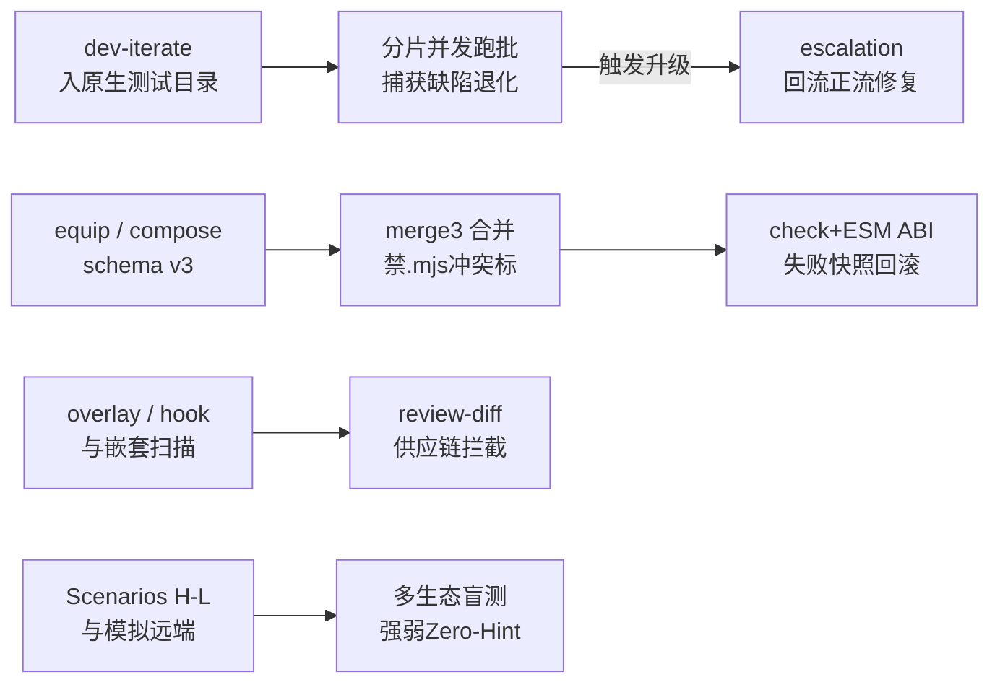

# 变更设计说明书：v10 第八技能 dev-iterate、跨代双向融合与 Stage B+C 全机制盲测终验（Stage C-4）

## 文档信息与变更概览

- **所属总控 PRD**：[Stage C 总控 PRD](../prd/261119-v10-stagec-unified-architecture-prd.md)（承接验收标准 `C13–C16`，对应 `SC13–SC16`）
- **所属波次与并行约束**：Wave C-2 右翼，与 [Stage C-3 设计规范](../specs/261119-v10-stagec-c3-dev-verify-tools-review-spec.md) 并行开发、写域严格零交叠；在 Wave C-1（`C1` + `C2`）全部合入 `main` 后启动
- **关联待办**：[Stage C-4 Todo](../todo/261119-v10-stagec-c4-dev-iterate-evolution-e2e-todo.md)
- **拟新建目录声明**：`kit/skills/dev-iterate/` (new)、`kit/skills/dev-iterate/scripts/` (new)、`.agents/forge-overlays/` (new)、`.agents/extensions/` (new)

## 系统变更全景

| 主题域 | 改动目标 | 关键载体 |
| --- | --- | --- |
| 第 8 技能 `dev-iterate` | 正向测试进原生目录并行跑通，与静态 `dev-govern` 严界，抓错升级 | `kit/skills/dev-iterate/` (new)、`kit/skills/lib/test-inventory.mjs` (new)、`kit/skills/dev-iterate/scripts/iterate.mjs` (new) |
| 跨代双向融合演进 | Overlay/Hook/嵌套发现/供应链扫描、解 `disabledCoreSkills` 死锁、`merge3` | `kit/skills/lib/overlay.mjs` (new)、`scripts/lib/merge3.mjs` (new)、`scripts/lib/equip-integrity.mjs` (new)、`protocol.mjs` |
| Stage B+C 离线 E2E 与自举 | 落地 `Scenarios H–L`、本仓 8 技能全量自举与本地模拟 HTTP/SSH 远端 | `scripts/dev/e2e-scenarios-stagec.mjs` (new)、`scripts/dev/mock-remote-server.mjs` (new)、`e2e-zip-harness.mjs` |
| 多生态与 Zero-Hint 盲测 | `$TMPDIR`（含 `LoopForge-main`）+ 5 类关键场景强弱模型对照终验 | 扩展 `B5` 基线 `scripts/dev/blind-run-harness.mjs` (new)、拆出 `blind-run-matrix.mjs` (new) |

## 一、背景与边界声明

1. **当前架构痛点**：
   - 现有研发闭环偏向「修 bug + 事后静态审计」，缺少专门的主动正向测试扩展技能；若不将静态体检（`dev-govern`）与动态测试编写/压测（`dev-iterate`）解耦，极易造成职责混杂。
   - 跨版本升级 `project-forge` 时，老仓库的本地定制扩展容易因 `TOOL_OWNED_PREFIXES` 过宽、`disabledCoreSkills` 死锁或整文件覆写被清零，而简单文本合并一旦把冲突标记写进 `.mjs` 又会直接摧毁宿主可用的工具链代码。
   - 前序各波次缺少把 Stage B 与 Stage C 全部 8 技能、双端后端、跨代升级和多生态 Zero-Hint 强弱模型统合验收的自动化终验框架。
2. **明确边界**：
   - `dev-iterate` 生成的测试**严禁放入 `.agents/`**，也**严禁污染目标仓轻量快速单测入口 `quick-test`**，必须写入目标仓原生集成/回归/性能测试目录并接受 `edit-gate` 质量守卫；发现真实缺陷只准通过 `escalation.mjs` (new) 转交正流修复，绝不在测点绕过。
   - 本切片不改写 `C3` 的 `dev-verify-tools/` (new)、`feature-map.mjs` (new)、`review-context.mjs` (new) 与 `flow-cleanup.mjs`，保持 Wave C-2 零并发冲突。

## 二、设计方案与契约变更

### 1. 第 8 技能 `dev-iterate` 与正向测试闭环（对应 C13 / SC13）
- **目录与契约边界**：
  - 创建 `kit/skills/dev-iterate/` (new) 与 `kit/skills/dev-iterate/scripts/` (new)。
  - 新增 `kit/skills/dev-iterate/SKILL.md` (new)（`order: 55`），明确声明与 `dev-govern` 的正交分工：`dev-govern` 只看静态规则与历史信号，不生成测试也不启动服务；`dev-iterate` 专司识别业务流盲区与高风险热点并落地动态正向校验与压力回归。
- **共享测试盘点提取（`kit/skills/lib/test-inventory.mjs` (new)）**：
  - 从 `kit/skills/dev-govern/scripts/govern-tests.mjs` 抽取出测试目录识别、原生测试运行入口解析与测试分级元数据归类函数放入 `test-inventory.mjs` (new)，同时供 `govern-tests.mjs` 与 `iterate.mjs` (new) 共用，避免双份目录推断逻辑。
- **正向测试生成、并行运行与异常升级（`kit/skills/dev-iterate/scripts/iterate.mjs` (new)，`<= 700L`）**：
  - **缺口识别**：交叉比对 `docs/feature-map.json` (new)（未配或弱覆盖的 `businessFlows`）、`signals.jsonl`（高频复发热点模块）及近期变更统计。
  - **入原生目录生成与质量守门**：依据 `test-inventory.mjs` (new) 确定的项目原生集成/端到端/性能测试目录与栈命名惯例生成持久化测试骨架/真实断言用例（绝不写入 `.agents/`，绝不混入极速 `quick-test` 白名单），写入前必须通过 `edit-gate` 反作弊校验（禁止零断言、纯 Mock 自证、`>= 1s` 硬等待）。
  - **分片并发执行**：支持按 `businessFlows` 或生态分组启动受限 worker 并行实跑新增与关联测试套件。
  - **发现缺陷升级闭环**：运行失败、出现竞态超时或性能超出阈值时，通过 Stage B 基线 `kit/skills/lib/escalation.mjs` (new) 自动开立或追加结构化修复建议单进入 `dev-plan -> dev-edit -> dev-review` 正流闭环，并按 C2 标准将 `defectClass`、`fingerprint` 等结构化信号写回运行态状态目录的 `signals.jsonl`。

### 2. 跨代双向演进融合体系（对应 C14 / SC14）
- **释放用户扩展边界与声明式 Overlay/Hook（`kit/skills/lib/{tool-owned,overlay}.mjs` + `equip.mjs` / `govern-checks.mjs`）**：
  - 收窄 `kit/skills/lib/tool-owned.mjs` `TOOL_OWNED_PREFIXES` 至工具自身严格托管的核心目录（8 个内置技能与 `kit/skills/lib/` 核心），正式放开同目录下用户自定义资产。
  - 新增 `kit/skills/lib/overlay.mjs` (new)，解析与校验三大用户自定义层：
    1. `.agents/forge-overlays/` (new)：按规范命名空间存储局部补充规则、示例片段与覆盖策略；
    2. `.agents/extensions/` (new)：用户自有领域技能扩展；
    3. `.agents/forge-hooks.json` (new)：声明式生命周期前置/后置钩子清单（**直接挂载到 `C1` 拆出的 `kit/skills/dev-flow/scripts/flow-lifecycle-hooks.mjs` (new) 中执行，绝不回涨 `flow-lifecycle.mjs`**），以及目标仓 Git 本地扩展钩子 `pre-push.local`（更新 `templates/githooks-pre-push.sh` 在内置检查后按条件安全链式执行）。
  - 精确分工修复扩展目录与清单误报：
    - 在 `scripts/equip.mjs` 第 66–96 行 `collectManagedDirExtras`（即 `extraManaged` 检测源）中将合法的 `.agents/forge-overlays/` (new)、`.agents/extensions/` (new) 与 `.agents/forge-hooks.json` (new) 排除出多余受管项误报；
    - 在 `kit/skills/dev-govern/scripts/govern-checks.mjs` 第 481–553 行 `inspectManifest` 中修复对 `manifest.files` 与 `customizedFiles` 状态校验的双轨脑裂判断，并将合法扩展项纳入豁免。
- **外部 PR 安全防线与账本锁收口（`kit/skills/dev-review/scripts/review-diff.mjs`）**：
  - 在 `untrusted-scan` 规则集中强制覆盖 `.agents/forge-overlays/**` (new)、`.agents/extensions/**` (new)、`.agents/forge-hooks.json` (new) 及目标仓 Git `pre-push.local` 钩子的高危变更扫描，识别非受信任外站下载、命令拼接、`curl | sh`、提权或跳过校验意图，在明确人审前阻断自动执行；同时将第 151 行对 `writeTaskLedger` 的调用迁移至统一加锁 `updateTaskLedger`。
- **嵌套容器支持与解除 `disabledCoreSkills` 死锁（`kit/skills/lib/skill-discovery.mjs` + `scripts/lib/survey-reentry.mjs`）**：
  - 升级 `skill-discovery.mjs` 支持递归扫描任意深度 `**/skills/*/SKILL.md` 容器包与插件目录，利用真实路径 `realpathSync` 对符号链接或重复镜像去重；
  - 废除旧版「存在 `disabledCoreSkills` 即拒绝或锁死核心升级」限制，允许用户按策略禁用/覆写单个内建技能同时顺利完成其余受管区升级。
- **Schema v3、区域迁移与无破坏三方合并（`scripts/lib/{protocol,merge3,equip-integrity,equip-bootstrap,agents-sections}.mjs` + `scripts/{equip,compose-agents}.mjs`）**：
  - `protocol.mjs` 将 `PF_MANIFEST_SCHEMA_VERSION` 升级为 `3`，定义 `REGION_MIGRATIONS`（自动重命名或合并旧版本 `AGENTS.md` 受管区块标记），并在 Wave C-2 正式落定阶段 C `preflight` exact-8 技能齐备校验与 `docs/TDD.md`、`AGENTS.md`、`SKILL.md`、`README.md`、`README.en.md` 最终同步。
  - 新增 `scripts/lib/merge3.mjs` (new)：按 `.pf-manifest.json` 记录的三重锚点（`baseHash`、`currentHash`、`upstreamContent`）执行条件三方合并。未本地改动直接快进；仅改不冲突区间无感合并保留；**若 `.mjs`（或其它程序代码文件）产生双端冲突，严禁往源文件写入文本冲突标记**——保留用户现有代码原样，将上游新版本写入 `{target}.upstream`、将三方冲突详情写入 `{target}.pf-conflict` 并在 `.pf-manifest.json` 记录 `pendingConflict` 字段，返回非零冲突码提示人工裁决。
  - 新增 `scripts/lib/equip-integrity.mjs` (new)：所有三方合并或升级落盘完毕后，逐一运行 `node --check` 校验语法完整，并对静态 `import`/`export` 符号引用做跨模块 ABI 一致性扫描；任何校验失败自动通过 `backup.mjs` 仓外备份瞬时回滚恢复。

### 3. Stage B+C 离线端到端 `Scenarios H–L`、本仓自举与本地模拟远端（对应 C15 / SC15）
- **新增 `scripts/dev/e2e-scenarios-stagec.mjs` (new) 并接入 `scripts/dev/e2e-zip-harness.mjs`**：
  - `Scenario H`（统一体系与按需定位）：验证全新安装 8 技能 + 旧 `lightweight` 2 技能仓库自动升级迁移 + `doc-locate` 零写盘精确定位 + `handoff` 仅含 Top-3 切片；
  - `Scenario I`（全局分诊与锁/限流）：验证 `flow intake` 五维拒单自动发评/自动建标打标/`closePr` + 多并发写入 `ledger.mjs` 无状态覆盖 + 有限并发池限流校验；
  - `Scenario J`（改码门与倒金字塔）：验证 `dev-edit` 全入口阻断 6 类违禁 + `signals.jsonl` 跨两次复发自动升格 Tier 1/Tier 2 且不向 `AGENTS.md` 默认追加 + `dev-govern` 自动周期触发；
  - `Scenario K`（验证工具与先实证审查）：验证 `docs/feature-map.json` (new) 自动预填与免日期 `stale` 分级处理 + `dev-verify-tools` 创造/复用/清理三流转 + `dev-review` 强制先实证后 `--include-diff` + 清理销毁仓外 `scratch/`；
  - `Scenario L`（正向迭代与跨代安全演进）：验证 `dev-iterate` 原生测试生成并发运行与 `escalation` 修复回流 + Overlay/Hook/嵌套发现/`untrusted-scan` + `merge3` 无冲突标记（`.upstream` + `.pf-conflict` + `pendingConflict`）保障 + `node --check`/ESM ABI 失败自动回滚。
- **本仓全量自举与本地模拟远端服务端（`scripts/dev/mock-remote-server.mjs` (new)）**：
  - 在本仓库完整装配 8 套技能与 `docs/feature-map.json` (new)，实现 `equip --check`、`compose-agents --check`、`review.mjs .`（0 缺失）、`govern-audit --strict` 与 `sync-toc --check` 全绿；
  - 启动零外网本地 Node HTTP Git 与 Mock Issue/PR 服务端 `mock-remote-server.mjs` (new)，覆盖 `contributor-fork` 403 只读降级、PR 标签自动建标与写后回读、`closePr`、双协作者抢锁冲突（`--takeover`）与本地分支生命周期完整验证。

### 4. `$TMPDIR` 多生态实测与 Zero-Hint 强弱模型对照盲测终验（对应 C16 / SC16）
- **扩展 Stage B 基线引擎（Stage B `B5` 基线交付 `scripts/dev/blind-run-harness.mjs` (new) + 本切片拆出 `scripts/dev/blind-run-matrix.mjs` (new)，各自 `<= 720L`）**：
  - 在 `$TMPDIR` 动态构造覆盖多生态与真实重演的全量沙箱矩阵：**Node.js（TS/ESM）**、**Python（Pytest/Ruff）**、**Rust（Cargo/Clippy）**、**Go（go test）** 及完整 **`LoopForge-main` 真实工程**（含 `local/skills/*` 嵌套自定义技能、多语文档、Day-2 自然语言功能开发/缺陷修复/Milestone 设置/`dev-verify-tools`/`dev-iterate` 业务开发，以及修改本地 Overlay/`.agents/skills`/`AGENTS.md` 后重跑 `S1–S4` 跨代再升级并验证 `.upstream`/`.pf-conflict`/`pendingConflict` 与本地定制保留），并叠加离线、`generic-git`、本地模拟远端三类配置。
  - **严格 Zero-Hint 实验条件与 5 大必测盲测场景**：任务指令仅给出真实人类自然语言工程需求（不包含内部脚本路径、子命令或提示词暗示），仅凭目标仓已有 `AGENTS.md` 与 `SKILL.md` 自主驱动；必须完整实测以下 **5 类盲测核心场景**：
    1. 裸粘贴单个 Issue 链接直接触发分诊至实施交付；
    2. 裸同源 PR 与外来 `inbound-external-pr`（覆盖方向偏离 PR 触发 `flow intake` 拒审关 PR + 三段式评论 + 自动建标打标，以及合规 PR 审查合入）；
    3. 纯口述「我要设置 milestone」触发 Milestone 绑定与跨后端同步；
    4. 无论 `docs/feature-map.json` (new) 有无预设工具，均优先从受波及全局 `businessFlows` 与邻域执行 E2E/运行实证再进入 diff 审查；
    5. 双侧返工停损门限收敛与干净收尾。
  - **强弱模型对照评估**：并行驱动 **`gemini-4-hydrogen-xhigh`**（强模型基线）与 **`gemini-3.8-flash-high`**（中弱模型对标），全自动采集并校验以下硬性回归门槛：
    1. 首轮端到端流程完成率（含弱模型无提示路由与 5 大核心场景闭环能力）；
    2. 按需定位模式相比全量上下文读取的 Token 消耗实测降幅；
    3. 8 技能自动触发精确度、零自发修改 `AGENTS.md` 条目膨胀；
    4. `dev-edit`/`dev-verify-tools`/`dev-iterate`/`dev-review` 先实证拦截有效性；
    5. 全部自动化结果汇入结构化对比报表与 `scripts/dev/fixtures-stagec-c4.mjs` (new)、`scripts/dev/injections-data-stagec-c4.mjs` (new)。

## 三、备选方案与否决理由

1. **否决「在 `merge3` 发生冲突时按标准 git 格式写入 `<<<<<<<` 到 `.mjs` 文件」**：一旦带冲突标记的 `.mjs` 留盘，连随后的修复命令行脚本自身（如 `flow.mjs` 或 `equip.mjs`）都会立刻因 `SyntaxError` 崩溃死锁；采用 `.upstream` + `.pf-conflict` 旁路文件、登记 `pendingConflict` 配合事后 `node --check` 与快照回滚彻底根除损坏风险。
2. **否决「让 `dev-iterate` 在 `.agents/generated-tests/` 下管理自己的一套黑盒测试集」**：与项目日常测试构建脱节的影子测试会迅速沦为僵尸且无法进入普通 PR CI；必须坚持生成进入目标仓原生对应层测试目录（同时严格排除进极速 `quick-test` 以保开发节奏）。
3. **否决「仅使用 `gemini-4-hydrogen-xhigh` 单一最强模型跑盲测验收」**：高智能模型往往能靠自身常识掩盖流程设计或路由文档的隐性模糊；只有把 `gemini-3.8-flash-high` 一起拉入 Zero-Hint 盲测对照组并跑通 5 类核心场景，才能真实暴露并收口工具发现与文档诱导盲区。

## 四、改动清单与影响面

1. **新增第 8 技能与共享测试/扩展核心库**：
   - `kit/skills/dev-iterate/` (new)、`kit/skills/dev-iterate/scripts/` (new)
   - `kit/skills/dev-iterate/SKILL.md` (new)
   - `kit/skills/dev-iterate/scripts/iterate.mjs` (new)
   - `kit/skills/lib/test-inventory.mjs` (new)
   - `kit/skills/lib/overlay.mjs` (new)
   - `kit/skills/lib/skill-discovery.mjs`、`kit/skills/lib/tool-owned.mjs`、`kit/skills/lib/shared.mjs`
2. **治理、安全扫描、生命周期与安装融合引擎**：
   - `kit/skills/dev-govern/scripts/govern-tests.mjs`、`kit/skills/dev-govern/scripts/govern-checks.mjs`（修复 `inspectManifest` 第 481–553 行一致性校验）
   - `kit/skills/dev-review/scripts/review-diff.mjs`（扩展 `untrusted-scan` 并迁移第 151 行 `writeTaskLedger`）
   - `kit/skills/dev-flow/scripts/flow-lifecycle-hooks.mjs` (new)（接入 `.agents/forge-hooks.json` (new) 声明式钩子而不修改 `flow-lifecycle.mjs`）
   - `scripts/lib/merge3.mjs` (new)、`scripts/lib/equip-integrity.mjs` (new)
   - `scripts/lib/protocol.mjs`、`scripts/lib/equip-bootstrap.mjs`、`scripts/lib/agents-sections.mjs`、`scripts/lib/survey-reentry.mjs`
   - `scripts/equip.mjs`（更新 `collectManagedDirExtras` 第 66–96 行并接入 `merge3`）、`scripts/compose-agents.mjs`、`templates/githooks-pre-push.sh`
3. **全仓终版契约同步与 E2E/盲测终验套组**：
   - 最终同步 `docs/TDD.md`、`AGENTS.md`、`SKILL.md`、`README.md`、`README.en.md`，并向 Stage B 基线 `scripts/dev/preflight-contract-rules.mjs` (new) 增补 exact-8 技能对齐检验
   - 新增 `scripts/dev/e2e-scenarios-stagec.mjs` (new)、`scripts/dev/mock-remote-server.mjs` (new)、`scripts/dev/blind-run-matrix.mjs` (new)、`scripts/dev/fixtures-stagec-c4.mjs` (new)、`scripts/dev/injections-data-stagec-c4.mjs` (new)；增量扩展 `scripts/dev/e2e-zip-harness.mjs` 与 Stage B 基线 `scripts/dev/blind-run-harness.mjs` (new)
   - 运行 `node scripts/equip.mjs . && node scripts/compose-agents.mjs .` 完成 `.agents/skills/` 与 `.agents/skills/.pf-manifest.json`（Schema v3）对齐。

## 五、冻结的验收标准

<!-- criteria:start -->
- [ ] C13: （SC13）新增第 8 技能 `dev-iterate/` (new)，与静态 `dev-govern` 严格划清边界并共用 `kit/skills/lib/test-inventory.mjs` (new)；依据功能地图盲区与高发信号生成符合质量门禁的业务/并发/性能测试直接进入目标仓原生测试目录并支持分片并发执行；抓出真实缺陷或退化时经 Stage B 基线 `escalation.mjs` (new) 转交 `dev-plan -> dev-edit -> dev-review` 修复并记录信号。
- [ ] C14: （SC14）实现跨代双向演进与融合机制：收窄 `TOOL_OWNED_PREFIXES`、支持 `.agents/forge-overlays/` (new)、`.agents/forge-hooks.json` (new)（挂入 `flow-lifecycle-hooks.mjs` (new)）、目标仓 Git `pre-push.local` 钩子与嵌套技能去重发现并将自定义载荷纳入 `untrusted-scan`；解除 `disabledCoreSkills` 升级死锁；升级 `.pf-manifest.json` 至 schema v3 与 `REGION_MIGRATIONS`，实现条件三方合并 `merge3.mjs` (new)（`.mjs` 冲突禁写文本标记，改写 `.upstream` + `.pf-conflict` 与 `pendingConflict` 并校验 `node --check` 与静态 ESM ABI）。
- [ ] C15: （SC15）新增并跑通 Stage B+C 离线全链路 `Scenarios H–L`（`scripts/dev/e2e-scenarios-stagec.mjs` (new)），在本仓完成 8 技能与 `docs/feature-map.json` (new) 自举全绿，并在本地自建模拟 HTTP/SSH 远端仓库验证双协作者、打标、`closePr`、升级融合与回滚链路。
- [ ] C16: （SC16）扩展 Stage B 基线 `scripts/dev/blind-run-harness.mjs` (new)（拆出 `scripts/dev/blind-run-matrix.mjs` (new)），在 `$TMPDIR` 下对 Node、Python、Rust、Go 与 `LoopForge-main`（含 `local/skills/*`、Day-2 与跨代再升级）矩阵，于 Zero-Hint（含裸 Issue/PR 拒审关单、设置 Milestone、无论有无工具先E2E、双侧返工停损）下完成 `gemini-4-hydrogen-xhigh` 与 `gemini-3.8-flash-high` 对照盲测并通过全部定量门槛与回归门禁。
<!-- criteria:end -->

## 六、高风险点、门型与回滚路径

1. **门型判定**：`one-way`（高风险）。触及 manifest schema v3、`equip` 升级融合安全、`tool-owned` 权限界、供应链扫描及最终 8 技能发布门，合入前必须通过全部 `Scenarios H–L`、全生态 `$TMPDIR`（含 `LoopForge-main`）与 Zero-Hint 终验。
2. **紧文件拆分布局与行数控制**：
   - `kit/skills/dev-govern/scripts/govern-checks.mjs`（当前 719L -> 维持 `<= 740L`）
   - `kit/skills/dev-flow/scripts/flow-lifecycle-hooks.mjs` (new)（Wave C-1 后 `<= 280L` -> 挂载 `.agents/forge-hooks.json` (new) 维持 `<= 320L`，零触碰 `flow-lifecycle.mjs`）
   - `scripts/equip.mjs`（725L -> 合并与验证逻辑拆入 `merge3.mjs` (new) 与 `equip-integrity.mjs` (new)，保持 `<= 730L`）
   - `scripts/compose-agents.mjs`（682L -> 维持 `<= 720L`）
   - Stage B 基线 `scripts/dev/blind-run-harness.mjs` (new) 与本切片拆出 `scripts/dev/blind-run-matrix.mjs` (new)、`scripts/dev/mock-remote-server.mjs` (new)（各自 `<= 720L`）
   - `kit/skills/dev-iterate/scripts/iterate.mjs` (new)（`<= 700L`）。
3. **关键故障点与回滚**：
   - **升级合并崩溃**：任何 `equip`/`compose-agents` 写前已落仓外 `.zip` 快照，且 `equip-integrity.mjs` (new) 一旦检测到语法或 ABI 异常即触发自动恢复。
   - **盲测配额或环境抖动**：离线 `Scenarios H–L`、本地 `mock-remote-server.mjs` (new) 与 `$TMPDIR` 自动化矩阵不依赖真实外部模型或公网配额，可随时在标准 CI 高速重现；模型对照盲测具备隔离预算开关与详细中间日志。
   - **回滚路径**：各组件全部独立于 `C4` 分支，异常时单一 `git revert` 即可退回 `C3` 基线。

## 七、上线与兼容策略

- **旧版 Manifest 平滑跃迁**：`schema v1 / v2 -> v3` 自动迁移旧 `REGION` 与缺省基线哈希，无法取得 `baseHash` 的历史手改文件按「只读报告差异 + 备份旧本 + 等待策略确认」安全引导，绝不盲目覆盖用户本地成果。
- **Wave C-2 合入终验门**：`C4` 无论与 `C3` 谁后合入，合入前一律在最终集成工作树执行 `node scripts/equip.mjs . && node scripts/compose-agents.mjs .` 重新生成 `.agents/skills/` 与派生路由、验证 exact-8 齐备、`docs/feature-map.json` (new) 自举全绿以及全部 `Scenarios A–L` 与双模型盲测报告无误后方允许并入 `main`。

## 澄清与补充记录

- `2026-11-19`：确认 `C4` 将 `test-inventory.mjs` (new) 从 `govern-tests.mjs` 独立抽出，杜绝与 `C2`（Wave C-1）及 `C3`（Wave C-2 左翼）产生任何文件级交叉冲突。

## 实现说明

待实施后补全提交 SHA、Stage B+C `Scenarios H–L` 全绿流水与 `gemini-4-hydrogen-xhigh` vs `gemini-3.8-flash-high` 双档盲测定量对照表。
