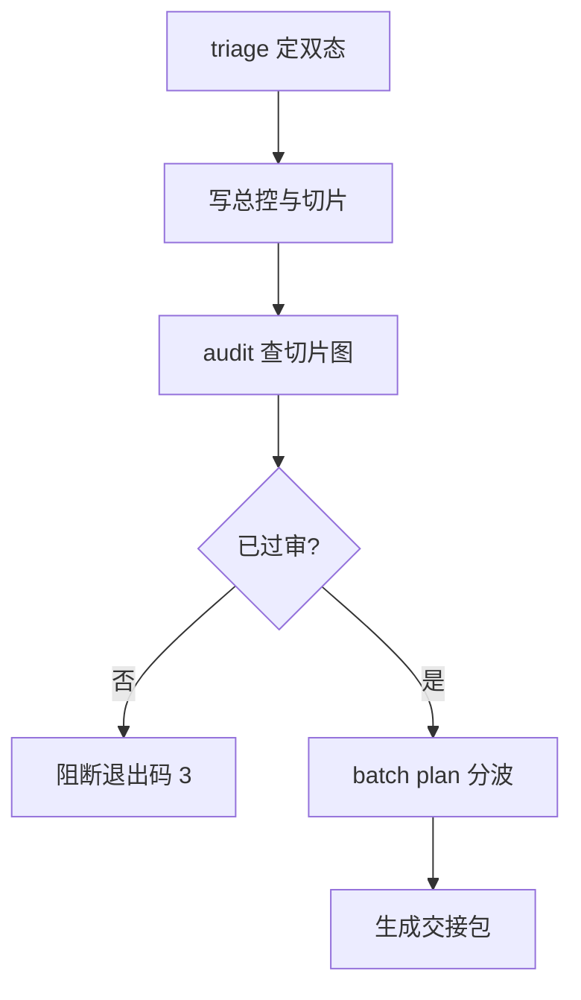

# 宿主无关双态规划门禁、PRD 切片图校验与波次交接包（Issue `#101`）

> 所属总控 PRD：[v10.1 总控 PRD](../prd/261120-v10-1-hardening-pillars-docs-prd.md)　｜　配对 Todo：[w2a-plan-wave-gate Todo](../todo/261120-issue101-w2a-plan-wave-gate-todo.md)
>
> 总控 PRD 认领范围：覆盖总控 `C5..C8`（总控 `C5` -> 本切片 `C1`；总控 `C6` -> 本切片 `C2`；总控 `C7` -> 本切片 `C3`；总控 `C8` -> 本切片 `C4` 及 Wave 2 透传契约）。

## 一、目标、红线与非目标

<!-- section: goal -->
### 1.1 目标

为 Case 3/4 研发规划建立完全独立于任何 AI 宿主环境的仓内落盘契约与机械门禁：

1. **双态规划退场契约**：通过 `plan_mode: interactive | autonomous` 区分「交互式逐题澄清到零待拍板」与「自治式默认推进、仅遇单向门/Case 5/真业务歧义才停」两条合规流；
2. **`flow.mjs start` 前置退场硬校验**：Case 3/4 在建位开工前强制检查关联规划文档 `pendingDecisions === 0` 且已通过审批/内审，未就绪直接以退出码 `3` 阻断 `BLOCKED_PLAN_NOT_READY`；
3. **总控 PRD 与切片有向图机械校验**：对 `multi_spec: true` 总控 PRD 强制校验子切片 100% 覆盖主验收条款、显式 `scope_files` 与 `depends_on` 声明、依赖无环（`BLOCKED_SLICE_CYCLE`）及同波次并行切片无写域路径碰撞；
4. **波次拓扑计算与并发交接包输出**：升级 `flow.mjs batch plan --handoff [--json]` 按依赖拓扑划分波次，并调用标准 `buildHandoff` 为当前就绪波次每个切片生成独立子代理交接包。

### 1.2 非目标（Explicit Non-Goals）

<!-- section: non-goals -->
- 严禁探测、导入、绑定或兼容任何特定 AI 宿主的 `/plan`、`/grill-me` 斜杠命令、私有状态文件或宿主环境变量。
- 不修改 `kit/skills/dev-review/**`、`kit/skills/dev-iterate/**`、`kit/skills/dev-govern/**`、`kit/skills/lib/workflow-policy.mjs`、`kit/skills/lib/workflow-helpers.mjs`、`kit/skills/lib/empirical-artifacts.mjs` (new) 与 `templates/agents-project.md`（留给 Wave 2 并行切片 `#102` 独占编辑，保障波内零冲突）。
- 注：`.agents/skills/.pf-manifest.json` 为 `equip.mjs .` 自动生成的确定性构建派生清单（不在手写业务逻辑写域内；先合入一方直推，后合入一方 rebase `main` 后重跑 `equip.mjs .` 刷新）。
- 不新增第 9 个技能。
<!-- section: non-goals-end -->
<!-- section: goal-end -->

## 二、技术设计与接口契约（`C1..C4`）

<!-- section: design -->

### 2.1 `C1` 双态规划模式（`plan_mode: interactive | autonomous`）

- **影响文件**：`kit/skills/dev-plan/scripts/doc-plan.mjs`、`kit/skills/dev-plan/scripts/triage-rules.mjs`、`kit/skills/dev-plan/scripts/doc-plan-ops.mjs`、`kit/skills/lib/doc-frontmatter.mjs`、`kit/skills/lib/pending-decisions.mjs`、`kit/skills/dev-plan/SKILL.md`、`kit/skills/templates/docs-prd.md`、`kit/skills/templates/docs-spec.md`、`kit/skills/templates/docs-todo.md`。
- **契约细节**：
  - `doc-plan.mjs triage` 与 `doc-plan.mjs init` 接收可选 CLI 参数 `--plan-mode {interactive|autonomous}`（提示文本严禁用尖括号，在手册与代码提示中仅写 `interactive | autonomous`），缺省按风险/门型规则推导默认值并回写至生成的 Frontmatter 字段 `plan_mode`。
  - 在 `kit/skills/lib/pending-decisions.mjs` 对无效 `plan_mode` 枚举值产出结构化校验错误；在 `kit/skills/dev-plan/SKILL.md` 固化规则：`interactive` 模式下所有待拍板问题须逐项沟通确认至零项；`autonomous` 模式下允许按仓内既有最佳模式自动拍板，仅在遭遇 `one-way` 不可逆门、Case 5（与 `docs/TDD.md` 冲突）或真业务语义歧义时停下来发问。

### 2.2 `C2` 规划退场独立校验与 `flow.mjs start` 硬阻断

- **新增共用模块**：`kit/skills/lib/plan-exit-gate.mjs` (new)，供 `dev-plan` 与 `dev-flow` 共同复用（不在两边重复写校验逻辑）。
- **核心函数**：`evaluatePlanExitGate(repoRoot, { caseType, slug, taskId, issue, docs })`：
  - Case 1 / Case 2 直接放行 `{ ok: true, blocked: false }`；
  - Case 3 检查关联 Todo/SPEC 是否存在且 `pendingDecisions.length === 0` 且满足 L2 过审要求；
  - Case 4 检查关联 SPEC（及关联 Master PRD 若 `multi_spec: true`）是否存在、`pendingDecisions.length === 0`、且 `approved === true`（或 `status === 'approved'`，同时若含 `plan_critique` 则不得为 `pending`/`rejected`）。
  - 未就绪时返回 `{ ok: false, blocked: true, code: 'BLOCKED_PLAN_NOT_READY', exitCode: 3, reasons: [...] }`；接入 `kit/skills/dev-flow/scripts/flow-inspect.mjs` / `flow-lifecycle.mjs` 中 `handleStart`，在 `inspectWorkspace` 之后、创建 branch/worktree 之前阻断并返回退出码 `3`。注意支持独立规划 PR 任务本身（如尚未存在目标切片 SPEC 且命令行明确正在立项规划 PR 本身时通过 `--allow-plan-bootstrap` 或 Case 4 规划单标识区分，避免鸡生蛋死锁；日常开发 Case 3/4 任务若无已过审规划必拦）。

### 2.3 `C3` 总控 PRD -> 切片有向图校验

- **新增共用模块**：`kit/skills/lib/doc-slice-graph.mjs` (new)，接入 `kit/skills/dev-plan/scripts/doc-audit.mjs` 与 `doc-audit-repo.mjs`。
- **四项确定性机械检查**：
  1. **总控 `C1..Cn` 100% 覆盖**：沿用并加固对 `multi_spec: true` 总控 PRD `<!-- criteria:start -->` 列表向全部关联 `SPEC` 的映射，漏认领任意条即报 `UNCOVERED_ACCEPTANCE_CRITERIA`（失败）；
  2. **切片元数据必填**：归属 `multi_spec` 总控的每个活跃切片 `SPEC` 与 `Todo` 必须显式声明非空 `scope_files` 数组与可解析的 `depends_on` 数组（缺项报结构性错误）；
  3. **有向依赖图判环**：按 `task_id` / `issue` / `slug` 构图执行 Kahn / DFS 三色拓扑判环，发现任意环或指向不存在节点的悬空依赖时，输出结构化错误 `BLOCKED_SLICE_CYCLE`（或缺失节点错误）；
  4. **同波次写域碰撞检查**：对同处一个就绪拓扑波次（如同无前置或同一前置集合之后并行就绪）的切片两两比对 `scope_files`（支持前缀目录、`*`/`**` glob 与精确文件路径交叉匹配，显式排除 `.agents/skills/.pf-manifest.json` 等确定性派生构建清单），发生潜在同波次写同一源码/文档路径时显式报错阻断（如 `Wave 2` 切片 2 与切片 3 必须严格零交叉）。

### 2.4 `C4` 升级 `flow.mjs batch plan --handoff [--json]` 与 Wave 2 标志透传预留

- **升级文件**：`kit/skills/dev-flow/scripts/flow-batch.mjs`、`kit/skills/dev-flow/scripts/flow.mjs`、`kit/skills/dev-flow/scripts/flow-lifecycle.mjs`、`kit/skills/dev-flow/scripts/flow-lifecycle-helpers.mjs`、`kit/skills/lib/handoff-package.mjs`（本切片不修改 `#102` 独占的 `kit/skills/lib/workflow-policy.mjs`）。
- **波次交接包输出结构（兼容 `buildMultiTaskWavePlan`）**：`flow-batch.mjs` 复用 `doc-slice-graph.mjs` (new) + `handoff-package.mjs`（`buildHandoff`），保持既有 `buildMultiTaskWavePlan` 返回格式 `{ wave, canParallel, tasks }` 不破坏现有调用方，同时为当前可执行波次中的每个切片附带 `handoffs`（含 `taskId`、`C1..Cn`、`scopeFiles`、`dependsOn` 与直接派发命令，支持 `--json` 与文本输出）。
- **与 Slice 3（`#102`）并行无碰撞透传契约**：
  1. 在 `kit/skills/dev-flow/scripts/flow.mjs` `verify` 中使用 `multiFlags` 注册 `artifact`、使用 `valueFlags` 注册 `visual-blocked-reason`；
  2. 移除 `kit/skills/dev-flow/scripts/flow-lifecycle.mjs` 中为裸 `--visual-checked` 硬编码合成伪造 `'e2e/visual runtime behavior observed and verified'` 字符串的逻辑；
  3. 经 `flow-lifecycle.mjs` -> `flow-lifecycle-helpers.mjs`（`recordVerifyEvidenceForFlow`）将 `{ artifacts, visualBlockedReason, visualCheckedRaw: Boolean(opts['visual-checked']), observationSummary }` 完整透传给 `kit/skills/lib/workflow-policy.mjs` 约定校验入口（`validateVerifyPrecheck` / `writeVerificationEvidence` 前置预检：前置未实现时 Fail-Soft、待 `#102` 实现后按返回的 `{ ok, code, exitCode }` 在 `verify` 阶段阻断退出）。
- **同步生成物与双证覆盖**：运行 `node scripts/equip.mjs .` 同步 `.agents/skills/` 镜像，并在 `scripts/dev/fixtures-plan-wave.mjs` (new) 与 `scripts/dev/injections-data-plan-wave.mjs` (new)（号段 `I250–I259`）覆写正反断言与故障注入。

### 2.5 可复用基础设施与备选方案

<!-- section: reuse -->
- `kit/skills/lib/pending-decisions.mjs`（已有待拍板扫描器）
- `kit/skills/lib/handoff-package.mjs`（已有 `buildHandoff` 交接包生成骨架）
- `kit/skills/lib/doc-substantive.mjs`（已有 `checkMasterPrdCoverage` 与 `criteria-lock.mjs`）
- `kit/skills/dev-flow/scripts/flow-batch.mjs`（已有 batch 分派框架）
<!-- section: reuse-end -->

<!-- section: alternatives -->
- **双态识别方式**：曾考虑读取外部宿主环境目录推断交互状态（否定，违背零宿主绑定红线）；改由标准 CLI `--plan-mode` 与 Frontmatter `plan_mode` 声明，完全可预测。
- **跨切片 `flow.mjs verify` 协调**：曾考虑延后等 Slice 2 合入再改 `flow.mjs`（否定，阻断 Wave 2 并行）；在 Slice 2 一次性开放通用透传字段即实现无冲突并发。
<!-- section: alternatives-end -->
<!-- section: design-end -->

## 三、门型评估、正反双向验收与故障注入矩阵

<!-- section: gates -->
- **门型**：`one-way` 级别门禁语义变更（新增 `BLOCKED_PLAN_NOT_READY` 与 `BLOCKED_SLICE_CYCLE` 退出码阻断，且涉及 `kit/` 高风险路径），须通过 `critic` 内审、双向 fixture、`I250–I259` 故障注入与独立审查。
- **验证命令**：
  - `node scripts/dev/fixtures.mjs --domain plan-wave`
  - 逐条校验注入（如 `node scripts/dev/verify-injections.mjs --only I250` 至 `I253`）或全量 `node scripts/dev/verify-injections.mjs`
  - `node scripts/equip.mjs . --check && node scripts/dev/preflight.mjs`
<!-- section: gates-end -->

<!-- section: acceptance -->
### 验收标准（对应 Issue `#101` 与总控 `C5..C8`）

<!-- criteria:start -->
- [ ] **C1**：`doc-plan.mjs triage` 与规划文档 Frontmatter 支持 `plan_mode: interactive | autonomous`（零宿主胶水），并在 `kit/skills/dev-plan/SKILL.md` 明确交互态逐题拍板清零、自治态仅遇单向门/Case 5/真业务歧义才停的规则；反例为非法 `plan_mode` 值被静态审计报错。
- [ ] **C2**：抽离 `kit/skills/lib/plan-exit-gate.mjs` (new) 并在 `flow.mjs start --case 3|4` 前置强校 `pendingDecisions === 0` 且文档已过审；反例为存在未拍板项或 `approved: false` 时以退出码 `3` 阻断 `BLOCKED_PLAN_NOT_READY`。
- [ ] **C3**：`kit/skills/lib/doc-slice-graph.mjs` (new) 与 `doc-plan.mjs audit` 针对总控 PRD + 子切片校验：① 100% 覆盖总控 `C1..Cn`；② 显式声明 `scope_files` 与 `depends_on`；③ 依赖无环（环依赖报 `BLOCKED_SLICE_CYCLE`）；④ 同并行波次切片无 `scope_files` 碰撞。
- [ ] **C4**：升级 `flow.mjs batch plan --handoff [--json]` 按依赖拓扑输出波次并为就绪并行波次切片生成独立子代理交接包，同时预透传 `flow.mjs verify` 的 `--artifact` / `--visual-blocked-reason` 参数，刷新 `equip.mjs .`，并在 `scripts/dev/fixtures-plan-wave.mjs` (new) 与 `scripts/dev/injections-data-plan-wave.mjs` (new)（`I250–I259`）完成正反双证。
<!-- criteria:end -->
<!-- section: acceptance-end -->

## 四、待拍板问题

<!-- section: pending -->
- 已定：双态门禁语义、退出码 `3` 契约、切片图校验规则及 Wave 2 并行透传均已拍板锁定，无未决事项。
<!-- section: pending-end -->
