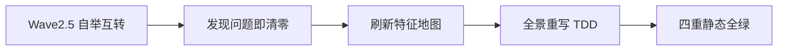

# Wave 2.5 自举互转演练与全景 `docs/TDD.md` 重写（Issue `#103`）

> 所属总控 PRD：[v10.1 总控 PRD](../prd/261120-v10-1-hardening-pillars-docs-prd.md)　｜　配对 Todo：[w3a-panoramic-tdd Todo](../todo/261120-issue103-w3a-panoramic-tdd-todo.md)
>
> 总控 PRD 认领范围：覆盖总控 `C13..C16`（总控 `C13` -> 本切片 `C4` Wave 2.5 自举演练；总控 `C14` -> 本切片 `C1`；总控 `C15` -> 本切片 `C2`；总控 `C16` -> 本切片 `C3`）。

## 一、目标、前置闸门与非目标

<!-- section: goal -->
### 1.1 目标

在 Wave 1（`#99`、`#100`）与 Wave 2（`#101`、`#102`）全部合入 `main` 后，分两步完成「先真实跑通验证，再全景写清架构」：

1. **Wave 2.5 本仓真实自举互转演练**：以合入后的完整工具链在本仓真刀真枪串联运行 `dev-govern` + `dev-verify-tools` + `dev-iterate`（含 `iterate.mjs cycle`），抓出并修清真实运转中暴露的最后一批隐蔽问题，同步刷新 `docs/feature-map.json`；
2. **全景彻底重写 `docs/TDD.md`**：消除长期增量叠补导致的拼接感，用平实无 AI 味中文 + 多张合规 `16/12` 无 HTML Mermaid 图，让真实人类读者无需打开源码符号表即可完全理解项目整体如何从外部项目接管 `S1–S4` 一路流转到全 8 个技能闭环、四大新工程支柱与跨代双向升级。

### 1.2 非目标（Explicit Non-Goals）

<!-- section: non-goals -->
- 本切片不改动 `README.md`、`README.en.md` 与 `assets/readme/*.svg`（留待定型 `docs/TDD.md` 后由 Slice 5 `#104` 推进）。
- 不得把 `docs/TDD.md` 写成 `tdd-structure.mjs` 最小校验的应付骨架，同时也不得破坏 `tdd-structure.mjs` 要求的核心节结构与非空模块清单。
- Wave 2.5 演练发现的源码缺陷须经 `escalation.mjs` 记单走正规 `dev-plan -> dev-edit -> dev-review` 修复，不夹带无审查临时代码进文档提交。
<!-- section: non-goals-end -->
<!-- section: goal-end -->

## 二、技术设计与内容蓝图（`C1..C4`）

<!-- section: design -->

### 2.1 Wave 2.5 本仓自举互转演练方案（`C4` / 总控 `C13`）

- **真实执行链路**（按顺序跑通并保存运行日志至 `.pf-state` 非跟踪实证目录供 PR `--artifact` 检验）：
  1. `node .agents/skills/dev-govern/scripts/govern-audit.mjs audit . --json`（排查死代码、规则下沉与文档/索引漂移）；
  2. `node .agents/skills/dev-verify-tools/scripts/verify-tools.mjs audit --json`（核验 `docs/feature-map.json` 覆盖率、符号锚点与树哈希有效性，补齐 `#99`/`#101`/`#102` 新增功能域映射）；
  3. `node .agents/skills/dev-iterate/scripts/iterate.mjs plan --json` + `cycle --goal "v10.1 self-bootstrap hardening" --max-rounds 3 --json`（串联 `Observe -> PoC/Escalate (autonomous) -> Fix/Verify -> Reflect` 检查盲区）；
  4. 若发现可复现真缺陷，按 `escalation.mjs` 结构化上报（附 `pocCommand` / `reproEvidence`）并另开独立修复 PR 走完闭环合入 `main` 后，再继续 `docs/TDD.md` 重写（严守本切片 `scope_files`，不越界混改源码），随后重跑 `compose-agents.mjs .` 保证契约收敛。

### 2.2 全景 `docs/TDD.md` 重写架构与图谱规划（`C1..C3` / 总控 `C14..C16`）

- **保留并充实 `kit/skills/lib/tdd-structure.mjs` 必填结构节**：确保包含 `doc-info`、背景与定位、核心架构与模块职责表、关键端到端工作流与边界流转、不变式与红线等所有结构校验区，不触发 `EMPTY_TDD_MODULES`。
- **内容全覆盖清单**：
  1. **外部项目治理全周期 `S1–S4`**：只读勘察 `survey.mjs` -> 装备工具包与契约 `equip.mjs` + `compose-agents.mjs` -> 体检交付 `review.mjs` -> 安全退场 `handoff.mjs` / 跨代双向升级 `update.mjs`；讲清为何坚持零入侵、备份回滚与零宿主绑定。
  2. **全 8 个内置技能协同全图**：用清晰分工与跳转去向讲透 `dev-explore`、`dev-plan`、`dev-edit`、`dev-flow`、`dev-verify-tools`、`dev-review`、`dev-iterate`、`dev-govern` 如何围着 `flow.mjs next` 状态机接力（含每步确定性阻断码：`BLOCKED_PLAN_NOT_READY`、`BLOCKED_SLICE_CYCLE`、高风险故障注入、UI 防裸传等）。
  3. **v10.1 四大工程支柱专章**：① 宿主无关双态规划门禁（`interactive` / `autonomous`）+ 总控切片图与波次交接；② 工具无关结构化实证 `--artifact` 与 UI 渲染诚实报阻；③ `PoC-first` 复现消误报与 Tier 1/2 整类根治；④ `iterate.mjs cycle` 有界循环与「只锁客观输出边界」原则。
  4. **三层常青文档与工作区管理**：讲透 `AGENTS.md`（入口地图）+ `docs/TDD.md`（系统真相）+ `docs/feature-map.json`（变更索引）如何用树哈希/签名按需跳读而不依赖易烂手工日期，以及跨平台 worktree 依赖共享与安全清理机制。
- **文风与图示硬性要求**：
  - 全文参考 `oil-tone` 平实克制原则写中文：先讲要解决什么真问题、再讲怎么流转和拦在哪里；避免大词堆砌、空泛排比和源码 symbol 念经；
  - 至少配备 4 张 Mermaid 图（如：外部治理 `S1–S4` 全图、8 技能日常研发流转图、Wave 调度与双态门禁流转图、实证升级与 `cycle` 闭环图），每张均经 `doc-plan.mjs audit` 核验矩形/子图单行 `<= 16` 显示宽度、菱形/边 `<= 12` 显示宽度、零 HTML 标签。

### 2.3 可复用基础设施与备选方案

<!-- section: reuse -->
- `kit/skills/lib/tdd-structure.mjs` 与 `kit/skills/lib/tdd-parity.mjs`（校验 `docs/TDD.md` 必选章节与模块表非空约束）
- `kit/skills/dev-explore/scripts/doc-locate.mjs`（验证重构后各节标题仍能被按节精准跳读定位）
- `scripts/dev/preflight.mjs`、`kit/skills/dev-plan/scripts/doc-audit.mjs`、`kit/skills/dev-govern/scripts/govern-audit.mjs`、`scripts/sync-toc.mjs`
<!-- section: reuse-end -->

<!-- section: alternatives -->
- **自举演练与 TDD 编写顺序**：曾考虑先写完新 `docs/TDD.md` 再跑演练（否定，演练暴露的任何新机制或修正会立刻使刚写好的架构描述失真）；定为 Wave 2.5 先行、缺陷清零再下笔重写 `docs/TDD.md`。
<!-- section: alternatives-end -->
<!-- section: design-end -->

## 三、门型评估与验收标准

<!-- section: gates -->
- **门型**：Wave 2.5 涉及运行态演练与 `docs/feature-map.json` 更新，`docs/TDD.md` 为全仓权威架构基线（触发 Case 5 比对源），按 `two-way` 伴随实证 `--artifact` 与独立审阅落地。
- **验证命令**：
  - `node .agents/skills/dev-govern/scripts/govern-audit.mjs audit .`
  - `node .agents/skills/dev-verify-tools/scripts/verify-tools.mjs audit --json`
  - `node .agents/skills/dev-plan/scripts/doc-plan.mjs audit .`
  - `node scripts/dev/preflight.mjs && node scripts/sync-toc.mjs README.md README.en.md --check`
<!-- section: gates-end -->

<!-- section: acceptance -->
### 验收标准（对应 Issue `#103` 与总控 `C13..C16`）

<!-- criteria:start -->
- [ ] **C1**：全面覆盖外部项目治理 `S1–S4`、全部 8 个技能日常研发流转、双态规划门禁、波次调度、结构化实证与有界优化循环、三层常青文档与跨代双向升级。
- [ ] **C2**：包含多张符合 Mermaid `16/12` 宽度上限且零 HTML 标签的清晰架构图与流程图，逐个流程写清跳转去向、确定性拦截点与核心设计原则。
- [ ] **C3**：全文采用无 AI 味、平实通俗中文，让真实用户无需读代码符号即可完全看懂系统运转方式，并通过 `preflight` / `doc-plan` / `govern-audit` / `sync-toc` 全部校验。
- [ ] **C4**：正式启动 `docs/TDD.md` 重写前，已在合入 Wave 1+2 后的 `main` 基线完成 Wave 2.5 本仓自举互转演练（真实跑通 `dev-govern` + `dev-verify-tools` + `dev-iterate` 互转），修清全部演练暴露缺陷并刷新 `docs/feature-map.json`。
<!-- criteria:end -->
<!-- section: acceptance-end -->

## 四、待拍板问题

<!-- section: pending -->
- 已定：Wave 2.5 演练前置顺序、Mermaid `16/12` 宽度红线、TDD 结构节兼容与平实中文基准均已锁定，无未决事项。
<!-- section: pending-end -->
