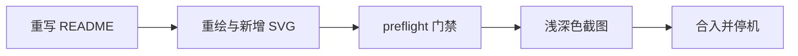

# `oil-tone` 双语 README 重写与可变高度 SVG 重设计（Issue `#104`）

> 所属总控 PRD：[v10.1 总控 PRD](../prd/261120-v10-1-hardening-pillars-docs-prd.md)　｜　配对 Todo：[w3b-readme-svg-redesign Todo](../todo/261120-issue104-w3b-readme-svg-redesign-todo.md)
>
> 总控 PRD 认领范围：覆盖总控 `C17..C20`（总控 `C17` -> 本切片 `C1`；总控 `C18` -> 本切片 `C2`；总控 `C19` -> 本切片 `C3`；总控 `C20` -> 本切片 `C4` 浏览器双主题实证与测试前硬停机门）。

## 一、目标、前提与非目标

<!-- section: goal -->
### 1.1 目标

在 `docs/TDD.md` 全景定型后，彻底重构仓库面向人类的首页文档与视觉图示体系：

1. **双语首页 `oil-tone` 重写**：按事实边界平铺直叙重写 `README.md` 与 `README.en.md`，清除文字墙、套话与过时数据（如旧版仅标「5 个日常技能」），讲透 `S1–S4` 外部治理、全 8 个技能日常自然语言与斜杠触发方式、`iterate.mjs cycle` 有界优化循环及跨代融合；
2. **全套重绘 + 新增关键可变高度 SVG**：按 `beautify-github-readme` 与本仓纯原生 SVG 规范重画既有 6 张 SVG 并补充关键章节成对图示，严守按内容自然定高、画幅宽松、字体 `>= 16`、浅深色背景双适配、零 AI 味；
3. **真实浅/深色浏览器渲染实证与停机闸门**：触发 Wave 2（`#102`）建立的 `UI_VISUAL_EXT_RE` 防敷衍门禁，以浏览器真实浅/深色截图作为 `--artifact` 实证放行；合入后进入最终外部真实仓库测试集前硬停机点，等待用户明确指令。

### 1.2 非目标（Explicit Non-Goals）

<!-- section: non-goals -->
- 本切片不修改核心引擎 `scripts/*.mjs`（除按需更新 `scripts/dev/preflight-suite-checks.mjs` 检查新 SVG 注册表）或 `kit/` 技能代码。
- 严禁在 SVG 内嵌入 `<script>`、`<foreignObject>`、`<image>`、外链 `http(s)://` 或字号 `< 16` 的微小注脚文本。
- 本切片合入后不自动运行外部测试仓库批量回归，不自动发布新版本。
<!-- section: non-goals-end -->
<!-- section: goal-end -->

## 二、技术设计与创作规范（`C1..C4`）

<!-- section: design -->

### 2.1 `C1` `oil-tone` 双语 `README.md` / `README.en.md` 重写规范

- **行文与结构准则**：
  - 事实边界内平铺直叙，句子可读、朗读顺口，面向读者合理使用「我们」或「大家」，避免空洞拔高立意、堆砌口号与模板化排比；
  - 从「你今天要做什么」直接切入：**首次标准化（`S1`–`S4`）** 与 **日常研发全 8 技能（`dev-explore` / `dev-plan` / `dev-edit` / `dev-flow` / `dev-verify-tools` / `dev-review` / `dev-iterate` / `dev-govern`）**，给出真实自然语言说法、斜杠触发形式及核心新机制（双态规划、`PoC-first`、`iterate.mjs cycle` 有界循环、三层常青文档与跨代升级）；
  - 双语严格成对同步内容段落、相互跳转链接与目录锚点，保持 `node scripts/sync-toc.mjs README.md README.en.md --check` 通过。

### 2.2 `C2` 全套重绘与关键章节新增可变高度 SVG 方案

- **清零既有陈旧信息**：当前 `assets/readme/hero.svg`、`hero-en.svg`、`workflow.svg`、`workflow-en.svg`、`architecture.svg`、`architecture-en.svg` 仍停留旧版「5 个日常技能」等过时内容；全部按最新 8 技能架构、四大支柱、三层文档体系及 `docs/feature-map.json` 重设计。
- **关键章节成对补充新 SVG**：
  - `assets/readme/skills-cycle.svg` (new) 与 `assets/readme/skills-cycle-en.svg` (new)：展示 8 个日常技能如何按工作流协同及 `iterate.mjs cycle` 有界循环停损；
  - `assets/readme/docs-layers.svg` (new) 与 `assets/readme/docs-layers-en.svg` (new)：展示 `AGENTS.md` + `docs/TDD.md` + `docs/feature-map.json` 三层常青文档与只读定位链路。
- **版式与视觉硬约束**：
  - **自然可变高度**：每张 SVG 按实际卡片行数、流向层级与留白自然决定 `viewBox` 高度（例如横向首图宽敞舒展、纵向架构与三层图合理增高），严禁强行把所有图裁成统一固定高度；
  - **画幅宽松且字大清晰**：统一主正文与标签字号 `>= 16`，充足内外边距与连线呼吸感，拒绝在窄盒内硬塞小字与密密麻麻说明文字；
  - **浅/深双背景可读**：色板兼顾 GitHub 浅色主题与深色主题下的前景/描边/填充对比度（使用含深浅兼容对比的实底卡片或适度半透明层与清晰描边）。

### 2.3 `C3` `preflight` 卫生与注册门禁联动

- 全部 `assets/readme/[a-z0-9_-]+\.svg` 须通过 `scripts/dev/preflight-suite.mjs` 与 `scripts/dev/preflight.mjs` 扫描：
  - 正文 `font-size >= 16`；
  - 零 `<script>`、`<foreignObject>`、`<image>`、`http(s)://`；
  - 零 `SVG_BANNED_JARGON_RE` 与零产品层禁止宿主绑定术语；
  - `scripts/dev/preflight-suite-checks.mjs` 同步核验全部必选双语 SVG 资产存在且具备合理的自然高度差异（`heights.size >= 2`）。

### 2.4 `C4` 浏览器双主题渲染实证与测试前硬停机门

- 使用本机真实浏览器（或受控无头浏览器渲染工具，**产物体留于仓外临时目录避免脏工作区**）分别在浅色（Light）与深色（Dark）背景下完整打开重排后的 `README.md` 与 `README.en.md` 全部 SVG 页面并截取可读视觉图像；
- 按 Slice 3（`#102`）落地的 `UI_VISUAL_EXT_RE` 拦截契约：执行 `flow.mjs verify` 与 `review-pack.mjs check-empirical` 时附上实际非空截图文件 `--artifact {path}` 并写出逐图核查记录（确认无文字裁切、重叠、溢出或深/浅色低对比问题），严禁裸传 `--visual-checked`；
- **硬停机门触发**：PR `#104` 合入 `main` 且 `merge-gate` 全绿后，向协调者/用户汇总 v10.1 全部 5 个切片合入状态与实证结果，**硬停在进入最终外部真实仓库批量测试集之前**，未获用户明确确认不启动外部测试集。

### 2.5 可复用基础设施与备选方案

<!-- section: reuse -->
- `scripts/sync-toc.mjs`（双语目录生成与一致性校验）
- `scripts/dev/preflight-suite.mjs` 与 `scripts/dev/preflight-suite-checks.mjs`（SVG 字体、安全性、禁用词、高度差与徽章校验）
- Slice 3 落地的 `--artifact` 实证校验与 `UI_VISUAL_EXT_RE` 门禁链
<!-- section: reuse-end -->

<!-- section: alternatives -->
- **SVG 排版策略**：曾考虑维持 `1200x440` 等统一小尺寸直接缩字硬塞 8 技能（否定，必然导致堆小字、折行裁切与低级拥挤感）；定为按内容结构自然拉高 `viewBox` 并拆出 `skills-cycle` 与 `docs-layers` 专题图示，保证每一张都清爽通透。
<!-- section: alternatives-end -->
<!-- section: design-end -->

## 三、门型评估与验收标准

<!-- section: gates -->
- **门型**：`two-way`（涉及 `assets/readme/*.svg` 视觉资产，受 `UI_VISUAL_EXT_RE` 强制非空截图 `--artifact` 门控；合入后触发外部测试前硬停机门）。
- **验证命令**：
  - `node scripts/sync-toc.mjs README.md README.en.md --check`
  - `node scripts/dev/preflight.mjs`
  - `node .agents/skills/dev-review/scripts/review-pack.mjs check-empirical --artifact {lightPng} --artifact {darkPng}`
<!-- section: gates-end -->

<!-- section: acceptance -->
### 验收标准（对应 Issue `#104` 与总控 `C17..C20`）

<!-- criteria:start -->
- [ ] C1: 严格遵循 `oil-tone` 面向真实人类全面重写 `README.md` 与 `README.en.md`（消灭文字墙与 AI 味），清晰介绍 `S1–S4`、全 8 个技能日常用法（自然语言与斜杠触发）、双态规划门禁、`iterate.mjs cycle` 有界优化循环与跨代融合，并通过 `node scripts/sync-toc.mjs README.md README.en.md --check`。
- [ ] C2: 按 `beautify-github-readme` 重新设计全套现有 6 张 SVG 并在关键章节补充新图示 `assets/readme/skills-cycle.svg` (new)、`assets/readme/skills-cycle-en.svg` (new)、`assets/readme/docs-layers.svg` (new)、`assets/readme/docs-layers-en.svg` (new)，同步最新 8 技能架构、三层常青文档与功能地图现状；严格按每张图实际内容自然定高、画幅宽松、字体 `>= 16`、不堆小字且零 AI 味。
- [ ] C3: 全部 SVG 通过 `preflight` 字体、卫生、禁止词与产品层检查，且在 `scripts/dev/preflight-suite-checks.mjs` 对齐新必选 SVG 注册校验。
- [ ] C4: 全部 SVG 与重构后双语 README 在浏览器真实浅/深色背景下完成渲染截图核查并以真实非空 `--artifact` 通过 `verify` 与 `review-pack check-empirical`；合入 `main` 后严格停在进入最终外部测试集前的硬停机点等待用户明确确认。
<!-- criteria:end -->
<!-- section: acceptance-end -->

## 四、待拍板问题

<!-- section: pending -->
- 已定：双语重写基准、SVG 增补矩阵、自然定高原则及测试前停机门机制均已定稿，无未决事项。
<!-- section: pending-end -->
