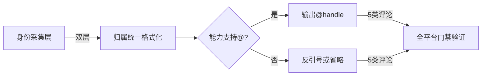

# 统一跨平台双层身份归属展示、生命周期标签与 AGENTS 意图路由去歧义 — 功能设计规范（SPEC）

## 文档信息与变更概览

| 项目 | 内容 |
| --- | --- |
| 当前状态 | `draft`（`draft \| approved \| implementing \| in_review \| implemented \| superseded`） |
| 规划级别 | `L3`（跨模块重构、接口/契约变更或高风险改造；未 `approved` 前不编码） |
| 创建 / 更新 | `2026-11-20` / `2026-11-20` |
| 分支 / Issue / PR | `feat/issue108-attribution-routing` / #108 / 未关联 |
| 负责人 / 内审状态 | `plan-108` / `pending` |
| 关联 PRD / Todo | `related_prd: null` / `docs/todo/261120-issue108-w15-attribution-routing-todo.md` |

- **变更一句话**：以双层正交身份模型（`account` + `agent`）与唯一 `formatAttribution` 彻底取代两套冲突正则黑名单、统一 PR 正文与全生命周期 5 类中文评论标签、补全 `parseAcceptanceCriteria` 回退与 `实证核验` 摘要、去歧义 `AGENTS.md` 路由与 8 技能/根 `SKILL.md`、落地四类资产真融合与主调度纯调度底线，并预先拆解逼近 800 行的 `.mjs` 模块。

## 系统变更全景



| 模块 / 文件 | 变更性质 | 核心职责 |
| --- | --- | --- |
| `kit/skills/lib/github-parse.mjs` | 改造 | 删除 `INTERNAL_AGENT_SLUG_RE`，新增正交身份解析 `resolveIdentityLayers` |
| `kit/skills/lib/doc-comments.mjs` | 改造 | 删除 `AGENT_OR_LOCAL_ID_RE` 与死代码分支，提供唯一 `formatAttribution` 并统一中文标签 |
| `kit/skills/lib/review-comment-render.mjs` (new) | 新增 | 拆出 `buildReviewComments` 与 `实证核验` 摘要渲染，控制单文件行数远低于 800 |
| `kit/skills/lib/pr-template-hydrate.mjs` (new) | 新增 | 从 797 行 `workflow-helpers.mjs` 拆出 PR 模板回填并统一 `实施人` 标签 |
| `kit/skills/dev-review/scripts/review-sync.mjs` | 改造 | 清除 `implementer=`，透传双层身份与 `reviewEmpirical` 摘要 |
| `kit/skills/dev-review/scripts/review-gates.mjs` | 改造 | `parseAcceptanceCriteria` 在缺 SPEC/Todo 时自动回退解析 `ledger.issueContext` |
| `kit/skills/dev-flow/scripts/*.mjs` | 改造 | 修复 `flow-intake.mjs:206` 与 `flow-explore.mjs:32`，各生命周期统一透传 `account`/`agent` |
| `kit/skills/*/SKILL.md` / `templates/agents-project.md` / `SKILL.md` | 改造 | 路由去歧义、补齐 8 技能脚本入口、清除 `tier: full`、升级 `v3` 账本与主调度底线 |
| `references/survey.md` / `references/docs-set.md` | 改造 | 补齐四类存量资产结构化真融合协议与主调度只调度约束 |

## 一、背景与边界声明

- **要改什么**：落地正交双层身份模型（`account` + `agent`）与唯一 `formatAttribution`，同步替换 `kit/skills/lib/shared.mjs` 等全链路导出的旧身份函数，统一 PR 正文与 5 类生命周期评论中文标签并消除 `intake-triage.mjs` / `doc-comments.mjs` `'dev-flow'` 硬编码兜底、补齐 `issueContext` 回退与 `实证核验` 摘要，去歧义 `AGENTS.md` 路由与 8 技能/根 `SKILL.md`，写入四类资产真融合与主调度纯调度底线，并预先拆解逼近 800 行的 `.mjs` 模块（新增 `kit/skills/lib/review-comment-render.mjs` (new)、`kit/skills/lib/pr-template-hydrate.mjs` (new)、`scripts/dev/fixtures-attribution-routing.mjs` (new)、`scripts/dev/injections-data-attribution-routing.mjs` (new)）。
- **不改什么**：不改变 `implementerId !== reviewerId` 自审锁与 `BLOCKED_SUBMIT_OWNERSHIP_MISMATCH` 防代提语义；不破坏 `pf-state` 旧键（`agent`、`actor`、`implementerId`、`claimedBy`、`reviewerId`）向后兼容；不引入任何第三方依赖，不绑定特定 AI 宿主。
- **本期不做**：不修改 `kit/skills/dev-iterate/` 的 `cycle` 子命令（留待 `#102` 追加）；不改变 `TaskBackend` 17 个方法签名与存储目录结构。
- **复用既有模块**：复用 `kit/skills/lib/github-parse.mjs`（`parsePfStateTags`、`stripPfStateTags`）、`kit/skills/lib/task-backend.mjs`（三态 `TaskBackend`）、`scripts/lib/agents-defaults.mjs`（`renderKitRoutingRows` 读取 `order` / `extra_routes` / `intent` / `intent_local` / `script`）、`scripts/equip.mjs` 与 `scripts/compose-agents.mjs`。
- **架构基线关系**：严格遵守 `AGENTS.md` `arch-rules`（`kit/**` 严禁反向引用 `scripts/dev/**` 或 `scripts/lib/**`）、`preflight` 契约规则（`REVIEW_FIELDS` 四字段同段、`SKILL.md <= 200L / 16384B`、`AGENTS.md < 24576 B` 建议阈值、`references/` 必读行预算）及所有 `.mjs <= 800` 行红线。
- **替代方案与否决理由**：见「三、备选方案与否决理由」。

## 二、设计方案与契约变更

### 接口 / 数据结构变更

1. **双层正交身份解析（`kit/skills/lib/github-parse.mjs`）**：
   - 删除 `INTERNAL_AGENT_SLUG_RE` 与 `isInternalAgentSlug` 的黑名单猜名逻辑；以 `resolveIdentityLayers` 取代混杂的 `resolveContributorIdentity`：
     ```js
     resolveIdentityLayers({
       ghLogin = null,
       ghTier = null,
       verifiedPlatformLogin = undefined,
       gitName = null,
       explicitAgent = null,
       ledgerAccount = null,
       ledgerAgent = null,
     })
     // 返回：{ account, verifiedPlatformLogin, agent }
     ```
   - `account` **仅**来自实测验证通过的平台登录名（`ghLogin`，且仅当 `verifiedPlatformLogin === true` 或 `ghTier` 为 `'gh-cli'` / `'node-https-token'` / 已鉴权客户端时 `verifiedPlatformLogin = true`）或回退到 `git config user.name`（`gitName`，此时 `verifiedPlatformLogin = false`）或 `ledgerAccount`（沿用账本已记录 `verifiedPlatformLogin`）；**绝不**从 `--agent` / `--reviewer-id` 写入 `account`，**绝不**回退硬造 `'maintainer'`；两者均空时 `account = null`。
   - `agent` **仅**来自显式传入的 `--agent` / `--reviewer-id` / `--actor` / `--by`（或回退到 `ledgerAgent`）；零正则黑名单过滤，任意自定义代理名（如 `alpha`、`bot-x`、`impl-c4`、`rev-1`、`coordinator-1`）原样保留。

2. **唯一归属格式化函数（`kit/skills/lib/doc-comments.mjs`）**：
   - 删除 `AGENT_OR_LOCAL_ID_RE`、`formatActorDisplay` 及第 23 行使 `isPlatformLogin: false` 失效的 `|| VALID_GH_LOGIN_RE.test(bare)` 死代码分支；
   - 由托管后端能力声明驱动 `@mention` 判定（零平台名硬编码）：在 `platform.mjs`（`GITHUB_PROVIDER` / `GENERIC_GIT_PROVIDER`）与 `task-backend.mjs`（`GitHubBackend` / `GenericRemoteBackend` / `LocalOnlyBackend`）`capabilities` 声明 `mention: true | false`（在线托管可 `@handle` 为 `true`，`generic-git` / `local-only` 为 `false`）；
   - 提供并全仓唯一复用 `formatAttribution({ account = null, verifiedPlatformLogin = false, agent = null, supportsMention = false, capabilities = null } = {})`（内部以 `const canMention = Boolean(verifiedPlatformLogin === true && (supportsMention === true || capabilities?.mention === true))` 判定，禁止按 `backendKind === 'github'` 硬编码）：
     - 剥离邮件后缀 `<...>` 与多余反引号/前导 `@`；
     - 账号段：仅当 `canMention === true` 且 `account` 符合平台 handle 规范（`VALID_HANDLE_RE`，兼容原 `VALID_GH_LOGIN_RE`）时输出 `@${account}`；否则若 `account` 非空，一律输出 `` \`${account}\` ``；若 `account` 为空则账号段为空（不造 `@maintainer`）；
     - 代理段：若 `agent` 非空且与 `account` 不完全重复（忽略大小写或仅 `account` 为空时保留），输出 `` \`${agent}\` ``；
     - 组合规则：两者皆有输出 `${accountPart}（${agentPart}）`；仅其一存在输出对应单段；两者皆空返回 `''`，调用方**省略该归属行/片段**。

3. **5 类生命周期评论与 PR 正文中文标签统一（`doc-comments.mjs` / `review-comment-render.mjs` / `pr-template-hydrate.mjs`）**：
   - `claim / takeover / release`（`buildClaimComments`）：`- **执行人**：` 统一改为 `- **认领人**：${actorText}`（仅 `actorText` 非空时输出）；`takeover` 保留 `- **原认领人**：${prevText}`（经 `formatAttribution` 格式化，若原认领人仅知账号或代理均安全渲染）；
   - `submit / rework`（`buildSubmitComments`）：`- **提交人**：` 统一改为 `- **实施人**：${actorDisplay}`（非空时输出）；
   - PR 正文（`hydratePrTemplateBody`）：`实施者：${actorDisplay}` 改为 `实施人：${implementerDisplay}`（若为空则省略该括号片段）；
   - `review`（`review-sync.mjs` + `buildReviewComments`）：
     - 完整保留 `REVIEW_FIELDS` 四必检词（`审查来源`、`逐条标准状态`、`故障注入记录`、`止损记录`）于同一连续段落内，防 `preflight` 破坏；
     - 清除英文 `implementer=` 与 `(respecting repo mergeAuthority)`（`review-ledger.mjs:48` 改为中文合并提示）；
     - 新增并统一输出：`- **审查人**：${reviewerDisplay}`、`- **实施人**：${implementerDisplay}`（非空时输出）、`- **审查来源**：${sourceLine}`（例如 `独立审查上下文（隔离 worktree 复核）`）与 `- **实证核验**：${empiricalSummary}`；
     - `实证核验` 在 `verdict === 'pass'` 与 `verdict === 'changes'` 的 PR 评论及 Issue 摘要评论中**均展示**，数据按优先级取自 `ledger.reviewEmpirical`（由 `review-ledger.mjs` `handleRecord` 采集：CLI `--evidence`、`--e2e-evidence`/`--visual-evidence`、`--artifact`、以及 `receipt.empiricalVerified` 实际跑过的命令/耗时/退出码与观察摘要），绝不输出空占位，并完整保留 `Must Fix`、`Should Fix`、`Pre-existing` 与 `本轮消解` 分区；
   - `merge`（`buildMergeComments` + `flow-merge.mjs`）：保留 `- **实施人**：${implementerDisplay}`，将独立审查行升级为 `- **审查人**：${reviewerDisplay}`（经 `formatAttribution` 格式化，无 `reviewer` 时保留门禁/人工放行说明）；
   - `intake`（`kit/skills/lib/doc-comments.mjs` `buildIntakeDecisionComments` + `kit/skills/lib/intake-triage.mjs` `evaluateIntakeTriage` + `kit/skills/dev-flow/scripts/flow-intake.mjs`）：修复 `flow-intake.mjs:206` `state.gitUser?.name` -> `state.gitIdentity?.name`；移除 `intake-triage.mjs:646` 与 `doc-comments.mjs:324` 的 `actor = 'dev-flow'` 硬编码兜底；由 `flow-intake.mjs` 透传 `account`/`verifiedPlatformLogin`/`agent`/`supportsMention`（来自后端 `capabilities?.mention`）经 `evaluateIntakeTriage` 传入 `buildIntakeDecisionComments` 与 `statePayload`（同时兼容 `pf-state` 旧键 `actor` 并补 `account`），经 `formatAttribution` 生成分诊人展示，非空时输出 `- **分诊人**：${actorDisplay}`，无真实账号与显式代理时省略该行，绝不泄露 `'dev-flow'`；
   - `flow-explore.mjs:32`：移除硬编码 `'dev-flow'` 兜底，改为从 `opts.by ?? opts.agent ?? ledger.agent ?? ledger.claimedBy ?? ledger.implementerId` 与 `account` 透传；若均缺省则仅记 `account` 或 omit（不写入 `'dev-flow'` 假代理名）。

4. **`parseAcceptanceCriteria` `issueContext` 自动回退（`kit/skills/dev-review/scripts/review-gates.mjs`）**：
   - 当 Case 2 或外部 PR 缺失 `todoFile` / `specFile` / `privateDocsDir`（即常规文件扫描后 `criteria.length === 0`）时，自动扫描 `task?.issueContext`（各条目的 `summary` / `body`）及 `task?.prContext?.summary` / `task?.prContext?.body`；
   - 提取 `- [ ] C1: ...` / `- [x] C2: ...` 标准复选框，以及无 `C*` 编号的普通复选框 `- [ ] ...`（按出现顺序自动编号 `C1..Cn`），标明 `source: issue#<N>` 或 `pr#<M>`；
   - `buildCriteriaStatusSummary` 与 `buildReviewComments` 据此输出逐条 `验收标准逐条核对` 表格，彻底消除空洞的「全部已核验项」。

5. **`AGENTS.md` 意图路由与 8 技能 / 根 `SKILL.md` 全量去歧义**：
   - `kit/skills/dev-plan/SKILL.md`：将「做功能」「implement feature」并入 `description` 触发词；`metadata.intent` 设为 `新需求 / 做新功能 / 跨模块改造 / 澄清拍板 / 写方案与拆任务`；`metadata.script` 设为 `"\`node .agents/skills/dev-plan/scripts/doc-plan.mjs triage\` / \`init\` / \`audit\`"`；`order: 20`。
   - `kit/skills/dev-flow/SKILL.md`：`description` 清除「做功能」「implement feature」「审外部 PR」；`metadata.intent` 设为 `已定案开工 / 明确局部修缺陷 / 查任务状态 / 启动隔离工作位`；`order: 30`；在 `metadata.extra_routes` 新增 `order: 46`（`intent: 外部 Issue・PR 业务分诊 / 里程碑管理 / 裸粘贴链接`，`intent_local: 本地新增提案分诊 / 里程碑管理`，`script: "\`node .agents/skills/dev-flow/scripts/flow.mjs intake\` / \`inspect <URL...>\` / \`milestone\`"`）。
   - `kit/skills/dev-review/SKILL.md`：移除已废弃的 `metadata.tier: full`。
   - 补全脚本入口：`kit/skills/dev-explore/SKILL.md`（`"\`node .agents/skills/dev-explore/scripts/doc-locate.mjs\` / \`repo-map.mjs\`"`）、`kit/skills/dev-verify-tools/SKILL.md`（`"\`node .agents/skills/dev-verify-tools/scripts/verify-tools.mjs\` (\`audit\` / \`run\` / \`create\`)"`）、`kit/skills/dev-govern/SKILL.md`（`"\`node .agents/skills/dev-govern/scripts/govern-audit.mjs\` (\`audit\` / \`reconcile\` / \`retro\`)"`）、`kit/skills/dev-iterate/SKILL.md`（`"\`node .agents/skills/dev-iterate/scripts/iterate.mjs\` (\`plan\` / \`generate\` / \`run\`)"`）。
   - `templates/agents-project.md`：删除第 14–16 行硬编码重复 `里程碑管理 / 裸粘贴...` 条件行，将 `project-forge` 元治理行移到意图路由表最末行（`{{KIT_ROUTING_ROWS}}` 之后）并改写为：`| 首次规范化接管 / 升级工具包 / 交棒退场 | 调用 \`project-forge\` 技能（\`survey\` / \`equip\` / \`review\` / \`handoff\`） | 始终先只读 \`survey.mjs\`，不直接写业务代码 |`。
   - 根 `SKILL.md`：保持 `metadata.version: "6.0.0"` 与 `<= 200L / 16384B` 红线；第 14、25、32、75 行陈旧 `v2 墓碑/定制豁免` / `v2 账本` 升级为 `v3 账本（墓碑/定制豁免/三方合并与 overlay 扩展）`；「日常研发闭环」表紧凑补齐全部 8 个技能协同（纳入 `dev-edit`、`dev-verify-tools`、`dev-iterate`），并显式写入四类资产真融合与主调度纯调度要求。

6. **四类资产真融合协议与主调度纯调度底线（`references/survey.md`、`references/docs-set.md`、`references/collaboration.md`、`templates/agents-project.md`、根 `SKILL.md`）**：
   - `references/survey.md`（同步清理 `v2` 措辞为 `v3`）与 `references/docs-set.md` 新增/融合「四类存量资产真融合协议」：
     1. 长青文档：识别既有架构/设计/API/数据库说明并统一纳入 `evergreen-docs:` / `docs/TDD.md` 单源映射，合并冲突多副本并清理过期副本；
     2. 非长青/过期/无效文档：归档至 `docs/archive/` 或标出无效残片确认清理，防止污染 `doc-locate` 与后续检索；
     3. 既有脚本、工具、数据库模型/迁移与 CI：直接融入 `Dev Profile`、`docs/feature-map.json` 与 `docs/TDD.md`（配合 `tdd-shape.mjs` 裁剪数据模型与部署节），对失效/冲突脚本清晰标出清理建议；
     4. 既有 AI 约定（`AGENTS.md`、`CLAUDE.md`、`.cursorrules`、自有技能）：做语义去重与无损融合（非机械追加），勘察发现的原仓问题全部通过 `TaskBackend` 建本地/远端 Issue 按正常流程分步修清。
   - `templates/agents-project.md`、`references/collaboration.md` 与根 `SKILL.md` 强化主调度纯调度底线：无论是否有远端（`local-only` / `generic-git` / `github`）或大仓接入（`parallel-subagents`）/日常迭代，主调度会话**只调度与验收，不亲自改业务源码、不代提 PR**，探索/规划/实施/审查一律派发独立隔离代理。

### 数据与状态变更

- **任务账本（`kit/skills/lib/ledger.mjs`）**：`createDefaultLedger` 新增可选字段 `account: partial.account ?? null`、`verifiedPlatformLogin: Boolean(partial.verifiedPlatformLogin)`、`agent: partial.agent ?? null`、`reviewEmpirical: partial.reviewEmpirical ?? null`；完整保留 `implementerId`、`claimedBy`、`reviewerId` 旧键用于 `SELF_REVIEW_REJECTED` 与 `BLOCKED_SUBMIT_OWNERSHIP_MISMATCH` 兼容性。
- **`pf-state` 载荷**：评论中隐藏的 `<!-- pf-state:{...} -->` 在保留原有 `agent`、`actor`、`implementerId`、`reviewerId` 键的基础上补齐 `account`（及 `verifiedPlatformLogin`），确保 `flow-next.mjs` 与 `analyzeIssueClaimState` 跨版本无缝水合。
- **生命周期归属不覆写**：`handleStart` 记录初始 `account`/`verifiedPlatformLogin`/`implementerId`；`handleClaim`/`handleTakeover`/`handleRelease` 更新 `agent`/`claimedBy` 而不丢弃已验证 `account`；`handleSubmit`/`handleMerge` 读取账本与实时探测并按 `formatAttribution` 渲染，不跨角色互相覆写 `account` 与 `agent`。

### 异常、回退与安全边界

- **零假 `@mention` 安全红线**：`formatAttribution` 严守能力驱动（零平台名硬编码）——仅当后端能力声明支持 `@mention`（`capabilities?.mention === true` / `supportsMention === true`）且通过实测验证登录名（`verifiedPlatformLogin === true`）且账号符合 handle 规范时才输出 `@handle`；`local-only`、`generic-git`、离线无凭据、仅来自 `git config user.name` 的账号及所有 `agent` 一律反引号包裹，绝不产生假 `@mention`；缺失真实账号时省略而不捏造 `@maintainer`。
- **防膨胀模块预先拆解**：
  - 将 `kit/skills/lib/workflow-helpers.mjs`（现 797 行）中的 `hydratePrTemplateBody`、`resolveReadablePrTitle` 及其私有辅助拆至 `kit/skills/lib/pr-template-hydrate.mjs`，`workflow-helpers.mjs` 仅保留 re-export，行数降至约 485 行；
  - 将 `kit/skills/lib/doc-comments.mjs` 中的 `buildReviewComments` 拆至 `kit/skills/lib/review-comment-render.mjs`，由 `doc-comments.mjs` 与 `docs.mjs` 重导出，保证全仓所有 `.mjs` 均远低于 `800` 行红线。
- **预算红线**：`SKILL.md <= 200` 行 / `16384` 字节，`AGENTS.md < 24576` 字节（远低于 `30720` 字节硬上限），`references/` 总行数与 `FULL_READ_MAX_LINES`（`1000` 行）严格守住 `preflight` 校验。

### 实现顺序

1. **底层身份原语与模块拆分**：在 `github-parse.mjs` 落地 `resolveIdentityLayers`（删除 `INTERNAL_AGENT_SLUG_RE`），在 `doc-comments.mjs` 落地 `formatAttribution`（删除 `AGENT_OR_LOCAL_ID_RE` 与死代码分支）并拆出 `pr-template-hydrate.mjs` 与 `review-comment-render.mjs`，同步更新 `github-client.mjs`、`platform.mjs`、`docs.mjs`、`shared.mjs`（替换 `242/264/409` 行旧导出为 `resolveIdentityLayers` 与 `formatAttribution`）、`workflow-helpers.mjs`、`ledger.mjs`。
2. **审查回退与生命周期透传**：更新 `review-gates.mjs`（`parseAcceptanceCriteria` `issueContext`/`prContext` 回退）、`review-ledger.mjs`（采集 `reviewEmpirical`、清除 `(respecting repo mergeAuthority)`）、`review-pack.mjs`（按需支持 `--artifact` 摘要）、`review-sync.mjs`（透传双层身份与 `实证核验`，清除 `implementer=`），以及 `intake-triage.mjs`（移除 646 行 `'dev-flow'` 硬编码兜底并透传双层身份）、`flow-intake.mjs:206`、`flow-explore.mjs:32`、`flow-inspect.mjs`、`flow-issues.mjs`、`flow-lifecycle-hooks.mjs`、`flow-lifecycle.mjs`、`flow-merge.mjs`、`flow-next.mjs`、`task-backend.mjs`、`local-issues.mjs`。
3. **意图路由、8 技能与真融合规范同步**：更新 7 份 `kit/skills/*/SKILL.md`、`templates/agents-project.md`、根 `SKILL.md`、`references/survey.md`、`references/docs-set.md`、`references/collaboration.md`，运行 `node scripts/equip.mjs .` 与 `node scripts/compose-agents.mjs .`。
4. **双向测试与故障注入**：新增 `scripts/dev/fixtures-attribution-routing.mjs` 与 `scripts/dev/injections-data-attribution-routing.mjs`（`I245–I249`），同步更新 `fixtures-flow.mjs`、`fixtures-iterate-evolution.mjs`、`fixtures-locate-intake.mjs`、`injections-data-gates.mjs`、`injections-data-iterate-evolution.mjs`、`injections-data-locate-intake.mjs` 中引用旧正则/旧模块/旧中文标签的既有断言与注入点，全量跑通 `merge-gate`。

## 三、备选方案与否决理由

| 方案 | 怎么做的 | 为什么没选 | 什么情况下该改回它 |
| --- | --- | --- | --- |
| 正交双层模型 + 唯一 `formatAttribution`（已选） | 彻底删除两套冲突正则，区分实测 `account` 与显式 `agent`，由后端 `capabilities.mention` 驱动 `@handle`，拆出 `pr-template-hydrate.mjs` 与 `review-comment-render.mjs` | 根除正则漏匹配与双轨打架，任意自定义代理名零误伤，零平台名硬编码且严格守住 `<=800` 行门禁 | 无需改回；若未来新增托管平台，只需声明 `capabilities.mention` 与 `verifiedPlatformLogin` 判定 |
| 继续扩充黑名单正则并保留双轨函数（备选） | 在 `INTERNAL_AGENT_SLUG_RE` / `AGENT_OR_LOCAL_ID_RE` 追加 `impl-`、`plan-`、`alpha` 并打补丁包装 | 新代理命名无穷无尽，双正则必然继续漂移，且会在 `workflow-helpers.mjs` 突破 800 行 | 永不采用，属于治标不治本的补丁叠加 |

## 四、改动清单与影响面

| 文件 / 目录 | 改动性质 | 改什么 | 谁会被影响 |
| --- | --- | --- | --- |
| `kit/skills/lib/github-parse.mjs` | 修改 | 删除 `INTERNAL_AGENT_SLUG_RE`，新增 `resolveIdentityLayers` | `github-client.mjs`、`platform.mjs`、全部 flow/review 调用方 |
| `kit/skills/lib/github-client.mjs` | 修改 | 同步导出 `resolveIdentityLayers` 并清理旧导出引用 | `platform.mjs` |
| `kit/skills/lib/platform.mjs` | 修改 | 同步重导出 `resolveIdentityLayers`，并在 `GITHUB_PROVIDER`/`GENERIC_GIT_PROVIDER` 声明 `capabilities.mention` | `flow-*.mjs`、`review-*.mjs`、`shared.mjs` |
| `kit/skills/lib/shared.mjs` | 修改 | 替换 242/264/409 行旧导出为 `resolveIdentityLayers` 与 `formatAttribution` | `preflight-suite-checks.mjs`、全套测试夹具与脚本 |
| `kit/skills/lib/intake-triage.mjs` | 修改 | 移除 646 行 `'dev-flow'` 兜底，透传 `account`/`verifiedPlatformLogin`/`agent`/`supportsMention` 至评论渲染与 `pf-state` | `flow-intake.mjs`、`shared.mjs` |
| `kit/skills/lib/doc-comments.mjs` | 修改 | 删除 `AGENT_OR_LOCAL_ID_RE` 与死代码及 324 行 `'dev-flow'` 兜底，落地 `formatAttribution` 与 `认领人`/`实施人`/`分诊人` | `docs.mjs`、`shared.mjs`、`intake-triage.mjs`、`task-backend.mjs`、`local-issues.mjs`、`flow-*.mjs` |
| `kit/skills/lib/review-comment-render.mjs` (new) | 新增 | 承接 `buildReviewComments`，支持 `审查人`/`实施人`/`审查来源`/`实证核验` 双状态输出 | `doc-comments.mjs`、`docs.mjs`、`review-sync.mjs` |
| `kit/skills/lib/pr-template-hydrate.mjs` (new) | 新增 | 从 `workflow-helpers.mjs` 拆出 `hydratePrTemplateBody` 与 `resolveReadablePrTitle` 并用 `实施人` | `workflow-helpers.mjs`、`workflow-policy.mjs`、`flow-lifecycle.mjs` |
| `kit/skills/lib/docs.mjs` | 修改 | 汇总导出 `formatAttribution` 与 `buildReviewComments` | 上层 `flow`/`review` 脚本 |
| `kit/skills/lib/workflow-helpers.mjs` | 修改 | 移出 PR 模板回填逻辑并 re-export，行数从 797 降至约 485 | `workflow-policy.mjs` |
| `kit/skills/lib/workflow-policy.mjs` | 修改 | 确认重导出一致并严守 `<= 800` 行 | `flow-lifecycle.mjs`、`flow-merge.mjs` |
| `kit/skills/lib/ledger.mjs` | 修改 | `createDefaultLedger` 补 `account`/`verifiedPlatformLogin`/`agent`/`reviewEmpirical` 并兼容旧键 | 全部读写账本模块 |
| `kit/skills/lib/task-backend.mjs` | 修改 | `capabilities` 声明 `mention` 布尔能力，`claimTask`/`releaseTask` 透传 `account`/`verifiedPlatformLogin`/`agent`/`supportsMention` 并写入 `pf-state` | `GitHubBackend`、`GenericRemoteBackend`、`LocalOnlyBackend` |
| `kit/skills/lib/local-issues.mjs` | 修改 | `claimLocalIssue`/`releaseLocalIssue` 透传双层身份及 `pf-state.account` | `local-only` / `generic-git` 工单流 |
| `kit/skills/dev-flow/scripts/flow-inspect.mjs` | 修改 | `handleStart` 记录初始 `account`/`verifiedPlatformLogin`/`implementerId` | `flow start` |
| `kit/skills/dev-flow/scripts/flow-intake.mjs` | 修改 | 修复 206 行 `state.gitIdentity?.name`，透传双层身份渲染 `分诊人` | `flow intake` |
| `kit/skills/dev-flow/scripts/flow-explore.mjs` | 修改 | 修复 32 行消除 `'dev-flow'` 硬编码兜底，透传 `account`/`agent` | `flow explore` |
| `kit/skills/dev-flow/scripts/flow-issues.mjs` | 修改 | 评论作者解析改用 `resolveIdentityLayers` | `flow issue comment` |
| `kit/skills/dev-flow/scripts/flow-lifecycle.mjs` | 修改 | `submit`/`rework` 透传双层身份与 `formatAttribution` | `flow submit` |
| `kit/skills/dev-flow/scripts/flow-lifecycle-hooks.mjs` | 修改 | `assertSubmitOwnership` 对齐双层身份，保持 `BLOCKED_SUBMIT_OWNERSHIP_MISMATCH` | `finalize`/`verify`/`submit` |
| `kit/skills/dev-flow/scripts/flow-merge.mjs` | 修改 | `claim`/`release`/`merge` 透传 `account`/`agent` 并由 `formatAttribution` 渲染 `实施人`/`审查人` | `flow claim/release/merge` |
| `kit/skills/dev-flow/scripts/flow-next.mjs` | 修改 | `hydrateRemotePfState` 兼容读写 `pf-state` 中的 `account` 与旧键 | `flow next` |
| `kit/skills/dev-review/scripts/review-gates.mjs` | 修改 | `parseAcceptanceCriteria` 在缺失 SPEC/Todo 时自动回退解析 `ledger.issueContext`/`prContext` | `review-pack`、`review-sync` |
| `kit/skills/dev-review/scripts/review-ledger.mjs` | 修改 | 采集 `reviewEmpirical` 摘要，清除 `(respecting repo mergeAuthority)`，透传双层身份 | `review-pack record` |
| `kit/skills/dev-review/scripts/review-pack.mjs` | 修改 | `record` 支持 `--artifact` 摘要传入 `reviewEmpirical` | `review-pack` CLI |
| `kit/skills/dev-review/scripts/review-sync.mjs` | 修改 | 清除 `implementer=`，透传 `审查人`/`实施人`/`实证核验` 到 `buildReviewComments` | PR/Issue 审查评论双写 |
| `kit/skills/dev-plan/SKILL.md` | 修改 | 收编「做功能」/`implement feature`，更新 `metadata.intent` 与 `metadata.script` | `AGENTS.md` 路由表 |
| `kit/skills/dev-flow/SKILL.md` | 修改 | 清除重叠触发词，更新 `metadata.intent`，新增 `extra_routes` (`order: 46`) `intake/inspect/milestone` | `AGENTS.md` 路由表 |
| `kit/skills/dev-review/SKILL.md` | 修改 | 移除废弃 `metadata.tier: full` | 技能套件校验 |
| `kit/skills/dev-explore/SKILL.md` | 修改 | `metadata.script` 补全 `doc-locate.mjs` / `repo-map.mjs` | `AGENTS.md` 路由表 |
| `kit/skills/dev-verify-tools/SKILL.md` | 修改 | `metadata.script` 补全 `audit` / `run` / `create` | `AGENTS.md` 路由表 |
| `kit/skills/dev-govern/SKILL.md` | 修改 | `metadata.script` 补全 `audit` / `reconcile` / `retro` | `AGENTS.md` 路由表 |
| `kit/skills/dev-iterate/SKILL.md` | 修改 | `metadata.script` 补全 `plan` / `generate` / `run` | `AGENTS.md` 路由表 |
| `templates/agents-project.md` | 修改 | 去重复里程碑行，元治理行移至末行改写为「调用 `project-forge` 技能」，补充主调度纯调度底线 | `compose-agents.mjs`、`AGENTS.md` |
| `SKILL.md` | 修改 | `v2` 升级 `v3`、闭环表补齐 8 技能、写入四类真融合与纯调度底线（守住 `<=200L/16KB`、`version: 6.0.0`） | 根入口 |
| `references/survey.md` | 修改 | 升级 `v2` -> `v3`，融合四类存量资产真融合协议 | `survey`、`preflight` |
| `references/docs-set.md` | 修改 | 明确四类资产真融合与非长青清理/原仓 Issue 建单流 | `docs-set`、`preflight` |
| `references/collaboration.md` | 修改 | 对齐主调度纯调度底线与全生命周期统一中文评论标签规范 | `AGENTS.md` 同步不变量 |
| `scripts/dev/fixtures-attribution-routing.mjs` (new) | 新增 | 全平台双向测试覆盖 C1–C4、路由顺序、无 `tier: full`、8 技能与真融合/纯调度规范 | `fixtures.mjs` |
| `scripts/dev/injections-data-attribution-routing.mjs` (new) | 新增 | 故障注入 `I245–I249`（零号段碰撞）验证双层归属、标签、回退与路由不退化 | `verify-injections.mjs` |
| `scripts/dev/fixtures-flow.mjs` | 修改 | 对齐新双层归属断言（无 `@coordinator-*` 假 mention）与统一中文标签 | `fixtures.mjs` |
| `scripts/dev/fixtures-iterate-evolution.mjs` | 修改 | 将旧 `formatActorDisplay` 断言迁至 `formatAttribution`，对齐 `认领人`/`实施人` | `fixtures.mjs` |
| `scripts/dev/fixtures-locate-intake.mjs` | 修改 | 对齐 `buildMergeComments`/`hydratePrTemplateBody` 新标签与导入 | `fixtures.mjs` |
| `scripts/dev/injections-data-gates.mjs` | 修改 | 同步 `I145` `alsoPatches` 中的 `review-sync.mjs` 新导入行 | `verify-injections.mjs` |
| `scripts/dev/injections-data-iterate-evolution.mjs` | 修改 | 同步 `I219`（`formatAttribution`）与 `I221`（`pr-template-hydrate.mjs`）目标锚点 | `verify-injections.mjs` |
| `scripts/dev/injections-data-locate-intake.mjs` | 修改 | 同步 `I184`（`pr-template-hydrate.mjs`）目标模块路径 | `verify-injections.mjs` |

- **同步派生产物**：修改 `kit/skills/**` 与 `templates/agents-project.md` 后必须执行 `node scripts/equip.mjs .` 与 `node scripts/compose-agents.mjs .` 同步刷新 `.agents/skills/**` 与 `AGENTS.md`（保持 `AGENTS.md < 24576 B`）。
- **对外可见的变化**：PR 正文与 5 类评论标签统一为中文（`认领人`/`实施人`/`审查人`/`分诊人`/`实证核验`），绝不再向平台发出假 `@mention` 或 `@maintainer`；`AGENTS.md` 路由顺序与 8 技能触发词彻底去歧义；`review-pack record` 可选支持 `--artifact`。

## 五、冻结的验收标准

> 动手改代码前冻结；实现期间不顺手删减或放宽标准。每条必须能由一条命令或断言实证。

- [ ] C1: 删除 `github-parse.mjs` `INTERNAL_AGENT_SLUG_RE` 与 `doc-comments.mjs` `AGENT_OR_LOCAL_ID_RE` 及死代码分支，落地正交双层身份 `resolveIdentityLayers`、后端能力声明 `capabilities.mention`（零平台名硬编码）与唯一 `formatAttribution({ account, verifiedPlatformLogin, agent, supportsMention, capabilities })`：仅当后端声明支持 `@mention` 且 `verifiedPlatformLogin === true` 时输出 `@handle`，其余平台、未验证/`git user.name`、离线/`generic-git`/`local-only` 及任意 `agent` 一律反引号包裹，无真实账号时省略而非造 `@maintainer`；经 `fixtures-attribution-routing.mjs` 与 `I245–I246` 实测通过。
- [ ] C2: 统一 PR 正文与 5 类评论标签（`认领人`/`原认领人`、`实施人`、`审查人`、`分诊人`），彻底清除 `implementer=` 与 `(respecting repo mergeAuthority)`；`parseAcceptanceCriteria` 在 Case 2/外部 PR 缺 SPEC/Todo 时回退解析 `ledger.issueContext`/`prContext` 复选框，`buildReviewComments` 在 `PASS` 与 `CHANGES_REQUESTED` 中均输出 `实证核验` 摘要并完整保留 `Must Fix`/`Should Fix`/`Pre-existing`/`本轮消解` 分区；修复 `flow-intake.mjs:206`（`state.gitIdentity?.name`）与 `flow-explore.mjs:32`；保留自审锁、`BLOCKED_SUBMIT_OWNERSHIP_MISMATCH` 及 `pf-state` 旧键兼容并补齐 `account`；经 `fixtures-attribution-routing.mjs` 与 `I247–I248` 实测通过。
- [ ] C3: 完成 `AGENTS.md` 路由去歧义（`dev-plan` 先于 `dev-flow`、`extra_routes` `order: 46` 收口 `intake/inspect/milestone`、去重里程碑行、`project-forge` 移至末行）、补全 8 技能脚本入口并清除 `dev-review` `tier: full`、刷新根 `SKILL.md` 为 `v3` 并补全 8 技能闭环（`<= 200L / 16384B`、`version: "6.0.0"`）、在 `references/survey.md`、`references/docs-set.md`、`references/collaboration.md` 与 `templates/agents-project.md` 落地四类资产真融合与主调度纯调度底线；经 `node scripts/equip.mjs . --check && node scripts/compose-agents.mjs . --check`（`AGENTS.md < 24576 B`）及 `I249` 实测通过。
- [ ] C4: 从 797 行 `workflow-helpers.mjs` 拆出 `kit/skills/lib/pr-template-hydrate.mjs` (new) 并拆出 `kit/skills/lib/review-comment-render.mjs` (new)，全仓全部 `.mjs` 文件均 `<= 800` 行；新增 `scripts/dev/fixtures-attribution-routing.mjs` (new) 与 `scripts/dev/injections-data-attribution-routing.mjs` (new)（`I245–I249`），全矩阵覆盖 `github`/`generic-git`/`local-only` 三后端下 `claim/takeover/release`、`submit/rework`、`review pass/changes`（含 Case 2、Case 4 与外部 PR）、`merge` 及 `intake`（外部裸 URL、恶意与正常评论 5 态分诊），同步覆盖任意代理名、路由顺序、无 `tier: full`、根 `SKILL.md` 8 技能、真融合/纯调度与防自审/防代提锁；全量通过 `merge-gate`（`preflight.mjs`、`gap-coverage.mjs`、`fixtures.mjs`、`compose-agents.mjs . --check`、`equip.mjs . --check`、`review.mjs .`、`sync-toc.mjs --check`、`verify-injections.mjs`）。

## 六、高风险点、门型与回滚路径

- **门型与回滚路径**：`two-way`（纯仓库源码与受管模板改造，无不可逆远端状态或数据迁移）；回滚做法：在实施分支未合并前可直接 `git revert` 对应提交或重跑 `equip.mjs . && compose-agents.mjs .` 还原派生产物。
- **高风险路径**：触及 `kit/`、`templates/`、`SKILL.md`、`AGENTS.md`，须走独立上下文审查 + 故障注入闭环（`I245–I249`）。
- **故障注入预演**：复用 `scripts/dev/verify-injections.mjs` 与 `kit/skills/dev-review/scripts/review-pack.mjs check-fault`，新增 `I245–I249` 验证破坏双层归属红线、中文标签与 `实证核验`、`issueContext` 回退及意图路由顺序时对应测试必红且还原必绿。

## 澄清与补充记录

- 已确认（Issue #108 正文与两条补充评论全量核实）：合并 `dev-plan`/`dev-flow`/`dev-review`/8 技能 `SKILL.md` 去歧义、根 `SKILL.md` `v3` 与 8 技能升级、`parseAcceptanceCriteria` `issueContext` 回退、`PASS/CHANGES_REQUESTED` 均输出 `实证核验`、四类资产真融合协议、主调度纯调度底线及 `.mjs <= 800` 行预先拆解，无遗留待拍板项。

## 实现说明

> 代码合入前补齐，随功能 PR 一同提交并标记 `implemented`；若常青架构已同步进 `docs/TDD.md`，随关联 `PRD`/`Todo` 成对归档至 `docs/archive/specs/`。

- **实际落地摘要**：
- **与草案的差异**：
- **关联同步文件**：
