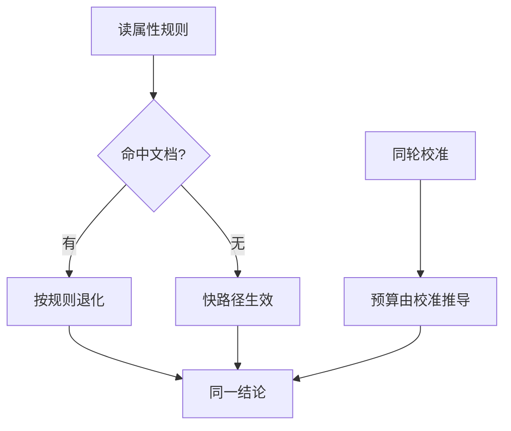

# 性能门禁从事实判据重建（Issue `#114`）

> 配对 Todo：[perf-budget Todo](../todo/261120-issue114-w25-perf-budget-todo.md)
>
> **基线**：`a0fe4df`。本文全部数字均在基线工作区重新实测，测量方法与原始读数一并写出。

本切片处理性能门禁失效。它是独立问题，不与其它 Wave 2.5 切片共享总控 PRD：它改的是三个互不相干的判定，验收清单一份装得下。

## 一、目标、红线与非目标

<!-- section: goal -->
### 1.1 目标

1. **快路径的触发判据改看事实**：是否退化为慢路径，今天由「`.gitattributes` 里有没有某条规则」决定。规则本身是对的，错的是判据——真正决定是否需要慢路径的，是**已跟踪文件里有没有命中该规则的文件**。改为按后者判，同一个仓库换一台机器、换一个分支都得到同一结论。
2. **提交日志快路径不再整体放弃**：今天遇到合并提交就返回失败，本仓几乎全是合并提交，于是快路径永远退回子进程。改为「遇合并提交停止续读、返回已读前缀」——调用处本来就有长度判断，前缀是可用的。
3. **预算单点，且由同一轮实测推导**：今天同一个命令在两种环境下有两个预算（本地一倍、远端两倍半），实测本地五次全红、远端五次全绿，这条门禁因此不验任何东西。改为「同一次运行内先测一个固定的校准负载，各基准的预算 = 校准值 × 该基准声明的倍数」，倍数表是唯一常量表。任何环境都是同一套倍数、同一套判据。
4. **实测降下来而不是把预算抬上去**：目标不是让现有数字通过，而是让真实耗时下降，使预算与实测之间有可用的判别余量。

### 1.2 非目标（Explicit Non-Goals）

<!-- section: non-goals -->
- **不改远端流水线文件**。实测预算放大发生在脚本里（读环境变量），不在流水线文件里，所以在脚本内即可治本。流水线文件保持原样。
- **不放宽 250ms 这个量级**。改成校准倍数后，`survey(self)` 的倍数按「本机校准单位」表述，量级与原 250ms 相当，不允许借重构之名整体放宽。
- **不靠加大采样次数或丢弃离群值来压数字**。判定用中位数是既有做法，保留。
- **不删除 `.gitattributes` 里的行尾规则**。那三条规则是对的（Windows 脚本确实需要 CRLF），删掉它等于用破坏正确性换取速度。
- **不动其它基准项**（勘察 300 文件、体检、预检、快照创建）的实现与预算倍数，只改它们的预算来源。
- **不加关掉门禁的开关**：不新增「跳过基准」「只打报告不判定」这类通道。`--strict-budget` 保留，但语义从「放大倍数」改为「额外打印校准值与相对余量」。
- **不改为「只和上次记录比」的趋势门禁**：那需要一份随机器变化的基线账本，等于把今天的双口径换成三口径。
<!-- section: non-goals-end -->

### 1.3 三个缺陷到判据的对应

| 判据 | 覆盖 | 一句话 |
| --- | --- | --- |
| `C1` | 属性规则触发判据 | 两处入口都改看「已跟踪文件是否命中规则」 |
| `C2` | 合并提交放弃 | 遇合并提交返回已读前缀，不再整体失败 |
| `C3` | 预算来源 | 环境不再隐式放大，预算由同轮校准推导 |
| `C4` | 单一结论 | 两条环境给出完全相同的预算数值 |
| `C5` | 实测与余量 | 连跑五次全绿且留出可判别余量 |
<!-- section: goal-end -->

## 二、技术设计与接口契约

<!-- section: design -->

### 2.1 `C1` 属性规则的触发判据改看已跟踪文件

- **影响文件**：`kit/skills/lib/git-status-fast.mjs`（第 `201` 行与第 `348` 行两处，同一个判据写了两遍）。
- **现状**：两处都是「`.gitattributes` 文本里出现 `filter=` / `working-tree-encoding=` / `ident=` / `eol=crlf` 任一条，就放弃快路径」。本仓 `.gitattributes` 第 9 至 11 行有三条 `eol=crlf` 规则，而 `git ls-files '*.bat' '*.cmd' '*.ps1'` 的返回是 **0 个文件**——规则一条都没命中任何已跟踪文件，快路径却被整条关掉。
- **改法**：把「规则存在」换成「已跟踪文件里存在命中该规则的文件」。命中判定不需要实现属性匹配引擎：只需判断**有没有任一已跟踪文件的扩展名/名字命中那条规则的模式**。判据落在事实层——文件清单来自 `git ls-files` 或索引读取（该模块已有索引快路径），不来自对 `.gitattributes` 文本的猜测。
- **为什么不是删掉这条检查**：一旦真有 `*.ps1` 被跟踪，快路径的字节级比较就必须让位给行尾规范化，否则会误报「文件已改」。规则逻辑是对的，缺的是「有没有命中」这一步。
- **两处必须同改**：同一个判据写两遍本身就是本切片要治的病。改完抽成一个内部函数，两处调用，禁止再各写一份条件。

### 2.2 `C2` 合并提交不再整体放弃

- **影响文件**：`kit/skills/lib/git-fast.mjs`（`readLooseCommitLogFast`，第 `434` 行）。
- **现状**：读到多父提交即 `return null`，整段快路径作废，退回子进程执行 `git log`。本仓提交里合并提交占绝大多数，所以这条快路径在本仓**从未生效过**——它不是「快路径」，是一条永远走不到的代码。
- **改法**：遇多父提交时停止续读、返回已读到的前缀（`complete` 标假）。调用处（`flow-inspect.mjs`、`git.mjs`、`survey-workspace.mjs`）本来就有「条目数是否够用」的判断，前缀是合法输入。
- **反例边界**：一个条目都没读到就遇到多父提交时，仍返回失败——不能把「什么都没读到」包装成「读到了零条」的成功，那是另一种形式的假绿。

### 2.3 `C3` 预算由同轮校准推导

- **影响文件**：`scripts/dev/bench.mjs`。
- **现状**：第 `89` 行 `budgetScale = (process.env.CI === 'true' && !strictBudget) ? 2.5 : 1`，第 `116` 行用 `budget × budgetScale` 当阈值。同一命令两个结论。
- **改法**：
  1. **删掉按环境决定阈值的分支**，`budgetScale` 这个概念不再存在。
  2. 每轮开头先跑一段**校准负载**：读取本仓固定的一批小文件并做一次词法级处理（读入、按行切分、统计行数），重复若干次取中位数，记为 `unitMs`。它衡量的是这台机器上「读文件 + 过一遍文本」的速度——正是被测基准共同依赖的那部分能力。
  3. 每个基准从「绝对毫秒预算」改为「相对校准单位的倍数」：倍数表是该脚本里唯一的一处常量表，写清每一项为什么是这个倍数（被测工作量与校准工作量之比）。
  4. 阈值 = `unitMs × 倍数`，四舍五入到毫秒。报告里同时打印 `unitMs`、倍数、阈值与实测中位数，让人一眼能判断是「机器慢」还是「代码退化」。
- **为什么这是治本**：绝对毫秒预算只能在一台机器上成立。写成倍数之后，判据与机器能力挂钩、与仓库状态无关，任何环境跑同一命令得到同一结论；而真实退化仍然会被抓——被测项相对于校准单位变贵了。
- **风险与应对**：校准负载与各基准的 I/O/CPU 配比不完全一致，倍数是近似。应对有两条：倍数取「实测占比的整数倍并留余量」；`C5` 要求留出可判别余量，避免倍数刚好卡在实测值上。

### 2.4 `C4` 两条环境给出完全相同的预算

- **影响文件**：`scripts/dev/bench.mjs`。
- **判据**：设 `CI=true` 与不设该变量，各跑一次，两次输出里的「阈值」数值必须逐项相同。
- **为什么单独立一条**：`C3` 说「删掉放大分支」，但删掉之后仍可能有人在别处补一个隐含的乘数。这条判据只关注结果数值相等，不关注实现怎么做到，因此不会因为内部重构而失效。

### 2.5 `C5` 实测与余量

- **影响文件**：`scripts/dev/bench.mjs`（打印余量），`scripts/dev/fixtures-perf-budget.mjs` (new)。
- **判据**：`--strict-budget` 连跑五次全绿；且 `survey(self)` 的实测中位数相对阈值的余量不低于 20%。余量在报告里显式打印（这里沿用「百分比」表述，具体数值由脚本算，不在文档里写死）。
- **为什么要求余量**：实测基线压在阈值之上 6ms 时，这条门禁抓不到任何东西——它只会偶尔红、偶尔绿，红了被当抖动忽视。余量是「这条门禁有没有判别力」的直接度量。
- **定点用例**（落在新夹具里）：构造一个只在 `.gitattributes` 有规则、而索引里没有任何命中文件的仓库，断言快路径生效；再构造一个有命中文件的仓库，断言按规则退化。两条用例互为反例。

### 2.6 行数与拆分

- `scripts/dev/bench.mjs` 现为若干百行以内的小脚本，本切片只改判据来源，不新增文件职责；若加校准后超过 400 行，把校准与预算计算下沉为同目录一个模块，`bench.mjs` 只保留编排。
- 新增夹具独立成文件，遵守 `scripts/dev/fixtures-*.mjs` 的单文件单域约定。
<!-- section: design-end -->

## 三、门型评估与验收标准

<!-- section: gates -->
- **门型**：`two-way`。三个改动都可反向提交回退：判据换来源、快路径返回前缀、阈值来源改变，都不改对外契约、不迁移数据。回滚路径为反向提交；不改写已推送历史。
- **风险等级**：`medium`。命中 `kit/` 与 `scripts/dev/` 两条高风险路径，但改动面限于判据来源，不触及标记语法、模板求值与报告排版。
- **故障注入**：把快路径命中判定改成恒「无命中」，对应用例必须变红；把校准倍数改成恒 1，余量判据必须变红。
- **验证命令**：
  - `node scripts/dev/fixtures.mjs --domain perf-budget`
  - `node scripts/dev/bench.mjs --strict-budget`
  - `node scripts/dev/preflight.mjs && node scripts/equip.mjs . --check`
<!-- section: gates-end -->

<!-- section: acceptance -->
### 验收标准（正例 / 反例双向可判定）

<!-- criteria:start -->
- [ ] C1: `.gitattributes` 含 `eol=crlf` 规则而 `git ls-files` 无命中文件时，`inspectSurveyStatusFast` 与另一个同判据入口都返回非空结果（快路径生效）；含同样规则且索引里有命中文件时，两处都返回空（按规则退化）。反例（易误判）：只改一处、另一处仍按「规则存在」判——此时同一仓库内两个入口对同一状态给出相反结论，用一条断言同时比对两处即可变红。
- [ ] C2: 当 HEAD 是合并提交、且其某个父提交不是合并提交时，`readLooseCommitLogFast` 返回至少一条 entry 且 `complete` 为假；当父链自 HEAD 起全是合并提交时返回空（失败），不得返回「零条的成功」。反例：把失败也统一成返回空数组，于是「读不到」与「读到零条」再次混为一谈。
- [ ] C3: 全仓搜不到按环境变量决定预算阈值的分支（`CI` 环境变量不再参与阈值计算）；同一脚本内只存在一处倍数常量表，每项倍数带一句「被测工作量与校准工作量之比」的说明。反例：保留按环境乘倍数的分支但把默认倍数改成 1——那只是把放大藏起来，环境一变仍会出现第二个结论。
- [ ] C4: 设 `CI=true` 与不设该变量各跑一次，两次输出中每一项的阈值数值逐个相等。反例：只断言「两次都通过」——通过不等于阈值相同，两条不同的阈值可以同时通过。
- [ ] C5: `node scripts/dev/bench.mjs --strict-budget` 连跑五次全部通过，且每次输出都打印校准值、倍数、阈值与余量百分比；其中 `survey(self)` 的余量不低于 20%。反例：余量为负或接近零却报通过——那说明阈值卡在实测值上，这条门禁没有判别力。
- [ ] C6: 两条定点用例存在且各自会红：仓库属性有规则而索引无命中文件时断言快路径生效，把命中判定改成恒「无命中」后该断言不变红即用例无效；索引有命中文件时断言按规则退化，把命中判定改成恒「有命中」后该断言必须变红。
<!-- criteria:end -->
<!-- section: acceptance-end -->

## 四、可复用基础设施与备选方案

<!-- section: reuse -->
- `kit/skills/lib/git-status-fast.mjs` 已有索引读取快路径（`readGitIndexFast`）与已跟踪文件清单的来源，命中判定直接建立在它上面，不再新起一次 `git ls-files` 子进程。
- `kit/skills/lib/git-fast.mjs` 的 `readLooseCommitLogFast` 已有 `complete` 标记与调用处的长度判断，前缀返回是既有形状的合法取值，不需要新增接口。
- `scripts/dev/bench.mjs` 已有「中位数 + 逐项预算 + 报告」的骨架，本切片只替换阈值来源与报告字段。
- `scripts/dev/fixtures.mjs` 按 `scripts/dev/fixtures-*.mjs` 自动发现功能域，新增夹具无需登记。
<!-- section: reuse-end -->

<!-- section: alternatives -->
- **方案一（否决）：远端加一次带严格开关的基准步骤。** 严格的基准步骤本身是对的，但它只是绕开脚本里的放大分支——放大分支还在，下一个人换个环境变量仍然能拿到两倍半的预算。门禁要治的是「同一命令两个结论」，不是「今天这一条绿的」。
- **方案二（否决）：把绝对预算调到远端实测上限之上。** 这样远端紧、本地松。本地开发者在 40% 退化时仍看不到红，等于把门禁只留在一台机器上。
- **方案三（否决）：改成与上一次记录比对的趋势门禁。** 需要一份随机器变化的基线账本，并且一旦有人在慢机器上提交基线，后续所有人都被放宽。把双口径换成三口径，复杂度换不到判别力。
- **方案四（采纳）：校准相对预算 + 实测压降。** 判据与机器能力挂钩、与仓库状态无关；真实退化仍然可见；不需要额外账本。
- **「只改一处、放过另一处」：否决。** 同一个判据写两遍，改一处留一处，等于留下一个「取决于你走哪条调用路径」的结论，比现在更糟。
<!-- section: alternatives-end -->

## 五、待拍板问题

<!-- section: pending -->
- 已定：快路径触发判据从「规则存在」改为「已跟踪文件命中规则」，两处入口抽成一个内部函数同改，不允许各写一份。
- 已定：保留 `.gitattributes` 的行尾规则，只改触发判据；不删除任何规则。
- 已定：提交日志快路径遇合并提交返回已读前缀，`complete` 标假；零条目时仍按失败返回。
- 已定：删除按环境变量放大预算的分支；预算由同一次运行内的校准负载推导，倍数表是唯一常量表，每项带工作量比说明。
- 已定：不改远端流水线文件。预算来源归脚本所有，因此在脚本内闭环。
- 已定：`--strict-budget` 保留，语义为「额外打印校准值与相对余量」；它不参与预算放大。
- 已定：余量要求按百分比表述并由脚本计算打印，文档不写死具体毫秒数——写死就会在换机器后再次失真。
- 已定：新增夹具独立成文件，遵守单文件单域约定；若基准脚本加校准后超过 400 行，把校准与预算计算下沉到同目录模块。
- 已定：本切片与 Wave 2.5 其它切片无依赖关系，可与其他独立切片并行开工。
<!-- section: pending-end -->
