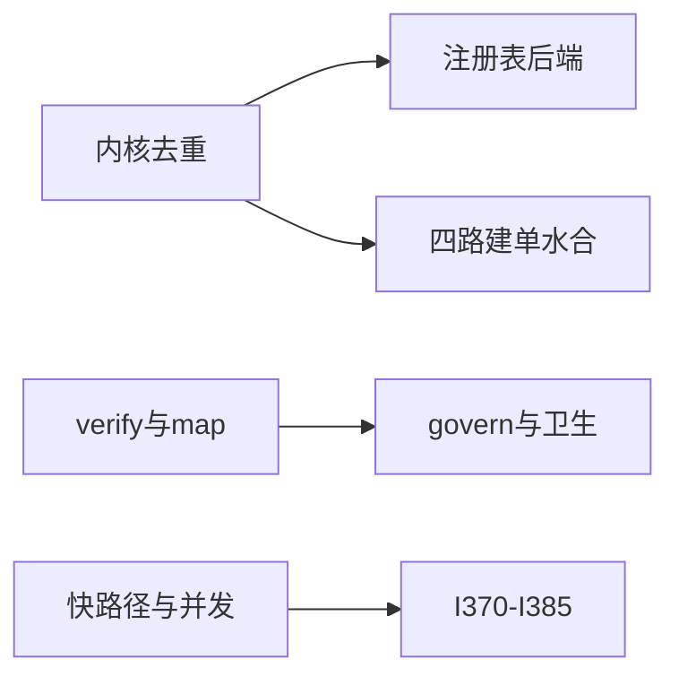

# PR-B（#115）合并技术方案：共享内核去重、平台收口、验证治理与性能预算

## 一、目标与非目标

<!-- section: goal -->
### 1.1 目标

将 W25 剩余 5 个未合入草案（`#115` + `#119` + `#117` + `#118` + `#114`）合并收口为单一可独立交付的 **Phase 3B（PR-B）**，消除 `scripts/lib/` 与 `kit/skills/` 的底层逻辑分叉，完成多远端/无远端平台注册表收口、四条建单路径统一模板水合、首次接入零误报、`verify-tools` 脚本指纹校验、确定性注释卫生与 `govern` 真实性修复、快路径边界修复与安全并发提速，并在同 PR 内完成冗余草案与 `261120-w25-hardening-prd.md` 退役，保持所有 `.mjs` 严格 `<= 800` 行及 `I370–I385` 故障注入 100% 实证覆盖。

<!-- section: non-goals -->
### 1.2 非目标

- 不改动 PR-A（`#120`）已合入的波次调度与 `--planning` 隔离核心，除非消费其现成工作流能力。
- 不新增第 9 个内建 skill，不引入一刀切禁注释，不新建 `docs/adr/` 目录。
- 不把依赖共享 Git 状态或写锁的集成校验步骤盲目并发化；不改动默认全量 `preflight` 与 `merge-gate` 门禁强度。
- 不修改已逼近 800 行的无关/只读模块：`kit/skills/dev-flow/scripts/flow-inspect.mjs`（795L）、`kit/skills/lib/docs.mjs`（790L）、`kit/skills/lib/profile-sniffer.mjs`（788L）、`kit/skills/dev-flow/scripts/flow-merge.mjs`（782L）、`scripts/equip.mjs`（781L）。
- 不在本 PR 内重写 `README.md` / `references/` 全量文档漂移（文档漂移长尾继续归口 `#103`），本 PR 仅修复 `doc-locate`、`compose-agents` 幂等与退役 W25 吸收草案。

### 1.3 W25 主 PRD 覆盖映射

本 SPEC 在归口 `C1–C8` 验收锚点的同时，承接 `docs/prd/261120-w25-hardening-prd.md` 中除 PR-A（`#120` 已归档）外全部剩余目标（`C1`/`C2`/`C4`/`C5`/`C6`），并由 `2.7` 在合入前规范退役该主 PRD 与 `#114`/`#117`/`#118`/`#119` 草案。

## 二、技术设计与接口契约

<!-- section: design -->

### 2.1 `C1`：共享内核去重与 `#119` 零引用死代码清理

遵循 `arch-rules`（`scripts/lib/** -> kit/**` 合法，`kit/** -> scripts/lib/**` 禁止），将双层重复底层原语收敛至 `kit/skills/lib/` 单源，`scripts/lib/` 仅做导入或薄重导出：

| 原语 | 唯一真源 | 清理/修复要点 |
| --- | --- | --- |
| `readTextSafe` | `kit/skills/lib/git-core.mjs` | 支持可配 `maxBytes`；替代 `scripts/lib/text.mjs` 同名副本与 `kit/skills/lib/platform-probe.mjs` `importSafeRead` |
| `isMacOsJunkPath` / `isMacMetadataName` | `kit/skills/lib/git-core.mjs` | 统一 macOS 元数据/垃圾路径判定；`text.mjs` 委托或重导出 |
| `isInsideDir(candidateAbs, parentAbs)` | `kit/skills/lib/git-core.mjs` | 统一参数序与边界符校验；替换 `worktree-deps.mjs` / `review-empirical-state.mjs` 副本，修复 `scripts/lib/update-ops.mjs` 反序 bug |
| `parseSshConfigHostMap` / `lookupSshHost` | `kit/skills/lib/platform.mjs` | 显式注入 `env` 参数；消除 `text.mjs` 与 `platform-probe.mjs` 行为漂移 |
| `countTextLines` | `kit/skills/lib/static-gates.mjs` | 统一按 `split('\n')` 剥离末尾空行语义；`scripts/lib/protocol.mjs` 重导出，`edit-gate.mjs` 与 `preflight` 共用，消除 798/799 偏差 |

`#119` 死代码与废弃参数清理（零外部消费者已静态核实）：
- `scripts/lib/fs-atomic.mjs`：移除 `parentOf`；`scripts/lib/protocol.mjs`：移除 `emitMarker`、`hasMarkers`、`WORKTREES_STATE_RE`；`scripts/lib/text.mjs`：移除 `readTextFile`、`normVersion`、`repoRelation`。
- `scripts/lib/survey-workspace.mjs`：移除 ~190 行的 `scanWorkspaceRaw`；`scripts/lib/survey-ecosystem.mjs`：移除 `detectTaskEntries`（保留 `detectTaskEntriesDetailed`）。
- `kit/skills/lib/platform-probe.mjs` / `scripts/lib/review-helpers.mjs` 等：取消零外部消费者内部辅助函数导出或删除确认死函数；在 `scripts/dev/preflight-kernel-parity.mjs` (new) 固化 `--slot` 零残留与重复原语回归检查（不设脆弱的行数自证门禁）。

### 2.2 `C2`：多远端/无远端平台注册表收口

1. **适配器契约强校验**：对齐双侧 `GITHUB_PROVIDER`（`scripts/lib/platform/github.mjs` + `scripts/lib/platform/registry.mjs` 与 `kit/skills/lib/platform.mjs`），在两侧 `registerHostingProvider` 中校验必备方法契约（`matchRemote`、`normalizeRepo`、`parseRelations`、`formatIssueRef` 等），缺方法即 Fail-Closed 抛错。
2. **注册表分发 `createTaskBackend`**：从 `kit/skills/lib/task-backend.mjs`（当前 799L）拆出 `LocalOnlyBackend` / `GenericRemoteBackend` 至 `kit/skills/lib/task-backend-local.mjs` (new)；`createTaskBackend` 取消硬编码 `role`/`providerId` `if/else`，改为查 `PROVIDER_REGISTRY` 分发远程后端，对 `generic-git` 与 `local-only` 统一回落到安全降级后端。
3. **`equip-ci` 消费 `artifactPlan`**：`scripts/equip-ci.mjs` 删除直接判定 `providerId !== 'github'` 的分支，改为直接消费 `scripts/survey.mjs` `computeArtifactPlan` 产出的 `facts.artifactPlan` 决定是否写 CI 模板与校验分支保护。
4. **`declaredRepo` 去宿主化与规划远端同步**：`platform.mjs` `detectDeclaredRepo` 与 `survey-ecosystem.mjs` 通过注册表 `normalizeRepo` / 通用远端解析提取仓库标识，不再直调 `githubRepoPath`；在 `kit/skills/lib/plan-sync.mjs` 新增共享 `resolveDocIssueNumber` 并修复 `kit/skills/dev-plan/scripts/doc-plan.mjs` 的 `critique-pass`/`critique-reject`/`approve` 调用 `syncPlanPhaseToBackend` 时未透传 `issueNumber` 的缺陷。

### 2.3 `C3`：统一 `hydrateIssueBody` 与首次接入零误报

1. **统一 Issue 水合器**：新建 `kit/skills/lib/issue-template-hydrate.mjs` (new)，导出与 `hydratePrTemplateBody` 风格一致的 `hydrateIssueBody(repoRoot, kind, fields, opts)`：优先读取目标仓 `.github/ISSUE_TEMPLATE/`（按 `kind` 匹配或回退默认模板），保留用户模板章节，回填上下文/复现/验收段，归一化字面量 `\n`，剥离代码围栏外 `<!-- ... -->`；无模板或 `local-only`/`generic-git` 时干净降级生成结构化正文。
2. **四路接入**：`flow issue create`（`flow-issues.mjs`）、`flow start --create-issue`（`flow-issues.mjs` `createIssueForStart`）、`escalation.mjs` `buildEscalationIssuePayload`、`govern-audit.mjs` `issues` 全部改走 `hydrateIssueBody`。
3. **首次接入零误报**：在 `scripts/lib/equip-bootstrap.mjs`（不改 781L `equip.mjs`）为首次接入/空仓落盘合法空 `docs/feature-map.json`，同时 `verify-tools-audit.mjs` 与 `verify-tools.mjs` 在空 `feature-map` 或 `tools` 为空时返回 `NOT_APPLICABLE` 零失败。
4. **`doc-locate` 与 `compose-agents` 幂等**：`kit/skills/lib/doc-locator.mjs` `discoverContextDocs` 将 `references/*.md` 纳入 `contextIndex`，`doc-locate.mjs` 增加 `--list`；修复 `scripts/compose-agents.mjs` / `scripts/lib/agents-defaults.mjs` 导致 `意图路由`、`探索策略` 在主仓漂移的逻辑，确保单次 `node scripts/compose-agents.mjs .` 后 `--check` 一次通过。

### 2.4 `C4`：`#117` 验证工具真指纹与功能地图刷新

- `kit/skills/lib/verify-state.mjs`（并由 `kit/skills/lib/feature-map.mjs` 重导出）：`computeFeatureFingerprint` 除覆盖路径树哈希外，同步纳入关联工具 `scriptPath` 文件内容哈希；校验 `scriptPath` 必须落在仓内安全路径（`isInsideDir`）且不得越界。
- `kit/skills/dev-verify-tools/scripts/verify-tools.mjs` & `verify-tools-audit.mjs`：当目标工具匹配数 `matched.length === 0`（非空仓 `NOT_APPLICABLE`）或 `executedCount === 0` 时 Fail-Closed 非零退出；移除 stale 通过时静默覆写基线逻辑，并在 `verify-state.mjs` 命中 scratch 校验时落盘 `verify.scratch-used` 信号。
- 刷新本仓 `docs/feature-map.json`（含 PR-A 与 PR-B 新增核心模块）并重跑全部过时验证工具、清理已归档 `#116` 僵尸引用，达到 `verify-tools audit` 0 stale / 0 zombies / 0 blindSpots。

### 2.5 `C5`：`#118` 治理真实性 + 三项确定性注释卫生升级

**治理真实性修复**：
- `scripts/dev/evidence.mjs`：用 `git ls-files -z` + `!isRepoOnlyPath(...)` 替代递归扫工作区，消除打包计数虚高。
- `kit/skills/dev-flow/scripts/flow-lifecycle-helpers.mjs` / `flow-lifecycle.mjs`：信号归因选取变更文件时过滤 `.pf-manifest.json`（借助 `flow-lifecycle-helpers.mjs` 保持 `flow-lifecycle.mjs <= 786L`）。
- `kit/skills/dev-govern/scripts/govern-checks.mjs`：未注册 `.worktrees/*` `orphan_dir` 提示直接清理目录而非误报 `git worktree remove`；`govern-retro.mjs` 淘汰失效历史路径建议；`scripts/lib/review-helpers.mjs` `collectStaleCommandsInfo` 拆解多行/本地命令后再匹配 `AGENTS.md`。

**三项确定性注释卫生升级（内聚于 `dev-edit`/`dev-govern`/`dev-review`，不新增 skill、不一刀切禁注释、不新建独立 ADR 目录）**：
1. `static-gates.mjs` / `edit-gate.mjs`：新增或修改的 `HACK` / `WORKAROUND` / `TEMP` 注释若缺有效 Issue 链接（`#123` 或完整 Issue URL），报错引导执行 `flow.mjs issue create` / `escalation.mjs` 建单跟踪后再引用。
2. 新建 `kit/skills/lib/static-gates-comment-hygiene.mjs` (new)，复用 `static-gates-lexer.mjs` 精确提取代码注释（排除代码围栏、字符串字面量、URL、glob、正则与示例占位路径），仅检测反引号内的仓内路径引用是否存在；严格限定 `--changed` 变更文件模式 + 基线棘轮，不逼存量仓一次性改旧债，并从 `edit-gate.mjs` 与 `govern-checks.mjs` 接入。
3. 在 `kit/skills/dev-edit/SKILL.md` 与 `kit/skills/dev-review/SKILL.md`（同步至 `.agents/skills/`）补充「解释 why 而非复述 what」注释纪律与架构决策优先落盘 `docs/TDD.md` / `AGENTS.md ## 取舍` 的核对条款。

### 2.6 `C6`：`#114` 性能快路径修复、增量门禁、安全隔离并发与真预算

1. **`git-status-fast.mjs` 与 `git-fast.mjs` 边界修复**：`git-status-fast.mjs` 按 `.gitattributes` 规则匹配具体受 `eol=crlf` 影响的候选路径才回退原生 `git`，其余路径保持快路径；`git-fast.mjs` 修复 `readGitConfigFast` 在 linked worktree 下解析 `commondir` 指向共享 `.git/config`（避免误读空 `remoteText` 降级 `generic-git`），并修复 `readLooseCommitLogFast` 多父合并提交（`parents.length > 1`）处理。配与原生 `git` 及 linked worktree 远端/真无远端结果一致的正反对照测试。
2. **`preflight.mjs --changed` 增量模式**：`preflight.mjs` 与 `preflight-suite.mjs` 支持 `--changed` 仅校验 `git diff` 涉及模块及契约，默认无参调用与 `merge-gate.mjs` 全量严格度保持不变。
3. **`bench.mjs` 1x 硬预算**：移除 `budgetScale`（CI 2.5x 放宽），新增 `--strict-budget` 以 1x 硬预算（如 `survey(self) <= 250ms`）校验，超限即非零退出。
4. **安全隔离并发提速**：现场排查确认 `e2e-zip-harness.mjs` 的 Stage B（`H/I/J`）与 Evolution（`evo-h..evo-l`）各场景使用独立 `mkdtempSync` 临时沙盒；须为 Stage B `H/I/J` 各自隔离独立 `mockSrv` 实例以防端口/请求交叉污染后，再对无共享状态场景实施有界并发池；`merge-gate.mjs` 中纯只读无共享状态的静态步骤（`preflight`、`gap-coverage`、`compose-agents --check`、`equip --check`、`sync-toc --check`、`review`、`govern-audit`）可并发池运行，有共享仓/重锁步骤（`fixtures`、`verify-injections`、`e2e-zip-harness`、`git archive`）严格保持串行；`fixtures.mjs` 仅并行独立纯临时目录子集；所有并发路径均保持确定性排序输出与完全等价退出码。

### 2.7 `C7`：同分支退役被吸收草案与 `261120-w25-hardening-prd.md`

`impl-prb` 在完成 `C1–C6` 编码验证后，严格按以下无冲突顺序在 `feat/w25-kernel-dedup` 同分支退役文档（遵循 `buildArchivedDocPatch`、`shouldHold` 与 `BROKEN_RELATED_LINK` 约束）：
1. **`flow finalize` 前先退役 `#114`/`#117`/`#118`/`#119`**：先运行 `node .agents/skills/dev-plan/scripts/doc-plan.mjs supersede <oldSpec> --by docs/specs/261120-issue115-w25-kernel-dedup-spec.md` 标为 `superseded`，再用 `git mv` 将 `#114`/`#117`/`#118`/`#119` 的 SPEC 与 Todo 迁入 `docs/archive/specs/` 与 `docs/archive/todo/` 并更新各自 `superseded_by`/`related_*` 相对链接（**不**调用会以 `buildArchivedDocPatch` 把 `superseded` 覆写为 `implemented`/`done` 的 `archive` 命令）。
2. **预备 PRD 闭环条件（暂留 `docs/prd/`）**：在 `docs/prd/261120-w25-hardening-prd.md` 勾选全部 `C1..C7` 为 `[x]`（使 `evaluateMasterPrdClosure` 返回 `shouldHold: false`、`archivePrd: true`），此时**不提前归档**该 PRD，以免 `#115` `related_prd` 触发 `BROKEN_RELATED_LINK`。
3. **随 `flow finalize` 原子共归档**：运行 `flow.mjs finalize --task w25-kernel-dedup`，自动勾选 `#115` 验收条并调用 `archiveCompletedDocsGroup` 将 `#115` SPEC（`status: implemented`）、`#115` Todo（`status: done`）与 `261120-w25-hardening-prd.md`（合法设为 `status: done`）原子共归档至 `docs/archive/`。
4. **终态审计**：运行 `node .agents/skills/dev-plan/scripts/doc-plan.mjs audit . --json` 验证仅剩 `docs/prd/261120-v10-1-hardening-pillars-docs-prd.md`、`#103`、`#104` 且零报错。

### 2.8 `C8`：文件行数预算拆分策略与故障注入 `I370–I385`

**关键 `.mjs <= 800` 行预算控制**：
- `kit/skills/lib/task-backend.mjs`（799L）：拆出 `kit/skills/lib/task-backend-local.mjs` (new)，目标 `<= 650L`。
- `kit/skills/dev-plan/scripts/doc-plan.mjs`（771L）：`resolveDocIssueNumber` 放入 `kit/skills/lib/plan-sync.mjs`（265L），保持 `doc-plan.mjs <= 780L`。
- `kit/skills/dev-govern/scripts/govern-checks.mjs`（767L）：注释路径检查落 `kit/skills/lib/static-gates-comment-hygiene.mjs` (new)，主模块保持 `<= 775L`。
- `kit/skills/dev-flow/scripts/flow-lifecycle.mjs`（786L）：过滤逻辑落 `flow-lifecycle-helpers.mjs`（566L），零净增。
- `scripts/dev/preflight-suite.mjs`（673L）：内核对等门禁落 `scripts/dev/preflight-kernel-parity.mjs` (new)，主模块 `<= 750L`。
- `scripts/lib/survey-ecosystem.mjs`（784L）、`kit/skills/lib/platform-probe.mjs`（772L）、`scripts/lib/survey-workspace.mjs`（717L）：随 C1/C2 删除死代码后净行数显著下降。

**`scripts/dev/injections-data-kernel-dedup.mjs` (new) 故障注入表（`I370–I385`）**：

| ID | 注入点与故障 | 预期变红目标 |
| --- | --- | --- |
| `I370` | `git-core.mjs`：`isInsideDir` 去掉路径分隔符前缀边界判定 | C1 正反边界用例（`/tmp/repo2` 误判在 `/tmp/repo` 内） |
| `I371` | `static-gates.mjs`：`countTextLines` 漏剥离 `\n` 结尾空行 | `preflight` 行数语义对等与 799/800 用例 |
| `I372` | `platform.mjs`：`registerHostingProvider` 跳过适配器方法契约校验 | C2 缺方法适配器注入测试 |
| `I373` | `task-backend.mjs`：`createTaskBackend` 绕过注册表回退硬编码分支 | C2 `generic-git` / 自定义后端分发断言 |
| `I374` | `equip-ci.mjs`：忽略 `facts.artifactPlan` 恢复 `providerId !== 'github'` 特判 | C2 多远端 `equip-ci` 行为断言 |
| `I375` | `issue-template-hydrate.mjs` (new)：`hydrateIssueBody` 跳过注释剥离或 `\n` 归一化 | C3 四路建单注释与换行污染断言 |
| `I376` | `doc-plan.mjs`：`critique-pass`/`critique-reject` 漏传 `issueNumber` 给 `syncPlanPhaseToBackend` | C2/C3 规划远端同步透传断言 |
| `I377` | `git-fast.mjs`：`readGitConfigFast` 漏解析 linked worktree `commondir/config` 返回空 `remoteText` | C2/C6 worktree 远端识别对比测试 |
| `I378` | `verify-state.mjs`：`computeFeatureFingerprint` 忽略 `tool.scriptPath` 文件内容哈希 | C4 脚本篡改 stale 检出测试 |
| `I379` | `verify-tools.mjs`：`run` 在零执行（`matched.length === 0`）时仍返回 0 | C4 零执行 Fail-Closed 测试 |
| `I380` | `flow-lifecycle-helpers.mjs`：信号归因过滤漏掉 `.pf-manifest.json` | C5 manifest blame 污染测试 |
| `I381` | `static-gates-comment-hygiene.mjs` (new)：放行变更文件注释内失效反引号路径或绕过 `--changed` 基线棘轮 | C5 注释路径正反双向测试 |
| `I382` | `evidence.mjs`：退回 `ROOT` 全目录遍历而不走 `git ls-files -z` | C5 发包清单文件数漂移断言 |
| `I383` | `git-status-fast.mjs`：对 `eol=crlf` 命中文件跳过回退原生 `git status` | C6 CRLF 快路径等价对比测试 |
| `I384` | `git-fast.mjs`：遇 `parents.length > 1` 合并提交直接返回 `null` | C6 多父合并提交对比测试 |
| `I385` | `bench.mjs`：恢复 `CI` 2.5x `budgetScale` 放宽使 `--strict-budget` 放行超标耗时 | C6 `--strict-budget` 1x 硬预算断言 |

## 三、门型评估与验收标准

<!-- section: gates -->
### 3.1 门型与风险定级

- **门型**：`two-way`（独立分支 `feat/w25-kernel-dedup`，经 PR-B 合前 `merge-gate` 与独立审查后合并，可完整回退）；**风险**：`high`（触碰 `kit/`、`scripts/lib/`、`scripts/dev/`、`AGENTS.md` 高风险路径，须全量实证 + `I370–I385` 故障注入）。

<!-- section: acceptance -->
### 3.2 验收标准（正反双向）

<!-- criteria:start -->
- [x] C1: 共享内核五原语（`readTextSafe`/`isMacOsJunkPath`/`isInsideDir`/`parseSshConfigHostMap`/`countTextLines`）收敛唯一真源，正向修复 `update-ops.mjs` `isInsideDir` 参数序与 798/799 行数偏差且 `#119` 零引用死导出清理完毕；反向 `/tmp/repo2` 越界与废弃 `--slot` 均被拦截（`node scripts/dev/preflight-kernel-parity.mjs` 通过）。
- [x] C2: 两侧 `GITHUB_PROVIDER`/`registerHostingProvider` 强校验方法契约、`createTaskBackend` 走注册表分发、`equip-ci` 消费 `scripts/survey.mjs` `artifactPlan`、`declaredRepo` 去宿主化、`doc-plan` (`critique-pass`/`critique-reject`/`approve`) 透传 `issueNumber` 给 `syncPlanPhaseToBackend`；正向支持 `github` / `generic-git` / `local-only` 三态优雅降级，反向未实现契约的自定义适配器被 Fail-Closed 拒绝。
- [x] C3: `hydrateIssueBody` 统一接入 `flow issue create`/`flow start --create-issue`/`escalation.mjs`/`govern-audit issues` 四条路径；首次接入空仓 `equip` 落盘合法空 `feature-map.json` 且 `verify-tools audit` 零误报；`doc-locate` 索引 `references/`；`compose-agents .` 单次幂等（反向含字面 `\n`/HTML 注释模板不泄漏、未改写用户自有模板章节）。
- [x] C4: `verify-tools` 落地 `scriptPath` 内容指纹、仓内路径校验、零执行非零退出与 `verify.scratch-used` 信号；刷新本仓 `docs/feature-map.json` 与全部工具后 `verify-tools audit` 达 `0 stale / 0 zombies / 0 blindSpots`（反向篡改脚本或零执行必变红）。
- [x] C5: `evidence.mjs` 改用 `git ls-files -z`、`.pf-manifest.json` 从信号 blame 排除、`orphan_dir` 修复提示、`retro` 淘汰旧建议；三项确定性注释卫生升级落地于 `dev-edit`/`dev-govern`/`dev-review`（无第 9 个 skill、无独立 ADR 目录、无禁注释）；反向缺 Issue 的 `HACK`/`WORKAROUND` 及 `--changed` 失效反引号路径被拦，存量旧注释与 URL/示例路径零误报。
- [x] C6: `git-status-fast` `eol=crlf`、`readGitConfigFast` linked worktree `commondir` 与 `git-fast` 多父提交修复经正反测试与原生 `git` 结果 100% 一致；`preflight --changed` 可用且默认全量/合前强度不变；`bench.mjs --strict-budget` 落 1x 硬预算；`fixtures`/`e2e-zip-harness`（隔离 `H/I/J` `mockSrv`）/`merge-gate` 隔离并发提速且输出与退出码等价。
- [x] C7: 先 `supersede` 并 `git mv` 归档 `#114`/`#117`/`#118`/`#119`（防 `buildArchivedDocPatch` 覆写），再勾选 `261120-w25-hardening-prd.md` `C1..C7` 后随 `flow finalize` 原子共归档 PRD，收尾 `doc-plan.mjs audit . --json` 仅保留 `v10.1` 主 PRD + `#103` + `#104` 且零报错。
- [x] C8: 全仓所有 `.mjs` 严格 `<= 800` 行（`task-backend.mjs` 已拆出 `task-backend-local.mjs`）、`I370–I385` 16 条故障注入全部实证变红并完成多后端正反双向 fixture（`merge-gate.mjs` 与 `verify-injections.mjs` 全绿）。
<!-- criteria:end -->

## 四、可复用基础设施与备选方案

<!-- section: reuse -->
- 复用 `kit/skills/lib/pr-template-hydrate.mjs`（`stripHtmlCommentsOutsideFences` 等）实现 `hydrateIssueBody`，避免重复编写围栏/注释解析器。
- 复用 `kit/skills/lib/static-gates-lexer.mjs`（`buildLexedViews`/`extractLineCommentInfo`）构建 `static-gates-comment-hygiene.mjs` (new)。
- 复用 `kit/skills/lib/verify-state.mjs`（`isSafeTaskScratchPath`/`destroyTaskScratchDir`/`computeFeatureFingerprint`）与 `scripts/survey.mjs`（`computeArtifactPlan`）。

<!-- section: alternatives -->
- 备选 A（未采纳）：新增第 9 个注释审查 skill 或全仓硬扫旧注释。否决原因：破坏既有 `8` skill 收敛边界且强迫存量仓大面积改旧注释。
- 备选 B（未采纳）：用静态行数阈值做 `arch`/去重自证门禁。否决原因：行数门禁易脆弱误报，改用符号出口parity + 共享原语去重检测。

## 五、待拍板问题

<!-- section: pending -->
- 已定：统一内核放置于 `kit/skills/lib/`（`git-core.mjs`/`platform.mjs`/`static-gates.mjs`），严格满足 `arch-rules` 与零第三方依赖。
- 已定：所有注释卫生规则严限 `--changed` + 基线棘轮与 `dev-edit`/`dev-govern`/`dev-review` 内聚实现，不新增第 9 skill 与独立 ADR 目录。
- 已定：`bench.mjs` 彻底移除 `2.5x` CI 系数，默认与 `--strict-budget` 均按 1x 基准度量。
