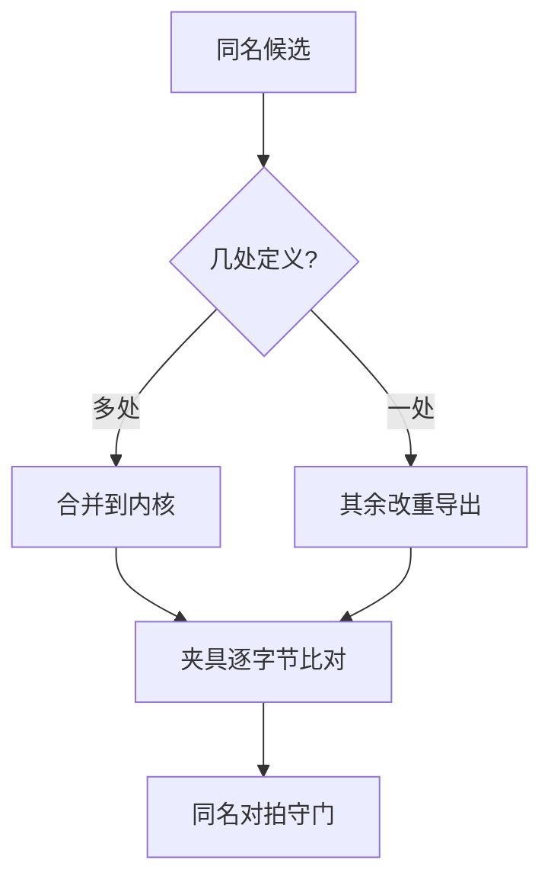

# 共享内核去重（Issue `#115`）

> 配对 Todo：[kernel-dedup Todo](../todo/261120-issue115-w25-kernel-dedup-todo.md)
>
> **基线**：`a0fe4df`。本切片认领总控 PRD `261120-w25-hardening-prd.md` 的 `C2`。前置：`w25-flow-defects`（先把流程入口的引用与路径形状定下来）、`w25-deadcode-split`（先把策略模块拆出边界）。

## 一、目标、红线与非目标

<!-- section: goal -->
### 1.1 目标

1. **已漂移的六组收敛为单一实现**：这六组今天已经对同一输入给出不同答案，其中两组会让下游把「读不到」当成「没问题」。收敛后只保留一处定义，其余位置一律重导出，不留兼容别名。
2. **未漂移的五组提前收口**：它们今天恰好一致，但各自独立演化。同类重复不做提前处理，下一次改动就会变成第六组已漂移。收口前后全套夹具输出必须逐字节一致——这条是「没有偷偷改行为」的唯一证据。
3. **行数口径单点**：同一个「这个文件多少行」在两处实现里对同一文件给出 798 与 799。度量与规则必须待在一起：`<= 800 行` 这条规则的权威定义处，就是唯一算行数的地方。
4. **同名导出机械对拍**：新增一条检查，同名导出在全仓只允许一处定义，其余必须是重导出。这条检查的存在，是「同一个病根不会第三次出现」的保证。

### 1.2 非目标（Explicit Non-Goals）

<!-- section: non-goals -->
- **不把四处产物目录名硬合成一个集合**。实测四处名单的用途根本不同：一处判「这是产物目录，不算源码」、一处判「这里有没有未忽略的产物要提示」、一处判「遍历时跳过」、一处判「依赖安装目录」。硬合成一个 `bin` 与 `.worktrees` 混在一起的集合，会让每一处都在用自己不需要的语义。正确做法是**按用途各留一份、名字里带用途**，并在一张声明表里登记每份的用途与条目差异的理由。
- **不改 `kit/skills/lib/shared.mjs`**。它是纯重导出层，四十五个以上夹具依赖它的导出面；动它等于同时改动全部夹具的导入路径。
- **不改 `kit/skills/lib/task-backend.mjs` 里三个 class 的布局**。十七个方法契约靠一份清单守住，拆成三个文件就要拆清单，收益为零。
- **不拆 `scripts/lib/survey-ecosystem.mjs` 里的生态声明式表**。那两百多行是数据不是逻辑。
- **不拆 `kit/skills/lib/platform-probe.mjs` 的线性降级链**、`scripts/equip.mjs` 的线性事务、`scripts/lib/fs-atomic.mjs` 的临时清理返回形状。
- **不动「跳过规划引导」开关**：它有间接读取点，不是死参数。
- **不改 `arch-rules` 的方向**：`kit/` 不得 import `scripts/lib/`。因此所有共享实现的落点是 `kit/skills/lib/git-core.mjs`（或同层模块），`scripts/lib/` 反向重导出。
<!-- section: non-goals-end -->

### 1.3 各组到判据的对应

| 判据 | 覆盖 | 一句话 |
| --- | --- | --- |
| `C1` | 读文本上限、版本号归一、仓库关系 | 同一输入两处同一结果，含空串与超限边界 |
| `C2` | 仓库路径解析、SSH 配置解析 | 认裸 slug；沙箱注入的家目录对两处同时生效 |
| `C3` | 路径规范形、同路径判定、主模块判定 | 空串行为由一处决定，夹具全绿 |
| `C4` | 五组未漂移同名实现 | 收敛后全套夹具逐字节一致 |
| `C5` | 行数口径 | 800 行边界在两道门禁上同结论 |
| `C6` | 同名导出对拍 | 一处定义、其余重导出，机械可验 |
| `C7` | 四处产物目录名单 | 按用途分治并登记差异理由 |
<!-- section: goal-end -->

## 二、技术设计与接口契约

<!-- section: design -->

### 2.1 `C1` 读文本、版本归一、仓库关系

- **影响文件**：`scripts/lib/text.mjs`、`kit/skills/lib/git-core.mjs`。
- **现状**：读文本上限一处 256KB、一处 512KB；同一份 300KB 文件，后者读得到、前者返回空，而下游通常把空当成「文件没问题」。版本号归一与仓库关系也各有一份。
- **改法**：`git-core.mjs` 保留实现（它在 `kit/`，`scripts/lib/` 可以 import 它）；`text.mjs` 改为重导出，不再保留第二份实现。上限取较大的那个——「读得进」比「读不进」安全，且读不进时的空返回值是静默失败的最大来源。
- **行为变化必须被锁住**：上限从 256KB 变 512KB 会改变既有调用方的行为。逐调用点核对（`text.mjs` 内四处自用）并把「300KB 文件现在读得到」写成一条正例断言。
- **反例边界**：不把上限提到无上限。无上限会让一次误指向大二进制的读取把内存打满。512KB 是保守值，保持不变。

### 2.2 `C2` 仓库路径与 SSH 配置解析

- **影响文件**：`scripts/lib/text.mjs`、`kit/skills/lib/platform-probe.mjs`。
- **现状**：仓库路径解析两份，一份认裸 `owner/repo` 一种写法不认完整 URL，另一份相反；SSH 配置解析两份，签名与返回类型都不同，其中只有一份接受注入的环境变量——而沙箱里注入家目录是唯一能测它的方式。
- **改法**：保留 `platform-probe.mjs` 那份（认裸 slug、接受环境注入）；`text.mjs` 重导出。它依赖的完整仓名函数一并迁移，避免从 `scripts/lib/` 反向引用 `kit/` 造成循环。
- **反例边界**：不改变「解析不出来返回什么」。今天两处对失败的处理不同（一处返回空、一处抛错），收敛后必须选定一种并在夹具里写明：返回空表示「格式不认识」，抛错表示「调用方式错」。两者不能混。

### 2.3 `C3` 路径规范形、同路径判定、主模块判定

- **影响文件**：`scripts/lib/text.mjs`、`kit/skills/lib/git-core.mjs`。
- **现状**：三对同义函数各两份，实测空串输入时相反（一处返回空串、一处返回当前工作目录；一处判「不同」、一处判「相同」）。
- **改法**：收敛到 `git-core.mjs`，`text.mjs` 重导出。**空串行为会变**，所以合并前先跑一遍全套夹具，确认没有断言依赖旧行为；若有，在夹具里写明新语义并说明为什么新语义更对（空输入不是一个路径，把它当成当前目录会让「没给参数」变成「动了这里」）。
- **必须一起做的核对**：工作树挂载与卸载都校验「主仓与工作树是否同一路径」，该判定现在走的是哪一份实现必须查清；走的是即将被替换那一份时，先补一条夹具锁住它的现有行为。

### 2.4 `C4` 五组未漂移同名实现

- **影响文件**：`kit/skills/dev-govern/scripts/govern-checks.mjs`、`kit/skills/lib/static-gates-lexer.mjs`、`kit/skills/dev-govern/scripts/govern-docs.mjs`、`kit/skills/lib/workflow-policy.mjs`、`kit/skills/dev-review/scripts/review-locks.mjs`、`kit/skills/lib/empirical-artifacts.mjs`、`kit/skills/lib/feature-map.mjs`、`kit/skills/lib/verify-state.mjs`、`scripts/lib/survey-ecosystem.mjs`、`kit/skills/lib/skill-discovery.mjs`、`kit/skills/lib/profile.mjs`、`kit/skills/lib/profile-sniffer.mjs`、`kit/skills/dev-flow/scripts/flow-intake.mjs`、`kit/skills/dev-flow/scripts/flow-issues.mjs`、`kit/skills/dev-flow/scripts/worktree-deps.mjs`、`kit/skills/dev-review/scripts/review-empirical-state.mjs`、`kit/skills/dev-verify-tools/scripts/verify-tools.mjs`、`kit/skills/dev-verify-tools/scripts/verify-tools-audit.mjs`。
- **契约**：五组同名函数各自收敛到一处定义，其余为重导出。收敛前后**全套夹具输出必须逐字节一致**，这是「纯位移不改行为」的证据。
- **为什么现在做**：这五组今天一致，但它们各自独立演化。不做提前处理，下一个改动它们的人就会制造出第六组已漂移——而那时可能已经有人在依赖其中一份的细微行为。
- **附带修掉的一处检查盲区**：现有重复解析器检查不覆盖 YAML 值剥离这一对（`stripWrapQuotes` 与 `stripInlineYamlComment`）。收敛后把它们纳入同名对拍，检查盲区随之消失——这是「同一病根不复发」的一部分，不是额外要求。

### 2.5 `C5` 行数口径单点

- **影响文件**：`kit/skills/lib/static-gates.mjs`、`scripts/dev/preflight-suite.mjs`、`kit/skills/dev-edit/scripts/edit-gate.mjs`。
- **现状**：预检侧算行数时先按行切分、再在尾部是空行时弹出最后一项；改码门禁侧直接取切分后长度。实测同一文件得 798 与 799。两个门禁对「800 行」给出相反结论——恰好卡在边界上的文件，一个红一个绿。
- **改法**：行数计算收敛到 `static-gates.mjs` 一处（`<= 800 行` 这条规则的定义处就在那里，度量与规则必须待在一起），另两处调用它。语义选定为「按行切分后，若末尾一项为空则不计」——这是「文件有多少行」的通行理解，也是预检侧已有一致行为。
- **反例边界**：不改 800 这个上限，不改「紧文件预警」的阈值。

### 2.6 `C6` 同名导出机械对拍

- **影响文件**：`scripts/dev/preflight-suite.mjs`、`scripts/dev/fixtures-kernel-dedup.mjs` (new)。
- **判据**：扫描 `kit/skills/lib/**` 与 `scripts/lib/**` 的导出声明，凡同一个名字出现在两个以上「函数或常量定义」位置即失败；重导出（`export { x } from ...` 与 `export * from ...`）不计。
- **为什么这条是对拍的落点**：其它五条判据都是「这次改对了」，只有这一条保证「下次不会改错」。它不需要知道哪个函数该在哪，只需要知道同一个名字不能有两份实现。

### 2.7 `C7` 四处产物目录名单按用途分治

- **影响文件**：`scripts/lib/survey-ecosystem.mjs`、`kit/skills/dev-govern/scripts/govern-checks.mjs`、`scripts/lib/survey-workspace.mjs`、`scripts/lib/survey-reentry.mjs`。
- **现状**：四处各写一份名单，同名不同义。实测差异是真实的（`bin` 在一处、`.worktrees` 在另一处），但**没有一处写明为什么不同**，于是下一次有人「统一一下」就会把语义抹平。
- **改法**：四份各自改名为带用途的名字（例如按「源码统计跳过」「未忽略产物提示」「遍历跳过」「依赖安装目录」区分），并在同一模块里放一张声明表：每份名单的用途一句、条目差异一句。检查判据：每份名单都有用途声明，且声明的条目差异与实际差异一致。
- **为什么不是合成一个**：合成之后每一处都在用自己不需要的语义。`bin` 对「遍历跳过」是对的（编译产物），对「依赖安装目录」是错的（它不是依赖）。用一个集合同时服务四种用途，就是把「看起来像重复」误当成「同一个东西」。

### 2.8 行数与拆分

- 本切片以「减少重复」为方向，净行数应下降。逐文件核对 `.mjs <= 800`；尤其 `kit/skills/lib/workflow-policy.mjs` 已由前置切片拆过，本片只改其中一段（`decodeUriSafe` 与 `normRel` 的去向），不得把它加长。
- `scripts/lib/text.mjs` 变薄、`kit/skills/lib/git-core.mjs` 变厚：必须核对后者仍在 800 行以内。超限时把新增的读文本与路径规范化部分下沉为同目录独立模块（`git-core` 只保留重导出），不靠删注释凑数。
<!-- section: design-end -->

## 三、门型评估与验收标准

<!-- section: gates -->
- **门型**：`one-way`。收敛会改变部分边界的实际行为（读文本上限、空串路径、SSH 配置返回类型），历史上依赖旧行为的调用方必须按新口径重算。回滚路径为反向提交；不改写已推送历史。
- **风险等级**：`high`（命中 `kit/` 与 `scripts/lib/`，且 `scripts/lib/` 是标记语法、条件求值、报告排版的单一真相源所在层）。
- **故障注入**：把同名对拍改成恒通过，重复定义用例必须变红；把行数计算改回两份，边界用例必须变红。
- **验证命令**：
  - `node scripts/dev/fixtures.mjs`（全量，非按域——本片的判据是「逐字节一致」，必须全跑）
  - `node scripts/dev/preflight.mjs`
  - `node scripts/dev/gap-coverage.mjs`
<!-- section: gates-end -->

<!-- section: acceptance -->
### 验收标准（正例 / 反例双向可判定）

<!-- criteria:start -->
- [ ] C1: 同一份 300KB 文本在两处入口都读得到；同一份 600KB 文本在两处入口都读不到；读不到时返回的仍是「空」这一种表示，不得一处返回空另一处抛错。反例：只把上限统一到 512KB 却不核对既有调用点的行为变化，于是某条原本「读不到就跳过」的路径现在读到内容并改了判定。
- [ ] C2: 裸 `owner/repo` 与完整托管地址两种写法在两处入口解析出同一结果；注入伪造家目录后两处入口都读到伪造目录里的配置，不得有一处仍读真实用户目录。反例：收敛到不接受环境注入的那一份，于是沙箱里根本测不出它——测试全绿而实际行为未验。
- [ ] C3: 空串路径在两处入口得到同一结果（同为「不是路径」），同路径判定对两个空串给出同一答案；工作树挂载与卸载的「主仓与工作树是否同一」判定有夹具锁住。反例：合并时没查该判定的现有实现，合并后挂载校验偷偷跑到另一条分支上。
- [ ] C4: 五组同名实现各只有一处定义，其余为重导出；收敛前后全套夹具输出逐字节一致；YAML 值剥离那一对纳入同名对拍，检查盲区为零。反例：只收敛三组、以「另外两组暂时一致」为由留下——同名对拍第一次跑就红。
- [ ] C5: 行数计算只有一处实现；同一文件在预检与改码门禁上得到同一个数字；恰好 800 行的文件在两处得到同一结论。反例：把两处都改成「按行切分取长度」而不处理末尾空行，于是所有以换行结尾的文件都多算一行。
- [ ] C6: 同名导出对拍存在且会红——在一个内核模块里复制一个新定义、与既有导出同名，`preflight` 失败并指出两处位置；改成重导出后恢复绿。反例：把对拍写成「只检查文件名相同」或「只检查 import 路径」，于是真正的重复定义照样通过。
- [ ] C7: 四份产物目录名单各自带用途名与用途声明；声明的条目差异与实际差异一致（逐条比对，多一条少一条都算不一致）。反例：把四份合成一个集合，于是「依赖安装目录」里出现了编译产物目录，安装判定跟着改。
<!-- criteria:end -->
<!-- section: acceptance-end -->

## 四、可复用基础设施与备选方案

<!-- section: reuse -->
- `kit/skills/lib/git-core.mjs` 是共享基础层，且 `scripts/lib/` 已在实际 import 它（`protocol.mjs`、`agents-sections.mjs`、`markdown.mjs` 等七处），方向已被验证，本切片只是把更多实现搬到这里。
- `scripts/dev/preflight-suite.mjs` 已有「同名检查」「导出对拍」的落点与报告格式，新判据接进去，不另起脚本。
- `scripts/lib/text.mjs` 已有 `readTextSafe` 的完整实现与四处置信调用点，收敛时保留其对外形状，只换实现来源。
- `scripts/dev/fixtures.mjs` 的全量跑法已存在，本切片直接用它做「逐字节一致」的证据来源。
<!-- section: reuse-end -->

<!-- section: alternatives -->
- **方案一（否决）：只收敛已漂移的六组。** 未漂移的五组正好在「还没出事」的阶段，此刻收敛零风险；等它们漂了再收，就要先写脚本判定哪一份是对的。
- **方案二（否决）：保留两处实现，加一条对拍检查它们相等。** 对拍只能告诉你「不一致」，不能告诉你「应该是什么」；而且每加一组就要加一条对拍，最终对拍表比实现还长。
- **方案三（否决）：把六组都收敛到 `scripts/lib/`。** `arch-rules` 规定 `kit/` 不得 import `scripts/lib/`，而 `kit/` 里的模块正在用这些函数。收敛到 `scripts/lib/` 等于让 `kit/` 违反架构规则。
- **方案四（否决）：把四处产物目录名单合成一个带标注的集合。** 四处用途不同，标注只能说明「这是哪一项」，不能阻止某一处拿到不属于它的条目。按用途分治并写清差异才是治本。
- **方案五（采纳）：`kit/skills/lib/` 单点实现 + `scripts/lib/` 反向重导出 + 同名对拍守住。** 符合既有架构方向，且检查一旦存在，第三次重复会在产生时就红。
<!-- section: alternatives-end -->

## 五、待拍板问题

<!-- section: pending -->
- 已定：六组已漂移全部收敛到 `kit/skills/lib/` 层（`git-core.mjs` 或其同目录新模块），`scripts/lib/` 反向重导出；依据是 `arch-rules` 的单向依赖与既有七处先例。
- 已定：读文本上限取 512KB，逐调用点核对行为变化并写成正例断言；不提到无上限。
- 已定：解析失败统一表示，「返回空」表示格式不认识、「抛错」表示调用方式错，两者不混。
- 已定：路径规范形的空串行为以「空输入不是路径」为准；合并前跑全套夹具确认无断言依赖旧行为，有则改断言并写明理由。
- 已定：五组未漂移一并收敛，证据是收敛前后全套夹具逐字节一致；YAML 值剥离那一对同时纳入同名对拍。
- 已定：行数计算落在 `static-gates.mjs`（规则的定义处），语义为「切分后末尾空项不计」。
- 已定：四处产物目录名单**不合成**，改为带用途命名 + 一张声明表；声明差异与实际差异须逐条一致。
- 已定：本切片不碰 `shared.mjs`、`task-backend.mjs` 三 class、生态声明式表、两组线性降级链与线性事务。
- 已定：本切片前置为 `w25-flow-defects` 与 `w25-deadcode-split`；实施时若二者已合入，以当时默认分支为准，只做核对与补测，不重复实现、不保留两套做法。
- 已定：与并行度切片（`w25-parallel-dispatch`）写域相邻于 `workflow-helpers.mjs`。本片只动该文件中的路径归一引用，不动波次函数；若并行度切片先合入并已改动该文件，本片按当时内容 rebase，不重写其逻辑。
<!-- section: pending-end -->
