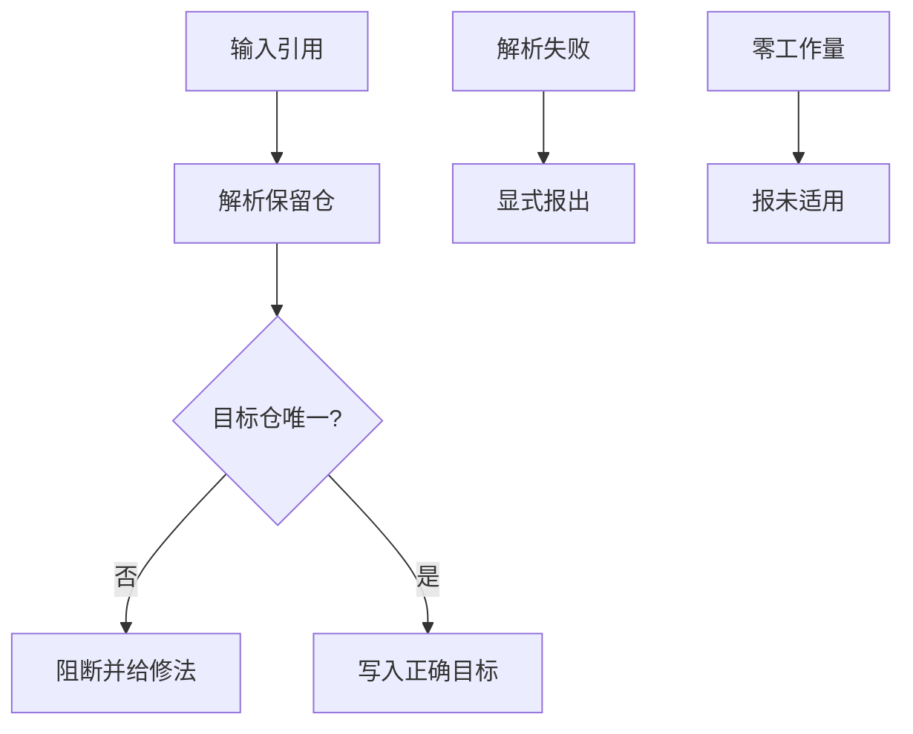

# 流程缺陷收口（Issue `#116`）

> 配对 Todo：[flow-defects Todo](../todo/261120-issue116-w25-flow-defects-todo.md)
>
> **基线**：`a0fe4df`。本切片认领总控 PRD `261120-w25-hardening-prd.md` 的 `C3`。

十二条边界缺陷里十一条在范围内（第十二条归 `#113`，见非目标），它们不是同一个字面现象，而是同一个病根的两面：**输出的结论与真实状态不一致**。七个是「沉默放过」——没做、没查到、不认识、解析失败，全部转成通过或空集；四个是「声称了没发生的事」——拒绝了却承诺能用、只做了第一步却在措辞上按完成态写、空跑也落盘、提示降级而正文不降。两面一起治，才不会出现「沉默的修好了，声称的还在说」。

## 一、目标、红线与非目标

<!-- section: goal -->
### 1.1 目标

1. **引用成为贯穿全链的一等对象**：一条单据引用在解析处不得坍缩成一个数字。今天解析只取编号、丢掉仓库，于是跨仓引用被当成同号本地单，带写操作时会把评论与标签写到错误的单上——而且完全看不出来。改为让「同一目标仓判定」成为写操作的前置条件。
2. **全部静默降级改为显式报出，并给修法**：不认识、没查到、没执行、超出上限、解析失败，一律在输出里明确写出，且写明下一步该做什么。今天这些情形大多转成「通过」「零问题」或空集。
3. **同一类入口只保留一套解析**：同一条命令的两条入口各写一套逻辑（一条接受位置参数、一条不接受），承诺与实现因此分叉。改为共用一个实现。
4. **报告口径如实**：审计与门禁在「什么都没查」时必须报「未适用」而不是「全部通过」。

### 1.2 非目标（Explicit Non-Goals）

<!-- section: non-goals -->
- **不改「未提及是否等于已解决」的账本语义**。本条与立项单 `#113` 是同一个病根、同一批函数（同一问题判定与轮次收口），已由该切片承担。本切片只在验收里加一条核对：若 `#113` 先合入，本片只跑夹具确认该语义生效，不重复实现；若本片先合入，`#113` 落地时复用本片收敛后的解析与报出形状。
- 不改装配脚本的「受管区间 vs 手写区」边界。手写的契约文件被拒绝改写是设计意图，不是缺陷；本片只修「拒绝时不给修法」与「写路径与校验路径对同一情况结论不同」这两点。
- 不改真幂等语义与写前快照语义。
- 不改停损机制本身，只修「三个输入通道静默丢弃」。
- 不改工作树清理的确认闸与依赖解绑顺序。
- 不新增任何「关掉检查」的开关；相反，本切片的目标是让检查无法被静默绕过。
- 不动 `docs/archive/`。
<!-- section: non-goals-end -->

### 1.3 十二条缺陷到判据的对应

| 判据 | 覆盖 | 一句话 |
| --- | --- | --- |
| `C1` | 跨仓引用坍缩、裸链接入口分叉 | 引用保留目标仓；写操作前置唯一目标仓判定；两条入口共用一套解析 |
| `C2` | 校验报错无修法、写路径与校验路径结论不同 | 拒绝必须带修法；同一情况两条路径同结论 |
| `C3` | 只放说明文档被判成纯文档项目 | 无源码且提交数极少的目录保留起步态，技术设计文档不被跳过 |
| `C4` | 反斜杠路径丢文件行号、三个输入通道静默丢弃/截断 | 路径归一后再解析；超出上限与解析失败都显式报出 |
| `C5` | 非 JSON 模式丢输入、空跑落盘、未装套件仍打印套件命令 | 无法识别的输入显式报出；零工作量不落盘；正文与提示同一降级 |
| `C6` | 审计对零文档报全部通过、门禁无参数报通过 | 「什么都没查」报未适用，退出码非零 |
<!-- section: goal-end -->

## 二、技术设计与接口契约

<!-- section: design -->

### 2.1 `C1` 引用是一等对象

- **影响文件**：`kit/skills/lib/github-parse.mjs`、`kit/skills/dev-flow/scripts/flow-intake.mjs`、`kit/skills/dev-flow/scripts/flow-inspect.mjs`。
- **现状**：编号解析函数返回纯数字数组；调用方拿到数字就去读本地同号单。实测：本地已有某号时，一个指向完全不同仓库的单据链接被判为可接受，依据读的是本地那一份；换成当地不存在的号才报待补。也就是说，**判定结果取决于本地恰好有没有那个号**，而不是取决于引用指向谁。
- **改法**：
  1. 解析函数增加一个返回完整引用的入口（目标仓 + 编号 + 原始串），保留旧入口但让它的实现建立在完整引用之上，不再各写一套匹配。
  2. 写操作（评论、标签、关单）前置一步「目标仓唯一性判定」：引用里带仓且与本地不同时，必须阻断并说明「这是跨仓引用，请在对应仓执行或先切换目标」。
  3. 分诊与状态查询共用同一个判定，不各写一份。
- **反例边界**：本地号与引用号相同但引用不带仓（裸号、`#N`、`issue#N`）时，仍按本地处理——那是明确指向本地的写法，不是跨仓。

### 2.2 `C2` 拒绝必须带修法，两条路径同结论

- **影响文件**：`scripts/equip.mjs`。
- **现状**：校验路径对「托管文件被改动」只打印「字节不一致」并退 1；写入路径对同一情况退 0 并把它记成一条待裁决冲突。于是「校验红了」与「写一遍就绿了」同时成立，而写完之后再校验仍然是红。
- **改法**：
  1. 报告格式化函数对每一类问题都给出一句可执行的修法（分歧在哪、三种合法处置各是什么）。
  2. 写入路径对「产生了待裁决冲突」不再退 0——它没有修复任何东西，只是记录了一份分歧。
  3. 两条路径的结论来自同一个判定：一个输入要么是「一致」，要么是「不一致且已登记待裁决」，不允许出现第三种。
- **为什么不是统一退 0**：把校验放松到与写入一致，等于让「字节不一致」这件事不再是问题。分歧是真实存在的，只能被处置，不能被宣布不存在。

### 2.3 `C3` 起步态与纯文档目录分开

- **影响文件**：`scripts/survey.mjs`。
- **现状**：只有「无源码文件 + 有文档 + 有说明文件」三条同时成立就判成纯文档项目，技术设计文档那一项于是以「纯文档目录无需」为由跳过。实测：一个只放了说明文件的新项目被这么判，起步当天就没有技术设计文档。
- **改法**：判据加入提交数——无源码、且提交数不超过极小阈值时，保留「起步态」而不是「纯文档项目」；技术设计文档的跳过判据改为读「起步态」这一条，不再直接吃项目类型。两项判据各自成立，不互相推导。
- **反例边界**：真的只有文档的仓库（提交历史长、长期无源码）仍必须能被判成纯文档项目，否则每次勘察都会要求它写技术设计文档。

### 2.4 `C4` 路径先归一再解析；上限与解析失败都显式

- **影响文件**：`kit/skills/dev-review/scripts/review-locks.mjs`（只读引用其解析逻辑，实际改动落在 `kit/skills/lib/github-parse.mjs` 之外的同目录工具若有需要）、`kit/skills/dev-iterate/scripts/iterate-cycle.mjs`、`kit/skills/dev-iterate/scripts/iterate.mjs`。
- **现状**：测试脚本里的文件路径正则只认正斜杠，反斜杠路径判出空文件与空行号；优化循环三个参数通道各有静默行为——缺摘要的门禁项被直接丢掉（单向门因此消失、停损失效）、进度历史解析失败返回空（零进展停损永不触发）、轮次上限被截断到硬上限但不告警。
- **改法**：路径在进入解析前统一归一到平台无关形式（复用既有路径归一工具）；三个通道的失败改为返回带原因的结果：被丢弃的项要报出、解析失败要报出、被截断要报出。三项都进报告，不静默。
- **反例边界**：不因为「报出」就把原本合法的输入判红。缺摘要的门禁项报出之后，仍按它本来的语义推进（只是不再静默消失）。

### 2.5 `C5` 输出通道与提示文本

- **影响文件**：`kit/skills/dev-flow/scripts/flow-inspect.mjs`、`kit/skills/dev-flow/scripts/flow-batch.mjs`、`kit/skills/dev-flow/scripts/flow-next.mjs`、`kit/skills/dev-flow/scripts/flow.mjs`。
- **契约细节**：
  - 非 JSON 模式不再静默丢弃无法识别的输入，在正文里列出并给出「这些输入没被使用」的说明。
  - 批量合并队列在零条目时不落盘：写一份空队列与写一份「本次无事可做」的记录是两件事，前者会被后续读取当成真实状态。
  - 未装套件的目录里，正文命令与降级提示用同一套判定：提示降级时正文也必须降级，不能一个说「用原生 Git」、另一个仍打印套件命令。
  - 帮助文本按任务组织，并把「哪些参数属于哪个子命令」写清（本条只做结构整理，与参数注册表的机械对拍归另一片）。

### 2.6 `C6` 「什么都没查」必须报未适用

- **影响文件**：`kit/skills/dev-plan/scripts/doc-audit-repo.mjs`、`scripts/dev/preflight-suite.mjs`（只读核对）、`kit/skills/dev-edit/scripts/edit-gate.mjs`。
- **现状**：审计命令对空目录输出「共零份：全部通过」并退 0；改码门禁无参数时检查的是一批未跟踪的规划文档，却输出通过——弱模型会把它读成「我的改动通过了」。
- **改法**：
  - 审计在目标集合为空时输出「未适用（范围内没有可审计的规划文档）」并给出非零退出码，同时区分「真的一份都没有」与「有但都不是受管文档」两种情形并分别说明。
  - 改码门禁在没有任何目标文件时输出「未适用」而不是通过，退出码沿用既有语义的「有事先处理但可继续」档，不得返回通过档。
- **为什么不能只加一句提示**：提示与结论分离时，读的人只看结论。结论本身必须是「未适用」。

### 2.7 行数与拆分

- 本片所有改动都在既有文件内替换判据与报出方式，不新增职责。逐文件核对 `.mjs <= 800`，尤其 `kit/skills/dev-flow/scripts/flow-inspect.mjs`（现约 695 行）与 `scripts/equip.mjs`（现约 763 行）：任何一片超出上限，就把报出与格式化部分下沉到同目录辅助模块。
- 新增夹具独立成文件，遵守 `scripts/dev/fixtures-*.mjs` 单文件单域约定。
<!-- section: design-end -->

## 三、门型评估与验收标准

<!-- section: gates -->
- **门型**：`one-way`。原因不是代码量：跨仓引用的处置与「未适用」的退出码会改变「什么叫通过」，历史上依赖「空集即通过」的调用方必须按新口径重算。
- **风险等级**：`medium`。命中 `kit/` 与 `scripts/` 两条高风险路径，但改动都是判据替换与报出方式，不触及标记语法、模板求值、报告排版。
- **故障注入**：把「目标仓唯一性判定」改成恒真，跨仓用例必须变红；把「未适用」改回通过档，对应用例必须变红；把三个通道的报出改成不报，对应用例必须变红。
- **验证命令**：
  - `node scripts/dev/fixtures.mjs --domain flow-defects`
  - `node scripts/dev/preflight.mjs`
  - `node .agents/skills/dev-plan/scripts/doc-plan.mjs audit docs`（对零目标范围应非零退出）
<!-- section: gates-end -->

<!-- section: acceptance -->
### 验收标准（正例 / 反例双向可判定）

<!-- criteria:start -->
- [ ] C1: 本地已存在同号单据、引用指向另一个仓库时，分诊结论必须标为跨仓并在 `--apply` 前阻断；引用为裸号或 `#N` 时仍按本地处理；`inspect` 与 `intake` 两个入口对同一引用给出同一判定。反例：只让分诊打印一条警告但允许 `--apply` 继续——写操作仍会落到错误的单上。
- [ ] C2: 校验路径对每个问题都输出至少一句可执行修法；写入路径在产生待裁决冲突时返回非零；同一输入在两条路径上的结论一致（要么一致，要么不一致且已登记）。反例：把写入路径改成退 0 且把校验也放宽到退 0——分歧被宣布不存在，而文件仍然不一致。
- [ ] C3: 无源码、有说明文件、提交数极少的目录被判为起步态，技术设计文档一项不被跳过；无源码且提交历史长的目录仍被判为纯文档项目，技术设计文档一项仍以纯文档为由跳过。反例：把纯文档判定整个删掉，于是长期文档仓库每次勘察都被要求写技术设计文档。
- [ ] C4: 反斜杠路径与正斜杠路径解析出相同的文件与行号；缺摘要的门禁项被报出且仍按其语义推进；进度历史解析失败被报出且不返回空进度；轮次上限被截断时输出告警与实际上限值。反例：只补路径归一，三个通道照旧静默——另三条断言会红。
- [ ] C5: 非 JSON 模式列出未被使用的输入；批量队列零条目时不产生落盘文件；未装套件目录里正文命令与降级提示同时降级，搜不到套件命令字样。反例：只改提示不改正文，于是同一条输出里两种口径并存。
- [ ] C6: 对空目录审计输出「未适用」且退出码非零；对「有文档但不是受管文档」的目录也输出未适用并说明区别；改码门禁无目标文件时输出「未适用」且不返回通过档。反例：只把提示文案换成未适用而退出码仍是 0——脚本调用方照样把它当通过。
- [ ] C7: 与立项单 `#113` 的关系已核对——同一问题判定与轮次收口那两处，本片全仓零改动；若该单已合入，相关夹具全绿即算本项完成；若未合入，本片输出中不含对该语义的第二份实现。反例：两片各写一套「同一问题」的判据，于是同一个阻塞项在两条链路上有两个结论。
<!-- criteria:end -->
<!-- section: acceptance-end -->

## 四、可复用基础设施与备选方案

<!-- section: reuse -->
- `kit/skills/lib/github-parse.mjs` 已有完整引用的解析形态（含目标仓的入口），本片把它提升为唯一基础，旧入口改为薄包装。
- `kit/skills/lib/git-core.mjs` 的路径归一工具（正反斜杠统一）已是全仓单点，本片直接复用，不自写正则。
- 退出码档位语义由 `#113` 同批落地的单点模块提供；「未适用」走「前提事实不成立」中间档，不新造档位。该模块尚未落地时，本片按现有常量表达同一语义，并在待拍板里注明兼容，不预先创建它。
- `scripts/dev/fixtures.mjs` 自动发现功能域，新增夹具无需登记。
<!-- section: reuse-end -->

<!-- section: alternatives -->
- **方案一（否决）：在分诊处加一句「跨仓请自行注意」的提示。** 提示不改变行为，写操作照样落到错误的单上。收集到的事实必须参与判定，不能只进日志。
- **方案二（否决）：禁止一切跨仓引用。** 跨仓引用是正常需求（协作、迁移、上游依赖）。要治的是「静默解析成本地」，不是「跨仓」本身。
- **方案三（否决）：把「未适用」折成「通过但加一句说明」。** 结论与说明分离时，读的人只看结论；调用方也只看退出码。
- **方案四（采纳）：引用保留目标仓 + 写操作前置唯一目标仓判定 + 全部降级显式报出 + 未适用独立成档。** 每一处都让「不知道」不再等同于「好」，且不新增自由度。
<!-- section: alternatives-end -->

## 五、待拍板问题

<!-- section: pending -->
- 已定：引用在解析处保留目标仓；写操作前置唯一目标仓判定，跨仓必须阻断并给出下一步；裸号仍按本地处理。
- 已定：分诊与状态查询共用同一份引用判定，不各写一份。
- 已定：校验路径必须给修法；写入路径在产生待裁决冲突时返回非零；两条路径结论同源。
- 已定：起步态与纯文档项目各自独立判据——无源码且提交数极少为起步态，提交历史长的无源码目录仍是纯文档项目。
- 已定：路径在解析前统一归一；三个输入通道的丢弃、失败与截断全部显式报出，但报出不改变原有语义。
- 已定：批量队列零条目不落盘；未装套件时正文与提示同一降级；非 JSON 模式列出未使用输入。
- 已定：审计与改码门禁在零目标时输出「未适用」并返回非零，「未适用」不得折成通过。
- 已定：与立项单 `#113` 的同一问题判定与轮次收口不重复实现，只加核对项；两片谁先合入都不改对方写的判定。
- 已定：本切片无前置，可与性能门禁、治理真相、并行度三片同时开工；写域已按文件划清，`flow-batch.mjs` 与 `flow-next.mjs` 归本片，`workflow-policy.mjs` 与 `workflow-helpers.mjs` 不归本片。
<!-- section: pending-end -->
