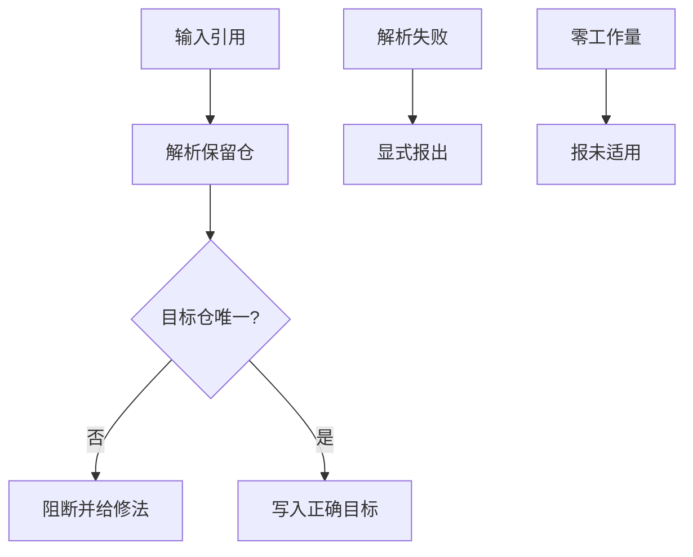

# 流程缺陷收口（Issue `#116`）

> 配对 Todo：[flow-defects Todo](../todo/261120-issue116-w25-flow-defects-todo.md)
>
> **基线**：`a0fe4df`。本切片认领总控 PRD `261120-w25-hardening-prd.md` 的 `C3`。

十三条边界缺陷（`#116`）与 Wave 2 五处遗留缺陷同源：**输出的结论与真实状态不一致**——没做、没查到、不认识或跨仓被静默折成通过或空集，或失败被吞掉。本切片逐处把「沉默放过」改为如实报出并给修法，且补齐 Wave 2 实证/生命周期/切片图五处缺陷。

## 一、目标、红线与非目标

<!-- section: goal -->
### 1.1 目标

1. **引用成为贯穿全链的一等对象**：一条单据引用在解析处不得坍缩成一个数字。今天解析只取编号、丢掉仓库，于是跨仓引用被当成同号本地单，带写操作时会把评论与标签写到错误的单上——而且完全看不出来。改为让「同一目标仓判定」成为写操作的前置条件。
2. **全部静默降级改为显式报出，并给修法**：不认识、没查到、没执行、超出上限、解析失败，一律在输出里明确写出，且写明下一步该做什么。今天这些情形大多转成「通过」「零问题」或空集。
3. **同一类入口只保留一套解析**：同一条命令的两条入口各写一套逻辑（一条接受位置参数、一条不接受），承诺与实现因此分叉。改为共用一个实现。
4. **报告口径如实**：审计与门禁在「什么都没查」时必须报「未适用」而不是「全部通过」。

### 1.2 非目标（Explicit Non-Goals）

<!-- section: non-goals -->
- 不改装配脚本的「受管区间 vs 手写区」边界。手写的契约文件被拒绝改写是设计意图，不是缺陷；本片只修「拒绝时不给修法」与「写路径与校验路径对同一情况结论不同」这两点。
- 不改真幂等语义与写前快照语义。
- 不改停损机制本身，只修「三个输入通道静默丢弃」与 `review-locks.mjs` / `review-ledger.mjs` 的定位点同一性与未提及三态收口。
- 不改工作树清理的确认闸与依赖解绑顺序。
- 不新增任何「关掉检查」的开关；相反，本切片的目标是让检查无法被静默绕过。
- 不触及 `kit/skills/dev-edit/scripts/edit-gate.mjs`（本片不改改码门禁无目标退出码），也不重做 `flow.mjs --help` 按任务重组。
- 不动 `docs/archive/`。
<!-- section: non-goals-end -->

### 1.3 缺陷到判据的对应

| 判据 | 覆盖 | 一句话 |
| --- | --- | --- |
| `C1` | 跨仓引用坍缩、裸链接入口分叉 | 引用保留目标仓；写操作前置唯一目标仓判定；两条入口共用 `parseFlowInputs` |
| `C2` | 校验报错无修法、写路径与校验路径结论不同 | 拒绝必须带修法；同一情况两条路径同结论（`merge3.mjs` 六值枚举） |
| `C3` | 纯文档误判、零提交勘察/起步缺失 | `isDocsOnlyByDocuments` 看文档数、零提交报「尚未首次提交」、空仓落首次提交与 `none` 配置 |
| `C4` | 反斜杠路径丢定位点、轮次收口失真、三通道静默 | 路径归一并解析中文行号；定位点交集 + 三态收口；三通道进告警不改语义 |
| `C5` | 非 JSON 丢输入、空跑落盘、降级不一致、回告吞失败 | 未知输入报出；零工作量不落盘；正文与提示同降级；`judgeCommentOutcome` 读返回值 |
| `C6` | 审计对零文档报全部通过 | `doc-audit-repo.mjs` 零目标报「未适用」并由 `doc-plan.mjs` 退非零 |
| `C8` | Wave 2（PR #111 / #112）5 处实证/生命周期/切片图缺陷 | 取消未定义变量崩溃、透传实证与陈旧清理、单源切片图审计 |
<!-- section: goal-end -->

## 二、技术设计与接口契约

<!-- section: design -->

### 2.1 `C1` 引用是一等对象

- **影响文件**：`kit/skills/lib/github-parse.mjs`、`kit/skills/dev-flow/scripts/flow-intake.mjs`。
- **现状**：编号解析返回纯数字数组，跨仓引用被当成同号本地单；`flow-intake.mjs` 不接位置参数且各写解析。
- **改法**：`parseFlowInputs` 保留 `{ repo, number, raw }`；`judgeCrossRepoReference` 做三态判定（同仓本地、异仓阻断、本仓不可判定只报出不阻断）；分诊与 `inspect` 共用 `parseFlowInputs`。
- **反例边界**：裸号、`#N`、`issue#N` 不带仓时按本地处理。

### 2.2 `C2` 拒绝必须带修法，两条路径同结论

- **影响文件**：`scripts/equip.mjs`、`scripts/lib/merge3.mjs`。
- **改法**：`merge3.mjs` 定义逐文件六值封闭枚举；`equip.mjs` 校验与写入两条路径共读该判定，非同步非豁免定制均退 `3`，拒绝输出三种合法处置（手工合并+`--adopt-custom`、`--restore`、pendingConflicts 留痕）。

### 2.3 `C3` 纯文档判据、零提交勘察与空仓首次提交

- **影响文件**：`scripts/survey.mjs`、`scripts/lib/equip-bootstrap.mjs`、`scripts/lib/agents-defaults.mjs`。
- **改法**：放弃提交数阈值，`survey.mjs` 按 `isDocsOnlyByDocuments`（「文档不止一份说明文件」）判纯文档，零提交仓显式报「尚未首次提交」；`equip-bootstrap.mjs` 的 `createFirstCommit` 在 `--bootstrap-empty` 落首次提交；`agents-defaults.mjs` 对 `unknown` 且 0 代码文件将 Dev Profile 收口为 `none`。

### 2.4 `C4` 定位点同一性、轮次三态收口与三通道显式告警

- **影响文件**：`kit/skills/dev-review/scripts/review-locks.mjs`、`kit/skills/dev-review/scripts/review-ledger.mjs`、`kit/skills/dev-iterate/scripts/iterate-cycle.mjs`。
- **改法**：`review-locks.mjs` 先归一正反斜杠与盘符，支持 `path:line`、`第 N 行`、`第 N-M 行`、`N 行` 并以 `sameBlockerItem`（判据编号只排除不认定，行区间相交才同项）去重；`review-ledger.mjs` 落三态收口（`resolved`/`remaining`/`unmentionedFromPrev`，整轮 `pass` 不批量置已解决）；`iterate-cycle.mjs` 将丢弃、解析失败与截断进 `warnings` 并保持原语义。

### 2.5 `C5` 输出降级、零工作量与合并回告真实性

- **影响文件**：`kit/skills/dev-flow/scripts/flow.mjs`、`flow-batch.mjs`、`flow-merge.mjs`、`kit/skills/lib/cli.mjs`、`kit/skills/lib/session-orient.mjs`。
- **改法**：`flow.mjs` 非 JSON 正文列出 `inputs.unknown`；`flow-batch.mjs` `merge-queue` 零工作量不落盘；`cli.mjs`（`degradeSkillCommands`）与 `session-orient.mjs`（`degradeOrientationLines`）在未装套件时同步降级正文命令；`flow-merge.mjs` 的 `judgeCommentOutcome` 以 `ok === true` 判回告是否发出，未发出（含后端 `delegated`）在报告列出并给补发命令。

### 2.6 `C6` 「什么都没查」必须报未适用

- **影响文件**：`kit/skills/dev-plan/scripts/doc-audit-repo.mjs`、`kit/skills/dev-plan/scripts/doc-plan.mjs`。
- **改法**：`doc-audit-repo.mjs` 区分 `none`（无文档）与 `unmanaged`（有非受管文档），返回 `applicable: false` 并由 `doc-plan.mjs` 返回非零退出码。

### 2.7 行数与拆分

- 本片所有改动都在既有文件内替换判据与报出方式，不新增职责。逐文件核对 `.mjs <= 800`，尤其 `kit/skills/dev-flow/scripts/flow-lifecycle.mjs`（现 787 行）与 `scripts/equip.mjs`（现 781 行）：任何一片超出上限，就把报出与格式化部分下沉到同目录辅助模块。
- 新增夹具独立成文件，遵守 `scripts/dev/fixtures-*.mjs` 单文件单域约定。

### 2.8 `C8` Wave 2（PR #111 / #112）5 处遗留缺陷收口

- `kit/skills/dev-review/scripts/review-empirical.mjs` & `review-pack.mjs`：`evaluateIncludeDiffGate` 改用 `workspaceFingerprint` 并恒返回结构化对象（禁直接 `return emitGateBlock` 返回数字 `3`）；拦截前先核查 `evidence.json`（`evaluateStoredVisualEvidence`）与 `receipt` 存量实证。
- `kit/skills/dev-flow/scripts/flow-lifecycle.mjs`：`isExplicitNone` 路径向 `recordVerifyEvidenceForFlow` 透传 `artifacts`/`visualCheckedRaw`/`visualBlockedReason` 并严格执行阻断返回值；`hasVisualCheckFlag` 补入 `opts.artifact` 与 `opts['visual-blocked-reason']`；precheck 阻断 JSON 输出真实 `reason`/`errors`。
- `kit/skills/dev-flow/scripts/flow-lifecycle-helpers.mjs` & `kit/skills/lib/empirical-artifacts.mjs`：`record: false` 路径同样绑定 `visual.headSha`，使 `BLOCKED_VISUAL_EVIDENCE_STALE` 生效；`carriedArtifacts` 调 `mergeArtifactRecords` 并按 `sameClean` 过滤跨 HEAD 陈旧附件。
- `kit/skills/dev-plan/scripts/doc-audit-repo.mjs`、`doc-audit.mjs` & `kit/skills/lib/doc-slice-graph.mjs`：移除重复调用旧 `checkMasterPrdCoverage`（单源依赖 `evaluateSliceGraph`）；`checkSliceMetadata` 仅检查 `!s.done && !s.archived && s.kind === 'spec'`。
<!-- section: design-end -->

## 三、门型评估与验收标准

<!-- section: gates -->
- **门型**：`one-way`。原因不是代码量：跨仓引用的处置与「未适用」的退出码会改变「什么叫通过」，历史上依赖「空集即通过」的调用方必须按新口径重算。
- **风险等级**：`medium`。命中 `kit/` 与 `scripts/` 两条高风险路径，但改动都是判据替换与报出方式，不触及标记语法、模板求值、报告排版。
- **故障注入**：对齐 `scripts/dev/injections-data-flow-defects.mjs`（`I310–I316`：跨仓判定、未识别输入、定位点交集、三态收口、零工作量写盘、正文降级、`judgeCommentOutcome`）与 `scripts/dev/injections-data-gates.mjs`（`I131` `evaluateIncludeDiffGate` 拦截）。
- **验证命令**：
  - `node scripts/dev/fixtures.mjs --domain flow-defects`
  - `node scripts/dev/preflight.mjs`
  - `node scripts/dev/verify-injections.mjs --jobs 4`
  - `node .agents/skills/dev-plan/scripts/doc-plan.mjs audit docs/specs/261120-issue116-w25-flow-defects-spec.md --json`
<!-- section: gates-end -->

<!-- section: acceptance -->
### 验收标准（正例 / 反例双向可判定）

<!-- criteria:start -->
- [ ] C1: 本地已存在同号单据、引用指向另一个仓库时，`judgeCrossRepoReference` 判为跨仓并在写操作前阻断；引用为裸号或 `#N` 时按本地处理；`inspect` 与 `intake` 共用 `parseFlowInputs`。反例：只打告警仍继续写入。
- [ ] C2: 校验与写入共用 `merge3.mjs` 六值枚举，拒绝输出三种合法处置且两条路径对非同步非豁免均退 `3`。反例：写入路径对冲突退 `0`。
- [ ] C3: 单一说明文件仓由 `isDocsOnlyByDocuments` 判保留 `docs/TDD.md`、多文档才判纯文档；零提交报「尚未首次提交」；`--bootstrap-empty` 落首次提交；`unknown`+0 代码收口 Dev Profile 为 `none`。反例：仍用提交数阈值或跳过 `TDD`。
- [ ] C4: `review-locks.mjs` 归一正反斜杠并识别中文行号，定位点相交才同项；`review-ledger.mjs` 保留 `unmentionedFromPrev`；`iterate-cycle.mjs` 三通道进 `warnings`。反例：跨行合并或 `pass` 批量置已解决。
- [ ] C5: 非 JSON 列出 `inputs.unknown`；`merge-queue` 零工作量不落盘；未装套件时 `cli.mjs` 与 `session-orient.mjs` 同步降级正文；`flow-merge.mjs` `judgeCommentOutcome` 对 `ok !== true`（含 `delegated`）报未发出与补发命令。反例：裸 `await` 吞掉失败。
- [ ] C6: 对空目录或非受管文档目录审计输出「未适用」且退出码非零，有受管文档全通过仍退 `0`。反例：空目录退 `0`。
- [ ] C7: 与立项单 `#113` 的交集文件保留双方完整逻辑，`fixtures-docs.mjs` 与 `fixtures-flow-truth.mjs` 全绿。反例：用旧版简单覆盖 `#113` 逻辑。
- [ ] C8: `UI_VISUAL_EXT_RE` diff 下 `review-pack` 未核验按合约阻断不抛 `ReferenceError`、已核验（含仅落盘 `evidence.json`/`receipt`）则放行；`flow verify` `explicit-none` 阻断裸 `--visual-checked` 且透传 `--artifact`/`--visual-blocked-reason` 绑定 `visual.headSha` 与 `visualVerifiedHead`、跨 HEAD 不携带旧附件；`auditRepoDocs` 不重复报 `UNCOVERED_ACCEPTANCE_CRITERIA` 且 `checkSliceMetadata` 不误伤 `todo`/已完成/已归档切片。反例：跨 HEAD 仍带旧附件或重复报两条缺失判据。
<!-- criteria:end -->
<!-- section: acceptance-end -->

## 四、可复用基础设施与备选方案

<!-- section: reuse -->
- `kit/skills/lib/github-parse.mjs` 已有完整引用的解析形态（含目标仓的入口），本片把它提升为唯一基础，旧入口改为薄包装。
- `kit/skills/lib/git-core.mjs` 的路径归一工具（正反斜杠统一）已是全仓单点，本片直接复用，不自写正则。
- 退出码档位语义由 `#113` 同批落地的单点模块提供；「未适用」走 `EXIT.FACT` 中间档，不新造档位。
- `scripts/dev/fixtures.mjs` 自动发现功能域，新增夹具无需登记。
<!-- section: reuse-end -->

<!-- section: alternatives -->
- **方案一（否决）：在分诊处加一句「跨仓请自行注意」的提示。** 提示不改变行为，写操作照样落到错误的单上。收集到的事实必须参与判定，不能只进日志。
- **方案二（否决）：禁止一切跨仓引用。** 跨仓引用是正常需求（协作、迁移、上游依赖）。要治的是「静默解析成本地」，不是「跨仓」本身。
- **方案三（否决）：把「未适用」折成「通过但加一句说明」。** 结论与说明分离时，读的人只看结论；调用方也只看退出码。
- **方案四（采纳）：引用保留目标仓 + 写操作前置唯一目标仓判定 + 全部降级显式报出 + 未适用独立成档。** 每一处都让「不知道」不再等同于「好」，且不新增自由度。
<!-- section: alternatives-end -->

## 五、待拍板问题

<!-- section: pending -->
- 已定：引用保留目标仓并三态判定；`inspect` 与 `intake` 共用 `parseFlowInputs`。
- 已定：`equip.mjs` 两条路径共读 `merge3.mjs` 六值枚举并给三种处置。
- 已定：`survey.mjs` 按 `isDocsOnlyByDocuments` 判纯文档；`createFirstCommit` 落首次提交；`agents-defaults.mjs` 收口为 `none`。
- 已定：`review-locks.mjs` 定位点交集 + `review-ledger.mjs` 三态收口；`iterate-cycle.mjs` 三通道进 `warnings`。
- 已定：零工作量不落盘；`cli.mjs` 与 `session-orient.mjs` 同降级；`judgeCommentOutcome` 读返回值；`doc-audit-repo.mjs` 零目标报未适用；Wave 2 五处缺陷同分支修复并配正反夹具。
<!-- section: pending-end -->
