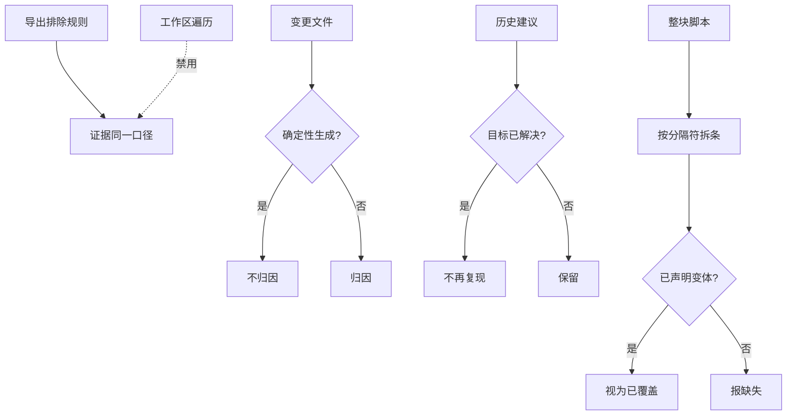

# 治理真相与规则纠偏（Issue `#118`）

> 配对 Todo：[govern-truth Todo](../todo/261120-issue118-w25-govern-truth-todo.md)
>
> **基线**：`a0fe4df`。本切片认领总控 PRD `261120-w25-hardening-prd.md` 的 `C5`。无前置，可立即开工。

本切片处理三类事：治理脚本输出的「事实」与真实不符、一条**本身就错的规则**、以及把文档漂移整理成一份可执行的移交清单。第二类要特别说明：改文档去迁就错误规则，是把文档变成错误的帮凶；规则错了就改规则。

## 一、目标、红线与非目标

<!-- section: goal -->
### 1.1 目标

1. **发版证据与导出包同源**：脚本声称清点「当前导出包」，实际遍历工作区文件系统再用一张只列了四个目录前缀的排除名单过滤。同一基线两次测量：一次 **259 vs 206**（多 53 条），另一次 **248 vs 206**（多 42 条）——差额全部来自任务账本状态目录与临时目录，且**数字会随工作区内容漂移**。这正是它不能靠遍历工作区来算的证据：同一个提交，两分钟之内给出两个不同的「包内有多少文件」。改为与导出包同源，不再允许「什么算包内」有两套算法。
2. **生成物不进归因**：信号归属被每次装备都会重新生成的清单文件污染。实测 228 条信号里 130 条归属到该文件，根因是归属取值取「变更文件排序后的第一个」。改为只在有真实手写内容时归因。
3. **复盘建议带失效判据**：复盘仍在建议拆一个早已拆完的文件，依据是几天前的四条信号，且没有「已解决」的判据。改为：目标已不存在或已达标时，该建议不再复现。
4. **陈旧命令检查能表达「有意的本地变体」**：这是本切片要治的**规则缺陷**。检查拿整块流水线脚本做逐字比对，对「流水线是唯一命令来源」的仓库必然误报；而只做「按分隔符拆条」还不够——拆开之后，「远端带并发参数、本地故意不带」这类有意差异仍会被判成缺失。规则必须能表达「这条命令的本地变体是有意的」，否则下一次还得改文档迁就它。
5. **处置指令与实际状态一致**：对已反注册的空目录给出「先解绑再跑工作树移除」，而实际跑会报「不是一个工作树」——它根本不在注册表里。改为区分「已注册工作树」与「未注册孤儿目录」，后者直接给删除目录的指引。
6. **临时目录污染工作区要看得见**：临时目录被留在仓内，检查曾把它当变更文件收进清单。改为工作区出现未被跟踪且未被忽略的临时内容即告警，只告警不阻断。

### 1.2 非目标（Explicit Non-Goals）

<!-- section: non-goals -->
- **不修文档漂移**（技术设计文档与契约文档的那些行）。已定移交下一波的文档重写切片统一处理，本切片只交出一份可执行的移交清单（见 2.7）。理由有二：那些修正逐行依赖一份即将被整体重写的文档，改完就被覆盖；且该切片已独占这两个文件的写域，两片同时改必然冲突。**这是一次有意的范围让渡，不是遗漏**——清单逐条带原文、应为、证据三要素，接收方按单执行即可。
- **不改交接校验的退出码四态**。那四态是设计内语义，其中一条在「不适用」时返回特定非零码是有意的。
- **不改治理巡检的严格开关语义**。严格开关只报不拦是设计意图。
- **不改契约文件的字节预算**。
- **不合并十份参考文档**。
- **不改本地与远端「注入校验是否带并发」这条有意差异本身**——本切片做的是让规则能表达它，不是消灭它。
- **不碰 `docs/archive/`**。
- 不加「跳过陈旧命令检查」的开关；规则缺陷用规则修。
<!-- section: non-goals-end -->

### 1.3 六件事到判据的对应

| 判据 | 覆盖 | 一句话 |
| --- | --- | --- |
| `C1` | 发版证据 259 vs 206 | 与导出包同源，条目数相等 |
| `C2` | 信号归属污染 | 生成物与临时目录零归因 |
| `C3` | 复盘建议过期 | 目标不存在或已达标即不复现 |
| `C4` | 陈旧命令规则 | 拆条 + 可声明本地变体，本仓零误报 |
| `C5` | 处置指令错 | 已注册与未注册分开给指引 |
| `C6` | 临时目录污染 | 未被跟踪且未被忽略即告警 |
| `C7` | 文档漂移移交 | 清单三要素齐备，逐条可执行 |
<!-- section: goal-end -->

## 二、技术设计与接口契约

<!-- section: design -->

### 2.1 `C1` 发版证据与导出包同源

- **影响文件**：`scripts/dev/evidence.mjs`、`scripts/lib/protocol.mjs`。
- **现状**：脚本遍历工作区（只跳过版本库目录与依赖目录），再用排除前缀过滤。排除名单只列了四个目录前缀与六个顶层文件，而工作区里还有任务账本状态目录与临时目录。同一基线两次测量得 **259 vs 206** 与 **248 vs 206**——差额随工作区内容变化，而导出包对这同一个提交是固定的 206。这个不稳定性本身就是判据：遍历工作区的东西，回答不了「包里有什么」。
- **改法**：条目清单不再由脚本自己算，改为**读同一份排除规则并作用于已跟踪文件清单**。这样「什么算包内」只有一个答案，且排除规则已由既有检查与版本库属性文件对拍守住，不需要第二份前缀清单。
- **反例边界**：导出包不含未跟踪文件。若工作区有一个未提交的新文件，证据不该列出它——它本来就不会进包。这是「同源」的自然结果，不是缺陷。
- **同时要修的第二处**：该脚本目前是孤儿——没有任何门禁、流水线或文档命令调用它。修好之后必须接进一处会被实际执行到的链路，否则下一个人仍然不会跑它，口径对不对也没人知道。

### 2.2 `C2` 生成物不进归因

- **影响文件**：`kit/skills/dev-flow/scripts/flow-lifecycle.mjs`、`kit/skills/dev-flow/scripts/flow-context.mjs`、`kit/skills/dev-govern/scripts/govern-checks.mjs`。
- **现状**：归属取值是「显式传入 ?? 变更文件排序后的第一个 ?? 空」。生成物路径排序后永远第一（以 `.` 开头），于是它成了几乎全部信号的归属。实测 228 条里 130 条指向它；复盘因此把它列为热点并建议给它增补夹具，而它根本没有手写内容。
- **改法**：
  1. 取归属前先过滤掉确定性派生清单与临时目录下的文件（该模块已有派生清单常量，直接复用，不新写一份路径清单）。
  2. 过滤后为空时不归因，记为「无单一归属文件」而不是硬塞第一个。空归因是诚实的；硬塞一个是编造。
  3. 复盘的热点统计只统计有归属的信号。
- **为什么不是按文件名黑名单**：黑名单会漏。判据是「这个路径是不是由脚本确定性生成的」，这件事已有单一清单，复用它是唯一不会漏的做法。

### 2.3 `C3` 复盘建议带失效判据

- **影响文件**：`kit/skills/dev-govern/scripts/govern-retro.mjs`。
- **现状**：复盘基于信号历史生成建议，但从不检查「建议要做的事是不是已经做完了」。实测仍在建议拆一个已在基线上拆完的文件。
- **改法**：每条建议生成前先跑一次失效判定——若建议的目标（文件 / 阈值 / 结构）已经变成建议想要的样子，就跳过并记一条「已达标」；若目标已不存在（文件已删），也跳过并记「目标不存在」。两种跳过都进报告，让人看到「这条建议为什么不在」。
- **反例边界**：失效判定不能只按「文件里还有没有那个文件名」判——文件名可能在别处出现。判定要落在建议声明的可观测条件上（行数是否已低于阈值、单文件是否已拆成多个）。

### 2.4 `C4` 陈旧命令规则：拆条 + 可声明本地变体

- **影响文件**：`scripts/lib/review-helpers.mjs`、`scripts/lib/survey-ecosystem.mjs`。
- **现状**：命令探测把一整块流水线执行脚本拼成**一条**「测试命令」，比对时做整串逐字包含。任何文档都不该原样包含整块 CI 脚本，于是对「流水线是唯一命令来源」的仓库**必然误报**。
- **两层改法，缺一不可**：
  1. **拆条**：比对前先按分隔符（`&&`、换行、`;`）把命令拆成单条，逐条比对；单条都命中才算提到。数据源侧同步按单条输出，两处一致。
  2. **可声明本地变体**：拆条之后，「远端带并发参数、本地故意不带」这类有意差异仍会被判成缺失。契约必须能声明「这条远端命令的本地等价形式是什么」，声明之后按本地形式比对。声明写在契约文件里，与命令清单相邻，且每条声明要带一句为什么不同——**这条差异是设计，不是遗漏，规则不该逼人消灭它**。
- **为什么改规则不改文档**：让文档抄一份流水线脚本，等于把同一份内容维护两遍——那正是「同一真相写多处」的另一种形态。规则应该问的是「这条命令有没有被覆盖到」，不是「整块脚本有没有被一字不差地抄下来」。
- **反例边界**：拆条与变体声明之后仍要能抓真缺失。若某条真实存在的命令既没被原文提到、也没有声明本地变体，检查必须仍报出来。
- **不做的事**：不给这条检查加豁免开关，也不把它降级为提示。规则修对了，它就该继续是门禁。

### 2.5 `C5` 处置指令与实际状态一致

- **影响文件**：`kit/skills/dev-govern/scripts/govern-checks.mjs`。
- **现状**：对工作树残留给出一条统一指令，而实际有三类：已注册且活着、已注册但目录已删、目录还在但已反注册。第三类跑那条指令会直接报错。
- **改法**：先判状态再给指令。已反注册的孤儿目录给「直接删除该目录」；已注册的给既有的解绑与移除流程；目录不存在的给「清理注册记录」。

### 2.6 `C6` 临时目录污染工作区

- **影响文件**：`scripts/lib/survey-workspace.mjs`、`scripts/dev/preflight-suite.mjs`。
- **现状**：临时目录被留在仓内，状态查询出现未跟踪项，改码检查还曾把它当变更文件收进清单。
- **改法**：预检加一条机械检查——工作区出现未被跟踪且未被忽略的临时内容即告警，只告警不阻断。**不用忽略规则让它隐形**：让它隐形只是把痕迹藏起来，下一次仍然会发生。
- **反例边界**：只对「含可执行脚本或源文件」的未跟踪目录告警，不对任意未跟踪目录告警——否则一个新拉下来的空构建目录也会告警，人就会开始忽略这条提示。

### 2.7 `C7` 文档漂移移交清单

- **影响文件**：无（清单写在本节）。
- **要交出什么**：一份逐条可执行的清单，每条三要素——**原文引文**（哪个文件哪一行、现在写的是什么）、**应为**（改成什么）、**证据**（为什么现在那条是错的，附实测或零命中计数）。接收方是不重写的那个切片；它按单执行即完成，不需要重新勘察。

  | 编号 | 位置 | 现状 | 应为 | 证据 |
  | --- | --- | --- | --- | --- |
  | 漂移一 | 技术设计文档的勘察快速探测那一行 | 列了六个导出名 | 换成实际的十一个导出名 | 那六个在全仓定义与调用均为零 |
  | 漂移二 | 技术设计文档的评论渲染那一行 | 把两个模块的导出合成一行 | 拆成两行，各自列自己的导出 | 五个实际在前一个模块，第二个模块只有两个 |
  | 漂移三 | 技术设计文档的夹具枚举 | 手工列了十六个夹具 | 改为「按 `fixtures-*.mjs` 自动发现」，数量由脚本报 | 实际有四十六个 |
  | 漂移四 | 技术设计文档功能表 vs 功能地图 | 表多两个脚本、地图多一个技能 | 两侧对齐到同一份事实 | 逐项差集实测 |
  | 漂移五 | 技术设计文档的模块表 | 导航模块零登记 | 补一行，说明它是勘察报告下一步计算的唯一实现 | 被勘察入口与报告排版两处依赖 |
  | 漂移六 | 契约文档的引擎行 | 列了八个脚本 | 补两个（打包与装备校验） | 实际有十个脚本文件 |
  | 漂移七 | 技术设计文档的更新日期 | 写的是前一天 | 改为最后一次实际改动日期 | 版本库记录 |
  | 漂移八 | 技术设计文档的一处数量阈值 | 断言「不少于十个」 | 与导出数量同源，或去掉具体数字 | 实际有十三个 |
  | 漂移九 | 契约文档与流水线执行步骤 | 缺四条命令（两条整条、两条带并发与临时路径的变体） | 补齐，并注明本地与远端那条有意差异 | 逐条比对流水线与契约 |

- **为什么写在这里而不是直接改**：那些行所在的文档正被另一个切片整体重写；本切片改完就会被覆盖，且两片写域冲突。清单交给它，一次改到位。
- **怎么保证不丢**：清单在本节，随本切片的规划文档一起归档；接收方的规划文档验收时以本表为对照组。本切片的验收只判「清单三要素齐备且每条与实测一致」，不判「文档已改」。

### 2.8 行数与拆分

- `scripts/dev/evidence.mjs` 会变短（不再自己走文件系统）。`scripts/lib/review-helpers.mjs` 会变长（拆条与变体比对），逐文件核对 `.mjs <= 800`；接近上限时把命令切条与变体解析下沉到同目录辅助模块（命令词法模块已有切段能力，优先复用它）。
<!-- section: design-end -->

## 三、门型评估与验收标准

<!-- section: gates -->
- **门型**：`one-way`。发版证据的口径、信号归属的口径、复盘建议的失效判据都会改变「已经发出去的版本里有什么」与「历史上哪些信号算数」的结论。回滚路径为反向提交；不改写已推送历史。
- **风险等级**：`high`（命中 `scripts/lib/`、`kit/`、`scripts/dev/`）。
- **故障注入**：把证据脚本的条目来源改回工作区遍历，条目数断言必须变红；把拆条逻辑改成不拆，误报用例必须变红；把变体声明忽略，变体用例必须变红。
- **验证命令**：
  - `node scripts/dev/evidence.mjs --json` 与导出包条目数比对
  - `node scripts/review.mjs .`（陈旧命令一项应零命中）
  - `node scripts/dev/fixtures.mjs --domain govern-truth`
  - `node scripts/dev/preflight.mjs`
<!-- section: gates-end -->

<!-- section: acceptance -->
### 验收标准（正例 / 反例双向可判定）

<!-- criteria:start -->
- [ ] C1: 发版证据输出的条目集合与该提交真实导出包的文件集合逐项相等（两向差集均为空）；工作区存在未跟踪文件时，该文件不出现在证据里。反例：只把排除名单加几个前缀——下一次工作区多一个新目录，差额又回来了。
- [ ] C2: 228 条历史信号按新规则重算后，确定性派生清单的归因条数为零；过滤后无归属的信号记为「无单一归属文件」而非硬塞第一项；复盘热点统计只含已归因信号。反例：只加一个以点开头的路径前缀过滤——那只是躲开当前这一个生成物。
- [ ] C3: 复盘对「目标文件已拆成多个且行数低于阈值」的既有建议不再复现，并在报告里记一条「已达标」；对目标已删除的建议记「目标不存在」；对确实未解决的旧建议仍然复现。反例：把所有历史建议一律按时间过期处理，于是真正未解决的问题也消失了。
- [ ] C4: 陈旧命令检查把执行块拆成单条后逐条比对，本仓跑出零条误报；契约里声明本地变体后，该变体不再被判缺失；人为从契约里删掉一条既无原文覆盖也无形变体声明的真实命令，检查必须报出那一条；每条变体声明都带一句差异理由，缺理由即报错。反例：只做拆条不做变体声明——「远端带并发、本地不带」仍被报成缺失，于是又得回去改文档迁就规则。
- [ ] C5: 对已反注册的孤儿目录，处置指令是「直接删除该目录」且照做可执行；对已注册且活着的工作树，指令仍是解绑后移除；对目录不存在的注册记录，指令是清理注册记录。反例：三类共用一条指令，于是其中两类跑起来必然报错。
- [ ] C6: 工作区出现含可执行脚本且未被跟踪未被忽略的目录时，预检输出一条告警且退出码不变；该目录被跟踪或被忽略后告警消失；纯空的未跟踪目录不告警。反例：按目录名前缀判定，于是合法的临时命名目录也被告警，人开始忽略这条提示。
- [ ] C7: 移交清单九条齐备，每条都含原文位置、应为、证据三要素；逐条与实测复核，证据成立（六个导出名零命中、夹具实际四十六个、脚本实际十个等）；本切片自身不改那两个文档。反例：清单只写「某文档有导出错误」而不给应为什么——接收方必须重新勘察，等于没移交。
- [ ] C8: 发版证据脚本出现在至少一处会被实际执行到的命令链里，且该链路真的会跑到它。反例：把它接进一份没人执行的文档，等于换了一个地方当孤儿。
<!-- criteria:end -->
<!-- section: acceptance-end -->

## 四、可复用基础设施与备选方案

<!-- section: reuse -->
- `scripts/lib/protocol.mjs` 已有「不进包」的单一清单（目录前缀与顶层文件），且预检已有检查核对它与版本库属性文件一致。证据脚本改为读这份清单即可，不新建第二份。
- `kit/skills/dev-govern/scripts/govern-checks.mjs` 已有派生清单常量，归因过滤直接复用。
- `kit/skills/lib/command-lex.mjs` 已有命令切段与命令位置识别能力，陈旧命令拆条直接复用它，不新写一个分隔符切分器。
- `scripts/dev/preflight-suite.mjs` 是既有结构检查的落点，临时目录告警接在这里。
<!-- section: reuse-end -->

<!-- section: alternatives -->
- **方案一（否决）：给排除名单多加几个前缀。** 名单是枚举，工作区里会出现什么无法穷举；下一次多一个新目录，差额再来一次。
- **方案二（否决）：让证据脚本调用导出命令并解析其输出。** 那需要额外一次导出，且在无网络/无完整版本库的环境下不可用。读同一份排除规则并作用于已跟踪文件清单，是不引入新依赖的同源方案。
- **方案三（否决）：把整块流水线脚本抄进契约文档。** 让文档为错误规则让路，且把同一份内容维护两遍。
- **方案四（否决）：只做拆条。** 拆条解决「整块比对」这一层，但「本地有意不带某参数」仍被判缺失。规则必须能表达有意差异，否则下一次还得改文档。
- **方案五（否决）：给陈旧命令检查加豁免开关。** 开关会被一直打开，检查随即失效。规则缺陷用规则修。
- **方案六（否决）：本切片直接改那两个文档。** 它们正被另一片整体重写，改完即被覆盖，而且两片写域冲突。移交清单是唯一不浪费的做法。
- **方案七（采纳）：同源清单 + 归因过滤 + 建议失效判据 + 拆条加变体 + 状态分类指令 + 移交清单。** 每一处都从「事实」出发，且不新增枚举、不新增开关。
<!-- section: alternatives-end -->

## 五、待拍板问题

<!-- section: pending -->
- 已定：发版证据的条目来源改为「同一份排除规则 + 已跟踪文件清单」，不再遍历工作区文件系统；未跟踪文件不进证据。
- 已定：条目数与导出包条目数必须逐项相等，两向差集为空；这条作为可机械判定的验收。
- 已定：发版证据脚本要接进一处会被实际执行到的命令链，不能继续当孤儿。
- 已定：信号归属先过滤确定性派生清单与临时目录，过滤后为空则记「无单一归属文件」，不硬塞第一项。
- 已定：复盘建议生成前跑失效判定，命中「已达标」或「目标不存在」即跳过并进报告；判定落在建议声明的可观测条件上。
- 已定：陈旧命令检查做两层改法——先按分隔符拆条，再允许契约声明本地变体（每条带差异理由）；不要求文档原样抄流水线脚本；不加豁免开关。
- 已定：工作树残留处置按三种状态分类给指令，已反注册的孤儿目录直接给删除目录指引。
- 已定：临时目录检查判「未被跟踪且未被忽略且含可执行内容」，只告警不阻断；不按名字前缀判。
- 已定：**文档漂移（技术设计文档与契约文档那些行）不在本切片修**，改为交出一份三要素齐备的移交清单，由下一波整体重写文档的切片一次改到位。这是一次有意的范围让渡：那两份文件的写域已被该切片独占，逐行改完即被覆盖。本切片的验收只判清单质量，不判文档已改。
- 已定：本切片无前置，可与其他独立切片并行；写域与流程缺陷片在 `survey-ecosystem.mjs` 上相邻——本片只改命令探测的拆条输出，流程缺陷片不改该文件，冲突面为零。
<!-- section: pending-end -->
