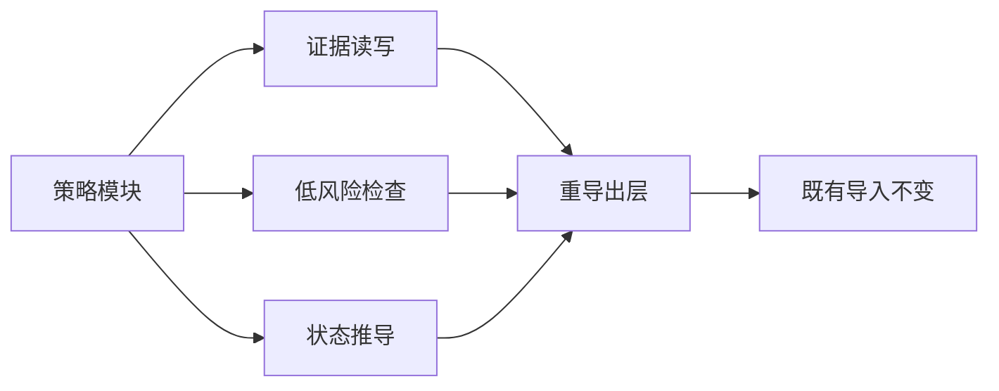

# 死代码清零与热点拆分（Issue `#119`）

> 配对 Todo：[deadcode-split Todo](../todo/261120-issue119-w25-deadcode-split-todo.md)
>
> **基线**：`a0fe4df`。本切片认领总控 PRD `261120-w25-hardening-prd.md` 的 `C6`。前置：`w25-parallel-dispatch`（先把策略模块的状态推导行为定下来，再拆文件）。

## 一、目标、红线与非目标

<!-- section: goal -->
### 1.1 目标

1. **二十个零消费者导出清零**：其中十四个只有自己的定义行命中（全仓再无第二处），四个只在同文件内被组合调用，对外零消费者。另有一个真陷阱：它只有自己的注释在提，注释还写着「调用方因此必须用它」，而后人照着注释去找，会发现根本没人用。
2. **死参数清零**：八十九个声明标志里唯一全仓零读取的那个，从注册表、帮助与读取点一并清掉。
3. **热点模块按职责拆分**：策略模块七百九十八行里塞了四个互不相干的职责，其中一个状态推导函数占三百二十七行。拆成三个模块，保留一层重导出以维持既有导入。
4. **帮助文本按任务组织**：把近九十个标志平铺、按字母序排列的写法，改为按子命令分组并写明各参数归属。
5. **定位器补列清单开关**：当前传 `--list` 报「未知参数」，而这是最便宜的可用性改进。

### 1.2 非目标（Explicit Non-Goals）

<!-- section: non-goals -->
- **不拆探测模块的线性降级链**（七百七十二行，其中两百余行是有序的探测降级步骤，拆开就切断回滚边界）。
- **不拆装备脚本的线性事务**（七百六十三行，拆开就撕开回滚边界）。
- **不改原子写模块的临时清理返回形状**（返回「删除了什么 / 保留了什么」两段是有意的）。
- **不改三个文件头部的长注释**（协议、原子写、文本）：那些注释解释的是「为什么这样设计」，是本仓唯一的设计记录。
- **不改工作区遍历的并发 worker 数**。
- **不删两组「被文档提到但零调用」的包装函数**——见待拍板第 2 条，已定处理方式。
- **不动「跳过规划引导」开关**：它有间接读取点。
- **不改 `kit/skills/lib/shared.mjs` 的导出面**：重导出层不动。
- **不改生态声明式表**（两百多行是数据不是逻辑）。
- **不碰 `docs/archive/`**。
<!-- section: non-goals-end -->

### 1.3 五件事到判据的对应

| 判据 | 覆盖 | 一句话 |
| --- | --- | --- |
| `C1` | 二十个零消费者导出 | 全仓零命中 |
| `C2` | 死参数 | 注册、帮助、读取三处全清 |
| `C3` | 策略模块拆分 | 三模块各不超三百行，导入方零改动 |
| `C4` | 帮助文本 | 按子命令分组，参数归属可机械核对 |
| `C5` | 定位器清单开关 | 能列出可定位对象 |
<!-- section: goal-end -->

## 二、技术设计与接口契约

<!-- section: design -->

### 2.1 `C1` 二十个零消费者导出

- **影响文件**：`scripts/lib/fs-atomic.mjs`、`scripts/lib/protocol.mjs`、`scripts/lib/text.mjs`、`scripts/lib/survey-ecosystem.mjs`、`scripts/lib/survey-workspace.mjs`、`kit/skills/lib/symbol-index.mjs`、`kit/skills/lib/test-inventory.mjs`、`kit/skills/lib/doc-toc.mjs`、`kit/skills/lib/doc-facts.mjs`、`kit/skills/lib/doc-template-render.mjs`、`kit/skills/lib/platform-probe.mjs`。
- **现状**（全仓命中数 / 文件数，均在本基线实测）：
  - 只有定义行命中：`parentOf`、`countTextLines`、`emitMarker`、`hasMarkers`、`WORKTREES_STATE_RE`、`readTextFile`、`normVersion`、`repoRelation`、`detectTaskEntries`、`scanWorkspaceRaw`、`supportedLanguages`、`readFeatureMapDocHint`、`findTocDrift`、`splitJudgeable`、`templateVarNames`（十五个）。
  - 只在同文件内被组合调用、对外零消费者：`applySectionPolicy`、`fillCriteriaBlock`、`fillTemplateVars`、`DOC_TEMPLATE_DIR`（四个，保留文件内的可用性，去掉 `export` 关键字）。
  - 四个探测函数只在同文件内被组合调用：`probeGhBridge`、`probeGhCliAuth`、`probeHttpsCredential`、`computeProtocolRemediation`（同样去掉 `export`）。
  - 一个真陷阱：`repoRelation` 的定义旁有一条注释声称「调用方因此必须用它」，而调用方为零。注释随实现一并删除。
- **改法**：确认零消费者后删除；被同名真实实现取代的（`detectTaskEntries` → `detectTaskEntriesDetailed`、`scanWorkspaceRaw` → `scanWorkspaceRawAsync`）直接删除，不留兼容别名。文件内仍需使用的去掉 `export` 而不是删实现。
- **为什么不留「以后可能有用」的**：留着就要维护它；而它从没被任何调用点检验过，留着等于保存一份未经验证的假设。需要时从提交记录里取回，那里有完整历史。

### 2.2 `C2` 死参数

- **影响文件**：`kit/skills/dev-flow/scripts/flow.mjs`、`scripts/dev/preflight-suite.mjs`。
- **现状**：八十九个声明标志里唯一全仓零读取的是 `--slot`；「槽位」这个概念已由另一个带前缀的标志承载。
- **改法**：从注册表、帮助文本与读取点三处一并清掉；把「每个注册参数至少一个读取点」写成机械检查（该检查与另一片的三重对拍共用落点，本切片只负责清这一处并让检查覆盖流程入口）。
- **反例边界**：不得顺手清掉「跳过规划引导」开关——它有间接读取点（经规划退场门禁读取），不是死参数。

### 2.3 `C3` 策略模块三分

- **影响文件**：`kit/skills/lib/workflow-policy.mjs`（七百九十八行）、`kit/skills/lib/workflow-evidence.mjs` (new)、`kit/skills/lib/low-risk-doc-check.mjs` (new)、`kit/skills/lib/workflow-policy-next.mjs` (new)。
- **现状与拆法**（按职责，不按行数）：

  | 职责 | 现状位置 | 去向 |
  | --- | --- | --- |
  | 策略判定（风险分级、必过门禁解析） | 顶部，约七十行 | 留在原模块 |
  | 低风险文档静态检查（读文件、扫 Markdown、查死链，是 I/O） | 约八十行 | `low-risk-doc-check.mjs` (new) |
  | 证据读写与校验（路径、读、写、前置校验） | 约一百五十行 | `workflow-evidence.mjs` (new) |
  | 状态推导（`evaluateNextState`，单函数三百二十七行） | 主体 | `workflow-policy-next.mjs` (new)，并按阶段拆成若干小函数 |

- **必须保留重导出层**：有四十六处 import 指向原模块。原模块保留全部原有导出名，实现改为从三个新模块引入再重导出。导入方零改动是硬要求——本条判据的目的就是让拆分不产生「改了一堆 import」的噪音 diff。
- **返回字段一个都不能变**：状态推导的返回体字段是调用方契约。拆函数可以，改字段名不行。
- **状态推导按阶段拆**：现有实现是一条长条件链（冲突中、只读克隆、已释放、未认领、未探索、已合并、外部提案……）。拆成「前置条件判定」「阶段选择」「动作与命令生成」三段，每段一个函数，条件顺序保持不变。
- **拆完的验证方式**：拆分前后对同一批输入跑一遍，输出逐字节比对。这是唯一能证明「纯位移」的方式。
- **附带收掉一处重复**：该模块里有一个 URI 解码安全函数与治理侧同名实现重复，随低风险检查一并迁走（重复项本身的收敛归内核去重片，本片只把它的位置准备好）。

### 2.4 `C4` 帮助文本按子命令组织

- **影响文件**：`kit/skills/dev-flow/scripts/flow.mjs`。
- **现状**：近九十个标志平铺在一个选项段里，按字母序排列，不写哪个标志配哪个子命令。
- **改法**：选项段按子命令分组，每组下列该子命令可用参数；同时可用全部子命令的全局参数单列一段。分组的权威来源是参数注册表，不是手写的第二份清单——两处不一致时以注册表为准（该一致性由另一片的三重对拍守住）。

### 2.5 `C5` 定位器补列清单

- **影响文件**：`kit/skills/dev-explore/scripts/doc-locate.mjs`。
- **现状**：传 `--list` 报「未知参数」。
- **改法**：新增清单开关，列出可定位的文档与符号范围（按既有定位索引的顺序，不新造索引）。不传其它参数时只列不检索。

### 2.6 行数与拆分核对

- 本切片以「减少」为方向：二十个导出删除、策略模块从七百九十八行降到三段各不超三百行。
- 三个新模块各自核对 `.mjs <= 800`；`workflow-policy.mjs` 拆分后应显著变薄，若仍超三百行说明还混着别的职责。
- `platform-probe.mjs` 只删四个导出的 `export` 关键字，行数不变，仍为七百余行，不改结构。
<!-- section: design-end -->

## 三、门型评估与验收标准

<!-- section: gates -->
- **门型**：`two-way`。删除的都是零消费者导出与零读取参数，回退就是反向提交；拆分保留重导出层与返回字段，撤销同样只需回退一次提交。
- **风险等级**：`high`（命中 `kit/` 与 `scripts/lib/`，且策略模块是流程判定的单一真相源）。
- **故障注入**：把重导出层删掉一层导出，导入方解析必须失败；把状态推导的返回字段改名，比对断言必须变红。
- **验证命令**：
  - `node scripts/dev/fixtures.mjs`（全量，本片判据是「拆分前后逐字节一致」）
  - `node scripts/dev/preflight.mjs`
  - `node scripts/dev/gap-coverage.mjs`
<!-- section: gates-end -->

<!-- section: acceptance -->
### 验收标准（正例 / 反例双向可判定）

<!-- criteria:start -->
- [ ] C1: 二十个符号在全仓（`kit/`、`scripts/`、`templates/`、`references/`、`docs/`）命中数为零（`repoRelation` 的注释一并消失）；文件内仍需使用的四个函数保留实现但无 `export` 关键字；两个被同名真实实现取代的包装函数删除后无兼容别名。反例：只删「从未被 import」的，留下「同文件内被调用」的四个仍带 `export`——外部仍可 import 到死接口。
- [ ] C2: `--slot` 在注册表、帮助文本与读取点三处均为零命中；「跳过规划引导」开关仍存在且仍有一个间接读取点；机械检查覆盖流程入口且对新增未读取参数会红。反例：把「跳过规划引导」一并当死参数删掉，于是规划退场门禁失去放行通道。
- [ ] C3: 三个新模块各不超三百行；原模块保留全部原有导出名且全部实现来自新模块；四十六处 import 一处未改；同一批输入在拆分前后输出逐字节一致；状态推导的条件顺序与返回字段名一个未变。反例：拆完顺手重命名了返回字段，于是调用方静默拿到 `undefined`。
- [ ] C4: 帮助文本按子命令分组，每组列出的参数集合与注册表逐个相等；全局参数单列且与统一解析器注入的白名单相等。反例：手写第二份分组清单，于是注册表加参数后帮助不再更新。
- [ ] C5: 定位器传清单开关时列出可定位范围且退出码为零；不传其它参数时不执行检索；范围条目数等于既有定位索引的条目数。反例：清单开关顺便跑一次全仓检索，于是「只列不查」变成隐性的慢操作。
- [ ] C6: 策略模块拆分后，`scripts/dev/fixtures.mjs` 全量通过；同一批状态推导输入的输出在拆分前后逐字节一致（快照落盘并可复跑）。反例：只跑按域子集，于是别的域的调用路径没被验证。
<!-- criteria:end -->
<!-- section: acceptance-end -->

## 四、可复用基础设施与备选方案

<!-- section: reuse -->
- `kit/skills/lib/workflow-policy.mjs` 现有的重导出写法已经存在（它从多个模块引入再导出），拆分沿用同一形状，不发明新做法。
- `scripts/dev/preflight-suite.mjs` 已有「每个注册参数至少一个读取点」的检查落点，本切片把流程入口纳入它的覆盖范围。
- `scripts/dev/fixtures.mjs` 的全量跑法已存在，用作「拆分前后逐字节一致」的证据来源。
- `kit/skills/dev-explore/scripts/doc-locate.mjs` 已有定位索引与检索实现，清单开关只是把索引列出来。
<!-- section: reuse-end -->

<!-- section: alternatives -->
- **方案一（否决）：把零消费者导出标记为 `@deprecated` 留着。** 本仓明令禁止墓碑注释，且标记不减少维护面——它仍在导出面上，仍会被当成可用接口。
- **方案二（否决）：按行数均分策略模块。** 按行数切会把一个职责劈成两半（例如证据读写被切成「路径部分」与「校验部分」），两半必须一起改，等于制造新的成对维护。
- **方案三（否决）：拆分时不保留重导出层，一次性改全部 import。** 四十六处 import 的改动会让 diff 淹没真实变更，审查者无法判断行为有没有变。
- **方案四（否决）：帮助文本自动从注册表生成。** 自动生成会得到一份「参数名 + 一行占位说明」的清单，比手写更差。正确做法是手写分组但参数集合由注册表对拍守住。
- **方案五（采纳）：删除零消费者导出 + 按职责三分 + 保留重导出 + 帮助手写分组但机械对拍。** 每一处都在减少维护面，且改动面可审。
<!-- section: alternatives-end -->

## 五、待拍板问题

<!-- section: pending -->
- 已定：二十个零消费者导出全部处理——十五个删除、四个去掉 `export` 保留实现、一个连注释一并删。
- 已定：两个被同名真实实现取代的包装函数直接删除，不留兼容别名。
- 已定：死参数 `--slot` 从注册表、帮助与读取点三处清零；「跳过规划引导」开关不动，它有间接读取点。
- 已定：策略模块按四个职责拆为「策略判定留在原模块 + 三个新模块」，保留完整重导出层，导入方零改动，返回字段名一个不变。
- 已定：状态推导按「前置条件 / 阶段选择 / 动作生成」三段拆，条件顺序保持原样；拆分前后输出逐字节比对作为唯一证据。
- 已定：帮助文本手写分组，但分组内的参数集合由注册表机械对拍守住，不写第二份权威清单。
- 已定：定位器清单开关只列不查，范围来自既有索引。
- 已定：不拆探测模块线性降级链、装备脚本线性事务、原子写临时清理返回形状；不改三处文件头长注释。
- 已定：本切片前置 `w25-parallel-dispatch`——它要先改状态推导的行为，本片再拆文件；顺序颠倒会让同一段代码被两片各改一次。
- 已定：两个「只被文档提到、代码零调用」的包装函数（`walkWorkspace`、`detectTaskEntries`）按删除处理：它们各自有一个真实入口，留着等于给后人两个名字选一个，选错会静默走慢路径。文档中提到它们的地方由治理真相片一并改掉。
- 已定：本切片与内核去重片在 `text.mjs` 与 `protocol.mjs` 上相邻——本片只删导出，不搬实现；搬实现归内核去重片。
<!-- section: pending-end -->
