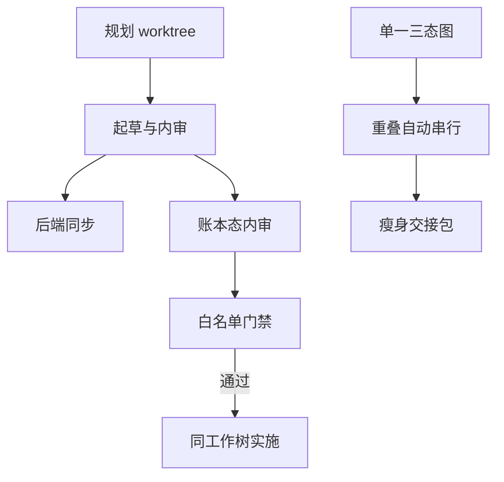

# Phase 3A 治本重构 PR-A（Issue `#120`）

> 配对 Todo：[w25-parallel-dispatch Todo](../todo/261120-issue120-w25-parallel-dispatch-todo.md)
>
> **基线**：`85e5f9d`。本切片认领总控 PRD `261120-w25-hardening-prd.md` 的 `C7`，并统一收口 PR-A 七项工作流、规划隔离与调度瘦身改动。无前置依赖。

## 一、目标与非目标

<!-- section: goal -->
### 1.1 目标

1. **规划独立 worktree 隔离**：支持 `flow start --planning` 与 `doc-plan init --worktree`，使 Case 3/4 起草与 Critique 在独立 worktree 分支完成，过审后平滑转入同一 worktree 实施，杜绝多规划者共享 `main` 互踩。
2. **规划期 `TaskBackend` 同步**：`doc-plan` 关键阶段经 `createTaskBackend()` 与 `capabilities` 同步远端评论/状态标签或本地事件日志，离线/无远端显式报 `NOT_APPLICABLE`。
3. **账本态内审与白名单门禁**：Critique 历史迁入单任务账本消除 Frontmatter 膨胀，`plan-exit-gate.mjs` 改用严格白名单，修复停损后禁止补充意见、缺 frontmatter 空操作与 PRD 状态漏枚举问题。
4. **砍掉锚点膨胀棘轮**：删除 `DOC_REGRESSION_ANCHOR_LOST` 单调膨胀棘轮（保留结构节非空与冻结 `C1..Cn`），理性化 Case 3/Case 4 Critique 轮次与行数软提示。
5. **全局视图与交接包瘦身**：新增 `flow.mjs status --all [--json]`；重建 `handoff-package.mjs` 注入真实返工意见与 `scope_files`、修复正则吞节与 0 命中、追加 15 行回报约束；消除 `flow-inspect` 重复输出。
6. **单一三态依赖图与 `serial-by-overlap`**：废除 `workflow-helpers.mjs` 分裂的正则/字面波次判定，统一收口到 `doc-slice-graph.mjs`，写域重叠自动串行而非报假错 `BLOCKED_SLICE_OVERLAP`，`needs-*` 阶段保持并行切片可见。
7. **入站、可靠性、折叠 `flow explore` 与信号治理**：补全外部 PR 受理评论与 `issue:` 继承、多目标逐条 `try/catch` 落账本、审查完成强校 `review-pack record`、`escalation.mjs` 默认建单、折叠 `BLOCKED_NOT_EXPLORED`、`signals.jsonl` 隔离与 `severity >= medium` 聚类过滤、`--jobs` 透传、多 ID 注入筛选与 `I320–I349` 故障注入。

### 1.2 非目标（Explicit Non-Goals）

<!-- section: non-goals -->
- **不触碰 Phase 3B 专属域**：不改 `#114`（`kit/skills/lib/git-status-fast.mjs`、`kit/skills/lib/git-fast.mjs`、`scripts/dev/bench.mjs`）、`#115`（`kit/skills/lib/git-core.mjs`、`kit/skills/lib/platform-probe.mjs`、`scripts/lib/text.mjs`）、`#117`（`kit/skills/dev-verify-tools/scripts/verify-tools.mjs`、`kit/skills/lib/feature-map.mjs`、`docs/feature-map.json`）、`#118`（`scripts/dev/evidence.mjs`、`scripts/lib/protocol.mjs`、`kit/skills/dev-govern/scripts/govern-checks.mjs`、`kit/skills/dev-govern/scripts/govern-retro.mjs`、`scripts/lib/review-helpers.mjs`）及 `#119`（`scripts/lib/fs-atomic.mjs`、`kit/skills/lib/workflow-policy-next.mjs`、`kit/skills/dev-explore/scripts/doc-locate.mjs`）专属模块。
- **不改既定基础判据**：不改「缺写域即保守串行」判据、不改并行阈值（Wave 1 至少 2 个任务）、不加跳过门禁开关、不新增第 10 套 `collab/*.json` 持久化文件、不硬编码托管平台名与账号、不碰 `docs/archive/`。

### 1.3 七项改造与判据对应

| 判据 | 主题 | 核心落点 |
| --- | --- | --- |
| `C1` | 规划 worktree 隔离 | `flow-inspect.mjs` / `doc-plan.mjs` / `workflow-policy.mjs` |
| `C2` | 规划期 `TaskBackend` 同步 | `kit/skills/lib/plan-sync.mjs` (new) / `doc-plan.mjs` |
| `C3` | 账本内审与白名单门禁 | `critique-rounds.mjs` / `plan-exit-gate.mjs` / `doc-audit.mjs` |
| `C4` | 去棘轮与理性化规划仪式 | `doc-substantive.mjs` / `doc-audit.mjs` / `critique-rounds.mjs` |
| `C5` | `status --all` 与交接包重建 | `flow-cleanup.mjs` / `handoff-package.mjs` / `flow-inspect.mjs` |
| `C6` | 单一三态图与 `serial-by-overlap` | `doc-slice-graph.mjs` / `workflow-helpers.mjs` / `workflow-policy.mjs` |
| `C7` | 外部 PR/可靠性/折叠探索/信号/并发 | `flow-merge.mjs` / `review-sync.mjs` / `signals.mjs` / `govern-state.mjs` |
<!-- section: goal-end -->

## 二、技术设计与接口契约

<!-- section: design -->

### 2.1 `C1` 规划独立 worktree 隔离

- **入口扩展**：`kit/skills/dev-flow/scripts/flow.mjs` 注册 `--planning` 布尔参数；`kit/skills/dev-flow/scripts/flow-inspect.mjs` 的 `handleStart` 在 `--planning` 下允许未过审规划提前建 `.worktrees/impl-taskId`（分支 `feat/slug` 或 `plan/slug`），在账本记录 `status: 'planning'` 与 `planning: true`，跳过 `evaluatePlanExitGate` 阻塞但不允许直接进入 `submit` / `merge`。
- **文档侧联动**：`kit/skills/dev-plan/scripts/doc-plan.mjs` 的 `init` 新增 `--worktree` 选项；若对应 `taskId` 尚无 worktree，则复用统一 worktree 创建逻辑建好隔离位并直接把 PRD/SPEC/Todo 写入隔离位，使 `main` 保持零脏改动。
- **平滑转实施**：规划通过 `approve` 后再执行 `flow start --task taskId`（不带 `--planning`），通过 `evaluatePlanExitGate` 白名单校验后，直接幂等复用同一 `.worktrees/impl-taskId` 将状态切换为 `started` / `claimed`，不新建第二个 worktree。`kit/skills/lib/workflow-policy.mjs` 的 `evaluateNextState` 与 `kit/skills/lib/ledger.mjs` 识别 `planning` 状态并引导 `audit -> critique -> approve`。

### 2.2 `C2` 规划期 `TaskBackend` 远端同步

- **单一同步模块**：新增 `kit/skills/lib/plan-sync.mjs` (new)，暴露 `syncPlanPhaseToBackend`，由 `doc-plan.mjs` 的 `init`（建单或关联 Issue）、`critique-reject`、`critique-pass`、`stop-loss`（`critique-reject` 触发停损时）与 `approve` 统一调用。
- **能力探测与幂等**：通过 `createTaskBackend()` 读取 `capabilities`，构造幂等键 `taskId + phase + round` 并写入账本 `planSyncKeys`（或本地事件日志）去重；严禁硬编码托管平台名称。
- **双端行为**：当后端 `capabilities.issues === true && capabilities.labels === true` 且非本地模式时，写精简进度/打回明细评论并同步状态标签 `planning` / `changes-requested` / `needs-human-decision` / `approved`（若目标已是 Planning PR 则复用单一 PR 通道不重复刷屏）；对 `generic-git` / `local-only` 写本地事件日志并显式返回 `status: 'NOT_APPLICABLE'`、`notApplicable: true` 与原因说明。

### 2.3 `C3` 账本态内审、白名单门禁与停损解耦

- **账本态存储**：`kit/skills/lib/critique-rounds.mjs` 将多轮 Critique 轮次、裁定、正文 SHA、findings 与 `override` 写入单任务账本 `ledger.planCritique`；Frontmatter 仅保留精简 `plan_critique` 单行印记（不再写入 `critique_anchors` 与冗长 `critique_rounds` JSON 数组），同时在读取端兼容旧文档 Frontmatter `critique_rounds` / `critique_override` 回退，保证旧文档无损平滑迁移。
- **白名单退出门禁**：重构 `kit/skills/lib/plan-exit-gate.mjs` 的 `resolveApprovalBasis`，删除黑名单 `UNREADY_CRITIQUE`：仅当（1）存在 `passed` 且记录 SHA 与当前正文指纹 `critiqueTextFingerprint` 一致；（2）存在有效 `human-override`（`approved === true`、SHA 一致且非空 `reason`）；或（3）合法 `skipped` 且实质理由达标，才判定放行。缺失字段、SHA 失配或未知状态一律返回阻断。`formatPlanExitGate` 必须格式化输出 `gate.warnings`（含 `WARN_PLAN_NOT_BOUND`）。
- **停损与记录解耦**：修改 `critique-rounds.mjs` 的 `validateCritiqueActorAndHistory`，停损触发后不再阻断 `critique-reject` / `critique-pass` 写入新一轮复核意见；仅在 `doc-plan-ops.mjs` 的 `approveSpec` 锁定 `approve` 直至人类介入。落盘/回读失败必须显式抛错。拆分子命令 `critique-continue`（仅记人类准许继续复核、不放行 `approve`）与 `critique-override`（带 `--human-approved --reason` 签字解锁）；修复 `critiqueOverrideDoc` 在 `!fm.hasFrontmatter` 时静默空操作问题（同步写入账本并更新文本头）；`doc-audit.mjs` 的 `VALID_STATUS_BY_TYPE.prd` 补入 `superseded`，且 `doc-plan.mjs` 对 PRD `critique-pass` 后不再误提示 `approve`（改为提示初始化切片或标记 `active`）。

### 2.4 `C4` 砍掉锚点棘轮与理性化规划仪式

- **删除膨胀棘轮**：移除 `kit/skills/lib/doc-substantive.mjs` 中 `checkDocRegression` 的 `DOC_REGRESSION_ANCHOR_LOST` 校验（跨轮技术锚点计数与 C 编号删除拦阻统一交由 `criteria-lock.mjs` 的冻结 `C1..Cn` 指纹与核心章节实质性守门），保留 `DOC_REGRESSION_CORE_EMPTIED` 与 `DOC_REGRESSION_CORE_DEGRADED` 防删空护栏，允许修订时精简重写与以换代加。同步更新 `scripts/dev/fixtures-doc-depth.mjs`。
- **行数软提示与轮次收敛**：`doc-audit.mjs` 对 SPEC 正文超过 380 行仅输出 `warnings` 软提示而不产生 `errors`；PRD 不设行上限。Case 3 不跑多轮换人 Critique；Case 4 规划停损上限从 3 轮收敛为 2 轮（`PLAN_STOP_LOSS_MAX_ROUNDS = 2`），第 2 轮仍未过审或连续同因即触发停损升级人类拍板。

### 2.5 `C5` 全局视图与交接包瘦身重建

- **全局视图命令**：`flow.mjs` 为 `status` 注册 `--all` 布尔标志；`kit/skills/dev-flow/scripts/flow-cleanup.mjs` 的 `handleStatus` 支持 `--all [--json]`，一次性聚合全部活跃账本、活跃未启动 SPEC、`createTaskBackend().capabilities` 与 `doc-slice-graph.mjs` 计算的可并行波次。
- **交接包重建**：重建 `kit/skills/lib/handoff-package.mjs`：
  1. 返工分支对 `role === 'implementer'` 与 `'reviewer'` 统一注入上一轮真实 `last.mustFix`、`last.shouldFix` 与 `last.blockers`（彻底替换误读不存在的 `last.findings`）；
  2. 直接解析规划文档 Frontmatter 的 `scope_files` 合并注入「能改哪里」提示段；
  3. 修复 `extractNonGoals` 的标题匹配正则（仅匹配以非目标/明确不做/本期不做为独立标题节，防止 `## 一、目标、红线与非目标` 吞掉第 1 节）与 `extractDesignSection` 正则（兼容 `技术设计`、`接口契约`、`设计方案` 等标题，消除 0 命中）；
  4. 在交接包末尾写入硬性回报约束与**极简 5 行回执模板**（第 1 行状态、第 2 行 HEAD、第 3 行 PR 或 Issue、第 4 行门禁与阻断数、第 5 行下一步命令），并写明 CLI 详报与测试日志默认只落单任务账本及 Issue/PR 评论，严禁把大段终端日志倒回主调度（总回报不超过 15 行）。
- **去重输出**：`flow-inspect.mjs` 将 `formatPlanExitGate(planGate)` 收敛为单点计算与单次输出，消除重复打印。

### 2.6 `C6` 单一三态依赖图与 `serial-by-overlap`

- **删除分裂实现**：删除 `kit/skills/lib/workflow-helpers.mjs` 中基于正则的 `extractSpecWriteScope` 与分裂的 `scanUnstartedReadySlices` / `buildMultiTaskWavePlan` 私有逻辑，改为从 `kit/skills/lib/doc-slice-graph.mjs` 统一导入并重导出兼容符号（保持 `flow-batch.mjs` / `flow-next.mjs` / `workflow-policy.mjs` 零破坏）。
- **三态图与 `serial-by-overlap`**：在 `doc-slice-graph.mjs` 收口单一切片依赖图与波次调度：
  1. 已完成或已归档（`docs/archive/`）前置自然满足 `depends_on`；
  2. 目标存在但处于 `draft` / `pending` / `active` 未完成状态的 `depends_on` 严禁静默过滤丢弃，下游切片必须被阻断/后移波次，悬空未声明 `task_id` 仍报错；
  3. 显式区分**真逻辑依赖**（`depends_on`）与**写域重叠自动串行**（`serial-by-overlap`）：当两个切片无逻辑 `depends_on` 但 `scope_files` 相交时，波次调度器将其自动拆分到先后子波次并标注 `serialReason: 'serial-by-overlap'`，而 `evaluateSliceGraph` / `checkWaveScopeOverlap` 不再对此类可串行重叠误报阻塞错误 `BLOCKED_SLICE_OVERLAP`（同步更新 `scripts/dev/fixtures-plan-wave-slices.mjs`）；
  4. `workflow-policy.mjs` 在 `selectedTask` 处于 `needs-*` 阶段时同样计算并附带 `parallelDispatch`、`waves` 与 `readySlices`，保持并行切片全阶段可见。

### 2.7 `C7` 外部 PR 入站、可靠性、折叠探索、信号隔离与并发

- **外部 PR 入站与 SPEC `issue:` 继承**：`flow inspect`（及 `flow start --external-pr`）创建 `inbound-external-pr` 账本时，经 `createTaskBackend()` 写入精简受理评论并挂载 `external-contribution` 标签（带幂等防重）；`flow start` 读取匹配 SPEC Frontmatter 的 `issue:` 字段并自动并入 `ledger.linkedIssues`。
- **多目标写入可靠性与审查闭环**：`flow-merge.mjs` 与 `review-sync.mjs` 遍历 PR 与多个关联 Issue 写入评论/标签时，逐条使用 `try/catch` 捕获异常并将每条目标成功/失败明细追加写入单任务账本（`ledger.syncFailures` / `ledger.mergeComments`），禁止 `.some()` 吞掉部分失败，严禁新建第 10 套 `collab/*.json` 文件；`flow merge` 与 `workflow-policy.mjs` 校验审查闭环时必须确认存在由 `review-pack record` 写入的有效轮次记录（含 `reviewTokens` 消费或合法记录标记）；`kit/skills/lib/escalation.mjs` 默认对 `outOfScope` 或连续 2 轮未关闭的严重问题自动调用后端建单，仅显式传 `--no-escalate --reason`（非空）才允许豁免。
- **折叠形式主义 `flow explore`**：将 `flow-explore.mjs` 的独立手工盖章门禁（`BLOCKED_NOT_EXPLORED`）折叠为 `flow start` 与 `handoff-package.mjs` 的自动只读上下文注入（启动或生成交接包时自动运行轻量索引并写入 `ledger.explored`）；移除 `flow-lifecycle.mjs`、`flow-lifecycle-hooks.mjs`、`flow-merge.mjs`、`workflow-policy.mjs`、`exit-codes.mjs` 中过时的 `BLOCKED_NOT_EXPLORED` 强卡，保留 `flow explore` 作为按需显式刷新命令，并同步更新 `scripts/dev/fixtures-flow-explore-gate.mjs` 与 `scripts/dev/injections-data-flow-explore.mjs`（`I240–I244`）。
- **`signals.jsonl` 隔离与聚类过滤**：`kit/skills/lib/signals.mjs` 支持按 `taskId` / `branch` / `worktree` 作用域读写过滤（事件携带 `branch` 与 `worktree`，`readSignalsJsonl` 支持作用域筛选）；`kit/skills/dev-govern/scripts/govern-state.mjs` 的 `buildClusterReport` 仅聚类 `severity >= medium` 的失败信号，过滤掉 `info` 级别、`*.pass` 正向事件以及纯 Markdown 文档路径，停止将其误聚成 `tier1-refactor`。
- **并发、筛选与体积约束**：`workflow-policy.mjs` 放行合法 `--jobs N` 并发命令（不误判为门禁弱化）；`scripts/dev/fixtures.mjs` 保证 `--jobs N` 并发透传；`scripts/dev/verify-injections.mjs` 的 `--only` 支持逗号分隔多 ID（如 `--only I320,I321`）；新增 `scripts/dev/injections-data-parallel-dispatch.mjs` (new) 注册号段 `I320–I349`。全仓所有 `.mjs` 文件严格控制在 800 行以内，变更后执行 `node scripts/equip.mjs .` 与 `node scripts/compose-agents.mjs .`（`AGENTS.md` 小于 24576 字节）。

### 2.8 接口与数据结构冻结

- **规划账本增量字段**：`ledger.planning`（boolean）、`ledger.planSyncKeys`（string 数组，按 `taskId:phase:round` 去重）、`ledger.planCritique`（按 `docRel` 存 `rounds` / `override` / `continueGrants` / `sha`）、`ledger.syncFailures`（数组，记录 `{ target, op, error, at }`）。
- **交接包输入输出**：`buildHandoff` 输出 `fields.reworkFeedback`（含 `mustFix`、`shouldFix`、`blockers`）、`fields.scopeFiles`（合并 Frontmatter `scope_files` 与正文影响路径）与 `fields.receiptTemplate`（5 行极简回执模板：状态 / HEAD / PR 或 Issue / 门禁与阻断数 / 下一步命令），并默认将 CLI 详报与测试日志落账本及 Issue/PR 评论，在 `prompt` 固定节输出不超过 15 行回报约束。
- **波次调度输出**：`doc-slice-graph.mjs` 的波次项保留 `dependsOn`（真逻辑依赖）与 `serialReason: 'serial-by-overlap' | 'missing-scope' | null`，禁止将 `serial-by-overlap` 记为 `errors`。
- **信号作用域字段**：`appendGovernSignal` 写入 `branch` 与 `worktree`，`readSignalsJsonl` 接受 `{ taskId, branch, worktree }` 过滤条件；`buildClusterReport` 仅纳入 `severity` 属于 `medium` / `high` / `critical` 的非 `*.pass` 信号。
- **体积与拆分红线**：`kit/skills/lib/task-backend.mjs`（799 行）与 `kit/skills/lib/workflow-policy.mjs`（794 行）逼近 800 行上限，禁止向两文件净增行数；规划期同步抽入 `kit/skills/lib/plan-sync.mjs` (new)，波次逻辑移入 `kit/skills/lib/doc-slice-graph.mjs`。
- **退出码与兼容约定**：白名单阻断返回退出码 3（`BLOCKED_PLAN_NOT_READY`），规划停损锁定 `approve` 返回退出码 4（`STOP_LOSS_ESCALATE`）；旧文件 Frontmatter 残留的 `critique_rounds` / `critique_override` 仍可无损回读。

### 2.9 故障注入与双向验证矩阵（`I320–I349`）

| 号段 | 注入篡改点 | 必红断言 |
| --- | --- | --- |
| `I320` | `flow start --planning` 放行常规未过审启动 | `C1` 常规 `start` 阻断变红 |
| `I321` | `plan-sync.mjs` (new) 无远端返 `synced: true` | `C2` `NOT_APPLICABLE` 变红 |
| `I322` | `plan-exit-gate.mjs` 跳过 `sha` 一致白名单校验 | `C3` 篡改正文后阻断变红 |
| `I323` | `critique-rounds.mjs` 停损后继续拒绝写新意见 | `C3` 停损后写意见变红 |
| `I324` | `handoff-package.mjs` 退回读 `last.findings` | `C5` 返工 `mustFix` 注入变红 |
| `I325` | `doc-slice-graph.mjs` 静默丢弃 `draft` 前置 | `C6` 未就绪依赖阻断变红 |
| `I326` | `govern-state.mjs` 保留 `info` 信号入聚类 | `C7` 聚类过滤断言变红 |
| `I327` | `flow-merge.mjs` / `review-sync.mjs` 用 `.some()` 吞失败 | `C7` 部分失败落账本变红 |
| `I328–I349` | PR 受理缺失、缺 `review-pack record`、`--jobs` 误判 | 对应 `C7` 双向夹具变红 |
<!-- section: design-end -->

## 三、门型评估与验收标准

<!-- section: gates -->
- **门型**：`one-way`。涉及退出门禁白名单化、账本字段迁移、依赖图口径统一与 `BLOCKED_NOT_EXPLORED` 折叠，会改变历史流程放行与阻断边界。
- **风险等级**：`high`（命中 `kit/`、`scripts/dev/`、`AGENTS.md`）。
- **故障注入**：新增 `scripts/dev/injections-data-parallel-dispatch.mjs` (new) 覆盖 `I320–I349`，并将 `I240–I244` 对齐折叠后的上下文自动注入逻辑。
- **验证命令**：
  - `node scripts/dev/fixtures.mjs --domain parallel-dispatch --jobs 6`
  - `node scripts/dev/verify-injections.mjs --only I320,I321,I322,I323,I324,I325,I326`
  - `node scripts/dev/preflight.mjs`
  - `node scripts/dev/fixtures.mjs --jobs 6`
<!-- section: gates-end -->

<!-- section: acceptance -->
### 验收标准（正例 / 反例双向可判定）

<!-- criteria:start -->
- [ ] C1: 执行 `flow.mjs start --planning --task p1` 或 `doc-plan.mjs init --kind pair --slug p1 --title "p1" --worktree` 后，工作文档落于 `.worktrees/impl-p1` 独立分支且 `main` 干净；过审后执行 `flow.mjs start --task p1` 复用同一 worktree 转入实施。反例：未传 `--planning` 且 SPEC 仍为 `draft` 时，`flow.mjs start` 仍以退出码 3 阻断。
- [ ] C2: `doc-plan` 的 `init` / `critique-reject` / `critique-pass` / `approve` 调用 `createTaskBackend()` + `capabilities` 与幂等键 `taskId + phase + round`：`github` 模拟后端写精简评论与 `planning`/`changes-requested`/`needs-human-decision`/`approved` 标签；`local-only` 与 `generic-git` 写本地事件日志并返回 `NOT_APPLICABLE`。反例：同键重复调用不重复发评论，离线或无远端时不得返回 `synced: true`。
- [ ] C3: Critique 轮次与裁定写入单任务账本 `ledger.planCritique`，不向 SPEC Frontmatter 写 `critique_anchors`；`plan-exit-gate.mjs` 白名单对 `passed` 且 SHA 一致放行、对缺字段或 SHA 失配阻断，`formatPlanExitGate` 输出 `gate.warnings`；停损后仍可写入 `critique-reject` 意见，仅锁定 `approve`；`critique-continue` 与 `critique-override` 分离且缺 frontmatter 也能持久化；`VALID_STATUS_BY_TYPE.prd` 含 `superseded` 且 PRD `critique-pass` 不提示 `approve`。反例：修改 SPEC 正文一行后，未重审直接 `flow start` 必须被白名单门禁阻断。
- [ ] C4: `doc-substantive.mjs` 删除 `DOC_REGRESSION_ANCHOR_LOST` 后，精简重写 SPEC 锚点减少但结构实质完备时 `doc-plan.mjs audit` 返回 `ok: true`；SPEC 正文超 380 行仅给 `warnings` 不阻断，PRD 无行上限；Case 3 无需多轮 Critique，`PLAN_STOP_LOSS_MAX_ROUNDS` 为 2 轮。反例：将核心节删空或改成占位词时，仍触发 `DOC_REGRESSION_CORE_EMPTIED` / `DOC_REGRESSION_CORE_DEGRADED` 阻断。
- [ ] C5: `flow.mjs status --all --json` 返回活跃账本、未启动活跃 SPEC、`TaskBackend` 能力与波次计划；`handoff-package.mjs` 为 `implementer` 与 `reviewer` 注入真实 `mustFix` / `shouldFix` / `blockers` 与 `scope_files`，修复非目标误吞第 1 节与设计节 0 命中，内嵌 5 行极简回执模板（状态/HEAD/PR 或 Issue/门禁与阻断数/下一步命令）及 15 行回报上限（详报默认落账本与 Issue/PR 评论）；`flow-inspect.mjs` 单次输出 `formatPlanExitGate`。反例：存在 `mustFix` 时交接包若缺失该条内容或误吞第 1 节，`fixtures-parallel-dispatch.mjs` (new) 断言必须变红。
- [ ] C6: `doc-slice-graph.mjs` 作为唯一三态依赖图与波次引擎，归档前置自然满足、未就绪 `depends_on` 不被静默丢弃、写域重叠自动拆波并标 `serial-by-overlap` 而不报 `BLOCKED_SLICE_OVERLAP`，`needs-*` 阶段仍可见并行切片；`workflow-helpers.mjs` 不再保留分裂波次/正则逻辑。反例：前置切片为 `draft` 时下游切片不得进入 Wave 1，悬空 `task_id` 仍报错。
- [ ] C7: 外部 PR 入站写受理评论与 `external-contribution` 标签；`flow start` 读取 SPEC `issue:`；`flow-merge.mjs` 与 `review-sync.mjs` 逐条 `try/catch` 把部分失败写入账本且禁用 `.some()` 吞错；未跑 `review-pack record` 禁过审查；`escalation.mjs` 默认对跨范围/连续 2 轮未关严重问题自动建单（仅 `--no-escalate --reason` 豁免）；折叠 `BLOCKED_NOT_EXPLORED` 并更新 `fixtures-flow-explore-gate.mjs` 与 `I240–I244`；`signals.jsonl` 按工作位隔离且 `govern-state.mjs` 只聚类 `severity >= medium` 失败信号；支持 `--jobs N` 与 `verify-injections.mjs --only` 逗号多 ID 及 `I320–I349`；全仓 `.mjs <= 800` 行，同步 `equip.mjs .` 与 `compose-agents.mjs .`（`AGENTS.md < 24576` 字节）。反例：多目标中 1 成功 1 失败时不得返回全成功，且 `info` `*.pass` 信号不得进入 `tier1-refactor`。
<!-- criteria:end -->
<!-- section: acceptance-end -->

## 四、可复用基础设施与备选方案

<!-- section: reuse -->
- `kit/skills/lib/task-backend.mjs` 已提供 17 接口 `createTaskBackend()` 与 `capabilities`，`plan-sync.mjs` (new) 直接复用它而不另写平台客户端。
- `kit/skills/lib/doc-slice-graph.mjs` 已具备 `buildSliceGraph` 与 `scopesOverlap`，直接升级为单一三态依赖图与 `serial-by-overlap` 调度源。
- `kit/skills/lib/ledger.mjs` 已提供任务账本原子读写与锁，Critique 历史、多目标失败明细与规划幂等键直接落入单任务账本。
<!-- section: reuse-end -->

<!-- section: alternatives -->
- **方案一（否决）：保留 `UNREADY_CRITIQUE` 黑名单与 Frontmatter `critique_anchors` 序列化**。黑名单会放过缺字段或篡改后未重审的文档，YAML 头膨胀至 40KB 会污染 diff 并引发合并冲突；迁入单任务账本并改用严格白名单是唯一根治手段。
- **方案二（否决）：在 `kit/skills/lib/workflow-helpers.mjs` 与 `kit/skills/lib/doc-slice-graph.mjs` 同时打补丁并维持两套波次计算**。双轨维护已造成归档前置与重叠判定长期漂移；删除 `workflow-helpers.mjs` 私有分裂实现并单一收口到 `doc-slice-graph.mjs` 才符合单一真相源。
- **方案三（否决）：新建 `collab/*.json` 独立文件存放规划同步与部分写入失败状态**。会制造第 10 套状态文件并与单任务账本脱节；统一收敛至单任务账本与事件日志。
- **方案四（采纳）：规划隔离 worktree + 账本态 Critique + 白名单门禁 + 单一三态图 + 折叠探索与瘦身交接**。一次消解七组结构性病根，同时严格规避 Phase 3B 专属模块边界。
<!-- section: alternatives-end -->

## 五、待拍板问题

<!-- section: pending -->
- 已定：PR-A 在 `.worktrees/impl-w25-parallel-dispatch` 完成规划与实施，`scope_files` 严格避开 `#114/#115/#117/#118/#119` 专属领域。
- 已定：规划期 Critique 与多目标部分失败统一写入单任务账本，兼容旧文档 Frontmatter 回读，不新增独立持久化文件。
- 已定：`plan-exit-gate.mjs` 改为严格白名单，`DOC_REGRESSION_ANCHOR_LOST` 删除后保留结构节实质性与 `criteria-lock.mjs` 护栏。
- 已定：Case 4 规划停损上限为 2 轮，触发停损后仍允许追加复核意见，仅锁定 `approve` 直至 `critique-continue` 或 `critique-override`。
- 已定：新增故障注入使用固定号段 `I320–I349` 落于 `scripts/dev/injections-data-parallel-dispatch.mjs` (new)。
<!-- section: pending-end -->
