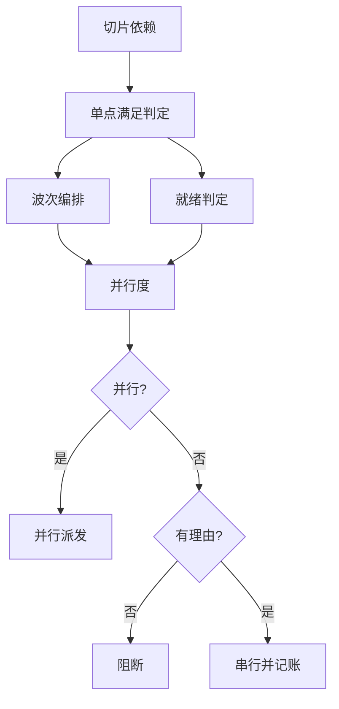

# 并行度机制（Issue `#120`）

> 配对 Todo：[parallel-dispatch Todo](../todo/261120-issue120-w25-parallel-dispatch-todo.md)
>
> **基线**：`a0fe4df`。本切片认领总控 PRD `261120-w25-hardening-prd.md` 的 `C7`。无前置，可立即开工。

## 一、目标、红线与非目标

<!-- section: goal -->
### 1.1 目标

1. **「依赖已满足」只由一处判定**：今天波次编排与任务就绪判定各算一次，两边对「依赖已满足」的口径不同。实测：一个切片的两个前置都已合入并归档，就绪判定仍报零个就绪切片——因为它按「在活跃目录里找得到前置」判，而前置已经归档。改为：目标切片存在且状态表示完成，两条路径共用同一判定（归档的自然满足）。
2. **并行度与波次在所有阶段可见**：今天只在「无活跃任务」时返回并行度与波次；一旦有任务在跑，这两个字段就空了。改为任何阶段都返回，让人任何时刻都能看到「现在能不能并行、下一波是谁」。
3. **串行必须留理由**：并行派发是建议、不是机制——忽略它串行做，没有任何东西会报错，也没留下「为什么串行」。改为：要么并行派发，要么有一条带理由的串行声明，两者都没有即阻断。串行是合法选择，缺的是记录与判据。
4. **不把建议改成强制并行**：真串行有正当理由（写域重叠、需要人拍板、单任务）。强制并行会逼人编造理由，反而让判据贬值。

### 1.2 非目标（Explicit Non-Goals）

<!-- section: non-goals -->
- **不改波次编排的拓扑算法**。现有的「按依赖分层、同层排除串行保守标记」是对的，本切片只改它读到的「依赖是否满足」这一输入。
- **不改「缺写域即保守串行」这条判据**。没声明写域就不知道该不该并行，保守串行是正确取向。
- **不改任务后端与账本结构**。并行度是推导出来的，不新增持久字段。
- **不改并行阈值**（第一波有两个以上任务才算可并行）。
- **不加「强制并行」开关**，也不加「跳过并行判定」开关。
- **不改任务认领与工作位隔离机制**。
- **不碰 `docs/archive/`**。
<!-- section: non-goals-end -->

### 1.3 三个缺口到判据的对应

| 判据 | 覆盖 | 一句话 |
| --- | --- | --- |
| `C1` | 已归档依赖被误判未满足 | 依赖满足单点判定，归档自然满足 |
| `C2` | 有任务在跑时不报并行度 | 全阶段返回并行度与波次 |
| `C3` | 串行无记录 | 并行或带理由串行，否则阻断 |
| `C4` | 两处口径不一致 | 两条路径对同一图给出同一结论 |
<!-- section: goal-end -->

## 二、技术设计与接口契约

<!-- section: design -->

### 2.1 `C1` 依赖满足单点判定

- **影响文件**：`kit/skills/lib/workflow-helpers.mjs`、`kit/skills/lib/doc-slice-graph.mjs`。
- **现状**：切片图模块已有一份「依赖是否满足」的判定（目标切片存在且状态表示完成，归档走同一条路径自然满足），且该判定有注释说明「按活跃目录找不到就算悬空，每一次合并都会把下游切片判死」。而就绪扫描走的是另一条路径：它按「活跃账本里有没有这个前置」判，已归档的前置因此被判为未满足。实测：两个前置都已实现并归档，就绪切片仍然为零。
- **改法**：把「依赖是否满足」抽成一个函数，只定义一次。切片图模块与就绪扫描都调用它，两边不再各写条件。该函数的判据：目标切片在（活跃或归档）文档集合里存在，且其状态属于「完成」集合。
- **反例边界**：指向一个从未声明过的标识仍然算悬空（那是拼写错或尚未规划），必须继续报出来——不能为了修「归档误判」把「悬空」也一起放过。两条路径必须能区分「已满足」与「悬空」。

### 2.2 `C2` 并行度全阶段可见

- **影响文件**：`kit/skills/lib/workflow-policy.mjs`。
- **现状**：状态评估有两条返回路径——无活跃任务时返回并行度与波次；选中某任务时返回体里没有这两个字段。实测：有任务在跑时查询，并行度字段不存在、波次是空数组。
- **改法**：两条返回路径都带上并行度、波次与就绪切片三个字段。选中任务时的语义是「这个任务之外还有什么可以并行」——就绪切片本来就已算出来，只是没返回。
- **不改的是**：选中任务时的阶段判定与动作生成完全不动；只补字段，不改既有字段的取值。

### 2.3 `C3` 串行必须留理由

- **影响文件**：`kit/skills/lib/workflow-helpers.mjs`、`kit/skills/lib/workflow-policy.mjs`。
- **现状**：并行派发是一个布尔建议。忽略它串行做，没有任何报错，也没有记录。
- **改法**：
  1. 波次计划在「第一波不足以并行」时输出一个显式的串行结论，并分两种情形：有正当理由（写域重叠导致同波次被拆散、或被依赖压成单链），以及无理由（就是单任务）。
  2. 选中任务时的返回体带一个「并行度结论」：`parallel`、`serial-with-reason`（附理由码）、或 `blocked-no-reason`。
  3. 当第一波有两个以上可并行任务、而调用方仍以单任务推进时，输出一条阻断结论并给出两条合法出口：改成批量派发，或声明串行理由（理由必须实质，不能是占位词）。
- **为什么用「理由码」而不是自由文本**：自由文本会退化成占位词。理由码来自一个封闭枚举（写域重叠、依赖单链、需人拍板、单任务），每个码对应一句系统自己生成的说明。这样「有没有理由」和「理由是什么」都能机械核对。
- **反例边界**：单任务仓库（只有一个就绪切片）永远不该被阻断。判据只在「可并行却串行」时生效。

### 2.4 `C4` 两条路径对同一图给出同一结论

- **影响文件**：`kit/skills/lib/workflow-helpers.mjs`、`kit/skills/lib/doc-slice-graph.mjs`。
- **判据**：给定同一批切片，「就绪扫描 + 波次编排」与「切片图的波次计算」必须给出相同的波次划分。
- **为什么单独立一条**：`C1` 说「收敛到一处判定」，但收敛之后仍可能有人在编排侧再写一段过滤。这条判据只关注结果一致，不关注实现怎么写，因此不会因为重构而失效。
- **实现方式**：切片图模块已有波次计算（按「前置都已排在更早波次」分层），直接让它成为唯一实现；就绪扫描改调它，不再自己分层。

### 2.5 行数与拆分

- 三个文件现状：编排辅助模块不到五百行、策略模块七百九十八行、切片图模块不到五百行。本切片在策略模块里补字段与结论，会让它更长——但它已由另一片拆分，本切片只补字段不搬逻辑。逐文件核对 `.mjs <= 800`；若策略模块因本切片超出，把「并行度结论」的计算下沉到编排辅助模块。
- 新增夹具独立成文件，遵守 `scripts/dev/fixtures-*.mjs` 单文件单域约定。
<!-- section: design-end -->

## 三、门型评估与验收标准

<!-- section: gates -->
- **门型**：`one-way`。「可并行却串行」从静默放行变成阻断，会改变历史上「单任务推进」这条路径的判定结论。
- **风险等级**：`medium`。命中 `kit/`，但改动限于依赖判定与返回字段，不触及标记语法、模板求值、报告排版。
- **故障注入**：把依赖满足判定改成恒「不满足」，归档前置用例必须变红；把串行理由判定改成恒「有理由」，无理由用例必须变红。
- **验证命令**：
  - `node scripts/dev/fixtures.mjs --domain parallel-dispatch`
  - `node .agents/skills/dev-flow/scripts/flow.mjs next --json`
  - `node scripts/dev/preflight.mjs`
<!-- section: gates-end -->

<!-- section: acceptance -->
### 验收标准（正例 / 反例双向可判定）

<!-- criteria:start -->
- [ ] C1: 两个前置都已实现并归档时，就绪扫描返回该切片为就绪；前置仍在活跃目录且状态未完成时返回不就绪；依赖指向一个从未声明过的标识时返回悬空并报出。反例（易误判）：为了修归档误判，把「找不到就算已满足」——于是拼错的依赖全部静默通过。
- [ ] C2: 有活跃任务被选中时，状态查询返回体同时含并行度、波次与就绪切片三个字段，且波次非空（存在就绪切片时）；无活跃任务时这三个字段的取值与今天一致。反例：只在「无活跃任务」分支补字段，有任务时仍然为空——那正是今天的状态。
- [ ] C3: 第一波有两个以上可并行任务而调用方单任务推进时，输出阻断结论并给出两条合法出口；声明串行理由（封闭枚举之一）后放行并进报告；只有一个就绪切片时不阻断。反例：把理由做成自由文本参数，于是传一个占位词就放行——理由码必须是枚举。
- [ ] C4: 给定同一批切片，「就绪扫描 + 波次编排」与「切片图的波次计算」给出相同波次划分；改动其中任一侧的过滤条件，对拍断言必须变红。反例：只让两侧都调用同一个函数却不做结果对拍，于是某侧在调用后自己又过滤一遍也不被发现。
- [ ] C5: 三条缺陷各有正反用例：归档前置就绪、全阶段可见并行度、串行理由枚举；且「单任务仓库不阻断」「悬空依赖仍报出」两条反例断言存在。反例：只测正例，于是「修好归档误判却放过悬空依赖」这种回归无人发现。
<!-- criteria:end -->
<!-- section: acceptance-end -->

## 四、可复用基础设施与备选方案

<!-- section: reuse -->
- `kit/skills/lib/doc-slice-graph.mjs` 已有依赖满足判定与波次计算，且其注释已写明「按活跃目录找不到就算悬空会把下游判死」——本切片只是让这条既有判据成为唯一判据，不新写。
- `kit/skills/lib/workflow-helpers.mjs` 已有就绪扫描与波次编排，以及「缺写域保守串行」判据，改动只在它读的输入。
- 任务账本已有状态字段与完成集合，本切片不新增字段，只读既有状态。
<!-- section: reuse-end -->

<!-- section: alternatives -->
- **方案一（否决）：把并行建议改成强制并行。** 真串行有正当理由（写域重叠、需人拍板、单任务）。强制并行会逼人编造理由，判据随即贬值——这正是「建议」今天被忽略的原因，换成强制只是把问题推到另一头。
- **方案二（否决）：只在文档里写「应当并行」。** 文档约束不住工具行为，这条建议已经被忽略过一次。
- **方案三（否决）：新增一个「串行理由」的持久字段。** 并行度是推导值，持久化会与切片状态不同步，还要处理「理由过期」。理由码存在报告里即可，不落账本。
- **方案四（否决）：把两处判定都改成「只要前置在归档目录里就算满足」。** 那会把「尚未规划的依赖」也放过。判据必须是「存在且完成」，不是「在归档目录里」。
- **方案五（采纳）：单点依赖判定 + 全阶段可见 + 理由码枚举 + 两路径结果对拍。** 每一条都不新增自由度，且把「为什么不并行」从沉默变成一条可核对的记录。
<!-- section: alternatives-end -->

## 五、待拍板问题

<!-- section: pending -->
- 已定：「依赖是否满足」抽成单一函数，判据为「目标切片存在且状态属于完成集合」；切片图模块与就绪扫描共用，归档自然满足。
- 已定：悬空依赖与已满足依赖必须能区分，修归档误判不得放过悬空。
- 已定：波次计算以切片图模块为唯一实现，就绪扫描改调它，不再自己分层。
- 已定：选中任务时也返回并行度、波次与就绪切片三个字段；阶段判定与动作生成不动，只补字段。
- 已定：串行理由用封闭枚举（写域重叠、依赖单链、需人拍板、单任务），不用自由文本；理由码进报告，不落账本。
- 已定：「可并行却串行」输出阻断结论并给两条合法出口；单就绪切片不阻断。
- 已定：新增一条结果对拍——两条路径对同一批切片给出相同波次划分。
- 已定：不改并行阈值、不改缺写域保守串行判据、不加强制并行开关、不加跳过判定开关。
- 已定：本切片无前置，波次排在第一位；后续拆分片与本片在 `workflow-policy.mjs` 上相邻，本片只补字段与结论、不搬逻辑，拆分由后续片负责，顺序由依赖保证。
- 已定：与内核去重片在 `workflow-helpers.mjs` 上相邻——本片改依赖判定与波次输入，内核去重片只改路径归一引用，不改波次函数；本片先合入，后续片按当时内容 rebase。
<!-- section: pending-end -->
