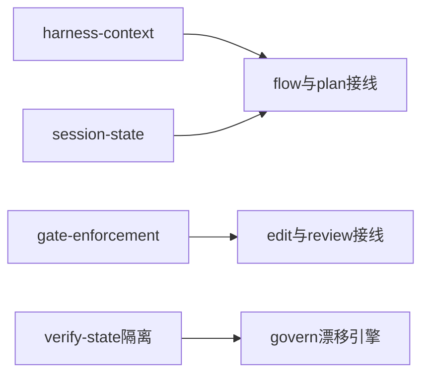

# Wave 1: Harness 共享内核原语与多技能门禁收口 — 功能设计规范（SPEC）

> 所属总控 PRD：[Wave 4 总控 PRD](../prd/261122-w4-harness-and-evergreen-prd.md) ｜ 配对 Todo：[w4a-harness-core Todo](../todo/261122-w4a-harness-core-todo.md)
>
> 总控认领范围：认领总控 `C1`、`C2`、`C3`、`C4`、`C5`（含前后半程全部 20 条审计缺口及 `dev-govern` / `verify-tools` 缓存与漂移引擎升级）。

## 文档信息与变更概览

| 项目 | 内容 |
| --- | --- |
| 当前状态 | `draft`（`draft \| approved \| implementing \| in_review \| implemented \| superseded`） |
| 规划级别 | `L3`（跨模块内核原语收敛与高风险门禁加严；未 `approved` 前不编码） |
| 创建 / 更新 | `2026-11-22` / `2026-11-22` |
| 分支 / 负责人 | `feat/w4a-harness-core` / `plan-harness` |
| 规划态 | `interactive`（边界、兼容路径与 4 原语架构已在 #519 指令与 Critique R1 后拍板清零） |

- **变更一句话**：在 `kit/skills/lib/` 收敛 3 个轻量共享原语并升级 `verify-state.mjs` 与 `dev-govern`，通过薄接线根治弱模型跳步、自审伪造、纯文本敷衍、跨 worktree 缓存污染、波次丢依赖与文档滞后漏检。

## 系统变更全景

| 模块 / 文件 | 变更性质 | 核心职责 |
| --- | --- | --- |
| `kit/skills/lib/harness-context.mjs` (new) | 新增 | 统一 `hostMode`、非空 `actor` 校验、单次令牌与 `enforceSlotBoundary` |
| `kit/skills/lib/session-state.mjs` (new) | 新增 | 统一 `S1–S4` 治理步、`triage` 指纹与 `explored` 状态（复用 `session-orient.mjs`） |
| `kit/skills/lib/gate-enforcement.mjs` (new) | 新增 | 统一零降级实证、`UI` 真实附件、`cleanup` 预览哈希与合并态删分支 |
| `kit/skills/lib/handoff-package.mjs` | 改造 | 泛化支持 `explore`/`plan`/`critique`/`implementer`/`reviewer` 统一回执契约 |
| `kit/skills/lib/verify-state.mjs`、`kit/skills/dev-govern/` | 改造 | Per-Slot 缓存隔离、`reconcile` 扫 `kit/`、修复 `checkDocChurnStaleness` |
| `kit/skills/dev-{explore,plan,edit,flow,review,iterate}/` | 改造 | 薄接线调用共享原语，修复 `flow-batch.mjs` 丢依赖 BUG，严守 `<= 800L` 与双对拍 |
| `scripts/dev/fixtures-w4-harness.mjs` (new) 等 | 新增 / 改造 | C1–C5 正反双向夹具、既有 12 份夹具 + `I313` 升级与 `I398–I409` 故障注入 |

## 一、背景与边界声明

<!-- section: goal -->
- **要改什么**：按「4 共享原语 + 薄接线」收敛全部 20 条 Harness 漏洞、`handoff-package` 泛化、`flow batch plan` 丢依赖 BUG 及 `dev-govern`/`verify-tools` 结构缺陷，并同步 `equip.mjs .` 与 `compose-agents.mjs .`。
- **不改什么**：不改动 `docs/TDD.md` 全景内容与 `docs/feature-map.json` 全量锚点（留给 Wave 2 `w4b-govern-evergreen` 在真实新内核上刷新）；不改动 `README.md`、`README.en.md`、`assets/readme/` 与 `docs/archive/`。
- **本期不做**：不新增第 9 个技能；不引入任何第三方 npm 依赖；不硬编码具体 AI 宿主名、环境变量或私有斜杠命令。
- **复用既有模块**：`kit/skills/lib/exit-codes.mjs`、`kit/skills/lib/ledger.mjs`、`kit/skills/lib/session-orient.mjs`、`kit/skills/lib/git.mjs`（`inspectBranchMergeState`）、`kit/skills/lib/evidence-substance.mjs`、`kit/skills/lib/handoff-package.mjs`、`scripts/dev/cli-parity.mjs`、`scripts/dev/exit-code-parity.mjs`。
- **架构基线关系**：严格遵循 `AGENTS.md` `arch-rules`（`kit/**` 仅引用 `kit/skills/lib/**` 与 `node:*`）、单文件 `.mjs <= 800L`、`AGENTS.md < 24576B`、`SKILL.md <= 200L`，`kit/skills/dev-govern/SKILL.md <= 16384B` 且不削弱 `bench.mjs --strict-budget`。
<!-- section: goal-end -->

## 二、设计方案与契约变更

<!-- section: design -->
### 2.1 `C1` 原语一：`kit/skills/lib/harness-context.mjs` (new)

1. **`hostMode` 分流与非空 `actor` 校验**：
   - 支持 `hostMode: 'multi-agent' | 'single-session'`（默认 `'multi-agent'`，可由 `--host-mode` 或 `AGENTS.md` 取舍键声明）。
   - `resolveNonEmptyActor(opts, { role, fallbackUser })`：`doc-plan.mjs init` 禁用 `owner: null`（在 `printHelp()` 补齐 `[--owner actor]`），若 `multi-agent` 未传 `--owner` 或 `single-session` 缺省则解析为非空确定性标识（且在 `audit`/`critique-rounds` 禁止 `null`）；`flow-inspect.mjs` 在 `planning -> started` 升格分支同样执行 `checkAuthorIsNotImplementer`（抽离升格辅助函数使 `flow-inspect.mjs` 降至 `< 770L`）。
   - `assertSubmitOwnership`（`flow-lifecycle-hooks.mjs`）：移除 `if (!rawExplicitAgent) return { ok: true }` 旁路；`multi-agent` 下 `submit` 必填非空 `--agent` 且拒收协调者/审查者代号；`hostMode === 'single-session'` 时允许传入显式 `--human-approved`（或等价单会话归属标识），输出人类确认提示而不诱导模型伪造子代理 ID。
   - **认领兼容性**：`commits > 0` 的 `Case >= 2` 在 `checkLifecyclePreconditions` 强制要求 `ledger.claimedAt`（`BLOCKED_NOT_CLAIMED`）；为不锁死纯本地单人流，对 `role === 'local-only' && linkedIssues.length === 0` 且非 `--planning` 的 `flow start` 任务自动写入 `claimedAt = now, claimedBy = implementerId`（除非已被 `release` 释放）；远端协同仓或含 Issue 任务仍须显式 `flow claim`。
   - **单次会话句柄绑定**：`ledger.mjs` 与 `review-ledger.mjs` 将 `reviewToken` 与 `(round, reviewerId, headSha)` 绑定，消费即失效（`BLOCKED_REVIEW_TOKEN_INVALID`）。
2. **统一槽位守卫 `enforceSlotBoundary`**：
   - 明确 `Case 1`（`riskTier === 'low'` 纯文档/单行修正）豁免建 worktree、豁免 `claimedAt` 并在 `flow start` / `enforceSlotBoundary` 允许原地改动；`Case 2..4`（`commits > 0`）必须在 `.worktrees/impl-<taskId>/` 实施，`verify` / `submit` / `merge` 硬拦截 `implRoot === mainRoot` 及 `mainRoot` 脏工作区（消除 `flow-merge.mjs` 静默跳过 `ff-only` pull 漏洞）。

### 2.2 `C2` 原语二：`kit/skills/lib/session-state.mjs` (new)、`handoff-package.mjs` 与波次修复

1. **会话指针与 `S1–S4` 治理账本（严禁重复扫描 `docs/`）**：
   - `session-state.mjs` 仅负责读写 `<gitCommonDir>/project-forge-flow/session-state.json`（`governancePhase: S1|S2|S3|S4`、`preBackupPath`、`preForgeBaseline` 与最新 `triage` 指纹）。
   - `flow-next.mjs` 无论是否处于 `idle`，**直接复用**既有 `kit/skills/lib/session-orient.mjs`（293L `buildSessionOrientation` / `listDocs`）摘要展示活跃 `draft` 规划与待执行 `governancePhase`（绝不造第二套 `docs/` 扫描）。
   - `scripts/survey.mjs --record`、`scripts/backup.mjs`、`scripts/equip.mjs`（仅新增 `<= 5` 行调用以保持 `<= 787L`）、`scripts/compose-agents.mjs` 写入步骤指针；`compose-agents.mjs --check` 与 `scripts/review.mjs` 对核心受管区做非空/非占位内容校验。
   - `doc-plan.mjs triage` 写下分流指纹，`flow start` / `determineWorkflowPolicy` 在触及路径或契约与先前 `Case 4` 分流冲突时阻断违规降档至 `Case 2`（`BLOCKED_TRIAGE_DOWNGRADE`）。
2. **探索、规划闭环与 `flow batch plan` 丢依赖修复**：
   - 移除 `flow-inspect.mjs` / `flow-explore.mjs` 的 `autoPopulateExplored`；`dev-explore` 写入真实探索回执（`source: 'dev-explore'`、`reusableModules`、`slicesCount`），`plan-exit-gate.mjs` 对新创建的 `caseType >= 3` 校验探索就绪（`BLOCKED_EXPLORE_REQUIRED`，对既有旧账本缺 `explored` 字段保留向后兼容或允许 `--allow-legacy-explored`? 不——旧账本缺字段按历史已开工豁免，仅对新建未探索拦截）。
   - `evaluatePlanExitGate`（`plan-exit-gate.mjs`）：`caseType >= 3 && !allowBootstrap && bound.length === 0` 硬阻断 `BLOCKED_PLAN_NOT_READY`（退出码 `3`）。
   - `doc-templates.mjs` / `doc-plan.mjs`：新增 `--multi-spec`；`doc-slice-graph.mjs` 与 `plan-exit-gate.mjs` 自动将「被 >= 1 份活跃子 SPEC `related_prd` 指向」的 PRD 视为总控 PRD。
   - `doc-plan-ops.mjs`：`--skip-critique-reason` 对 `Case 4`（`spec`/`prd`）仅在 `hostMode === 'single-session'` 且同时传 `--human-approved` 时放行。
   - `pending-decisions.mjs`：`analyzePendingDecisions` 扫描全文档**所有** `PENDING_WORDS` 标题及非围栏列表未决项；`plan_mode: interactive` 时要求澄清记录含 `--by user`。
   - `doc-substantive.mjs` & `doc-audit-helpers.mjs`：`checkCoreSubstantiveness` 对 `goal`/`design`/`non-goals` 取消 `VAGUE_FLUFF_RE` 前置过滤，直接校验 `extractTechAnchors(cleaned).count >= 1`；统一导出 `PATH_PREFIX_RE` 识别 `cmd`、`internal`、`pkg`、`apps`。
   - **修复 `doc-plan init` + `flow-batch.mjs` 丢依赖 BUG**：`doc-plan.mjs init` 按文档类型设定 `caseType`（`prd`/`spec`/`pair`/`all` -> `4`，`todo` -> `3`），同步写入 `dependsOn`/`scopeFiles` 且绝不把子切片写入总控容器账本；`flow-batch.mjs`（`handleBatchPlan`）对 `planned`/`planning` 账本合并 `buildSliceGraph` 的磁盘 `depends_on` 与 `scope_files` 并过滤纯 PRD 规划容器。
3. **泛化 `kit/skills/lib/handoff-package.mjs`**：
   - 将 `RECEIPT_LINES` 与 `ROLE_BOUNDARY` 从仅 `implementer`/`reviewer` 泛化至 `explore` / `plan` / `critique` / `implementer` / `reviewer` 五角色，统一输出紧凑 `<= 15` 行的 `role`、`status`、`head_sha`/`doc_sha`、`key_evidence`、`remaining_risks`、`next_action` 交接回执骨架（保持既有 `implementer`/`reviewer` 字段向后兼容）。

### 2.3 `C3` 原语三：`kit/skills/lib/gate-enforcement.mjs` (new)

1. **审查与实证默认零降级**：
   - `review-locks.mjs`：`evaluatePassBlockers` 默认 `enforceGates = true`；`review-gates.mjs`（<= 765L）保持完整命令模板输出。
   - `review-ledger.mjs`：Round >= 2 提交 `--verdict pass` 时，若 `unmentionedFromPrev.length > 0` 硬阻断 `BLOCKED_PASS_WITH_OPEN_BLOCKERS`（上轮 `mustFix` 必须全量进入 `--resolved` 或 `--rebut-accepted`）。
   - `empirical-artifacts.mjs`：`validateArtifactsAndVisual` 当 `visualFilesChanged.length > 0` 时要求至少 1 个非空 `--artifact` 或诚实 `--visual-blocked-reason`（退出码 `3`），禁用纯文本观察绕过。
   - `flow-lifecycle-hooks.mjs` & `edit-gate.mjs`：`runPreVerifyEditGateHook` 传 `--final` 且在终验拒绝 `--skip-edit-gate`（`BLOCKED_SKIP_EDIT_GATE_FORBIDDEN_ON_FINAL`）；`edit-gate.mjs` 取消 `delegatedToFlowPolicy` 对 `edit.do-not-edit` 的降级。
   - `review-empirical.mjs`：`check-empirical --cmd` 追加至 `requirements.autoCommands`；`check-fault --phase fail` 校验变动包含非空非纯注释可执行代码变更且命令失败。
2. **停损、`cleanup` 安全删分支与闭环状态化**：
   - `flow-merge.mjs` & `workflow-helpers.mjs`：停损解锁（`--human-approved --reason`）后**不再**豁免 `verifiedHead === currentHead` 与干净工作区校验。
   - `flow-merge.mjs` & `flow-cleanup.mjs`：`merge` 提示去掉 `--confirm`；`cleanup` 无 `--confirm` 预览生成绑定 `(taskId, worktrees, localBranch, remoteBranch, headSha)` 的 `previewHash`，`--confirm` 校验 `--preview-hash` 且默认 `git branch -d`；在 `gate-enforcement.mjs` 封装 `isSafeBranchDelete` 直接复用 `kit/skills/lib/git.mjs` 的 `inspectBranchMergeState` / `git cherry`（确认已合且无未推独有提交才允许 `-D`，否则报 `BLOCKED_UNMERGED_BRANCH_DELETE`）。
   - `flow-lifecycle-hooks.mjs`、`iterate-cycle.mjs`、`iterate.mjs`、`govern-retro.mjs`：`runLifecycleGovernHook` 在已安装 `dev-govern` 时默认启用轻量 `audit --changed`（除非配置 `govern: false` 或 `--skip-govern --reason`）；`iterate-cycle.mjs` 在 `<gitCommonDir>/project-forge-iterate/<taskId>.json` 持久化轮次进度；`iterate.mjs run` 纯文本输出 `[NEXT STEP]` 升级动作；`govern-retro.mjs` 整改 Todo 接入 `session-orient.mjs` 可见池。

### 2.4 `C4` 原语四：`verify-state.mjs` 缓存隔离与 `dev-govern` 漂移引擎

- `kit/skills/lib/verify-state.mjs`：`cache.json` 按 `(slotKey, treeHash)` 分槽读写，`cleanupTaskVerifyScratch` 清理 worktree 时同步回收槽位缓存。
- `kit/skills/dev-govern/scripts/govern-audit.mjs`（绝不撑破 781L `govern-checks.mjs`）：将 `unmappedSourceModules` 扩展支持 `kit/` 及 Go/Rust 目录前缀并拆出纯 helper；`reconcile` 报告 `emptyDocAnchors`、`emptyToolDomains` 与 `emptyTestRefDomains`。
- `kit/skills/dev-govern/scripts/govern-docs.mjs`（740L -> <= 755L）：`checkDocChurnStaleness` 中的 `isDocUpdate` 仅认权威长青文档，不被新建 `docs/specs/` 或 `docs/prd/` 清零。

### 2.5 `C5` 紧文件预算、双对拍与验证收敛

- **紧文件上限守卫**：`flow-inspect.mjs` (797L)、`flow-lifecycle.mjs` (795L)、`flow-merge.mjs` (783L)、`doc-plan.mjs` (776L)、`docs.mjs` (791L)、`scripts/equip.mjs` (782L -> <= 787L)、`govern-checks.mjs` (781L -> <= 781L)、`critique-rounds.mjs` (773L)、`review-gates.mjs` (755L) 均通过抽入 3 个新库守住 `<= 800L`；`kit/skills/dev-govern/SKILL.md` (15339B <= 16384B) 与 `AGENTS.md` (22883B < 24576B) 仅做极简增补。
- **双对拍同步**：`kit/skills/dev-flow/scripts/flow.mjs` `submit` 补 `[--agent agentId]` 等新参数入 `printHelp()`，`doc-plan.mjs` `init`/`approve` 同步 `printHelp()`，通过 `scripts/dev/cli-parity.mjs`；所有新 `BLOCKED_*` 码登记至 `kit/skills/lib/exit-codes.mjs` 并通过 `scripts/dev/exit-code-parity.mjs`；运行 `node scripts/equip.mjs .` 与 `node scripts/compose-agents.mjs .`；在 `scripts/dev/fixtures-w4-harness.mjs` (new) 与 `scripts/dev/injections-data-w4-harness.mjs` (new)（`I398–I409`）补齐正反双向用例与故障注入。
<!-- section: design-end -->

## 三、备选方案与否决理由

| 方案 | 怎么做的 | 为什么没选 | 什么情况下该改回它 |
| --- | --- | --- | --- |
| 在紧文件中原地加校验分支 | 直接修改 `flow-inspect.mjs`/`govern-checks.mjs`/`equip.mjs` | 否决：直接突破 800L 硬红线且造成多处重复 | 无（800L 是硬门禁） |
| 一刀切禁用单会话与纯本地快速流 | 所有模式强逼传多代理 ID 与显式 `claim` | 否决：锁死单会话宿主与 `local-only` 无 Issue 合法场景 | 无 |

## 四、改动清单与影响面

| 文件 / 目录 | 改动性质 | 改什么 | 谁会被影响 |
| --- | --- | --- | --- |
| `kit/skills/lib/harness-context.mjs` (new)、`session-state.mjs` (new)、`gate-enforcement.mjs` (new) | 新增 | 收敛角色/槽位锁、会话/探索/规划闭环与零降级门禁原语 | 全部 8 个技能与 `scripts/` |
| `kit/skills/lib/{handoff-package,verify-state,plan-exit-gate,pending-decisions,doc-substantive,doc-slice-graph,empirical-artifacts,ledger,exit-codes}.mjs` | 修改 | 泛化 5 角色交接、per-slot 缓存、退出码注册与门禁对接 | `dev-plan`/`dev-flow`/`dev-review`/`dev-verify-tools` |
| `kit/skills/dev-{explore,plan,edit,flow,review,iterate,verify-tools,govern}/` | 修改 | 薄接线、`printHelp()` 同步、`flow-batch.mjs` 修复、`SKILL.md` <= 180L/16KB | 全部 CLI 入口与 `.agents/skills/` |
| `scripts/{survey,backup,equip,compose-agents,review}.mjs`、`templates/agents-project.md`、`references/collaboration.md` | 修改 | S1–S4 账本（`equip.mjs` <= +5L）、话题锚点、`Case 1` 一致化 | 治理入场与 `AGENTS.md` |
| `scripts/dev/{fixtures-w4-harness,injections-data-w4-harness}.mjs` (new)、`scripts/dev/{cli-parity,exit-code-parity,preflight-kernel-parity}.mjs` | 新增 / 修改 | C1–C5 正反夹具、`I398–I409` 注入与双对拍同步 | `preflight`、`fixtures`、`verify-injections` |
| 既有 12 份夹具 + `I313`：`fixtures-{plan-wave,flow-docs,docs,locate-intake,flow-defects,empirical-cycle,flow-cleanup,flow-state,flow,verify-tools,explore}.mjs`、`injections-data-flow-defects.mjs` | 修改（升级断言） | 将旧松门禁断言升级为新硬门禁正反双向断言，补 `--owner`/`--agent`/`--preview-hash`/`--artifact` | `fixtures.mjs`、`verify-injections.mjs` |

## 五、冻结的验收标准

<!-- section: acceptance -->
<!-- criteria:start -->
- [ ] C1: `kit/skills/lib/harness-context.mjs` (new) 落地且 `doc-plan init` 禁 `owner: null`、`flow start` 升格分支校作者隔离、`submit` 按 `hostMode` 强制 `--agent`（`single-session` 支持人类确认通道）、`commits > 0` `Case >= 2` 强制 `claimedAt`（`local-only` 无 Issue 自动记认领）、`enforceSlotBoundary` 硬拦 `Case >= 2` 主仓修改/脏态并放行 `Case 1`，通过正反用例。
- [ ] C2: `kit/skills/lib/session-state.mjs` (new) 落地（`draft` 复用 `session-orient.mjs` 不重造扫描）、`handoff-package.mjs` 泛化 5 角色、`doc-plan init` + `flow-batch.mjs` 修复 `planned` 账本丢依赖 BUG、`S1–S4` 写步骤账本、`flow start` 移除 `autoPopulateExplored`、`plan-exit-gate` 硬阻断 `bound.length === 0`、`buildSliceGraph` 自动纳管总控 PRD、`--skip-critique-reason` 限 `single-session + --human-approved`、全扫描 `PENDING_WORDS`、去黑名单锚点检查与 `PATH_PREFIX_RE` 含 `cmd` 与 `internal`，通过正反用例。
- [ ] C3: `kit/skills/lib/gate-enforcement.mjs` (new) 落地且 `review-pack` 默认 `enforceGates: true`、Round 2+ `unmentionedFromPrev > 0` 禁 `pass`、UI 变更必附真实 `--artifact` 或 `--visual-blocked-reason`、`verify` 启用 `edit-gate --final` 且硬拦 `do-not-edit`、`check-empirical --cmd` 追加而非覆盖、`check-fault` 验真变更、停损解锁仍校 `headSha`、`cleanup` 校验 `previewHash` 与复用 `inspectBranchMergeState` 安全删分支、`dev-govern` 轻检默认开启、`iterate-cycle` 持久化进度，通过正反用例。
- [ ] C4: `kit/skills/lib/verify-state.mjs` 实现 `(slotKey, treeHash)` 分槽缓存；`govern-audit.mjs reconcile` 补扫 `kit/` 并报告空 `docAnchor`/`verificationTools`/`testRefs`；`govern-docs.mjs checkDocChurnStaleness` 仅由权威长青文档重置滞后计数，通过正反用例。
- [ ] C5: 8 技能接线与 `scripts/equip.mjs .` / `scripts/compose-agents.mjs .` 同步完成；所有 `.mjs <= 800L`、`AGENTS.md < 24576B`、`SKILL.md <= 200L/16384B`；既有 12 份夹具与 `I313` 升级完成，新增 `fixtures-w4-harness.mjs` (new) 与 `I398–I409`，全仓 `preflight` / `gap-coverage` / `fixtures` / `bench --strict-budget` / `verify-injections` / `cli-parity` / `exit-code-parity` 全绿。
<!-- criteria:end -->
<!-- section: acceptance-end -->

## 六、高风险点、门型与回滚路径

- **门型与回滚路径**：`one-way`（修改高风险门禁判断；未合并前可直接重置 worktree，合并后须通过单提交 `git revert` 反向恢复）。
- **故障注入预演**：在 `scripts/dev/injections-data-w4-harness.mjs` (new) 注册 `I398–I409`（并同步升级 `scripts/dev/injections-data-flow-defects.mjs` 的 `I313` 匹配新硬门禁），运行 `node scripts/dev/verify-injections.mjs` 验证逐条击红。

## 七、上线与兼容策略

- **向后兼容与既有测试升级**：历史已落盘账本缺少 `session-state.json`、`explored` 或 `previewHash` 历史字段时保留兼容读取；对依赖旧松门禁旁路的 12 份既有夹具（`fixtures-plan-wave.mjs`、`fixtures-flow-docs.mjs`、`fixtures-docs.mjs`、`fixtures-locate-intake.mjs`、`fixtures-flow-defects.mjs`、`fixtures-empirical-cycle.mjs`、`fixtures-flow-cleanup.mjs`、`fixtures-flow-state.mjs`、`fixtures-flow.mjs`、`fixtures-verify-tools.mjs`、`fixtures-explore.mjs`）及 `I313`，一律重构为新硬门禁正反双向断言（仅强化、绝不弱化）。

## 澄清与补充记录

- 已确认（2026-11-22 · user）：按 #519 指令确立 `w4a-harness-core` 为 Wave 1，覆盖 4 个共享内核原语、8 技能薄接线、`equip.mjs .` 同步及 `I398–I409` 故障注入，且不提前改写 Wave 2 独占的 `docs/TDD.md` 与 `docs/feature-map.json`。
- 已确认（2026-11-22 · critic-r1）：采纳 `critic-harness` R1 四项评审意见——补齐 `single-session` / `local-only` / `Case 1` 放行边界与 `cli-parity`/`exit-code-parity`、纳入 12 份既有夹具与 `I313` 升级写域、补齐 `handoff-package.mjs` 泛化及 `session-orient.mjs` 边界、纳入 `flow batch plan` 丢依赖 BUG 修复并标明紧文件行数上限防护。
