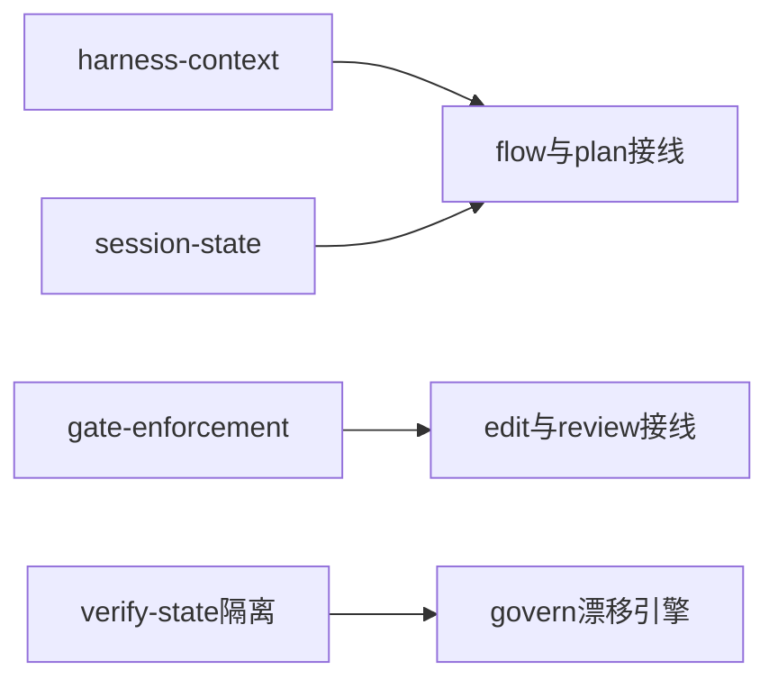

# Wave 1: Harness 共享内核原语与多技能门禁收口 — 功能设计规范（SPEC）

> 所属总控 PRD：[Wave 4 总控 PRD](../prd/261122-w4-harness-and-evergreen-prd.md) ｜ 配对 Todo：[w4a-harness-core Todo](../todo/261122-w4a-harness-core-todo.md)
>
> 总控认领范围：认领总控 `C1`、`C2`、`C3`、`C4`、`C5`（含前后半程全部 20 条审计缺口及 `dev-govern` / `verify-tools` 缓存与漂移引擎升级）。

## 文档信息与变更概览

| 项目 | 内容 |
| --- | --- |
| 当前状态 | `draft`（`draft \| approved \| implementing \| in_review \| implemented \| superseded`） |
| 规划级别 | `L3`（跨模块内核原语收敛与高风险门禁加严；未 `approved` 前不编码） |
| 创建 / 更新 | `2026-11-22` / `2026-11-22` |
| 分支 / 负责人 | `feat/w4a-harness-core` / `plan-harness` |
| 规划态 | `interactive`（边界与 4 原语架构已在 #519 指令下拍板清零） |

- **变更一句话**：在 `kit/skills/lib/` 收敛 3 个轻量共享原语并升级 `verify-state.mjs` 与 `dev-govern`，通过薄接线根治弱模型跳步、自审伪造、纯文本敷衍、跨 worktree 缓存污染与文档滞后漏检。

## 系统变更全景

| 模块 / 文件 | 变更性质 | 核心职责 |
| --- | --- | --- |
| `kit/skills/lib/harness-context.mjs` (new) | 新增 | 统一 `hostMode`、非空 `actor` 校验、单次令牌与 `enforceSlotBoundary` |
| `kit/skills/lib/session-state.mjs` (new) | 新增 | 统一 `S1–S4` 治理步、`triage` 指纹、`explored` 与 `draft` 可见性 |
| `kit/skills/lib/gate-enforcement.mjs` (new) | 新增 | 统一零降级实证、`UI` 真实附件、`cleanup` 预览哈希与 `isMergedBranch` |
| `kit/skills/lib/verify-state.mjs`、`kit/skills/dev-govern/` | 改造 | Per-Slot 缓存隔离、`reconcile` 扫 `kit/`、修复 `checkDocChurnStaleness` |
| `kit/skills/dev-{explore,plan,edit,flow,review,iterate}/` | 改造 | 薄接线调用共享原语，严守 `<= 800L` 与 `cli-parity` / `exit-codes` 对齐 |
| `scripts/dev/fixtures-w4-harness.mjs` (new) 等 | 新增 / 改造 | C1–C5 正反双向夹具与 `I398–I409` 故障注入复验 |

## 一、背景与边界声明

<!-- section: goal -->
- **要改什么**：按「4 共享原语 + 薄接线」收敛全部 20 条 Harness 漏洞及 `dev-govern`/`verify-tools` 结构缺陷，并同步 `equip.mjs .` 与 `compose-agents.mjs .`。
- **不改什么**：不改动 `docs/TDD.md` 全景内容与 `docs/feature-map.json` 全量锚点（留给 Wave 2 `w4b-govern-evergreen` 在真实新内核上刷新）；不改动 `README.md`、`README.en.md`、`assets/readme/` 与 `docs/archive/`。
- **本期不做**：不新增第 9 个技能；不引入任何第三方 npm 依赖；不硬编码具体 AI 宿主名、环境变量或私有斜杠命令。
- **复用既有模块**：`kit/skills/lib/exit-codes.mjs`、`kit/skills/lib/ledger.mjs`、`kit/skills/lib/evidence-substance.mjs`、`kit/skills/lib/handoff-package.mjs`、`kit/skills/lib/static-gates.mjs`、`kit/skills/lib/profile.mjs`、`scripts/dev/cli-parity.mjs`、`scripts/dev/exit-code-parity.mjs`。
- **架构基线关系**：严格遵循 `AGENTS.md` 的 `arch-rules`（`kit/**` 仅引用 `kit/skills/lib/**` 与 `node:*`）、单文件 `.mjs <= 800L`、`AGENTS.md < 24576B`、`SKILL.md <= 200L`，且不削弱 `bench.mjs --strict-budget`。
<!-- section: goal-end -->

## 二、设计方案与契约变更

<!-- section: design -->
### 2.1 `C1` 原语一：`kit/skills/lib/harness-context.mjs` (new)

1. **`hostMode` 与非空 `actor` 校验**：
   - 支持 `hostMode: 'multi-agent' | 'single-session'`（默认 `'multi-agent'`，可由 `--host-mode` 或 `AGENTS.md` 取舍键声明）。
   - `resolveNonEmptyActor(opts, { role, fallbackUser })`：`doc-plan.mjs init` 对 Case >= 3 / `prd` / `spec` / `todo` 禁用 `owner: null`（帮助文本补齐 `[--owner <actor>]`），确保 `SELF_CRITIQUE_REJECTED` 与 `SELF_AUTHORED_ACCEPTANCE` 不可绕过；`flow-inspect.mjs` 在 `planning -> started` 升格分支同样执行 `checkAuthorIsNotImplementer`。
   - `assertSubmitOwnership`（`kit/skills/dev-flow/scripts/flow-lifecycle-hooks.mjs`）：移除 `if (!rawExplicitAgent) return { ok: true }` 旁路；`submit` 必填非空 `--agent` 且拒收协调者/审查者代号；`commits > 0` 的 `Case >= 2` 在 `checkLifecyclePreconditions` 硬要求 `ledger.claimedAt`（报 `BLOCKED_NOT_CLAIMED`）。
   - **单次会话句柄绑定**：`ledger.mjs` 与 `review-ledger.mjs` 将 `reviewToken` 与 `(round, reviewerId, headSha)` 绑定，消费即失效；`single-session` 模式下提供人类确认提示而非诱导模型伪造子代理 ID。
2. **统一槽位守卫 `enforceSlotBoundary`**：
   - 显式对齐 `Case 1`（`riskTier === 'low'` 纯文档/单行修改允许在主工作区执行且豁免建 worktree）与 `Case 2..4`（`commits > 0` 必须位于 `.worktrees/impl-<taskId>/`）；`verify` / `submit` / `merge` 在 `Case >= 2` 时硬拦截 `implRoot === mainRoot` 及 `mainRoot` 脏工作区（消除 `flow-merge.mjs` 静默跳过 `ff-only` pull 漏洞）。

### 2.2 `C2` 原语二：`kit/skills/lib/session-state.mjs` (new)

1. **会话指针与 `S1–S4` 治理账本**：
   - 将 `governancePhase`（`S1|S2|S3|S4`、`preBackupPath`、`preForgeBaseline`）、最新 `triage` 结论指纹与未入账 `draft` 规划摘要写入 `<gitCommonDir>/project-forge-flow/session-state.json`。
   - `scripts/survey.mjs --record`、`scripts/backup.mjs`、`scripts/equip.mjs`、`scripts/compose-agents.mjs` 同步更新步骤指针；`compose-agents.mjs --check` 与 `scripts/review.mjs` 对核心受管区做非空/非占位内容校验（防止仅删除 `project-forge: fill` 待填注释交差）。
   - `flow-next.mjs` 与 `session-orient.mjs` 无论是否处于 `idle`，均输出活跃 `draft` 规划与未收口 `governancePhase` 摘要。
   - `doc-plan.mjs triage` 写下最近分流指纹，`flow start` / `determineWorkflowPolicy` 在触及路径或契约与先前 `Case 4` 分流冲突时阻断违规降档至 `Case 2`。
2. **探索与规划就绪态闭环**：
   - 移除 `flow-inspect.mjs` / `flow-explore.mjs` 的 `autoPopulateExplored` 自动写满逻辑；`dev-explore`（`repo-map.mjs --task` / `doc-locate.mjs` / `flow.mjs explore`）写入真实探索回执（`source: 'dev-explore'`、`reusableModules`、`slicesCount`），`plan-exit-gate.mjs` 与 `flow-next.mjs` 对 `caseType >= 3` 校验探索就绪。
   - `evaluatePlanExitGate`（`kit/skills/lib/plan-exit-gate.mjs`）：当 `caseType >= 3 && !allowBootstrap && bound.length === 0` 时硬阻断 `BLOCKED_PLAN_NOT_READY`（退出码 `3`），取消 `WARN_PLAN_NOT_BOUND` 静默放行。
   - `doc-templates.mjs` / `doc-plan.mjs`：新增 `--multi-spec`；`doc-slice-graph.mjs`（`buildSliceGraph`）与 `plan-exit-gate.mjs`（`evaluateMasterPrd`）自动将「被 >= 1 份活跃子 SPEC `related_prd` 指向」的 PRD 视为总控 PRD。
   - `doc-plan-ops.mjs`：`--skip-critique-reason` 对 `Case 4`（`spec`/`prd`）仅在 `hostMode === 'single-session'` 且同时传 `--human-approved` 时放行，否则报 `BLOCKED_CRITIQUE_REQUIRED` / `MISSING_HUMAN_APPROVAL`。
   - `pending-decisions.mjs`：`analyzePendingDecisions` 扫描全文档**所有** `PENDING_WORDS` 标题及非围栏列表中的未决项；`plan_mode: interactive` 时要求澄清记录含 `--by user` 真实归属。
   - `doc-substantive.mjs` & `doc-audit-helpers.mjs`：`checkCoreSubstantiveness` 对 `goal`/`design`/`non-goals` 取消 `VAGUE_FLUFF_RE` 前置过滤，直接校验 `extractTechAnchors(cleaned).count >= 1`；统一导出 `PATH_PREFIX_RE`，补全行内裸路径对 `cmd`、`internal`、`pkg`、`apps` 等前缀目录的识别。

### 2.3 `C3` 原语三：`kit/skills/lib/gate-enforcement.mjs` (new)

1. **审查与实证默认零降级**：
   - `review-locks.mjs`：`evaluatePassBlockers` 默认 `enforceGates = true`；`review-gates.mjs` `formatPackText` 保持完整 `--enforce-gates` / `--reviewer-id` 命令输出。
   - `review-ledger.mjs`：Round >= 2 提交 `--verdict pass` 时，若 `unmentionedFromPrev.length > 0` 硬阻断 `BLOCKED_PASS_WITH_OPEN_BLOCKERS`（上轮 `mustFix` 必须全量进入 `--resolved` 或 `--rebut-accepted`）。
   - `empirical-artifacts.mjs`：`validateArtifactsAndVisual` 当 `visualFilesChanged.length > 0` 时废除「仅凭纯文本 `--e2e-evidence` 放行」，强制要求至少 1 个非空 `--artifact` 或诚实 `--visual-blocked-reason`（退出码 `3`）。
   - `flow-lifecycle-hooks.mjs` & `edit-gate.mjs`：`runPreVerifyEditGateHook` 传 `--final` 且在终验拒绝 `--skip-edit-gate`（`BLOCKED_SKIP_EDIT_GATE_FORBIDDEN_ON_FINAL`）；`edit-gate.mjs` 取消 `delegatedToFlowPolicy` 对 `edit.do-not-edit` 的降级（除合法 `isLegalArchiveMove` 外一律硬阻断）。
   - `review-empirical.mjs`：`check-empirical --cmd` 采用追加至 `requirements.autoCommands`（不替换 Dev Profile 必跑命令）；`check-fault --phase fail` 校验变动包含非空非纯注释的可执行逻辑改动且测试真红。
2. **停损、`cleanup` 与闭环状态化**：
   - `flow-merge.mjs` & `workflow-helpers.mjs`：停损人类解锁（`--human-approved --reason`）后**不再**豁免 `verifiedHead === currentHead` 与干净工作区检查；停损后产生新提交须先复跑 `verify`。
   - `flow-merge.mjs` & `flow-cleanup.mjs`：`merge` 收尾提示去掉 `--confirm`；`cleanup` 无 `--confirm` 预览返回基于清单计算的 `previewHash`，`--confirm` 校验 `--preview-hash` 且默认使用 `git branch -d`，仅当 `isMergedBranch()` 证实已合且无未推送独有提交时才允许 `-D`。
   - `flow-lifecycle-hooks.mjs`、`iterate-cycle.mjs`、`iterate.mjs`、`govern-retro.mjs`：`runLifecycleGovernHook` 在已安装 `dev-govern` 时默认执行轻量 `audit --changed`（除非显式 `govern: false` 或 `--skip-govern --reason`）；`iterate-cycle.mjs` 在 `<gitCommonDir>/project-forge-iterate/<taskId>.json` 持久化轮次进度防止伪造跳过 `NO_PROGRESS_STALL`；`iterate.mjs run` 纯文本模式打印 `[NEXT STEP]` 升级动作；`govern-retro.mjs` 产出的未解决整改单纳入 `session-orient.mjs` / `flow next` 可见池。

### 2.4 `C4` 原语四：`verify-state.mjs` 缓存隔离与 `dev-govern` 漂移引擎

- `kit/skills/lib/verify-state.mjs`：`cache.json` 按 `(slotKey, treeHash)` 分槽读写（`slotKey` 派生自 `canonicalPath(worktreeRoot)` 与分支），`cleanupTaskVerifyScratch` 清理 worktree 时同步回收对应槽位缓存，彻底消除并行 worktree 污染 `main` 基线。
- `kit/skills/dev-govern/scripts/govern-audit.mjs`：`unmappedSourceModules` 正则扩充 `kit/`（`^(?:src|lib|app|packages|services|scripts|kit)\/`）并兼容 Go/Rust 目录前缀（`cmd` 与 `internal`）；`reconcile` 增补 `featureMap` 的 `emptyDocAnchors`、`emptyToolDomains` 与 `emptyTestRefDomains` 漂移报告。
- `kit/skills/dev-govern/scripts/govern-docs.mjs`：`checkDocChurnStaleness` 中的 `isDocUpdate` 仅认权威长青文档（`docs/TDD.md`、`docs/feature-map.json`、`AGENTS.md`、`README*`、`ARCHITECTURE.md`、`<codeDir>/AGENTS.md`），不再被新建 `docs/specs/` 或 `docs/prd/` 错误清零。

### 2.5 `C5` 接线、`templates/` 对齐与验证收敛

- 严守 800L 红线：从 `flow-inspect.mjs` (797L)、`flow-lifecycle.mjs` (795L)、`flow-merge.mjs` (783L)、`doc-plan.mjs` (776L) 抽薄接线入上述 3 个新共享库，使改动文件行数只减不增或保持安全余量；`templates/agents-project.md` 仅增 1 句「话题锚点」约束确保 `AGENTS.md < 24576B`。
- 所有新阻断码同步登记进 `kit/skills/lib/exit-codes.mjs`；所有新参数同步声明于各入口 `printHelp()` 并过 `scripts/dev/cli-parity.mjs`；运行 `node scripts/equip.mjs .` 与 `node scripts/compose-agents.mjs .`；在 `scripts/dev/fixtures-w4-harness.mjs` (new) 与 `scripts/dev/injections-data-w4-harness.mjs` (new)（`I398–I409`）补齐正反双向用例与故障注入。
<!-- section: design-end -->

## 三、备选方案与否决理由

| 方案 | 怎么做的 | 为什么没选 | 什么情况下该改回它 |
| --- | --- | --- | --- |
| 在 8 个技能脚本各处原地加 `if` 补丁 | 在 `flow-*`/`doc-*`/`review-*` 分别打 20 处检查 | 否决：会导致 776–797L 紧文件爆 800 行且出现多套口径漂移 | 无（800L 与单源内核是硬约束） |
| 仅允许单一大一统新文件承载全部 20 项逻辑 | 建单个千行 `harness.mjs` | 否决：直接突破 800 行上限且混合跨阶段职责 | 拆为 3 个内聚 `lib/*.mjs`（已选） |

## 四、改动清单与影响面

| 文件 / 目录 | 改动性质 | 改什么 | 谁会被影响 |
| --- | --- | --- | --- |
| `kit/skills/lib/harness-context.mjs` (new)、`session-state.mjs` (new)、`gate-enforcement.mjs` (new) | 新增 | 收敛角色/槽位锁、会话/探索/规划闭环与零降级门禁原语 | 全部 8 个技能与 `scripts/` |
| `kit/skills/lib/{verify-state,plan-exit-gate,pending-decisions,doc-substantive,doc-slice-graph,empirical-artifacts,ledger,exit-codes,handoff-package}.mjs` | 修改 | 对接新原语、per-slot 缓存与全量退出码注册 | `dev-plan`/`dev-flow`/`dev-review`/`dev-verify-tools` |
| `kit/skills/dev-{explore,plan,edit,flow,review,iterate,verify-tools,govern}/` | 修改 | 薄接线、`printHelp()` 同步、`SKILL.md` <= 180L 对齐 | 全部 CLI 入口与 `.agents/skills/` |
| `scripts/{survey,backup,equip,compose-agents,review}.mjs`、`templates/agents-project.md`、`references/collaboration.md` | 修改 | S1–S4 账本记录、话题锚点一句约束、`Case 1` 一致化 | 治理入场与 `AGENTS.md` |
| `scripts/dev/fixtures-w4-harness.mjs` (new)、`scripts/dev/injections-data-w4-harness.mjs` (new)、`scripts/dev/{cli-parity,preflight-kernel-parity}.mjs` | 新增 / 修改 | C1–C5 正反夹具、`I398–I409` 故障注入与奇偶门禁同步 | `preflight`、`fixtures`、`verify-injections` |

## 五、冻结的验收标准

<!-- section: acceptance -->
<!-- criteria:start -->
- [ ] C1: `kit/skills/lib/harness-context.mjs` (new) 落地且 `doc-plan init` 禁 `owner: null`、`flow start` 升格分支校作者隔离、`flow submit` 必传非空 `--agent`、`commits > 0` `Case >= 2` 强制 `claimedAt`、`enforceSlotBoundary` 硬拦 `Case >= 2` 主工作区改动与 `mainRoot` 脏态并放行 `Case 1` 低风险主仓修复，通过 `fixtures-w4-harness.mjs` 正反用例。
- [ ] C2: `kit/skills/lib/session-state.mjs` (new) 落地且 `S1–S4` 写步骤账本与非空节校验、`flow start` 移除 `autoPopulateExplored`、`plan-exit-gate` 硬阻断 `caseType >= 3 && bound.length === 0`、`buildSliceGraph` 自动纳管被子 SPEC 指向的 PRD、`--skip-critique-reason` 限 `single-session + --human-approved`、全扫描 `PENDING_WORDS`、去黑名单技术锚点检查、`PATH_PREFIX_RE` 含 `cmd/`/`internal/`、`flow next` 永不屏蔽 `draft` 规划，通过正反用例。
- [ ] C3: `kit/skills/lib/gate-enforcement.mjs` (new) 落地且 `review-pack` 默认 `enforceGates: true`、Round 2+ `unmentionedFromPrev > 0` 禁 `pass`、UI 变更必附真实 `--artifact` 或 `--visual-blocked-reason`、`verify` 启用 `edit-gate --final` 且硬拦 `do-not-edit`、`check-empirical --cmd` 追加而非覆盖、`check-fault` 验真变更、停损解锁仍校 `headSha`、`cleanup` 校验 `previewHash` 与 `isMergedBranch()`、`dev-govern` 轻检默认开启、`iterate-cycle` 状态持久化，通过正反用例。
- [ ] C4: `kit/skills/lib/verify-state.mjs` 实现 `(slotKey, treeHash)` 分槽缓存且并行 worktree 互不污染 `main` 基线；`govern-audit.mjs reconcile` 补扫 `kit/` 并报告空 `docAnchor`/`verificationTools`/`testRefs`；`govern-docs.mjs` `checkDocChurnStaleness` 不再被新建 `docs/specs/` 重置，通过正反用例。
- [ ] C5: 全部 8 个技能接线完成并执行 `node scripts/equip.mjs .` 与 `node scripts/compose-agents.mjs .`；所有 `.mjs <= 800L`、`AGENTS.md < 24576B`、`SKILL.md <= 200L`，`preflight.mjs`、`gap-coverage.mjs`、`fixtures.mjs`、`bench.mjs --strict-budget`、`verify-injections.mjs --only I398`..`I409`（及全量）与 `cli-parity.mjs` / `exit-code-parity.mjs` 全绿。
<!-- criteria:end -->
<!-- section: acceptance-end -->

## 六、高风险点、门型与回滚路径

- **门型与回滚路径**：`one-way`（修改高风险门禁判断；未合并前可直接重置 worktree，合并后须通过单提交 `git revert` 反向恢复）。
- **故障注入预演**：在 `scripts/dev/injections-data-w4-harness.mjs` (new) 注册 `I398–I409`（覆盖 `owner: null` 绕过、升格跳过作者校验、缺失 `--agent` 放行、`bound.length === 0` 放行、`--skip-critique-reason` 后门、UI 纯文本绕过、`enforceGates` 默认 `false`、Round 2+ 漏阻塞项 `pass`、`cleanup` 漏 `previewHash`、停损跳过 `headSha`、共享 `verify-tools` 缓存跨槽污染、`reconcile` 漏扫 `kit/`），运行 `node scripts/dev/verify-injections.mjs` 验证逐条击红。

## 七、上线与兼容策略

- **向后兼容**：读取历史旧账本或缺少 `session-state.json` 时优雅降级并保留旧字段解析；已有合法测试用例若依赖历史静默降级通道，在 `fixtures-w4-harness.mjs` (new) 与对应域夹具中对齐更新并保留正反断言。

## 澄清与补充记录

- 已确认（2026-11-22 · user）：按 #519 指令确立 `w4a-harness-core` 为 Wave 1，覆盖 4 个共享内核原语、8 技能薄接线、`equip.mjs .` 同步及 `I398–I409` 故障注入，且不提前改写 Wave 2 独占的 `docs/TDD.md` 与 `docs/feature-map.json`。
