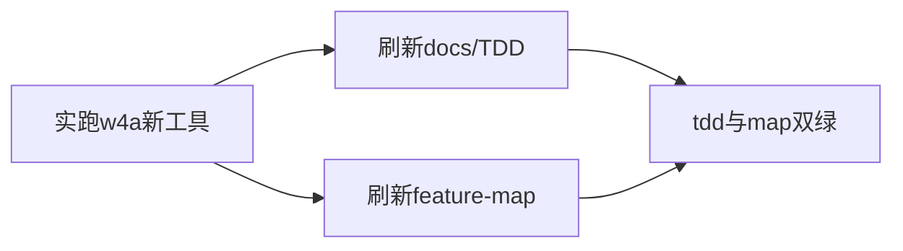

# Wave 2: 基于升级工具的长青文档系统与功能地图刷新 — 功能设计规范（SPEC）

> 所属总控 PRD：[Wave 4 总控 PRD](../prd/261122-w4-harness-and-evergreen-prd.md) ｜ 配对 Todo：[w4b-govern-evergreen Todo](../todo/261122-w4b-govern-evergreen-todo.md)
>
> 总控认领范围：认领总控 `C6`、`C7`（严格在 Wave 1 `w4a-harness-core` 合并 `main` 后执行）。

## 文档信息与变更概览

| 项目 | 内容 |
| --- | --- |
| 当前状态 | `draft`（`draft \| approved \| implementing \| in_review \| implemented \| superseded`） |
| 规划级别 | `L3`（全仓架构真源与功能地图全量对齐；依赖 Wave 1 合入后实跑新版工具生成并核对） |
| 创建 / 更新 | `2026-11-22` / `2026-11-22` |
| 分支 / 负责人 | `feat/w4b-govern-evergreen` / `plan-harness` |
| 规划态 | `interactive`（边界与验收目标已在 #519 指令下拍板清零） |

- **变更一句话**：在 `w4a-harness-core` 合入后的真实源码上，真正运行升级后的 `dev-govern`、`dev-explore` 与 `dev-verify-tools` 对本仓执行一次完整长青文档刷新，消除 `docs/TDD.md`、`docs/feature-map.json` 与 `AGENTS.md` 的全部已知滞后与空缺。

## 系统变更全景

| 模块 / 文件 | 变更性质 | 核心职责 |
| --- | --- | --- |
| `docs/TDD.md` | 改造 | 补齐 L1–L4 全模块清单、修复图 1/4/5 与 Harness/Worktree 状态隔离描述 |
| `docs/feature-map.json` | 改造 | 补齐全部 `docAnchor`、`skill` 验证工具、`check`/`release` 测试引用与新增模块 |
| `AGENTS.md`、`templates/agents-project.md` | 改造 | 对齐 `.github/workflows/check.yml` 校验命令声明，维持 `< 24576B` |

## 一、背景与边界声明

<!-- section: goal -->
- **要改什么**：以升级后的 `govern-audit.mjs reconcile`、`repo-map.mjs`、`verify-tools.mjs audit` 实测输出为唯一事实来源，全面刷新 `docs/TDD.md`、`docs/feature-map.json` 与 `AGENTS.md` 构建校验同步。
- **不改什么**：不修改 `kit/skills/` 与 `scripts/` 的业务/门禁源码（Wave 1 独占）；不修改 `README.md`、`README.en.md`、`assets/readme/` 与 `docs/archive/`。
- **本期不做**：不手工虚构模块数或工具清单（一律由 `git ls-files` 与实跑工具输出校验）；不把 Wave 2 提前与 Wave 1 并行执行（严格 `depends_on: [w4a-harness-core]` 防止树哈希漂移）。
- **复用既有模块**：`kit/skills/dev-govern/scripts/govern-audit.mjs`、`kit/skills/dev-explore/scripts/repo-map.mjs`、`kit/skills/dev-verify-tools/scripts/verify-tools.mjs`、`kit/skills/lib/tdd-structure.mjs`、`kit/skills/lib/tdd-parity.mjs`、`scripts/review.mjs`、`scripts/compose-agents.mjs`。
- **架构基线关系**：严格遵循 `docs/TDD.md` 自检规则（`tdd-structure`、`tdd-parity`）、Mermaid 标签宽度 `<= 16 / <= 12`（禁 HTML 标签）、`AGENTS.md < 24576B`。
<!-- section: goal-end -->

## 二、设计方案与契约变更

<!-- section: design -->
### 2.1 `C6` 全景刷新 `docs/TDD.md`

1. **前置实跑采集真实清单**：
   - 在 `w4a-harness-core` 合并后的隔离工作区执行 `node .agents/skills/dev-explore/scripts/repo-map.mjs . --json`、`node .agents/skills/dev-govern/scripts/govern-audit.mjs reconcile . --json` 与 `node .agents/skills/dev-govern/scripts/govern-audit.mjs audit . --strict`。
2. **修复 L1–L4 模块统计与清单缺口（原 `docs/TDD.md` L83–100 等处）**：
   - 补齐 `kit/skills/lib/` 全部真实存在的 `.mjs` 模块路径（涵盖此前漏记的 `cli.mjs`、`critique-rounds.mjs`、`doc-approval.mjs`、`doc-facts.mjs`、`doc-shape.mjs`、`doc-substantive.mjs`、`feature-map.mjs`、`signals.mjs`、`tdd-facts.mjs`、`tdd-shape.mjs`、`verify-state.mjs`、`verdict.mjs` 等以及 `w4a-harness-core` 新增的 3 个共享内核原语），核实并更新 L4 与目录表的真实文件数。
3. **升级 Mermaid 架构图与机制流转图（严格 `16/12` 宽度，禁 HTML）**：
   - **图 1（系统架构全景）**：补全 `kit/skills/templates/`、`docs/feature-map.json` 与仓外运行时状态面（`<gitCommonDir>/project-forge-{flow,govern,verify,iterate}/`）。
   - **图 2（S1–S4 接入流）**：同步 S1–S4 步骤账本记录与存量资产四类融合、实跑 `preForgeBaseline` 与 `compose-agents` 非空核验。
   - **图 4（8 技能全流程与 Harness 门禁流转）**：补全 `dev-iterate` 经 `escalation.mjs` 建单直回正流的主闭环边、`dev-govern` `retro`/`reconcile` 回流修订长青文档与门禁、停损解锁仍须 `verify`/复核后再合、以及 `flow.mjs batch` / `flow.mjs sync` / `--external-pr` 入口。
   - **图 5（双态规划与波次闭环）**：补齐 `batch` 交接消费接入 `flow.mjs start` 与波次完成后推进下一波次的闭环边。
   - **Worktree 状态隔离与三层文档关系**：补充 per-slot `verify-state.mjs` 缓存、`session-state.json` 会话指针及 `Tier 1 / Tier 2` 收敛原则说明。
4. **保持结构与同步全绿**：运行 `node .agents/skills/dev-plan/scripts/doc-plan.mjs audit . --json` 与 `tdd-structure` / `tdd-parity` 验证零错误、零警告。

### 2.2 `C7` 全量刷新 `docs/feature-map.json` 与 `AGENTS.md`

1. **补齐 `docs/feature-map.json` 四类结构缺口**：
   - **22+ 功能域 `docAnchor` 全量填充**：为每个 `feature` 写入精确有效的 `docs/TDD.md` 对应章节锚点（如 `docs/TDD.md#2-系统架构全景与模块边界`，并经 `govern-audit.mjs reconcile` 与 Markdown 锚点核对有效）。
   - **补齐局部覆盖空白与新增模块映射**：为 `skill` 功能域补充 `verificationTools`（对应 `preflight-suite-checks` / `review.mjs` 技能清单校验）；为 `check` 与 `release` 功能域补充真实存在的 `testRefs`（如 `.github/workflows/check.yml`、`scripts/dev/preflight.mjs`、`scripts/dev/e2e-zip-harness.mjs` 等）；将 `w4a-harness-core` 新增共享内核模块（`harness-context.mjs`、`session-state.mjs`、`gate-enforcement.mjs`）及 `assets/readme/*.svg` 相关条目全部准确映射入对应 `features[].modules` 与 `businessFlows`。
2. **对齐 `AGENTS.md` CI 校验命令**：
   - 同步 `AGENTS.md`「构建与验证」受管区间与 `.github/workflows/check.yml` 实际执行指令（包括 `node scripts/dev/verify-injections.mjs --jobs 4` 与 `preflight.mjs --package`），消除 `node scripts/review.mjs .` 的命令脱节提示，同时保持 `AGENTS.md < 24576B`。
3. **验证基准重建**：
   - 运行 `node .agents/skills/dev-verify-tools/scripts/verify-tools.mjs sync .`（按需）与 `verify-tools.mjs audit .`，达到 `Status: OK | StaleTools: 0 | BlindSpots: 0 | Zombies: 0`，且 `govern-audit.mjs reconcile . --json` 零漂移。
<!-- section: design-end -->

## 三、备选方案与否决理由

| 方案 | 怎么做的 | 为什么没选 | 什么情况下该改回它 |
| --- | --- | --- | --- |
| 将长青文档刷新合进 Wave 1 同分支做 | 一次 PR 同时改内核原语和 `TDD`/`feature-map` | 否决：无法在真实升级后的 `dev-govern`/`verify-tools` 下自测，且会让单 PR 体积失控、审查聚焦分散 | 无（Wave 依赖已显式声明） |
| 仅手工补 `docs/TDD.md` 数字不调图和 `feature-map` | 只改行 83–100 统计 | 否决：图 4/5 闭环仍误导弱模型，22 个 `docAnchor` 与 `skill`/`check`/`release` 空白仍未消除 | 无 |

## 四、改动清单与影响面

| 文件 / 目录 | 改动性质 | 改什么 | 谁会被影响 |
| --- | --- | --- | --- |
| `docs/TDD.md` | 修改 | 补齐全部模块清单、升级图 1/4/5、写实 Harness 四原语与 Worktree 状态隔离 | 维护者、`dev-explore`、`tdd-parity` |
| `docs/feature-map.json` | 修改 | 补齐全量 `docAnchor`、`skill` 工具、`check`/`release` `testRefs` 与 `w4a` 模块 | `verify-tools`、`govern-audit reconcile` |
| `AGENTS.md`、`templates/agents-project.md` | 修改 | 对齐 CI 校验命令清单，保持 `< 24576B` | `compose-agents.mjs`、`scripts/review.mjs` |

## 五、冻结的验收标准

<!-- section: acceptance -->
<!-- criteria:start -->
- [ ] C6: `docs/TDD.md` 经升级版 `dev-govern` 与 `dev-explore` 核实后完成全景刷新：补齐 L1–L4 全量真实模块路径与统计（含 `w4a-harness-core` 新增原语），图 1/图 4/图 5 均反映最新闭环且通过 Mermaid `16/12` 宽度校验，通过 `doc-plan.mjs audit .`、`tdd-structure` 与 `tdd-parity` 全绿。
- [ ] C7: `docs/feature-map.json` 全量功能域 `docAnchor` 非空且锚点真实可达，`skill` 补齐 `verificationTools`，`check`/`release` 补齐 `testRefs`，`w4a-harness-core` 新增原语与 `assets/readme/*.svg` 均全映射；`AGENTS.md` 消除 `review.mjs .` 校验命令脱节且 `< 24576B`；最终实跑 `verify-tools.mjs audit .` 返回 `Status: OK | StaleTools: 0 | BlindSpots: 0 | Zombies: 0`，`govern-audit.mjs reconcile . --json` 返回 `unmappedSourceModules: []`、`missingEntryPaths: []` 且 `govern-audit.mjs audit . --strict` 与 `preflight.mjs` 全绿。
<!-- criteria:end -->
<!-- section: acceptance-end -->

## 六、高风险点、门型与回滚路径

- **门型与回滚路径**：`two-way`（纯常青文档与索引更新，若 `AGENTS.md` 或锚点异常可通过 `git revert` 单提交回退）。
- **高风险路径**：`AGENTS.md`、`templates/` —— 须保证 `compose-agents.mjs . --check` 与 `AGENTS.md < 24576B` 通过，不破坏受管区间配对标记。
- **故障注入预演**：Wave 2 不改动运行态门禁逻辑，直接跑现有 `node scripts/dev/preflight.mjs`、`node scripts/dev/fixtures.mjs --domain govern`、`node scripts/dev/fixtures.mjs --domain docs` 与 `node scripts/dev/verify-injections.mjs --only I396` 验证长青文档与结构校验门禁全绿。

## 七、上线与兼容策略

- **依赖顺序**：严格要求 `w4a-harness-core` 合并进 `main` 后再执行 `flow.mjs start --task w4b-govern-evergreen`，确保 `docs/feature-map.json` 的树哈希与工具基线采样针对终态代码计算，不产生二次过时漂移。

## 澄清与补充记录

- 已确认（2026-11-22 · user）：按 #519 指令确立 `w4b-govern-evergreen` 为 Wave 2（`depends_on: [w4a-harness-core]`），在 `w4a` 落盘后使用升级工具系统刷新 `docs/TDD.md`、`docs/feature-map.json` 与 `AGENTS.md`。
