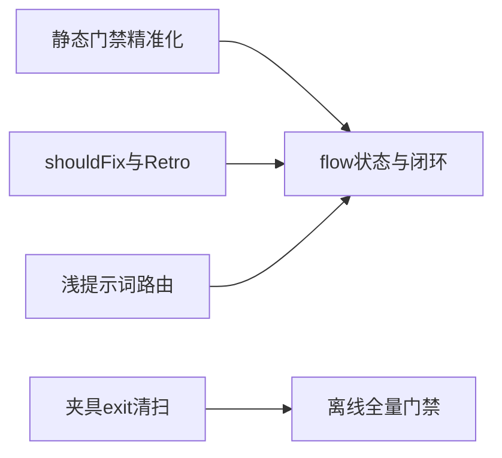

# 门禁精准化、should-fix与lastRetro闭环、浅提示词路由及夹具防泄漏 — 功能设计规范（SPEC）

## 文档信息与变更概览

| 项目 | 内容 |
| --- | --- |
| 当前状态 | `draft` |
| 规划级别 | `L3` |
| 创建 / 更新 | `2026-11-23` / `2026-11-23` |
| 分支 / Issue / PR | `feat/gates-retro-routing-hardening` / 未关联 / 未关联 |
| 负责人 / 内审状态 | coordinator / `pending` |
| 规划态 | `autonomous` |
| 关联 Todo | `docs/todo/261123-gates-retro-routing-hardening-todo.md` |

- **变更一句话**：精准收紧 `static-gates`/`edit-gate`/`doc-audit`/`govern`/`workflow-policy`/`plan-exit-gate` 与 `task-backend-local`，打通 `--should-fix` -> `signals.jsonl` -> `govern-retro` -> `flow-next` `lastRetro` 闭环，强化 `AGENTS.md`/skill 浅提示词隔离路由，并根治 `fixtures` 临时目录泄漏。

## 系统变更全景

| 模块 / 文件 | 变更性质 | 核心职责 |
| --- | --- | --- |
| `kit/skills/lib/static-gates.mjs` | 改造 | 恒真占位拦截、大面积断言删减升级 deterministic、识别 camelCase 断言助词 |
| `kit/skills/dev-edit/scripts/edit-gate.mjs` | 改造 | 仅对 diff 新增行做 hygiene 扫描；放行合法任务归档目标 |
| `kit/skills/dev-flow/scripts/flow-lifecycle-finalize.mjs` | 改造 | 归档 `git add` 保状态确定性 |
| `kit/skills/dev-plan/scripts/doc-audit.mjs` | 改造 | 正文相对路径同时兼容文档目录与仓根 |
| `kit/skills/lib/workflow-policy.mjs` / `flow-lifecycle.mjs` | 改造 | 输出无效 `--cmd` 拒收原因；pnpm worktree 注入环境变量 |
| `kit/skills/dev-govern/scripts/govern-{checks,tests,retro}.mjs` | 改造 | `testdata` 夹具、`secrets-are-placeholders`、`bench/example` 测试、统计 `shouldFix` |
| `kit/skills/dev-review/scripts/review-ledger.mjs` | 改造 | 将 `shouldFixList` 写入 `signals.jsonl` |
| `kit/skills/dev-flow/scripts/flow-next.mjs` | 改造 | 读取 `govern-state.json` `lastRetro` 输出逾期/复发提醒 |
| `kit/skills/lib/plan-exit-gate.mjs` / `task-backend-local.mjs` | 改造 | 禁用 YAML `skipped` 绕过 `spec`/`prd`；支持纯裸仓本地受控快进 |
| `templates/agents-project.md` / `kit/skills/dev-{iterate,govern}/SKILL.md` | 改造 | 明确只补测试归 Case 2/3 与探索转写入强制 `flow start` + `edit-gate` |
| `scripts/dev/fixtures-helpers.mjs` / `fixtures.mjs` | 改造 | 进程级临时目录登记与 `exit`/`finally` 清扫 |

## 一、背景与边界声明

- **要改什么**：Round-4 双 Hydrogen 审计暴露的全部门禁精准化、闭环断链、自签绕过、浅提示词路由与 `fixtures` 泄漏根因。
- **不改什么**：不再修改 `scripts/equip.mjs`、`scripts/lib/merge3.mjs` 与 `scripts/lib/platform/registry.mjs`（已在 PR #152 完成）；保持本仓 `AGENTS.md <= 24KB`。
- **本期不做**：不新增任何第三方依赖，保留 `Case <= 3`/`todo` 不强制 Critique 与常规远端未合并阻断的既有合法契约。
- **复用既有模块**：导出并复用 `TEST_FIXTURE_PATH_RE`（`credential-scan.mjs`）、`readDecisionMap`、`appendSignal`、`readJsonSafe`（直读 `govern-state.json` 不跨 skill 引用 `dev-govern`）、diff hunk 解析。
- **架构基线关系**：同步执行 `node scripts/equip.mjs .` 与 `node scripts/compose-agents.mjs .`；严控 800 行红线（紧文件 `workflow-policy`/`static-gates`/`doc-audit`/`review-ledger` 超 760 行即拆辅助模块至 `kit/skills/lib/`）并守住 `AGENTS.md < 24KB`。

## 二、设计方案与契约变更

### 接口 / 数据结构变更

1. **`static-gates.mjs`**：
   - 新增恒真占位断言正则 `TAUTOLOGY_ASSERT_RE`（匹配 Python `assert True`、JS/TS `expect(true).toBe(true)`、`assert.ok(true)`、`assertTrue(true)` 等），不计入有效 `addAsserts` 并在 `detectGateWeakeningInEntry` 产出 `deterministic` 命中（`tautology-assertion`）；
   - 当测试文件同一 hunk（或整体）净减少有效断言数 >= 3 且移除比例 >= 50% 时，升级 `deleted-assertion` 为 `severity: 'deterministic'`（封堵大面积删断言替换占位通过行为）；
   - `ASSERTION_RE` 扩展识别 camelCase `assertEqual` / `assertNoError` / `assertError` / `assertDeepEqual` / `assertNotEqual` / `assertContains`。
2. **`edit-gate.mjs` & `flow-lifecycle-finalize.mjs`**：
   - 已跟踪被修改文件调用 `scanStructuralHygiene` 时仅传 diff 新增行（`added`），新建文件、800 行超限、`arch-rules` 与 `do-not-edit` 维持全文件/变更文件检查；
   - `isLegalArchiveMove` 识别当前工作树/分支关联账本中 `archivedDocs` / `archivedPrdFile` / `archivedSpecFile` / `archivedTodoFile`（含 `??`/`M` 态），并在 `flow-lifecycle-finalize.mjs` 移动后自动 `git add` 归档目标与原文件。
3. **`doc-audit.mjs`**：正文路径抽取对 `./` 与 `../` 开头的路径候选，按 `resolve(dirname(abs), cleanRel)` 解析并校验不出 `repoRoot`。
4. **`workflow-policy.mjs` & `flow-lifecycle.mjs`**：
   - `validateVerificationEvidence` 当自定义 `--cmd` 与已配 `smoke-verify` 等配置不等价而被忽略时，将原因保留在结果中并在提示里写明「已运行自定义 `--cmd` 但与配置的 `smoke-verify` 不一致而被拒收」，不再混淆输出 `已通过 [none]`；
   - `flow-lifecycle` 执行校验命令若命令含 `pnpm` 且处于已挂载共享 `node_modules` 的 worktree，自动在子进程 env 注入 `PNPM_CONFIG_VERIFY_DEPS_BEFORE_RUN: 'false'`。
5. **`govern-checks.mjs` & `govern-tests.mjs` & `credential-scan.mjs`**：
   - 在 `credential-scan.mjs` 显式导出 `TEST_FIXTURE_PATH_RE`；`SECRET_FILE_RE` 对命中 `TEST_FIXTURE_PATH_RE`（含 `testdata/`、`fixtures/` 等）的路径降级为 `info`/豁免而非 `critical`，并尊重 `AGENTS.md` 「取舍」的 `secrets-are-placeholders`；
   - `govern-tests.mjs` 排除 Go 仅含基准/示例测试的 `*_bench_test.go` / `*_example_test.go`（或仅有 `Benchmark*`/`Example*` 的文件）免报 `tests.zero-assertion`。
6. **`--should-fix` -> `signals.jsonl` -> `govern-retro` -> `flow-next` `lastRetro`**：
   - `review-ledger.mjs` 为每条 `shouldFixList` 写入 `signals.jsonl`（`category: 'review.should-fix'`, `severity: 'should-fix'`）；
   - `govern-retro.mjs` 的 `collectLedgerStats` 纳入 `r.shouldFix` 参与统计与聚类阈值计算；
   - `flow-next.mjs` 通过 `readJsonSafe` 直读运行期状态 `govern-state.json`（不跨 skill 导入 `dev-govern`）里的 `lastRetro` 与未消化聚簇，当存在逾期/未闭环复发信号时输出非阻塞 `retroHint` / warning。
7. **防自签 + 浅提示词路由 + 本地裸仓**：
   - `doc-plan-ops.mjs` & `plan-exit-gate.mjs`：`doc-plan approve` 使用 `--skip-critique-reason`（仅 `single-session + --human-approved`）时，同步在任务账本记录 `planCritique.override` / `skipApproved` 授权留痕；`plan-exit-gate.mjs` 在仓库/账本上下文下要求 `spec` / `prd`（`Case >= 4` / `one-way`）的 `plan_critique: skipped (reason=...)` 必须命中对应账本留痕才返回 `hasBasis: true`，裸改 YAML 无账本授权一律阻断（同步更新 `scripts/dev/fixtures-flow-truth.mjs` 覆盖有账本正例与裸写 YAML 反例，并兼容 `fixtures-docs.mjs` 与 `fixtures-w4-harness.mjs`）；
   - `templates/agents-project.md`、`kit/skills/dev-iterate/SKILL.md`、`kit/skills/dev-govern/SKILL.md`：以最紧凑词条明确「从只读探索转入任何文件写改（含仅补测试归 Case 2/3、治理修复等）必须走 `flow.mjs start` 隔离 worktree + `edit-gate` + `review-pack`」，严控本仓 `AGENTS.md < 24KB`；
   - `task-backend-local.mjs`：`GenericRemoteBackend.mergePr` 默认维持远端未合并阻断（保障 `fixtures-local-backend.mjs` 与 `fixtures-flow-parallel.mjs` 契约不动），仅在「远端为本地路径/`file://` 裸仓 + 独立审查已 `reviewPassed` + `AGENTS.md`「取舍」显式登记 `no-branch-protection` 或 `solo-fast-forward` + 可纯快进」时执行受控快进并更新远端引用。
8. **`fixtures-helpers.mjs` / `fixtures.mjs` 并发防泄漏**：集中记录每进程创建临时目录并在 `process.on('exit')` 同步重试清理；`fixtures.mjs` `--jobs` 并发池为每个 worker 预建独立 `TMPDIR` / `TEMP` / `TMP` 子目录并在 `finally` 清零（覆盖所有 `mkdtempSync` 直调，绝不全局跨进程乱删）。

### 实现顺序

1. 先改 `kit/skills/lib/` 公共引擎（`static-gates`、`workflow-policy`、`plan-exit-gate`、`task-backend-local`）；
2. 再改 `dev-review`、`dev-govern`、`dev-edit`、`dev-plan`、`dev-flow`、`dev-iterate` 与 `templates/agents-project.md`；
3. 再改 `scripts/dev/fixtures-helpers.mjs`、`scripts/dev/fixtures.mjs` 并补齐正反双向用例；
4. 运行 `node scripts/equip.mjs .` 与 `node scripts/compose-agents.mjs .` 同步双层与本仓契约，验证所有文件 <= 800 行且 `AGENTS.md < 24KB`。

## 三、备选方案与否决理由

| 方案 | 怎么做的 | 为什么没选 | 什么情况下该改回它 |
| --- | --- | --- | --- |
| 门禁与信号同源精准化 | diff 新增行扫描 + 恒真/净减判据 + `shouldFix` 入库 + `lastRetro` 消费 | 本方案入选：从信号源头与消费端同时闭环 | 若项目需要按独立 AST 解析器替换正则再按需升级 |
| 仅在仓库 README 补充注意文字 | 仅靠文档提醒代理不要绕过 | 否决：Round-4 浅提示词实证证明纯文字无法替代确定性门禁 | 仅作辅助说明，不可替代硬拦截 |

## 四、改动清单与影响面

| 文件 / 目录 | 改动性质 | 改什么 | 谁会被影响 |
| --- | --- | --- | --- |
| `kit/skills/lib/{static-gates,workflow-policy,plan-exit-gate,task-backend-local}.mjs` | 修改 | 恒真/断言减判据、customCmd/pnpm提示、`spec`与`prd`防skip、本地裸仓合并 | 全链路研发流 |
| `kit/skills/dev-{edit,plan,review,govern,flow,iterate}/...` | 修改 | diff新增行/归档/相对路径/`shouldFix`/`lastRetro`/`testdata`/浅路由 | 全 8 个内置技能 |
| `templates/agents-project.md` / `AGENTS.md` / `.agents/skills/` | 同步刷新 | 紧凑增量路由条款与单源同步 | 所有后续初始化项目 |
| `scripts/dev/fixtures*.mjs` | 修改 | 临时目录追踪销毁 + 正反双向回归用例 | CI 与本地测试 |

## 五、冻结的验收标准

- [ ] C1: `detectGateWeakeningInEntry` 对删 39 条断言并新增 `assert True` 判定为 `severity: 'deterministic'` 并导致 `review-gates` `gateWeakened: true` 硬阻断；同时识别 `assertEqual`/`assertNoError` 等 camelCase 断言。
- [ ] C2: `edit-gate` 对已跟踪文件的历史 `// workaround` 旧注释零误拦，对新建文件与 diff 新增无工单 `hack/workaround` 正常拦截；`flow.mjs finalize` 归档后 `edit-gate --changed --final` 不再误拦 `docs/archive/`；`doc-plan init --kind pair` 产出成对文件直接通过 `doc-audit`。
- [ ] C3: `review-ledger` 记录 `shouldFixList` 自动写入 `signals.jsonl` 且 `govern-retro` 统计该聚类；`flow.mjs next` 消费 `govern-state.json` 的 `lastRetro` 并输出逾期/复发提醒；`doc-plan-ops` 批准写入 `planCritique.override` 留痕，`plan-exit-gate` 拒绝无账本授权的裸 YAML `plan_critique: skipped`。
- [ ] C4: `govern-audit` 对 `testdata/*.pem`（测试夹具/取舍豁免）与 Go `_bench_test.go`/`_example_test.go` 零误报；`workflow-policy` 自定义不匹配 `--cmd` 明示拒收原因；`GenericRemoteBackend.mergePr` 对满足显式单人快进策略的本地裸仓可完成审后快进合入而常规未合远端仍阻断。
- [ ] C5: `fixtures.mjs --jobs 6` 注入 worker 隔离 `TMPDIR` 并全数清零，跑完不向系统 Temp 目录残留 `pf-*` 临时目录；所有 `.mjs` <= 800 行且 `AGENTS.md` 体积 `< 24KB`；`equip --check`、`compose-agents --check`、`preflight`、`fixtures --jobs 6`、`verify-injections --jobs 4`、`e2e-zip-harness`、`govern-audit --strict` 全绿。

## 六、高风险点、门型与回滚路径

- **门型与回滚路径**：`two-way`；全为仓库内规则与脚本，可按 PR 反向提交回退。
- **高风险路径**：触碰 `kit/`、`templates/`，合前须独立审查与 2-phase 故障注入。
- **故障注入预演**：临时破坏 `TAUTOLOGY_ASSERT_RE` 或 `shouldFix` signal 写入，确认新增门禁测试红灯失败，还原后全绿。

## 澄清与补充记录

- 已确认：PR 2 严格保持向后兼容（`Case <= 3` / `todo` 不强求 Critique），且 `AGENTS.md` 不破 24KB 预警线。

## 实现说明

- **实际落地摘要**：
- **与草案的差异**：
- **关联同步文件**：
