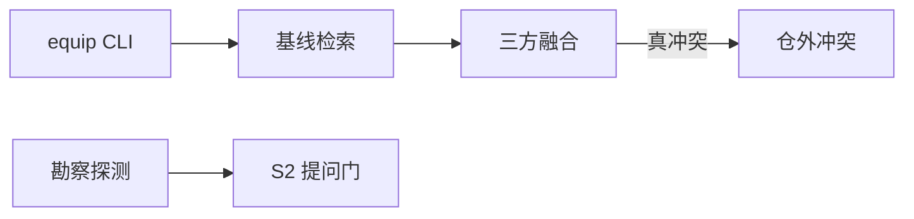

# 零工作区污染 8-Skill 跨代升级与勘察身份提问一致性 — 功能设计规范（SPEC）

## 文档信息与变更概览

| 项目 | 内容 |
| --- | --- |
| 当前状态 | `draft` |
| 规划级别 | `L3` |
| 创建 / 更新 | `2026-11-23` / `2026-11-23` |
| 分支 / Issue / PR | `feat/upgrade-merge3-and-survey-truth` / 未关联 / 未关联 |
| 负责人 / 内审状态 | coordinator / `pending` |
| 规划态 | `autonomous` |
| 关联 Todo | `docs/todo/261123-upgrade-merge3-and-survey-truth-todo.md` |

- **变更一句话**：让日常不传 `--base-dir` 的 `equip.mjs` 按 `oldHash` 自动找回基线完成 8 个 Skill 无损三方合并、真冲突旁路迁出工作区保 `git status` 干净并防误 `--restore` 墓碑，同时收敛首次勘察的 `generic-git` 身份判定、Git 署名/hooks 提问与离线只读边界。

## 系统变更全景

| 模块 / 文件 | 变更性质 | 核心职责 |
| --- | --- | --- |
| `scripts/lib/equip-bootstrap.mjs` | 改造 | 新增零依赖三层 `baseText` 回溯与内容寻址基线缓存读写 |
| `scripts/lib/merge3.mjs` | 改造 | 支持仓外冲突目录渲染、清理提示与 `outOfTree` 冲突载荷 |
| `scripts/equip.mjs` | 改造 | 默认按 `oldHash` 走三方融合、修 `!hasExplicitBase` 裂脑、返 `tombstonedNew` |
| `scripts/lib/platform/registry.mjs` | 改造 | 匿名未知 HTTPS 通用远端默认判 `undetermined` |
| `scripts/lib/survey-questions.mjs` | 改造 | 收敛 `q.git-identity` 进 `NEEDS_HUMAN` |
| `scripts/lib/survey-gap-rules.mjs` | 改造 | 区分新建墓碑与清单损坏文案，严禁自动 `--restore` |
| `SKILL.md` / `references/survey.md` | 改造 | 锁死 `NEEDS_HUMAN > 0` 禁 S3 写入与勘察/explore 禁联网 |

## 一、背景与边界声明

- **要改什么**：`scripts/equip.mjs`、`scripts/lib/equip-bootstrap.mjs`、`scripts/lib/merge3.mjs`、`scripts/lib/platform/registry.mjs`、`scripts/lib/survey-questions.mjs`、`scripts/lib/survey-gap-rules.mjs`、`SKILL.md`、`references/survey.md` 及对应 `scripts/dev/*` 测试夹具。
- **不改什么**：不引入第三方依赖；不修改 `kit/skills/` 中 `dev-edit`/`dev-review`/`dev-govern`/`dev-flow` 门禁逻辑（归下一 PR）；不改变 `compose-agents.mjs` 的标记合同。
- **本期不做**：`--should-fix` 聚类、`edit-gate` 仅扫 diff 新增行与浅提示词路由收紧（在 PR 2 处理）。
- **复用既有模块**：复用 `scripts/zip.mjs`（`readZip`）、`scripts/backup.mjs`（`findGitCommonDir` / 仓外路径定位）、`scripts/lib/merge3.mjs`（`merge3Text`、`judgeManagedFile`）。
- **架构基线关系**：严格保持零第三方依赖与 `scripts/`/`kit/` 单向依赖不变量，符合 `docs/TDD.md`。

## 二、设计方案与契约变更

### 接口 / 数据结构变更

- **三层零依赖 `baseText` 自动回溯**（无需 `--base-dir`）：当 `.pf-manifest.json` 的 `oldHash`（或 `customEntry.upstreamSha256`）与新版 `src.sha256` 不同时，按目标哈希顺序查找：
  1. 仓外基线缓存（位于 gitCommonDir 的 `project-forge-cache/baselines/`，非 Git 仓落 `~/.project-forge/cache/baselines/`），每次 `equip` 落盘受管上游文件时同步写入；
  2. gitCommonDir 下 `project-forge-backups/*.zip`（复用 `readZip` 比对 `.agents/skills/` 中对应文件）；
  3. Git 历史（`git log --format=%H -n 30 -- .agents/skills/...` + `git show` 校验 `normalizedSha256`）。
- **统一三方融合路径**：删去 `scripts/equip.mjs` `|| !hasExplicitBase` 放行漏洞；只要 `baseText` 存在（无论 `.md` 还是 `.mjs`），均调 `resolveThreeWayEquipFile` 执行 `merge3Text`，非重叠自动合并并更新 `customEntry`，真重叠交冲突裁决。
- **冲突旁路迁出工作区**：`resolveThreeWayEquipFile` 与 `scripts/equip.mjs` 将 `.upstream` / `.pf-conflict` 写入 gitCommonDir 下 `project-forge-conflicts/` 目录（非 Git 仓落 `~/.project-forge/conflicts/<project-slug-hash8>` 等仓外目录 — 即以 `slugHash` 命名）；`.pf-manifest.json` 的 `pendingConflicts[rel]` 持久化仓外路径及 `outOfTree: true`；`clearConflictSidecars` 同步清理仓外旁路及历史残留仓内 sidecar。
- **新建墓碑标识**：`equip()` 返回 `tombstonedNew`（本次首次缺失并写入 `removedFiles`/`disabledSkills` 的项），摘要明示「已登记 v3 用户删除墓碑，未经人确认禁 `--restore`」。
- **通用远端保守身份**：`GENERIC_GIT_PROVIDER.classifyIdentity` 对匿名 `http(s)://` 远端且无 `standaloneMode`、无声明源匹配、无推送凭据覆盖时返回 `role: 'undetermined'`，交由 `q.role` 在 S2 零写停步询问。
- **前置提问收口**：`survey-questions.mjs` 新增 `q.git-identity`；`SKILL.md` 与 `references/survey.md` 明文要求 `NEEDS_HUMAN > 0` 禁 S3 写入，且 S1/S2 勘察与 `explore` 严禁调用网页搜索/抓取工具。

### 数据与状态变更

- `.pf-manifest.json` 的 `pendingConflicts[rel]` 扩展可选布尔字段 `outOfTree: true` 及实际仓外绝对/相对路径；旧结构仍向下兼容清理。
- 新增仓外基线缓存与冲突旁路目录均在 gitCommonDir 或 `~/.project-forge/` 下，零污染工作区 `git status`。

### 异常、回退与安全边界

- 任何读取缓存、zip 或 Git 历史失败均 Fail-Soft 降级（回到既有的 `conflicts` 保底逻辑，不抛异常中断也不覆盖用户文件）。
- 目标 `.mjs`/`.md` 发生真冲突时仍严禁写入 Git 冲突标记（CONFLICT_MARKER_RE）；`equip --check` 对 `pendingConflicts` 与未解决漂移保持退出码 `3`。

### 实现顺序

1. 在 `scripts/lib/equip-bootstrap.mjs` 落盘仓外缓存/冲突路径解析与三层 `baseText` 查找器；
2. 改造 `scripts/lib/merge3.mjs` 与 `scripts/equip.mjs`（自动 `baseText` 融合、去 `!hasExplicitBase`、仓外冲突旁路、`tombstonedNew` 输出）；
3. 改造 `scripts/lib/platform/registry.mjs`、`scripts/lib/survey-questions.mjs`、`scripts/lib/survey-gap-rules.mjs`、`SKILL.md`、`references/survey.md`；
4. 更新并扩展 `scripts/dev/blind-run-matrix.mjs`、`scripts/dev/e2e-scenarios-evolution.mjs`、`scripts/dev/fixtures-iterate-evolution.mjs`、`scripts/dev/fixtures-onboarding.mjs` 正反双向用例，同步刷新本仓 `AGENTS.md` / `.agents/skills/`。

## 三、备选方案与否决理由

| 方案 | 怎么做的 | 为什么没选 | 什么情况下该改回它 |
| --- | --- | --- | --- |
| gitCommonDir 仓外缓存 + zip + git 三层检索 | 优先查内容寻址基线与既有 `.git` 快照/历史 | 本方案入选：零工作区文件、零第三方依赖、离线单机确定性有效 | 若宿主限制访问 `.git` 内部目录（可回退 `~/.project-forge/`） |
| 在工作区 `.agents/skills/` 保留 `.upstream`/`.pf-conflict` | 沿用现有同目录生成方式 | 否决：违背用户“工作区零多余新文件”要求并持续污染 `git status` | 仅在用户显式传参数要求同目录对比时可选 |

## 四、改动清单与影响面

| 文件 / 目录 | 改动性质 | 改什么 | 谁会被影响 |
| --- | --- | --- | --- |
| `scripts/lib/equip-bootstrap.mjs` | 修改 | 仓外基线缓存与三层 `baseText` 查找、仓外冲突目录解析 | `equip.mjs` |
| `scripts/lib/merge3.mjs` | 修改 | `resolveThreeWayEquipFile` 与提示文案适配仓外旁路 | `equip.mjs` |
| `scripts/equip.mjs` | 修改 | 无 `--base-dir` 自动三方合并、`!hasExplicitBase` 修复、`tombstonedNew`、写前缓存 | 被治理仓库升级流 |
| `scripts/lib/platform/registry.mjs` | 修改 | 未知 HTTPS 通用远端默认判 `undetermined` | `survey.mjs`、`platform` 测试 |
| `scripts/lib/survey-questions.mjs` | 修改 | 补 `q.git-identity` 进 `NEEDS_HUMAN` | `survey.mjs` |
| `scripts/lib/survey-gap-rules.mjs` | 修改 | 区分新建墓碑与损坏提示 | `survey.mjs` |
| `SKILL.md` / `references/survey.md` | 修改 | 明确 `NEEDS_HUMAN > 0` 禁 S3 写入与勘察禁联网 | 宿主代理 S1-S3 行为 |
| `scripts/dev/*` 相关夹具与 E2E | 修改 | 更新仓外旁路断言并补正反双向用例 | CI / `fixtures` / `e2e` |

- **对外可见的变化**：`equip.mjs` 默认 CLI 升级即可自动三方融合已修改 `.md`/`.mjs`；真冲突旁路写至仓外目录不再污染 `.agents/skills/`；未知 HTTPS 通用远端首次勘察默认停步确认身份。
- **需要同步改的地方**：`node scripts/equip.mjs .`、`node scripts/compose-agents.mjs .`。

## 五、冻结的验收标准

- [ ] C1: 不传 `--base-dir` 对已修改全部 8 个 `SKILL.md`（非重叠修改）与 `.mjs` 执行 `node scripts/equip.mjs` 对 vB 套件升级，8/8 自动无损三方合并（`merged >= 8`）、本地定制与上游新版并存、退出码 `0` 且 `equip --check` 返回 `0`。
- [ ] C2: 发生同行重叠冲突时，`.agents/skills/` 内零 `.upstream` / `.pf-conflict` 文件且 `.mjs` 零 Git 冲突标记，冲突对照写入 gitCommonDir 下的 `project-forge-conflicts/` 且 `git status --short` 零额外未跟踪文件，`equip --check` 返回 `3`；执行 `--adopt-custom` 或 `--restore` 后仓外旁路被清理且校验通过。
- [ ] C3: `--adopt-custom` 在上游改版且不传 `--base-dir` 时不再静默跳过，先尝试基线融合，无法合并时触发待裁决冲突；`equip()` 新登记缺失文件为 `removedFiles` 时输出 `tombstonedNew` 并明禁自动 `--restore`。
- [ ] C4: `GENERIC_GIT_PROVIDER` 对匿名 `https://codeberg.org/pmndrs/zustand.git` 判定为 `role: 'undetermined'`，对本地路径/`file://`/`standaloneMode: true` 保持 `maintainer`；缺本地 Git 署名时 `survey.mjs` 产出 `q.git-identity` 进 `NEEDS_HUMAN`；全量仓库离线门禁（`preflight`、`gap-coverage`、`fixtures --jobs 6`、`e2e-zip-harness`、`compose-agents --check`、`equip --check`、`review.mjs .`）全绿且 `AGENTS.md <= 24KB`。

## 六、高风险点、门型与回滚路径

- **门型与回滚路径**：`two-way`；回滚直接 `git revert` 对应提交即可，仓外缓存可安全删清。
- **高风险路径**：触碰 `scripts/lib/`、`SKILL.md`，合前须经独立审查与 2-phase 故障注入。
- **故障注入预演**：破坏三层基线查找匹配逻辑或遗漏写入仓外冲突记录，验证新增 `fixtures` 失败，恢复即通过。

## 澄清与补充记录

- 已确认：用户明确要求冲突旁路绝不在工作区 `.agents/skills/` 多留新文件。

## 实现说明

- **实际落地摘要**：
- **与草案的差异**：
- **关联同步文件**：
