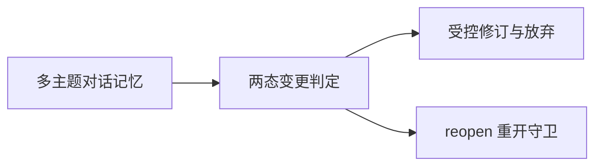

# 对话记忆、全周期两态状态机与受控重开 — 功能设计规范（SPEC）

## 文档信息与变更概览

| 项目 | 内容 |
| --- | --- |
| 当前状态 | `approved`（`draft \| approved \| implementing \| in_review \| implemented \| superseded`） |
| 规划级别 | `L3`（Schema v2 迁移、跨技能两态状态机与受控重开；未 `approved` 前不编码） |
| 创建 / 更新 | `2026-11-24` / `2026-11-24` |
| 分支 / Issue / PR | `feat/conv-arch-plan` / `#169` / 未关联 |
| 负责人 / 内审状态 | planner-conv-arch / `passed` |
| 规划态 | `interactive`（关键设计与 5 项决策已确认，待拍板为零） |
| 关联 PRD / Todo | `../prd/261124-conversational-state-machine-prd.md` / `../todo/261124-conversational-lifecycle-model-todo.md` |

- **变更一句话**：升级 `session-state.mjs` 至 v2 多主题对话记忆并落地单源 `OPEN` / `LOCKED` 两态状态机、`dropped` 终态与 `flow rework --reopen` 守卫。

## 系统变更全景

| 模块 / 文件 | 变更性质 | 核心职责 |
| --- | --- | --- |
| `kit/skills/lib/session-state.mjs`、`session-orient.mjs` | 改造 | `schemaVersion: 2` 多主题 `topics[topicId]`、6144 B 预算、完整渲染与去重 |
| `kit/skills/dev-plan/scripts/doc-plan.mjs`、`doc-plan-ops.mjs` | 改造 | `note`/`triage`/`init` 主题隔离、`BLOCKED_OPEN_QUESTIONS_UNRESOLVED`、多切片 `init` 修复 |
| `kit/skills/dev-explore/scripts/doc-locate.mjs`、`repo-map.mjs` | 改造 | 默认零写入；显式 `--topic` 才向仓外写入已验真 `anchors` |
| `kit/skills/lib/mutability.mjs` (new) | 新增（<= 200 行） | 单一纯函数 `evaluateMutability` 判定 `open` / `locked` 与 `safeExits` |
| `kit/skills/dev-plan/scripts/doc-audit.mjs`、`doc-substantive.mjs`、`doc-slice-graph.mjs`、`plan-next.mjs` | 改造 | `LOCKED` 阻断、`--drop-criterion`、`dropped` 终态、1:N 分阶段校验与优先级 |
| `kit/skills/dev-flow/scripts/flow-lifecycle-helpers.mjs`、`workflow-policy-next.mjs`、`flow-next.mjs`、`flow-cleanup.mjs` | 改造 | `flow rework --reopen` 守卫、原子吊销 token、`abort` 标 `dropped` 与 `ambiguous` 路由 |

## 一、背景与边界声明

- **要改什么**：落地多主题对话记忆（`session-state.mjs` v2）、全周期 `OPEN`/`LOCKED` 两态状态机（`kit/skills/lib/mutability.mjs` (new)）、用户授权删减 `C*` 与 `dropped` 终态，以及 `flow rework` 受控重开与 `ambiguous` 精细调度。
- **不改什么**：不修改 Wave 1 的 `critique-store` / `review-pack` 槽位钉住逻辑；不改 CLI 规范标志与 `SKILL.md` 体积预算（留待 Wave 3）。
- **本期不做**：不在 `doc-locate` / `repo-map` 默认无 `--topic` 模式下写任何持久化状态文件；不改动 `kit/skills/*/SKILL.md` 与 `AGENTS.md`（留待 Wave 3）。
- **复用既有模块**：复用 `kit/skills/lib/session-state.mjs` 仓外存储路径 `resolveSessionStatePath`、`kit/skills/lib/doc-frontmatter.mjs`、`kit/skills/lib/plan-index.mjs`、`kit/skills/lib/ledger.mjs`（`updateTaskLedger`）及 `kit/skills/lib/git.mjs`（`writeJsonAtomic`）。
- **架构基线关系**：保持零第三方依赖与仓外状态不污染工作区 `git status`，与 `docs/TDD.md` 一致。

## 二、设计方案与契约变更

### 接口 / 数据结构变更

1. **多主题对话记忆（`session-state.mjs` v2 & `session-orient.mjs`）**：
   - `session-state.json` 升级至 `schemaVersion: 2`，保留对 `schemaVersion: 1` 的向后兼容读取（读入时按默认主题折算）。
   - 结构新增 `topics[topicId]`，把同一主题的 `preInit` 与 `triage` 合并管理：最多保留 5 个活跃主题，单主题上限 6144 B；包含可覆写键值对 `facts`（`key -> value`）、可通过 `--resolve` 关闭的 `open` 问题集合、`nonGoals` 及可重建 `anchors`。
   - 超预算淘汰策略：优先淘汰可重建的 `anchors` 及已关闭非关键辅助字段，**严禁静默 FIFO 删除 `facts`**。
   - `markTriageConsumed` 与 `resolveInheritedTriagePlanMode` 严格按 `topicId` / `taskId` / `slug` 作用域匹配，绝不误消费其他未绑定主题记录。
   - `session-orient.mjs` 完整输出活跃主题下的 `facts` 与 `open`（取消 `.slice(-4)` 截断）；开启 `includeWorktrees: true` 并按修改新鲜度去重同名工作树/主仓文档。
2. **`note` / `triage` / `init` 与 `doc-locate` / `repo-map` 记忆接线**：
   - `doc-plan.mjs` / `doc-plan-ops.mjs` 扩展 `note` 支持 `--topic`、`--fact k=v`、`--resolve`、`--drop`、`--reset`；`triage` 绑定 `topic` 并在省略 `--paths` 时不再自动吸入脏 `git status` 文件列表。
   - `init` 在目标主题存在未关闭 `open.length > 0` 时阻断并报 `BLOCKED_OPEN_QUESTIONS_UNRESOLVED`，除非显式传入 `--allow-open-draft`（且仅将未决 `open` 写入主文档并只消费目标主题）；修复 `init --kind prd --multi-spec` 误入无账本 worktree 陷阱。
   - `kit/skills/dev-explore/scripts/doc-locate.mjs` 与 `repo-map.mjs` 默认保持只读零写入；**仅当**显式传入 `--topic <id>` 时，才把已验真的仓库相对路径写入仓外 `session-state.json` 的 `topics[topicId].anchors`。
3. **统一 `OPEN` / `LOCKED` 两态状态机（`kit/skills/lib/mutability.mjs` (new) <= 200L）**：
   - 新增纯函数模块 `kit/skills/lib/mutability.mjs` (new)（代码行数严格 `<= 200` 行），导出单一纯函数 `evaluateMutability`：输入文档/任务状态，返回 `{ state: 'open' | 'locked' | 'terminal', mutable: boolean, reason, safeExits: [...] }`，统一接入 `doc-plan next`、`clarify`、`flow next` 与 `flow rework`。
   - `clarifyDoc` 遭遇 `LOCKED` 文档时阻断报 `BLOCKED_DOC_FROZEN` 并附带 3 个安全出口（`rework --reopen`、`supersede`、`archive --drop`）；新增 `--drop-criterion C<N> --reason --by user` 显式授权删减能力，`kit/skills/lib/doc-substantive.mjs` 的 `checkDocRegression` 对用户授权删除放行而继续硬阻断静默删除。
   - `kit/skills/dev-plan/scripts/doc-audit.mjs` `VALID_STATUS_BY_TYPE` 统一支持 `dropped` 终态（含 `spec`）；新增 `doc-plan archive --drop --reason` 与 `flow abort`（`flow-cleanup.mjs`）将绑定文档标为 `dropped`。
   - `checkOrphanSlices` 允许互不关联的独立 SPEC 存在（仅多片存在公共隐含关联或均声明拆分时提示）；`kit/skills/lib/doc-slice-graph.mjs` 的 `checkMasterCriteriaCoverage` 在 Master PRD 处于 `active` 阶段允许分阶段落地切片、在收口阶段强制 100% 覆盖；`kit/skills/lib/plan-next.mjs` 在 `--task` 同时匹配 PRD 与 SPEC 时优先返回 PRD 且避免饿死次要活跃计划。
4. **`flow rework --reopen` 守卫与 `ambiguous` 波次调度**：
   - `kit/skills/dev-flow/scripts/flow-lifecycle-helpers.mjs`、`kit/skills/lib/workflow-policy-next.mjs` 与 `kit/skills/dev-flow/scripts/flow-next.mjs`：`flow rework` 默认仅在 `changes` 或 `queueConflict` 状态允许；对 `LOCKED` 任务缺 `--reopen --reason` 时阻断报 `BLOCKED_REWORK_REQUIRES_REOPEN`；传入 `--reopen --reason` 时原子吊销未消费 `reviewTokens`、清空 `reviewPassed` / `reviewPassedHead` 并退回 `OPEN`。
   - `ambiguous` 阶段为每个任务暴露独立的 `phase` 与 `mutability`，`batch plan` 仅纳入处于就绪或实施态的任务。

### 数据与状态变更

- `session-state.json`：`schemaVersion` 升至 `2`，新增 `topics: Record<string, TopicState>`（上限 5 活跃主题、每主题 `<= 6144` B），保留对 `schemaVersion: 1` 的读取降级转换。
- `VALID_STATUS_BY_TYPE.spec` 新增 `dropped`；`ledger` 支持 `reopenHistory` / 原子清理 `reviewTokens` 与 `reviewPassed*`。

### 异常、回退与安全边界

- 任何对 `facts` 的静默丢弃均视为失败，超出 6144 B 时优先裁剪 `anchors` 后若仍超限则报错提示手动 `--drop` 或 `--reset`。
- `--reopen` 必须在吊销 token 与清理 `reviewPassed*` 同一原子账本更新事务中完成，避免旧 token 仍可 `record` 或 `merge`。

### 实现顺序

1. 实现 `kit/skills/lib/session-state.mjs` v2 与 `kit/skills/lib/session-orient.mjs` 完整渲染及去重。
2. 落地 `doc-plan` `note`/`triage`/`init` 与 `doc-locate`/`repo-map` `--topic` 锚点写入。
3. 新建 `kit/skills/lib/mutability.mjs` (new)（<= 200 行）并接入 `clarifyDoc`、`doc-substantive.mjs`、`doc-audit.mjs`、`doc-slice-graph.mjs`、`plan-next.mjs`。
4. 接入 `flow rework --reopen`、`flow abort` 标 `dropped` 与 `ambiguous` 多任务路由，并补全正反双向 fixture。

## 三、备选方案与否决理由

| 方案 | 怎么做的 | 为什么没选 | 什么情况下该改回它 |
| --- | --- | --- | --- |
| 超出 6144 B 时按 FIFO 淘汰最早的 `facts` | 像日志环形缓冲区一样丢弃旧事实 | 用户早期确认的关键事实（如门型/约束）会静默丢失 | 永不改回（记忆不可靠比报错更危险） |
| 允许 `flow rework` 在 `LOCKED` 下静默清理审查状态 | 不要求 `--reopen --reason` | 实施者可在无理由的情况下绕过已通过审查或锁定标准 | 永不改回 |

## 四、改动清单与影响面

| 文件 / 目录 | 改动性质 | 改什么 | 谁会被影响 |
| --- | --- | --- | --- |
| `kit/skills/lib/session-state.mjs`、`kit/skills/lib/session-orient.mjs` | 修改 | v2 多主题记忆（5 主题/6144 B/`facts` 保护）与完整渲染去重 | 全部会前 orient 与规划对话 |
| `kit/skills/lib/mutability.mjs` (new) | 新增（<= 200 行） | 单一纯函数 `evaluateMutability` 评估 `open`/`locked` 与 `safeExits` | `doc-plan next`、`clarify`、`flow next`/`rework` |
| `kit/skills/dev-plan/scripts/doc-plan.mjs`、`doc-plan-ops.mjs`、`doc-audit.mjs` | 修改 | `note` 扩展、`init` 阻断未决、PRD worktree 修复、`--drop-criterion`、`dropped` 终态 | `doc-plan` 全链路 |
| `kit/skills/lib/doc-substantive.mjs`、`doc-slice-graph.mjs`、`plan-next.mjs` | 修改 | 用户授权删 `C*` 放行、1:N 分阶段校验、独立 SPEC 放行与 `plan-next` 优先级 | `doc-plan audit` / `next` |
| `kit/skills/dev-explore/scripts/doc-locate.mjs`、`repo-map.mjs` | 修改 | 显式 `--topic` 才写仓外 `anchors`，默认零写入 | `dev-explore` 探索脚本 |
| `kit/skills/dev-flow/scripts/flow-lifecycle-helpers.mjs`、`workflow-policy-next.mjs`、`flow-next.mjs`、`flow-cleanup.mjs` | 修改 | `flow rework --reopen` 守卫、原子吊销、`abort` 标 `dropped`、`ambiguous` 路由 | `flow next` / `rework` / `abort` / `batch plan` |

- **对外可见的变化**：新增 `note --topic/--fact/--resolve/--drop/--reset`、`clarify --drop-criterion`、`archive --drop --reason`、`flow rework --reopen --reason`、`doc-locate/repo-map --topic`；新增错误码 `BLOCKED_OPEN_QUESTIONS_UNRESOLVED`、`BLOCKED_DOC_FROZEN`、`BLOCKED_REWORK_REQUIRES_REOPEN`。
- **需要同步改的地方**：`.agents/skills/`（执行 `node scripts/equip.mjs .`）、`scripts/dev/fixtures*.mjs`、`scripts/dev/subcommand-parity.mjs`（CLI 选项对拍）。

## 五、冻结的验收标准

- [ ] C5: `kit/skills/lib/session-state.mjs` 升级至 `schemaVersion: 2` 且兼容读 v1，`topics[topicId]` 最多 5 活跃主题、每主题 <= 6144 B、支持覆写 `facts` 与 `--resolve` 关闭 `open`、超限先删可重建 `anchors` 且永不静默 FIFO 删 `facts`，`markTriageConsumed` / `resolveInheritedTriagePlanMode` 严格按 topic/task/slug 隔离；`session-orient.mjs` 完整输出活跃 `facts` 与 `open`（无 `.slice(-4)`）且 `includeWorktrees: true` 按新鲜度去重，由 `node scripts/dev/fixtures.mjs` 正反用例断言通过。
- [ ] C6: `doc-plan.mjs` / `doc-plan-ops.mjs` 支持 `note` 的 `--topic`、`--fact k=v`、`--resolve`、`--drop`、`--reset`；`triage` 绑定 `topic` 且省去 `--paths` 时不自动吸入脏 `git status` 文件；`init` 遇 `open.length > 0` 报 `BLOCKED_OPEN_QUESTIONS_UNRESOLVED`（除非 `--allow-open-draft` 仅写入主文档并只消费目标主题）；`init --kind prd --multi-spec` 不掉入无账本 worktree 陷阱；`doc-locate.mjs` 与 `repo-map.mjs` 默认零写入且仅显式 `--topic` 时写 `topics[topicId].anchors`，由 `node scripts/dev/fixtures.mjs` 断言通过。
- [ ] C7: 新建 `kit/skills/lib/mutability.mjs` (new)（<= 200 行）导出 `evaluateMutability` 并接入 `doc-plan next`、`clarify`、`flow next`、`flow rework`；`clarifyDoc` 对 `LOCKED` 报 `BLOCKED_DOC_FROZEN` 附 3 出口，支持 `--drop-criterion C<N> --reason --by user` 且 `checkDocRegression` 放行授权删除同时拦截静默删除；`VALID_STATUS_BY_TYPE`、`doc-plan archive --drop --reason` 与 `flow abort` 落地 `dropped` 终态；`checkOrphanSlices` 放行互不关联独立 SPEC，`checkMasterCriteriaCoverage` 在 `active` 期允许分阶段切片、收口时强制 100% 覆盖，`plan-next` 同命中 PRD/SPEC 优先 PRD 且不饿死次要活跃计划，由 `node scripts/dev/fixtures.mjs` 断言通过。
- [ ] C8: `flow-lifecycle-helpers.mjs` / `workflow-policy-next.mjs` / `flow-next.mjs` 强制 `flow rework` 默认仅在 `changes` 或 `queueConflict` 放行，`LOCKED` 缺 `--reopen --reason` 报 `BLOCKED_REWORK_REQUIRES_REOPEN`，带 `--reopen --reason` 时原子吊销未消费 `reviewTokens`、清空 `reviewPassed*` 并退回 `OPEN`；`ambiguous` 暴露 per-task `phase` 与 `mutability` 并仅把就绪/实施任务送入 `batch plan`，由 `node scripts/dev/fixtures.mjs` 正反用例断言通过。

## 六、高风险点、门型与回滚路径

- **门型与回滚路径**：`one-way`（涉及 `session-state.json` v2 Schema 与生命周期状态机）；回滚做法：经 `git revert` 回退提交，v2 读写器不破坏 v1 历史字段。
- **高风险路径**：触及 `kit/` 与 `scripts/dev/preflight.mjs` 对拍检查，改后须执行 `node scripts/equip.mjs .` 与全量 `fixtures.mjs` / `preflight.mjs`。
- **故障注入预演**：复用 `node .agents/skills/dev-review/scripts/review-pack.mjs check-fault --phase fail` / `restore`，注入未传 `--reopen` 直接清理 `reviewPassed` 或静默删除 `facts` 的缺陷，验证门禁必红并复绿。

## 七、上线与兼容策略

- **数据迁移**：`readSessionState` 自动识别 `schemaVersion: 1` 并向后兼容折算为默认主题；新写入统一使用 `schemaVersion: 2`。
- **向后兼容**：单仓无 `topics` 时仍支持直接无 `--topic` 降级，不中断现有单任务脚本调用。

## 澄清与补充记录

- （本轮无额外澄清补充；全部设计边界已由总控 PRD 确认，待拍板为零）

## 实现说明

- **实际落地摘要**：
- **与草案的差异**：
- **关联同步文件**：
