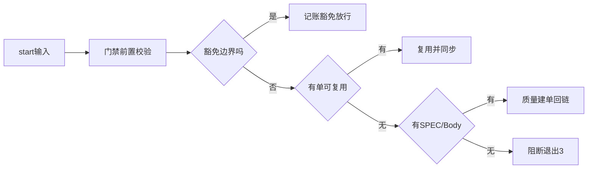

# Case 2/3/4 开工确定性 Issue 绑定闭环 — 功能设计规范（SPEC）

## 文档信息与变更概览

| 项目 | 内容 |
| --- | --- |
| 当前状态 | `draft`（`draft \| approved \| implementing \| in_review \| implemented \| superseded`） |
| 规划级别 | `L3`（跨模块状态机、退出码与协作契约变更；未 `approved` 前不编码） |
| 创建 / 更新 | `2026-11-24` / `2026-11-24` |
| 分支 / Issue / PR | `feat/deterministic-issue-binding` / 未关联 / 未关联 |
| 负责人 / 内审状态 | plan-issue-bind / `pending` |
| 规划态 | `interactive`（单向门与 L3 契约变更） |
| 关联 PRD / Todo | 无（单切片装得下）/ `docs/todo/261124-deterministic-issue-binding-todo.md` |

- **变更一句话**：为 `flow.mjs start` 的 `Case 2/3/4` 建立「豁免边界 -> 复用不重 -> 质量建单回链 -> `BLOCKED_MISSING_ISSUE_BINDING` 硬阻断」的确定性 Issue 绑定闭环，打通 `--no-issue --reason` / `--body` / `--body-file` 与 `AGENTS.md` `no-auto-issue` 取舍键并同步全仓测试夹具与契约。

## 系统变更全景

| 模块 / 文件 | 变更性质 | 核心职责 |
| --- | --- | --- |
| `kit/skills/lib/exit-codes.mjs` | 改造 | 在 `FACT_CODES` 注册 `BLOCKED_MISSING_ISSUE_BINDING`（`EXIT.FACT = 3`） |
| `kit/skills/dev-flow/scripts/flow.mjs` | 改造 | 注册 `--no-issue`、放行 `start` 消费 `--body`/`--body-file`、更新 `printHelp()` |
| `kit/skills/dev-flow/scripts/flow-start-helpers.mjs` | 改造 | 承载确定性 Issue 绑定状态机、豁免判定、复用检索与 `ledger.issueBinding` 审计 |
| `kit/skills/dev-flow/scripts/flow-inspect.mjs` | 改造 | 在前置门禁之后调用绑定状态机（新启动与 `--planning` 晋升共用），严守 `<= 800` 行 |
| `kit/skills/dev-flow/scripts/flow-issues.mjs` | 改造 | `createIssueForStart` 优先读取工作树内 `SPEC`/`Todo` 标题与上下文并回传新建单号 |
| `references/collaboration.md`、`kit/skills/dev-flow/SKILL.md`、`templates/agents-project.md`、`AGENTS.md`、`docs/TDD.md`、`docs/feature-map.json` | 改造 | 同步绑定规则、CLI 帮助、`no-auto-issue` 取舍说明及工具/夹具索引 |
| `scripts/dev/fixtures-*.mjs`、`scripts/dev/e2e-*.mjs`、`scripts/dev/blind-run-harness.mjs` | 改造 | 诚实对齐现有 `Case 2/3/4` 调用（`Case 3/4` 走真实自动建单，`Case 2` 传 `--issue`/`--body-file`/`--no-issue --reason`） |
| `scripts/dev/fixtures-issue-binding.mjs` (new) | 新增 | 正反双向行为断言（豁免、复用、自动建单回链、`BLOCKED_MISSING_ISSUE_BINDING`、门禁顺序） |
| `scripts/dev/injections-data-issue-binding.mjs` (new) | 新增 | 故障注入用例（拆掉拦截/复用/豁免/前置门禁后确认对应夹具必红） |

## 一、背景与边界声明

- **要改什么**：改造 `flow.mjs start`（含新建启动与 `--planning` 晋升至实施态）的 Issue 绑定流程、CLI 参数注册与 `printHelp()`、退出码登记、协作契约文档及 `scripts/dev/` 下所有调用 `start --case 2|3|4` 的测试与 E2E 夹具。
- **不改什么**：不改变 `validateIssueBodyQuality` 的 5 项结构底线与单一建单通道；不放宽 `plan-exit-gate.mjs`、`edit-gate.mjs`、`review-pack` 或 `merge` 门禁；不改变 `Case 1` 与外部 PR 审查流程；不引入任何第三方依赖或 emoji。
- **本期不做**：不在 `flow.mjs start` 为无 `SPEC`/`Todo` 的 `Case 2` 捏造占位工单正文；不对 `contributor-fork` / `clone-readonly` 自动向上游建单；不在 `scripts/review.mjs` 为 `no-auto-issue` 新增矛盾扫描或静态硬枚举（经查 `scripts/review.mjs` 与 `scripts/lib/protocol.mjs` 采用动态 `readDecisions` 解析，无闭合取舍键枚举表）。
- **复用既有模块**：复用 `createIssueForStart`、`validateIssueBodyQuality`、`hydrateIssueBody`、`indexPlanDocs`、`evaluateTextSubstance`、`readDecisions`、`syncTaskDocsSafe` 与 `exit-codes.mjs`，不另起炉灶：
  - `kit/skills/dev-flow/scripts/flow-issues.mjs`：`createIssueForStart`、`buildAndValidateIssueBody`、`resolveExplicitBodyText`
  - `kit/skills/lib/issue-quality.mjs`：`validateIssueBodyQuality`、`extractPlanDocContext`
  - `kit/skills/lib/issue-template-hydrate.mjs`：`hydrateIssueBody`
  - `kit/skills/lib/plan-index.mjs`：`indexPlanDocs`、`resolvePlanDocRoots`
  - `kit/skills/lib/evidence-substance.mjs`：`evaluateTextSubstance`（校验 `--no-issue --reason` 非水话/占位）
  - `kit/skills/lib/profile.mjs`：`readDecisions`（读取 `AGENTS.md`「## 取舍」`no-auto-issue`）
  - `kit/skills/dev-flow/scripts/flow-context.mjs`：`syncTaskDocsSafe`、`findMatchingDocStrict`、`resolveAndHydrateTaskContexts`
  - `kit/skills/lib/exit-codes.mjs`、`kit/skills/lib/subcommand-meta.mjs`
- **架构基线关系**：严格遵循 `docs/TDD.md` 四层单向依赖与 `arch-rules`（`kit/**` 仅引用 `node:*` 与 `kit/skills/` 内部模块），`flow-inspect.mjs`（当前 792 行）不膨胀超 `800` 行，主状态机逻辑下沉 `flow-start-helpers.mjs`。

## 二、设计方案与契约变更

### 接口 / 数据结构变更

1. **退出码注册（`kit/skills/lib/exit-codes.mjs`）**：
   - 在 `FACT_CODES` 新增 `'BLOCKED_MISSING_ISSUE_BINDING'`（`EXIT.FACT = 3`），表示 `Case 2`（无关联规划文档）在非豁免状态下既未绑定已有 Issue、也未提供通过质量门禁的 `--body`/`--body-file` 或合规设计文档。
2. **CLI 参数与帮助（`kit/skills/dev-flow/scripts/flow.mjs` 与 `kit/skills/dev-flow/SKILL.md`）**：
   - `booleanFlags` 新增 `'no-issue'`；
   - `CONTENT_BODY_SUBCOMMANDS` 新增 `'start'`，使 `flow.mjs start` 合法接收 `--body` / `--body-file`；
   - 确认 `kit/skills/lib/subcommand-meta.mjs` 中 `flow.start` 已登记 `{ name: 'start', mutating: true }`（保持 `subcommand-parity.mjs` 对齐）；
   - 更新 `flow.mjs` `printHelp()` 的 `start` 用法行与 `kit/skills/dev-flow/SKILL.md` 的 `flow.mjs start` 示例行，显式声明 `[--no-issue --reason "<原因>"]` 与 `[--body "<内容>" | --body-file <路径>]`，保持 `cli-parity.mjs` 0 新增暗参数、0 漂移。
   - 参数互斥校验：`--no-issue` 与 `--issue`/`--issues`/`--create-issue`/`--body`/`--body-file` 同时传入时以 `EXIT.USAGE`（`2`）阻断；`--no-issue` 缺失 `--reason` 或 `--reason` 未通过 `evaluateTextSubstance(..., { minChars: 4 })` 时分别以 `MISSING_OVERRIDE_REASON` / `BLOCKED_SHALLOW_OVERRIDE_REASON`（`EXIT.USAGE = 2`）阻断。
3. **确定性 Issue 绑定状态机（`kit/skills/dev-flow/scripts/flow-start-helpers.mjs` 新增 `resolveOrBindStartIssue` 与 `evaluateIssueBindingExemption`）**：
   - **执行时机（关键防孤儿单约束）**：在 `runStartPlanGate`、`checkStartAuthorSeparation`、`checkStartMainCleanAndSlot` 及基线/分支冲突检查全部通过之后执行，确保门禁阻断时绝不产生孤儿工单。
   - **步骤一：先复用不重复（全角色适用，只要显式或文档已有单即复用）**：
     按顺序收集已有 Issue 编号：
     1. `--issue <N>` / `--issues` / 位置参数 URL（含 `reuseExistingPr` 关联单号）；
     2. 活跃任务账本 `ledger.issue` / `ledger.linkedIssues`；
     3. 关联 `SPEC` / `Todo` / `PRD`（覆盖 `docRoot` 与 `mainRoot`）的 Frontmatter `issue: <N>` 或文件名 `-issue<N>-`。
     若命中任一有效正整数单号且未冲突，记录 `ledger.issueBinding = { mode: 'reused', source, issues }`，不重复建单。
   - **步骤二：显式请求建单与自动豁免边界**：
     - 若用户显式传入 `--create-issue`（即便同时传了 `--allow-plan-bootstrap`），直接进入步骤三走 `createIssueForStart`（兼容现有 `fixtures-flow.mjs`、`fixtures-handoff-review.mjs`、`fixtures-issue-quality.mjs` 契约）；
     - 否则判定自动豁免边界：满足任一即放行并记入 `ledger.issueBinding`（绝不静默跳过）：
       - `caseType === 1`（`exemptKind: 'case-1'`）
       - `isPlanning === true`（`--planning`，`exemptKind: 'planning'`；注意晋升为非 `planning` 实施态时不再沿用此豁免）
       - `opts['allow-plan-bootstrap'] === true`（`exemptKind: 'allow-plan-bootstrap'`）
       - `Boolean(effectiveExternalPr)`（`exemptKind: 'external-pr'`）
       - `role === 'contributor-fork'`（`exemptKind: 'contributor-fork'`）
       - `role === 'clone-readonly'`（`exemptKind: 'clone-readonly'`）
       - `AGENTS.md`「## 取舍」声明 `no-auto-issue`（`exemptKind: 'no-auto-issue-decision'`）
       - 显式 `--no-issue --reason "<实质理由>"`（`exemptKind: 'no-issue-flag'`，含 `reason`/`by`/`at` 写入账本；后续同任务幂等重入 `start` 若无新 `--issue`/`--create-issue` 则沿用该记录）。
   - **步骤三：保底质量门禁建单与回链（`maintainer` / `generic-git` / `local-only`）**：
     - 当仍未绑定且非豁免时，校验存在 `plan-index.mjs`（`indexPlanDocs`）验真的活跃 `SPEC` / `Todo`（`Case 3/4`），或显式 `--create-issue` / `--body` / `--body-file`：
       - 若满足：调用 `createIssueForStart`（传入 `workTreeRoot: docRoot` 以支持 `--planning` 隔离工作树内文档提取，无 `--title` 时优先取 `planCtx.title` 再回退 `slug`/`taskId`），严格经过 `hydrateIssueBody -> validateIssueBodyQuality -> TaskBackend.createIssue`；
       - 建单成功后写入 `linkedIssues`、`ledger.issueBinding = { mode: 'created', source, issues: [createdIssue.number], at }`，由 `resolveAndHydrateTaskContexts` 填充 `issueContext`，并由 `syncTaskDocsSafe` 自动回写 `SPEC`/`Todo` Frontmatter `issue: <N>` 与文件名 `-issue<N>-`；
       - 若无 `plan-index.mjs` 验真的 `SPEC`/`Todo` 且无 `--body`/`--body-file`（典型为未传任何单据与正文的 `Case 2`）：以 `BLOCKED_MISSING_ISSUE_BINDING`（`EXIT.FACT = 3`）机械阻断，输出含 `--issue <N>`、`--body-file <路径>`、`flow.mjs issue create` 与 `--no-issue --reason "<理由>"` 的可执行指引。

### 数据与状态变更

- 任务账本（`.worktrees/.state/tasks/<taskId>.json`）新增可选审计字段 `issueBinding`（`mode: 'reused' | 'created' | 'exempt'`，`source`/`exemptKind`/`reason`/`by`/`at`/`issues`），向后兼容既有无此字段的历史账本。
- `AGENTS.md`「## 取舍」支持可选决策键 `no-auto-issue`（豁免非显式建单的 `flow.mjs start` 自动 Issue 绑定检查）。

### 异常、回退与安全边界

- 隔离规划工作树晋升（`promotePlanningToStarted`）复用同一 `resolveOrBindStartIssue` 状态机，避免 `--planning` 阶段豁免后转实施态漏绑 Issue。
- 当 `maintainer` 模式下 `TaskBackend.createIssue` 返回 `delegated: true` 时透传 `EXIT.HUMAN = 4`（`ACTION_REQUIRED_CREATE_ISSUE_DELEGATED`），不伪造本地编号；`local-only` / `generic-git` 在无外部远端时落入 `<effectiveGitDir>/project-forge-flow/issues/` 本地工单，绝不探测或污染真实 GitHub。
- 若质量门禁拦截低质量 `--body`/`--body-file` 或缺少必需段落的设计文档，透传 `BLOCKED_ISSUE_QUALITY_INCOMPLETE`（`EXIT.FACT = 3`）而不静默降级。

### 实现顺序

1. **退出码与核心状态机（C1）**：先在 `exit-codes.mjs` 注册 `BLOCKED_MISSING_ISSUE_BINDING`，更新 `flow.mjs` 参数/帮助、`flow-issues.mjs` 工作树文档读取与标题兜底、`flow-start-helpers.mjs` 绑定状态机及 `flow-inspect.mjs`（新建 + 晋升双分支接入）。
2. **契约文档与模板同步（C3）**：更新 `references/collaboration.md`、`kit/skills/dev-flow/SKILL.md`、`templates/agents-project.md`、`docs/TDD.md`、`docs/feature-map.json`，并运行 `node scripts/equip.mjs .` 与 `node scripts/compose-agents.mjs .` 对齐实例。
3. **测试夹具对齐与双向新增（C2 + C4）**：先新增 `scripts/dev/fixtures-issue-binding.mjs` (new) 与 `scripts/dev/injections-data-issue-binding.mjs` (new)，再逐个诚实对齐 `scripts/dev/` 下既有 `Case 2/3/4` 调用并跑全量门禁与故障注入。

## 三、备选方案与否决理由

| 方案 | 怎么做的 | 为什么没选 | 什么情况下该改回它 |
| --- | --- | --- | --- |
| 前置门禁之后统一绑定 | 先跑 `plan-exit-gate`、作者分离与槽位干净检查，再执行复用/建单/阻断 | 无（已选）；彻底杜绝门禁拦截时在远端或本地创建孤儿工单 | 若未来存在门禁本身强依赖自动新建工单编号的场景再调整顺序 |
| 在 `flow-inspect.mjs` 原地堆叠逻辑 | 直接在 `handleStart` 内联实现全部绑定分支 | `flow-inspect.mjs` 已有 `792` 行，直接内联必然突破 `800` 行红线 | 仅当未来拆分 `flow-inspect.mjs` 的其他职责后 |
| 为无 SPEC 的 `Case 2` 自动生成占位工单 | `Case 2` 缺 `--issue` 时由脚本自动拼装默认描述建单 | 违背 PR #167 零空洞套话铁律，会向仓库批量制造低信息量垃圾单 | 永远不改回，信息不足应阻断或由调用方提供真实 `--body-file` |

## 四、改动清单与影响面

| 文件 / 目录 | 改动性质 | 改什么 | 谁会被影响 |
| --- | --- | --- | --- |
| `kit/skills/lib/exit-codes.mjs` | 修改 | 在 `FACT_CODES` 注册 `BLOCKED_MISSING_ISSUE_BINDING` | `exit-code-parity.mjs`、全部阻断返回消费方 |
| `kit/skills/dev-flow/scripts/flow.mjs` | 修改 | 注册 `--no-issue`、`CONTENT_BODY_SUBCOMMANDS` 加 `'start'`、更新 `printHelp()` | `cli-parity.mjs`、`flow.mjs start` CLI 调用方 |
| `kit/skills/dev-flow/scripts/flow-start-helpers.mjs` | 修改 | 实现 `evaluateIssueBindingExemption` 与 `resolveOrBindStartIssue`，并在 `promotePlanningToStarted` 接入 | `flow-inspect.mjs` |
| `kit/skills/dev-flow/scripts/flow-inspect.mjs` | 修改 | 接入 `resolveOrBindStartIssue`、调整 `resolveAndHydrateTaskContexts` 时机以包含自动建单结果，严守 `<= 800` 行 | `flow.mjs start`、`handleStart` 测试夹具 |
| `kit/skills/dev-flow/scripts/flow-issues.mjs` | 修改 | `createIssueForStart` 支持 `workTreeRoot`、从 `planCtx.title` 回退标题并检查 `scopeFiles` | `flow start`、`flow issue create` |
| `references/collaboration.md`、`kit/skills/dev-flow/SKILL.md`、`templates/agents-project.md`、`AGENTS.md`、`docs/TDD.md`、`docs/feature-map.json` | 修改 | 同步确定性绑定契约、`no-auto-issue` 说明、CLI 示例与地图索引，并执行 `equip`/`compose-agents` | 全仓研发流、文档自检与 `preflight` |
| `scripts/dev/fixtures-*.mjs`、`scripts/dev/e2e-*.mjs`、`scripts/dev/blind-run-harness.mjs` | 修改 | 按真实场景升级既有 `Case 2/3/4` 调用（`Case 3/4` 补全实质边界走自动建单，`Case 2` 传 `--issue`/`--body-file`/`--no-issue --reason`） | `fixtures.mjs`、`e2e-zip-harness.mjs`、`blind-run-harness.mjs` |
| `scripts/dev/fixtures-issue-binding.mjs` (new) | 新增 | 覆盖豁免、复用、自动建单回链、`BLOCKED_MISSING_ISSUE_BINDING` 与门禁顺序的正反双向夹具 | `fixtures.mjs` |
| `scripts/dev/injections-data-issue-binding.mjs` (new) | 新增 | 覆盖绑定状态机关键判据的故障注入表 | `verify-injections.mjs` |

- **对外可见的变化**：`flow.mjs start` 新增 `--no-issue`、`--body`、`--body-file` 参数与 `BLOCKED_MISSING_ISSUE_BINDING`（退出码 `3`）阻断码；`AGENTS.md`「## 取舍」支持 `no-auto-issue` 键；非豁免 `Case 3/4` 携带真实 `SPEC`/`Todo` 启动时自动创建并互链工单。
- **需要同步改的地方**：`.agents/skills/`（经 `node scripts/equip.mjs .` 同步）、`AGENTS.md`（经 `node scripts/compose-agents.mjs .` 同步）、`scripts/dev/` 下全部 `Case 2/3/4` 启动调用方。

## 五、冻结的验收标准

- [ ] C1: `flow.mjs start` 对非豁免 `Case 2/3/4` 按「`--issue` -> `ledger` -> 关联 `SPEC`/`Todo`/`PRD`」复用已有工单不重复建单；`Case 3/4` 携带 `plan-index.mjs` 验真的 `SPEC`/`Todo`（或显式 `--create-issue`/`--body`/`--body-file`）自动经 `createIssueForStart` 走 `hydrateIssueBody -> validateIssueBodyQuality -> TaskBackend.createIssue` 建单并回写账本与文档 Frontmatter；无文档且无有效正文/单号的 `Case 2` 返回 `BLOCKED_MISSING_ISSUE_BINDING`（`EXIT.FACT = 3`）；`Case 1`/`--planning`/`--allow-plan-bootstrap`（无显式建单）/`--external-pr`/`contributor-fork`/`clone-readonly`/`no-auto-issue`/`--no-issue --reason` 正确豁免且可审计；`cli-parity.mjs`、`subcommand-parity.mjs` 与 `exit-code-parity.mjs` 零失败。
- [ ] C2: 全量 `scripts/dev/` 既有测试与 E2E 夹具（含 `fixtures.mjs --jobs 6`、`e2e-zip-harness.mjs`、`e2e-scenarios-evolution.mjs`、`e2e-scenarios-lifecycle.mjs`、`blind-run-harness.mjs`）诚实对齐新契约且不弱化任何门禁，退出码全部为 `0`。
- [ ] C3: `references/collaboration.md`、`kit/skills/dev-flow/SKILL.md`、`templates/agents-project.md`、`docs/TDD.md`、`docs/feature-map.json` 同步完毕，`node scripts/equip.mjs . --check`、`node scripts/compose-agents.mjs . --check`、`node scripts/review.mjs .`（`0` 个「缺」）、`node scripts/dev/preflight.mjs`、`node .agents/skills/dev-govern/scripts/govern-audit.mjs audit . --strict` 与 `node .agents/skills/dev-verify-tools/scripts/verify-tools.mjs audit .` 全绿。
- [ ] C4: 新增 `scripts/dev/fixtures-issue-binding.mjs` (new) 与 `scripts/dev/injections-data-issue-binding.mjs` (new) 覆盖全部正反边界与故障注入，`node scripts/dev/fixtures.mjs --domain issue-binding` 与 `node scripts/dev/verify-injections.mjs --jobs 4` 全绿，且改动后所有 `.mjs` 文件均 `<= 800` 行、零第三方依赖、零 emoji。

## 六、高风险点、门型与回滚路径

- **门型与回滚路径**：`one-way`（涉及 `flow.mjs` CLI 对外契约、退出码注册与 `templates/` 骨架变更）；回滚做法：若未合入 `main` 可丢弃 worktree 分支，若已合入远端 `main` 须通过反向提交 `git revert <merge-sha>` 回退并重跑 `equip.mjs` / `compose-agents.mjs`。
- **高风险路径**：`kit/skills/lib/exit-codes.mjs`、`kit/skills/dev-flow/scripts/{flow,flow-inspect,flow-start-helpers,flow-issues}.mjs`、`kit/skills/dev-flow/SKILL.md`、`templates/agents-project.md`、`AGENTS.md`。
- **故障注入预演**：拆掉 `flow-start-helpers.mjs` 中 `BLOCKED_MISSING_ISSUE_BINDING` 阻断、`Case 3/4` 自动建单回链、`--no-issue` 浅理由拦截、`no-auto-issue`/`contributor-fork` 豁免守卫、以及前置门禁先于建单的顺序约束，逐条确认 `scripts/dev/fixtures-issue-binding.mjs` (new) 在 `scripts/dev/verify-injections.mjs` 隔离副本中必红。

## 澄清与补充记录

- （本轮无额外澄清补充；用户拍板确认的新增要求可通过 `doc-plan.mjs clarify` 写入「已确认：…」）

## 实现说明

> 代码合入前补齐，随功能 PR 一同提交并标记 `implemented`；若常青架构已同步进 `docs/TDD.md`，随关联 `PRD`/`Todo` 成对归档至 `docs/archive/specs/`。

- **实际落地摘要**：
- **与草案的差异**：
- **关联同步文件**：
