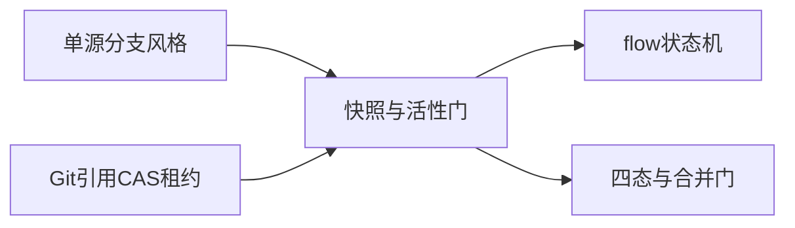

# 单源默认分支、任务活性分类与跨平台四态闭环 — 功能设计规范（SPEC）

## 文档信息与变更概览

| 项目 | 内容 |
| --- | --- |
| 当前状态 | `draft`（`draft \| approved \| implementing \| in_review \| implemented \| superseded`） |
| 规划级别 | `L3`（跨模块重构、接口/契约变更或高风险改造；未 `approved` 前不编码） |
| 创建 / 更新 | `2026-11-24` / `2026-11-24` |
| 分支 / Issue / PR | `feat/r6-arch-plan` / 未关联 / 未关联 |
| 负责人 / 内审状态 | plan-r6-arch / `pending` |
| 规划态 | `interactive`（逐题问到零拍板）/ `autonomous`（默认推进，仅单向门、Case 5 或真业务歧义才停） |
| 关联 PRD / Todo | `../prd/261124-r6-arch-hardening-prd.md` / `../todo/261124-r6a-single-source-state-todo.md` |

- **变更一句话**：改造唯一 `resolveDefaultBranch(repoRoot, { strict = true })`、下沉唯一 `detectCommitStyle`、落地 `classifyTaskLiveness` 与 `collectTaskRuntimeSnapshot`、解开 `generic-git` 合流死锁、落盘 A3 合并权、修复跨机便携交棒并实现标准 Git-Ref CAS 原子认领租约（认领总控 PRD `C1`、`C2`、`C3`、`C4`）。

## 系统变更全景

| 模块 / 文件 | 变更性质 | 核心职责 |
| --- | --- | --- |
| `kit/skills/lib/git-core.mjs` / `git.mjs` / `git-fast.mjs` / `scripts/lib/survey-git-fast.mjs` | 改造 | 单一 `resolveDefaultBranch(repoRoot, { strict = true })`、`isDefaultBranch` 与共享 `detectCommitStyle` |
| `kit/skills/lib/ledger.mjs` / `workflow-policy-next.mjs` / `workflow-policy.mjs` / `workflow-helpers.mjs` | 改造 | `baseBranch: null`、`classifyTaskLiveness` 过滤 `'merged'` 与孤儿、`collectTaskRuntimeSnapshot`、Case 3/draft/PRD 路由 |
| `kit/skills/lib/plan-exit-gate.mjs` / `task-backend-local.mjs` / `flow-*.mjs` | 改造 | 修 `'ledgerEntry' in doc` 假阳性、禁擅自 `update-ref` 建 `main`、解开 `GenericRemoteBackend.mergePr`、CAS 租约、A3 合并权与自动继承探索凭据 |
| `scripts/dev/fixtures-r6a-state.mjs` (new) / `scripts/dev/injections-data-r6a.mjs` (new) | 新增 | 正反双向夹具与故障注入 |

## 一、背景与边界声明

- **要改什么**：统一默认分支与提交风格单源原语、任务活性分类与运行时快照、跨机便携交棒、Git-Ref CAS 原子认领租约、解开 `generic-git` 远端核验与落盘 A3 合并边界。
- **不改什么**：不修改 `kit/skills/dev-flow/scripts/flow-lifecycle-finalize.mjs`（交由 `r6b` 统一切换正文同步）、不修改 `kit/skills/lib/handoff-package.mjs`（交由 `r6b` 按角色裁剪）、不修改 `flow.mjs` `printHelp()` 与 `doc-plan*` / `edit-gate*` / `review-*` / `govern-*`（Wave 2 `r6d` 统一切换这 4 处至 `isDefaultBranch`）。
- **本期不做**：不清理 `.worktrees/.state/tasks/` 的 7 个遗留台账（保留用于 Red->Green 验证）。
- **复用既有模块**：`kit/skills/lib/git-core.mjs` (`LIKELY_DEFAULT_BRANCHES`)、`kit/skills/lib/git.mjs` (`inspectBranchMergeState`)、`kit/skills/lib/ledger.mjs` (`listTaskLedgers`)、`kit/skills/lib/task-backend-local.mjs` (`GenericRemoteBackend`)。
- **架构基线关系**：消除双轨分支/风格判定与 `flow-merge.mjs` vs `task-backend-local.mjs` 互相打架，严格遵守 `docs/TDD.md` 单向依赖（依据：`docs/TDD.md`）。

## 二、设计方案与契约变更

### 接口 / 数据结构变更

1. **单一默认分支与提交风格原语（`C1`）**：
   - 直接改造唯一 `kit/skills/lib/git.mjs` `resolveDefaultBranch(repoRoot, { strict = true } = {})`（不保留返回 `'main'` 的第二套双轨 API）：按 `refs/remotes/origin/HEAD` -> `LIKELY_DEFAULT_BRANCHES` 存在引用 -> 当前非游离分支顺序解析，无可用分支时返回 `null`；同时导出唯一 `isDefaultBranch(repoRoot, branchName)`；`git-fast.mjs` `readRefsFast` 无可用引用时返回 `null`。
   - 将唯一 `detectCommitStyle(subjects)` 下沉到 `kit/skills/lib/git-core.mjs`（过滤 `Merge` 与自动化提交后，有效样本 `>= 5` 条且超半数符合 `conventional`/`gitmoji` 方定性，`< 5` 条返回中性结果防浅克隆 3 提交反转抖动），由 `scripts/lib/survey-git-fast.mjs` 与 `kit/skills/lib/git.mjs` (`detectProjectConventions`) 共同引用。
   - `ledger.mjs` `createDefaultLedger` 置 `baseBranch: partial.baseBranch ?? null`；`flow-start-helpers.mjs` 在账本 `baseBranch` 为空或指向仓库中不存在的分支名时校准为真实默认分支；移除 `flow-trial-merge.mjs` (`runTrialMerge`) 与 `task-backend-local.mjs` (`LocalOnlyBackend`) 擅自 `git update-ref refs/heads/main` 造旁支，缺失默认分支时返回 `BLOCKED_MISSING_DEFAULT_BRANCH`（exit 3）；同步消除 `gate-enforcement.mjs`、`workflow-helpers.mjs`、`platform*.mjs`、`github-parse.mjs`、`task-backend.mjs`、`task-graph.mjs`、`pr-template-hydrate.mjs`、`flow-*.mjs` 的 `'main'` 硬编码回退。

2. **单源任务活性分类与运行时快照（`C2`）**：
   - 在 `kit/skills/lib/ledger.mjs` 实现 `classifyTaskLiveness(ledger, { repoRoot, graph } = {})`，区分 `'active'`、`'terminal-pending-cleanup'`（`status === 'merged'` 或工作树目录已不存在的孤儿终态/已归档任务）与 `'terminal'`（`cleaned` / `aborted`）。
   - `listTaskLedgers(..., { includeTerminal: false })`、`resolveTaskContext` 与 `workflow-policy-next.mjs` (`evaluateNextState`) 统一跳过 `'terminal-pending-cleanup'`，仅返回 `pendingCleanupTasks` 提示而不报 `MULTIPLE_ACTIVE_TASKS` 或 `BLOCKED_NOT_CLAIMED`（验证本仓 7 个遗留台账现场变绿）。
   - 在 `kit/skills/lib/workflow-helpers.mjs`（或 `flow-lifecycle-helpers.mjs`）提供单源 `collectTaskRuntimeSnapshot`，由 `flow-next.mjs` 与 `flow-cleanup.mjs`（含 `status --all` 与 `status --task`）、`flow-merge.mjs`、`flow-lifecycle.mjs` 共用，统一输出 `phase`、`effectiveBaseSha`、`mergeState`、`policy` 与 `evidenceValidation`。

3. **解开 `generic-git` 合流死锁、A3 合并权与自动继承探索凭据（`C3`）**：
   - 移除 `kit/skills/dev-flow/scripts/flow-merge.mjs:70` 对 `GenericRemoteBackend` 的提前短路阻断，让 `generic-git` 直接进入 `backend.mergePr()` 执行 `git fetch` + `inspectBranchMergeState` 真实远端四态核验，仅当远端确实未合入或不可达时请求 `--human-approved --reason`。
   - 落实用户拍板 A3：`flow-merge.mjs` 强校验 `ledger.reviewPassed === true && currentHeadSha === ledger.reviewPassedHead`、非 `contributor-fork`、非 `merge-authority: human` 且调用者身份不得与 `implementerId` / `claimedBy` 相同（`BLOCKED_SELF_MERGE`），放行独立审查者或调度者执行 `flow.mjs merge`。
   - `flow-start-helpers.mjs` / `flow-inspect.mjs`：当 `flow.mjs start` 绑定的 `SPEC`/`Todo` 已过 `audit` 且含真实路径/复用模块（或关联 `session-state.json` 探索记录）时，自动继承写入 `ledger.explored` 凭据，不再强迫重跑 `flow.mjs explore`。

4. **跨机便携交棒、Git-Ref CAS 原子认领租约与四态闭环（`C4`）**：
   - 修复 `kit/skills/lib/plan-exit-gate.mjs:283` 仅在 `doc.ledgerEntry != null` 时才判存在本地账本上下文（消除 `'ledgerEntry' in doc` 假阳性）；取消 `flow-context.mjs` / `flow-issues.mjs` / `workflow-policy-next.mjs` 对跨机缺失本地 `.git/issues` 编号的 `ISSUE_CONTEXT_UNAVAILABLE` 硬死循环；修复 `workflow-policy-next.mjs:161` 对 Case 3 独立 Todo 硬编码 `--case 4`（改按 `caseTypeOfSlice` 派生）并在无活跃任务时优先引导在途 `draft` 规划或未拆完总控 PRD（而非直接退回 `idle -> triage`）。
   - 在 `kit/skills/dev-flow/scripts/flow-merge-claim.mjs` 与 `flow-inspect.mjs` / `flow-cleanup.mjs` 实现 `<50` 行标准 Git 协议原子认领租约：使用标准 Git 引用命名空间 `refs/pf/claims/`（全平台同源、零平台 API 依赖），`claim` / `start` 前 fetch 远端 claims 与分支，新建 ref 天然 CAS 原子互斥并发认领、`--takeover`（且缺 `--agent` 时阻断不回退旧作者）用 `--force-with-lease` 原子换手、`cleanup`/`release` 删除租约引用。
   - 修复 `flow-lifecycle.mjs` 对 `generic-git + contributor-fork` 写入 `'awaiting-upstream-merge'` 并移除不存在的 `--remote-merged` 提示；`flow-cleanup.mjs` 对 `generic-git` 通过 `git ls-remote --heads` 核查远端分支清理。

### 数据与状态变更

- `createDefaultLedger` `baseBranch` 默认值变为 `null`；标准 Git 引用新增租约命名空间 `refs/pf/claims/`（随 `release`/`cleanup` 删除）。

### 异常、回退与安全边界

- 缺少真实默认分支返回 `BLOCKED_MISSING_DEFAULT_BRANCH`（exit 3）；并发双认领或未传 `--takeover` 撞租约返回 `BLOCKED_ISSUE_ALREADY_CLAIMED`（exit 3）；实施者尝试自合或 `headSha !== reviewPassedHead` 硬拦截退出码 `3`。

### 实现顺序

1. 改造 `git-core.mjs`、`git.mjs`、`git-fast.mjs`、`survey-git-fast.mjs` 与 `ledger.mjs`（默认分支、风格识别与任务活性分类）。
2. 改造 `workflow-helpers.mjs`、`workflow-policy*.mjs`、`plan-exit-gate.mjs`、`task-backend-local.mjs`、`platform*.mjs`、`gate-enforcement.mjs`。
3. 改造 `flow-*.mjs`（快照聚合、解开 `generic-git`、A3 合并权、自动继承探索凭据、Git-Ref CAS 租约），补齐 `fixtures-r6a-state.mjs` (new) 与 `injections-data-r6a.mjs` (new)。

## 三、备选方案与否决理由

| 方案 | 怎么做的 | 为什么没选 | 什么情况下该改回它 |
| --- | --- | --- | --- |
| 单一 `resolveDefaultBranch(strict=true)` + `classifyTaskLiveness` + Git-Ref CAS 租约 | 废除双轨 API，借助 Git 原生 CAS 引用打通全平台防撞车 | 决定性采用：代码量最少、零第三方平台碎片化补丁 | 仅纯 `local-only` 无远端时不推远端 ref |
| 保留旧 `resolveDefaultBranch` 再加 `Strict` 新函数 + 平台 API 评论锁 | 双轨并存且按平台写 `if/else` 锁 | 否决：旧调用点易误用且 `generic-git`/离线必失效 | 任何情况下不留双轨分支 API |

## 四、改动清单与影响面

| 文件 / 目录 | 改动性质 | 改什么 | 谁会被影响 |
| --- | --- | --- | --- |
| `kit/skills/lib/git-core.mjs`、`git.mjs`、`git-fast.mjs`、`scripts/lib/survey-git-fast.mjs` | 修改 | 单源 `resolveDefaultBranch(strict=true)`、`isDefaultBranch`、共享 `detectCommitStyle` | 全仓分支解析与 `survey` |
| `kit/skills/lib/ledger.mjs`、`workflow-*.mjs`、`plan-exit-gate.mjs`、`gate-enforcement.mjs`、`platform*.mjs`、`github-parse.mjs`、`task-*.mjs`、`pr-template-hydrate.mjs` | 修改 | `baseBranch: null`、`classifyTaskLiveness`、`collectTaskRuntimeSnapshot`、修 `'ledgerEntry' in doc`、禁擅建 `main` | 状态机、规划退场与后端 |
| `kit/skills/dev-flow/scripts/flow-*.mjs`（不含 `flow.mjs` 与 `flow-lifecycle-finalize.mjs`） | 修改 | 解开 `generic-git` 合流、A3 合并权、探索继承、Git-Ref CAS 租约、跨机防死循环、清理 `--remote-merged` | `dev-flow` 全生命周期命令 |
| `scripts/dev/fixtures-r6a-state.mjs` (new)、`scripts/dev/injections-data-r6a.mjs` (new) | 新增 | 正反双向夹具与故障注入 | `fixtures.mjs` 与 `verify-injections.mjs` |

- **对外可见的变化**：本仓 7 个遗留台账现场 `flow.mjs next` 恢复正常；`generic-git` 自动走远端四态核验；A3 允许独立审查者/调度者合入；全平台具备原子认领防撞车；`flow-lifecycle.mjs` 移除幽灵 `--remote-merged`。
- **需要同步改的地方**：Wave 2 `r6d` 切换剩余 4 处默认分支白名单并同步 `docs/TDD.md` / `SKILL.md`。

## 五、冻结的验收标准

- [ ] C1: `master`-only 模拟仓全流转 `ledger.baseBranch` 恒为 `'master'` 且零新建 `refs/heads/main`；缺真实分支返回 `BLOCKED_MISSING_DEFAULT_BRANCH`；`detectCommitStyle` 在 `< 5` 条非自动提交下不反转漂移。
- [ ] C2: 保留本仓 7 个遗留台账运行 `node .agents/skills/dev-flow/scripts/flow.mjs next --json` 无 `MULTIPLE_ACTIVE_TASKS` / `BLOCKED_NOT_CLAIMED`；`flow.mjs status --all --json` 与 `status --task` 对同任务 `phase` 完全一致。
- [ ] C3: `generic-git` 进入 `GenericRemoteBackend.mergePr` 真实 fetch 四态判定；`flow.mjs merge` 放行 `reviewPassed === true && headSha === reviewPassedHead` 的独立审查者/调度者且硬拦截实施者自合；`flow.mjs start` 对已过 `audit` 规划自动继承 `explored` 凭据。
- [ ] C4: `plan-exit-gate.mjs` 在 `ledgerEntry: null` 时不触发假阳性、跨机缺 `.git/issues` 不死循环、Case 3 独立 Todo 正确带 `--case 3`、`refs/pf/claims/` CAS 并发认领互斥、`claim --takeover` 缺 `--agent` 阻断、`generic-git + contributor-fork` 写入 `awaiting-upstream-merge`；`node scripts/dev/fixtures.mjs --domain r6a-state` 与 `verify-injections.mjs --jobs 4` 全绿。

## 六、高风险点、门型与回滚路径

- **门型与回滚路径**：one-way；异常时用 `git revert <sha>` 回退。
- **高风险路径**：`kit/skills/lib/`、`kit/skills/dev-flow/scripts/`、`scripts/lib/` 须独立双门审查与两阶段故障注入。
- **故障注入预演**：使用 `scripts/dev/verify-injections.mjs --jobs 4` 与 `scripts/dev/injections-data-r6a.mjs` (new)，逐一破坏 `resolveDefaultBranch`、`classifyTaskLiveness`、`flow-merge.mjs` 自合校验与 CAS 租约确认测试必红。

## 澄清与补充记录

- 已确认（2026-11-24 · user）：A3: 独立审查通过后 `flow.mjs merge` 执行权 -> A3 已拍板：只读独立审查子代理通过 `review-pack record --verdict pass` 后，允许独立审查者或调度者执行 `flow.mjs merge`（强校验 `reviewPassed === true && headSha === reviewPassedHead`，仍严禁实施者自合），由切片 A 落盘门禁并在切片 D 同步文档。

## 实现说明

- **实际落地摘要**：
- **与草案的差异**：
- **关联同步文件**：
