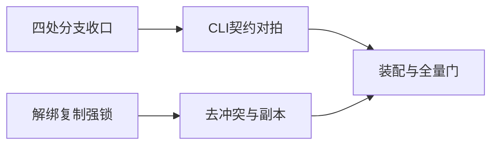

# 八大技能契约零漂移、提示词去臃肿与提交风格防抖 — 功能设计规范（SPEC）

## 文档信息与变更概览

| 项目 | 内容 |
| --- | --- |
| 当前状态 | `approved`（`draft \| approved \| implementing \| in_review \| implemented \| superseded`） |
| 规划级别 | `L3`（跨模块重构、接口/契约变更或高风险改造；未 `approved` 前不编码） |
| 创建 / 更新 | `2026-11-24` / `2026-11-24` |
| 分支 / Issue / PR | `feat/r6-arch-plan` / 未关联 / 未关联 |
| 负责人 / 内审状态 | plan-r6-arch / `passed` |
| 规划态 | `interactive`（逐题问到零拍板）/ `autonomous`（默认推进，仅单向门、Case 5 或真业务歧义才停） |
| 关联 PRD / Todo | `../prd/261124-r6-arch-hardening-prd.md` / `../todo/261124-r6d-skills-contract-debloat-todo.md` |

- **变更一句话**：在 Wave 1（A/B/C）合入后，将剩余 4 处默认分支调用收口至 `r6a` 的 `isDefaultBranch`、扩展 `cli-parity.mjs` 清零幽灵参数、先解绑 `preflight-contract-rules.mjs` 复制强锁再按「保留完整信息、仅删冲突与重复副本」原则整理全仓文档（无字节死线），并完成 `equip.mjs .`、`compose-agents.mjs .` 与总控 PRD 归档收口（认领总控 PRD `C13`、`C14`、`C15`、`C16`）。

## 系统变更全景

| 模块 / 文件 | 变更性质 | 核心职责 |
| --- | --- | --- |
| `doc-plan-ops.mjs` / `edit-gate.mjs` / `review-context.mjs` / `govern-state.mjs` | 改造 | 将剩余 4 处 `['main','master']` 统一切换至 `isDefaultBranch` |
| `scripts/dev/cli-parity.mjs` / `kit/skills/dev-flow/scripts/flow.mjs` | 改造 | 补齐 `flow.mjs` `printHelp()`；扩展 `cli-parity.mjs` 校验全部 `kit/skills/dev-*/SKILL.md` 与 `printNextStep` |
| `scripts/dev/preflight-contract-rules.mjs` | 改造 | 解绑多文件复制强锁，改为权威源完整判据 + 入口标题指针/禁过时声明 |
| `SKILL.md` / `AGENTS.md` / `templates/agents-project.md` / `references/*.md` / `kit/skills/dev-*/SKILL.md` | 改造 | 去冲突（A1/A2/A3、Case 1、`--planning`、`single-session`、外部调研、弹性探索）与重复副本（无硬压字节死线） |
| `docs/TDD.md` / `docs/feature-map.json` / `.agents/skills/**` | 同步 | 更新架构与地图、跑 `equip.mjs .` 与 `compose-agents.mjs .`、最终 PR 归档总控 PRD |
| `scripts/dev/fixtures-r6d-contracts.mjs` (new) / `scripts/dev/injections-data-r6d.mjs` (new) | 新增 | 正反双向夹具与故障注入 |

## 一、背景与边界声明

- **要改什么**：Wave 2 收口 4 处剩余默认分支调用、CLI 对拍防回归、解绑复制强锁并消除五处规则冲突与多处重复副本、同步文档/装配并跑通全量交付门禁。
- **不改什么**：不回改 Wave 1 已交付的核心状态机算法；不硬压 `AGENTS.md` `12–15KB` 字节死线、不写死探索文件数阈值、不写死简报行数上限。
- **本期不做**：不新增第 9 个内置技能；不改动无关历史归档文档。
- **复用既有模块**：`kit/skills/lib/git.mjs` (`isDefaultBranch`)、`scripts/dev/cli-parity.mjs`、`scripts/dev/preflight-contract-rules.mjs`、`scripts/compose-agents.mjs`、`scripts/equip.mjs`、`scripts/review.mjs`。
- **架构基线关系**：先解除 `preflight-contract-rules.mjs` 的多处副本强锁，再恢复 `SKILL.md`「入口不复述 `references/` 判据」与 `references/collaboration.md` 单一真相源（依据：`docs/TDD.md`）。

## 二、设计方案与契约变更

### 接口 / 数据结构变更

1. **剩余默认分支收口与 CLI 契约防回归（`C13`）**：
   - 将 `kit/skills/dev-plan/scripts/doc-plan-ops.mjs:297`、`kit/skills/dev-edit/scripts/edit-gate.mjs:299`、`kit/skills/dev-review/scripts/review-context.mjs:41` 与 `kit/skills/dev-govern/scripts/govern-state.mjs:74` 的 `['main','master']` 白名单全部切换为调用 `r6a` 提供的 `isDefaultBranch` / `resolveDefaultBranch`。
   - 移除 `kit/skills/dev-review/SKILL.md:35` `check-empirical` 中的幽灵参数 `--target targetPath`；对齐 `kit/skills/dev-flow/scripts/flow.mjs` `printHelp()` 与 `DARK_BASELINE`（声明 `--todo`/`--spec`/`--prd`/`--pr`/`--milestone`/`--visual-evidence`）；补齐 `kit/skills/dev-flow/SKILL.md`（`submit --agent agentId`、`cleanup --confirm --preview-hash previewHash`）与 `kit/skills/dev-plan/SKILL.md`（`init [--owner ownerId | --agent agentId]`）。
   - 扩展 `scripts/dev/cli-parity.mjs`：扫描所有 `kit/skills/dev-*/SKILL.md` 命令行代码块及核心脚本文本中的 `printNextStep` 命令，拦截任何未在对应脚本注册的幽灵参数与缺失必填参数。

2. **解绑复制强锁与去重整理（无硬压字节死线）（`C14`）**：
   - 先改造 `scripts/dev/preflight-contract-rules.mjs`：移除把同一长段步骤/规则强锁在 `AGENTS.md`、`templates/agents-project.md`、`SKILL.md` 与 `references/collaboration.md` 四处同时复制的正则（`PUSH_TIER_RULE` / `FINISH_SITES`），改为在权威源 `references/collaboration.md` 校验完整判据，在入口文件（`SKILL.md` / `AGENTS.md` / `templates/agents-project.md`）只校验**标题指针存在且不含过时矛盾声明**。
   - **彻底取消硬压字节死线**（仅守 `compose-agents.mjs` 原有 `24KB/30KB` 上限提示），按「保留合理信息完整度、仅删冲突与多处复制副本」原则整理 `SKILL.md`、`AGENTS.md`、`templates/agents-project.md`、`references/collaboration.md`、`references/docs-set.md` 与高重 `kit/skills/dev-*/SKILL.md`（去除重复抄写的五档表、7 步逐行操作、6 锁与「先最小复现再评整类加固」等通用说教副本，收敛回 `AGENTS.md` 总纲与 `references/` 权威源）。

3. **五处冲突消解、外部调研松绑与弹性探索启发式（`C15`）**：
   - 完整同步用户拍板 **A1**（非平凡 Case 3 Todo 自检直通，Critique 仅建议）、**A2**（`dev-iterate run` 默认 `--escalate: true`，支持 `--no-escalate`）、**A3**（独立只读审查 `verdict: pass` 且 `reviewPassedHead === HEAD` 后，允许独立审查者或调度者执行 `flow.mjs merge`，仍禁实施者自合）至 `docs/TDD.md`、`references/collaboration.md`、`references/docs-set.md` 及对应 `SKILL.md`。
   - 消解 `Case 1` 原地微调与「探索转写改必建 worktree」冲突、`--planning` 与 `doc-plan init` 自动隔离双写冲突，并将 `single-session + --human-approved` 前置说明放入显著入口。
   - **松绑外部调研 × 仓内路径硬回落**：破除 `SKILL.md:31` / `kit/skills/dev-plan/SKILL.md:57` / `references/survey.md:14` 对 `webfetch`/`websearch` 的一刀切禁令——允许在需求澄清、技术选型与用户要求外部调研时检索外部事实（注明外部来源），同时强制任何写入设计/任务单的仓内文件路径、符号与命令必须经 `doc-locate`/`repo-map`/`verifyDocClaims` 在本仓验真（Repo-Path Grounding Gate）。
   - **弹性探索启发式**：在 `SKILL.md` / `references/collaboration.md` / `kit/skills/dev-explore/SKILL.md` 明确「检索目标收敛且不污染主上下文时，主 Agent 直接自跑 `doc-locate`/`repo-map`；广度高、不确定性强时派并行只读 `explore` 并用短回执收口」，**不按 1–3 个文件数写死，也不给简报设固定行数死线**。

4. **全仓同步装配、总控 PRD 归档与全量交付门禁（`C16`）**：
   - 同步更新 `docs/TDD.md` 与 `docs/feature-map.json`（涵盖 `plan-index.mjs` (new)、`refs/pf/claims/` CAS 租约、`preInit` 缓冲、`resolveTestRunner` 等全部新增原语）。
   - 运行 `node scripts/equip.mjs .` 与 `node scripts/compose-agents.mjs .`；跑通全仓门禁矩阵；在切片 D 最终 PR 一并收口归档总控 PRD `docs/prd/261124-r6-arch-hardening-prd.md`。

### 数据与状态变更

- `.agents/skills/.pf-manifest.json` 随 `scripts/equip.mjs .` 同步更新；`docs/feature-map.json` 与 `docs/TDD.md` 同步更新。

### 异常、回退与安全边界

- `cli-parity.mjs` 仅针对 `node .../<entry>.mjs` 调用校验参数，不误伤 `git`/`gh`/`mvn`/`pytest` 等外部 CLI 参数；解绑 `preflight-contract-rules.mjs` 不得削弱权威源判据与 `gap-coverage.mjs` 覆盖率。

### 实现顺序

1. 切换剩余 4 处默认分支调用至 `isDefaultBranch`，改造 `scripts/dev/cli-parity.mjs` 与 `flow.mjs` `printHelp()`，解绑 `scripts/dev/preflight-contract-rules.mjs`。
2. 整理并同步 `SKILL.md`、`templates/agents-project.md`、`references/*.md`、`kit/skills/dev-*/SKILL.md`、`docs/TDD.md` 与 `docs/feature-map.json`。
3. 运行 `equip.mjs .`、`compose-agents.mjs .`，补齐 `fixtures-r6d-contracts.mjs` (new) 与 `injections-data-r6d.mjs` (new)，跑通全量门禁与外部压测复测。

## 三、备选方案与否决理由

| 方案 | 怎么做的 | 为什么没选 | 什么情况下该改回它 |
| --- | --- | --- | --- |
| 解绑多处复制强锁 + 去冲突副本（保留信息完整度）+ 扩面 `cli-parity` | 不硬卡字节数字，从门禁根源解绑重复复制要求 | 决定性采用：兼顾信息完整、规则零矛盾与长期防漂移 | 新增技能入口时同步纳入 `cli-parity` |
| 硬压 `AGENTS.md` 到 12–15KB 并保留 `preflight-contract-rules.mjs` 原锁 | 强行删字凑字节指标 | 否决：既炸掉 `preflight` 又丢失关键协作约束导致弱模型失底 | 任何情况下不以字节死线牺牲信息完整 |

## 四、改动清单与影响面

| 文件 / 目录 | 改动性质 | 改什么 | 谁会被影响 |
| --- | --- | --- | --- |
| `doc-plan-ops.mjs`、`edit-gate.mjs`、`review-context.mjs`、`govern-state.mjs` | 修改 | 4 处残余 `['main','master']` 切至 `isDefaultBranch` | 默认分支判定一致性 |
| `scripts/dev/cli-parity.mjs`、`scripts/dev/preflight-contract-rules.mjs`、`kit/skills/dev-flow/scripts/flow.mjs` | 修改 | 扩展 `cli-parity` 扫 `SKILL.md`/`printNextStep`；补 `flow.mjs` `printHelp()`；解绑复制强锁 | 门禁与命令行契约 |
| `SKILL.md`、`AGENTS.md`、`templates/agents-project.md`、`references/*.md`、`kit/skills/dev-*/SKILL.md`、`docs/TDD.md`、`docs/feature-map.json` | 修改 | 消解 A1/A2/A3 与 5 处冲突、去重复副本、外部调研松绑、弹性探索启发式 | 全项目 AI 会话与人类文档 |
| `.agents/skills/**`、`scripts/compose-agents.mjs`、`scripts/lib/agents-defaults.mjs` | 同步 | 运行 `equip.mjs .` 与 `compose-agents.mjs .` 对齐提交风格提示 | 本仓与外部装配项目 |
| `scripts/dev/fixtures-r6d-contracts.mjs` (new)、`scripts/dev/injections-data-r6d.mjs` (new) | 新增 | 正反双向夹具与故障注入 | `fixtures.mjs` 与 `verify-injections.mjs` |

- **对外可见的变化**：幽灵参数清零；五处文档冲突消解；支持弹性探索与外部调研松绑；`AGENTS.md` 去重复且保留完整关键约束。
- **需要同步改的地方**：最终 PR 随同归档总控 PRD `docs/prd/261124-r6-arch-hardening-prd.md`。

## 五、冻结的验收标准

- [ ] C13: `doc-plan-ops.mjs`、`edit-gate.mjs`、`review-context.mjs`、`govern-state.mjs` 均已切换至 `isDefaultBranch`；`node scripts/dev/cli-parity.mjs` 校验全部 `kit/skills/dev-*/SKILL.md` 与 `printNextStep` 通过且 `kit/skills/dev-review/SKILL.md` 无 `--target`。
- [ ] C14: `scripts/dev/preflight-contract-rules.mjs` 解绑多文件全文复制强锁，权威判据仅保留在 `references/` 单一真相源，入口保留指针与红线且无硬压字节死线；`node scripts/compose-agents.mjs . --check` 与 `node scripts/dev/gap-coverage.mjs` 通过。
- [ ] C15: 文档完整对齐 A1/A2/A3、`Case 1` 原地微调、`--planning` 自动隔离、`single-session + --human-approved`、外部调研松绑 + 仓内路径硬回落、弹性探索启发式（无固定文件数与简报行数死线）。
- [ ] C16: `node scripts/equip.mjs . --check`、`node scripts/compose-agents.mjs . --check`、`node scripts/review.mjs .`、`node scripts/dev/preflight.mjs`、`node scripts/dev/fixtures.mjs --jobs 6`、`node scripts/dev/verify-injections.mjs --jobs 4`、`node scripts/dev/e2e-zip-harness.mjs`、`node .agents/skills/dev-plan/scripts/doc-plan.mjs audit .` 与 `node .agents/skills/dev-govern/scripts/govern-audit.mjs audit . --strict` 全绿退出码 `0`。

## 六、高风险点、门型与回滚路径

- **门型与回滚路径**：one-way；异常时 `git revert <sha>` 回退。
- **高风险路径**：`SKILL.md`、`AGENTS.md`、`templates/`、`kit/` 与 `scripts/lib/` 须独立双门审查与故障注入。
- **故障注入预演**：使用 `scripts/dev/verify-injections.mjs --jobs 4` 与 `scripts/dev/injections-data-r6d.mjs` (new)，向 `kit/skills/dev-review/SKILL.md` 注入幽灵 `--target` 或破坏权威源指针，确认 `cli-parity.mjs` 与 `preflight.mjs` 必红。

## 澄清与补充记录

- 已确认（2026-11-24 · user）：A1: 非平凡 Case 3 Todo 的 Critique 口径 -> A1 已拍板：非平凡 Case 3 Todo 统一为「自检直通，Critique 仅建议（不强制）」，由切片 B 对齐 `doc-plan.mjs`，切片 D 同步校准 `docs/TDD.md` 与 `kit/skills/dev-plan/SKILL.md`。
- 已确认（2026-11-24 · user）：A2: `dev-iterate run` 失败升级默认值 -> A2 已拍板：`dev-iterate run` 默认开启失败自动升级建单（`--escalate` 默认 `true`，支持 `--no-escalate` 关闭），由切片 C 实现并在切片 D 同步文档。
- 已确认（2026-11-24 · user）：A3: 独立审查通过后 `flow.mjs merge` 执行权 -> A3 已拍板：只读独立审查子代理通过 `review-pack record --verdict pass` 后，允许独立审查者或调度者执行 `flow.mjs merge`（强校验 `reviewPassed === true && headSha === reviewPassedHead`，仍严禁实施者自合），由切片 A 落盘门禁并在切片 D 同步文档。

## 实现说明

- **实际落地摘要**：
- **与草案的差异**：
- **关联同步文件**：
