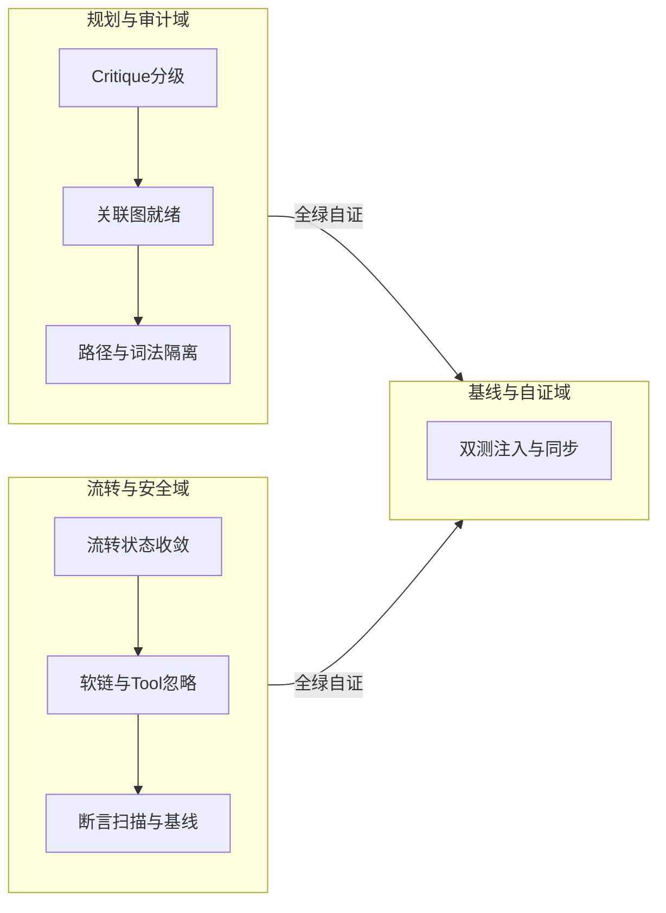

# Round-7 盲测 10 项跨项目架构级根因统一根治 — 功能设计规范（SPEC）

## 文档信息与变更概览

| 项目 | 内容 |
| --- | --- |
| 当前状态 | `draft`（`draft \| approved \| implementing \| in_review \| implemented \| superseded`） |
| 规划级别 | `L3`（跨模块重构、接口/契约变更或高风险改造；未 `approved` 前不编码） |
| 创建 / 更新 | `2026-11-24` / `2026-11-24` |
| 分支 / Issue / PR | `feat/r7-rootfix-closure` / 未关联 / 未关联 |
| 负责人 / 内审状态 | plan-r7-rootfix / `pending` |
| 规划态 | `interactive`（逐题问到零拍板）/ `autonomous`（默认推进，仅单向门、Case 5 或真业务歧义才停） |
| 关联 PRD / Todo | 无 / `docs/todo/261124-r7-rootfix-closure-todo.md` |

- **变更一句话**：将 Round-7 四条离线盲测通道双路取证证实的 10 项跨项目架构级根因一次性收敛为通用单源机制，消除规划停损误触、关联图审批脱节、路径/反引号误杀、流转状态串台、宿主软链误截断、多生态断言与 linter 探测盲区、供应链 diff 覆盖盲区及慢速 CI 性能预算反切。

## 系统变更全景

| 模块 / 文件 | 变更性质 | 核心职责 |
| --- | --- | --- |
| `kit/skills/lib/critique-rounds.mjs`、`kit/skills/lib/critique-diff.mjs` (new)、`kit/skills/lib/critique-store.mjs` | 改造 / 新增 | Critique 严重度分层、R2+ 正文快照 diff 区间锁、条目级闭环与防跳轮校验 |
| `kit/skills/lib/plan-index.mjs`、`kit/skills/lib/plan-exit-gate.mjs`、`kit/skills/lib/plan-next.mjs`、`kit/skills/dev-plan/scripts/doc-plan-ops.mjs` | 改造 | 关联规划图原子就绪校验、`APPROVING_STATUS` PRD 依据校验、Case 4 Todo 初始 `draft` 与联动激活 |
| `kit/skills/dev-plan/scripts/doc-plan.mjs`、`kit/skills/lib/subcommand-meta.mjs`、`kit/skills/dev-plan/SKILL.md` | 改造 | 注册并暴露 `note` 入口、新增 `--should-fix` / `--resolved` / `--rebut-accepted`、修正 PRD 下一步 |
| `kit/skills/dev-plan/scripts/doc-audit.mjs`、`doc-audit-helpers.mjs`、`doc-substantive.mjs`、`pending-decisions.mjs`、`doc-requirements.mjs` | 改造 | 活跃+归档双态路径解析、元信息/分支与行内反引号词法隔离、`风险与开放问题` 与否定前缀识别 |
| `kit/skills/lib/session-state.mjs`、`issue-template-hydrate.mjs`、`flow-inspect.mjs`、`flow-start-helpers.mjs`、`flow-merge.mjs`、`task-backend-local.mjs` | 改造 | `unconsumedFresh` 任务隔离、模板 `matchedCount === 0` 保底正文、`--planning` 身份隔离与 `generic-git` 合后主干同步 |
| `scripts/handoff.mjs`、`scripts/lib/review-helpers.mjs`、`scripts/review.mjs`、`scripts/survey.mjs`、`scripts/equip.mjs` | 改造 | `isForgeOwnedPath` + Git `120000`/`.gitignore` 软链分层判定、跨生态 `.agents/` 忽略探测表 |
| `kit/skills/lib/static-gates.mjs`、`kit/skills/lib/static-gates-assertions.mjs` (new)、`kit/skills/dev-review/scripts/review-diff.mjs`、`scripts/lib/survey-docs.mjs` | 改造 / 新增 | 分家族断言语义函数 `hasBehavioralAssertion`、普通新增 diff 行提示词注入/双向字符扫描、CI PR 流安装/权限审计 |
| `scripts/dev/bench.mjs`、`kit/skills/dev-verify-tools/scripts/verify-tools.mjs`、`scripts/dev/fixtures-r7-rootfix.mjs` (new)、`scripts/dev/injections-data-r7.mjs` (new) | 改造 / 新增 | 解耦 `strictBudget` 与 `runawayCapMs` 校准、`verify-tools run --stale` 批量实跑刷新基线、双向测试与故障注入 |

## 一、背景与边界声明

- **要改什么**：按 `C1..C7` 统一根治 Round-7 盲测暴露的 10 项跨项目架构级根因（规划 Critique、关联图就绪、路径/词法隔离、Flow 状态机、软链/linter 探测表、跨生态断言/供应链/性能与基线闭环）。
  1. **C1 规划 Critique 分级与 R2+ 收敛锁**：`kit/skills/lib/exit-codes.mjs`、`kit/skills/lib/critique-rounds.mjs`、`kit/skills/lib/critique-diff.mjs` (new)、`kit/skills/lib/critique-store.mjs`、`kit/skills/dev-plan/scripts/doc-plan.mjs`、`kit/skills/dev-plan/SKILL.md`、`references/docs-set.md`。
  2. **C2 关联规划图原子就绪与 `note` 入口对齐**：`kit/skills/lib/plan-index.mjs`、`kit/skills/lib/plan-exit-gate.mjs`、`kit/skills/dev-plan/scripts/doc-audit.mjs`、`kit/skills/dev-plan/scripts/doc-plan-ops.mjs`、`kit/skills/lib/plan-next.mjs`、`kit/skills/lib/doc-templates.mjs`、`kit/skills/lib/doc-template-render.mjs`、`kit/skills/templates/docs-todo.md`、`kit/skills/lib/subcommand-meta.mjs`、`scripts/dev/cli-parity.mjs`。
  3. **C3 生命周期路径解析与 Markdown 语义隔离**：`kit/skills/dev-plan/scripts/doc-audit.mjs`、`kit/skills/dev-plan/scripts/doc-audit-helpers.mjs`、`kit/skills/lib/doc-substantive.mjs`、`kit/skills/lib/pending-decisions.mjs`、`kit/skills/lib/doc-requirements.mjs`。
  4. **C4 Flow 状态机与模板水合修复**：`kit/skills/lib/session-state.mjs`、`kit/skills/lib/issue-template-hydrate.mjs`、`kit/skills/dev-flow/scripts/flow-inspect.mjs`、`kit/skills/dev-flow/scripts/flow-start-helpers.mjs`、`kit/skills/dev-flow/scripts/flow-merge.mjs`、`kit/skills/lib/task-backend-local.mjs`。
  5. **C5 `handoff.mjs` 所有权边界与跨生态 linter 探测表**：`scripts/handoff.mjs`、`scripts/lib/review-helpers.mjs`、`scripts/review.mjs`、`scripts/survey.mjs`、`scripts/equip.mjs`。
  6. **C6 栈无关断言模型、供应链扩散扫描与性能/基线闭环**：`kit/skills/lib/static-gates.mjs`、`kit/skills/lib/static-gates-assertions.mjs` (new)、`kit/skills/lib/test-inventory.mjs`、`kit/skills/dev-govern/scripts/govern-tests.mjs`、`kit/skills/dev-edit/scripts/edit-gate.mjs`、`kit/skills/dev-review/scripts/review-diff.mjs`、`scripts/lib/survey-docs.mjs`、`scripts/dev/bench.mjs`、`kit/skills/dev-verify-tools/scripts/verify-tools.mjs`。
  7. **C7 双向测试、故障注入、文档与装备同步**：`scripts/dev/fixtures-r7-rootfix.mjs` (new)、`scripts/dev/injections-data-r7.mjs` (new)、`scripts/dev/injections-data-kernel-dedup.mjs`、`scripts/dev/injections-data-iterate-evolution.mjs`、`docs/TDD.md`、`docs/feature-map.json`、`references/`、`scripts/equip.mjs`、`.agents/skills/`、`scripts/compose-agents.mjs`、`AGENTS.md`。
- **不改什么**：保持 `kit/` 零第三方依赖与 `arch-rules` 四层单向隔离边界不变；保持 `kit/skills/dev-review/scripts/review-locks.mjs` 与 `kit/skills/dev-review/scripts/review-ledger.mjs` 既有代码审查锁机制不变；保持 `scripts/dev/bench.mjs` 零环境变量分支（禁止 `process.env.CI` / `GITHUB_ACTIONS`）不变；保持外部未跟踪越界/悬空软链在 `scripts/handoff.mjs` 的 `truncated`（exit 3）严格拦截不变。
- **本期不做**：不在产品层引入任何 AI 宿主专有环境变量、私有路径或斜杠命令绑定；不新增第 9 个内置技能；不自动修改目标仓的 `.eslintrc*` / `ruff.toml` / `pyproject.toml` / `.markdownlint*` 宿主配置文件；不绕过 `doc-plan` 或 `flow` 既有权限与作者分离门禁。
- **复用既有模块**：`kit/skills/lib/doc-approval.mjs`（`APPROVING_STATUS`、`isApprovingStatus`）、`kit/skills/lib/markdown-scan.mjs`（`scanLines`、`fencedSpans`）、`kit/skills/lib/plan-index.mjs`（`indexPlanDocs`、`isPlanDocApproved`）、`kit/skills/lib/plan-exit-gate.mjs`（`resolveApprovalBasis`、`resolveCritiqueReadiness`）、`kit/skills/lib/overlay.mjs`（`scanExtensionSlotHazards`）、`kit/skills/lib/static-gates-lexer.mjs`（`stripCodeCommentsLines`、`maskLiteralsInCodeLine`）、`kit/skills/lib/git.mjs`（`inspectBranchMergeState`、`resolveDefaultBranch`、`isInsideDir`）。
- **架构基线关系**：严格遵循 `docs/TDD.md` 第 2 节 `arch-rules`（`kit/**` 只能引用 `kit/skills/lib/` 与 `node:*`）、第 8 节退出码四档登记（`kit/skills/lib/exit-codes.mjs`）及每个 `.mjs` 文件 `<= 800` 行上限（紧文件 `critique-rounds.mjs` 779 行、`doc-plan.mjs` 789 行、`flow-inspect.mjs` 797 行、`static-gates.mjs` 772 行、`survey-docs.mjs` 781 行需拆分纯函数到共享子模块）。

## 二、设计方案与契约变更

### 接口 / 数据结构变更

1. **C1 Critique 严重度分级与 Round 2+ 收敛锁**
   - 在 `kit/skills/lib/exit-codes.mjs` 的 `FACT_CODES` 注册：`BLOCKED_NON_BLOCKING_REJECT`、`BLOCKED_OUT_OF_SCOPE_CRITIQUE`、`BLOCKED_CRITIQUE_ROUND_GAP`（均为 `EXIT.FACT` = `3`）。
   - 新建 `kit/skills/lib/critique-diff.mjs` (new) 承接纯计算，防止 `critique-rounds.mjs` 超过 800 行：
     - **严重度分级**：支持 `--findings` 条目前缀/标签解析（`[blocker]` / `blocker:`、`[major]` / `major:`、`[minor]` / `minor:`，`critique-reject` 默认 `major`）。若 `critique-reject` 收到的全部意见均为 `minor`（零 `blocker`/`major`），抛 `BLOCKED_NON_BLOCKING_REJECT`（exit 3），提示改用 `doc-plan.mjs critique-pass --should-fix "..."`；在 `critique-pass` 新增 `--should-fix`（multiFlag）记录非阻断建议进 `ledgerEntry.findings` 而不阻断 `approve`。
     - **防跳轮锁**：`validateCritiqueActorAndHistory` 校验 `maxRound = max(priorRounds.round, 0)`，若显式 `--round` 大于 `maxRound + 1` 或非正整数，抛 `BLOCKED_CRITIQUE_ROUND_GAP`（exit 3）。
     - **R2+ 正文对比与条目闭环**：每轮将 `stripCritiqueMeta(text)` 的正文行快照存入 `ledgerEntry.roundSnapshots[round]`（不写入 Frontmatter）。在 Round `>= 2` 执行 `critique-reject` 时，用行级 diff 计算相对上一轮快照的变更行区间（`±3` 行缓冲）与变更章节集合；为每条阻断项分配稳定编号（如 `F1`、`F2`），支持 `--resolved idOrText` 与 `--rebut-accepted idOrText` 关闭历史未决项。R2+ 新阻塞项必须命中未闭环前轮阻塞项（同 ID / 同 `C<N>` 锚点 / 同归一化文本）、或落在变更行区间/变更章节内、或关联确定性 `auditDoc` 失败；命中未动旧行/旧章节的新增主观挑刺一律抛 `BLOCKED_OUT_OF_SCOPE_CRITIQUE`（exit 3），引导走 `critique-pass --should-fix`。
   - `doc-plan.mjs` 与 `kit/skills/dev-plan/SKILL.md`、`references/docs-set.md` 同步暴露 `--should-fix`、`--resolved`、`--rebut-accepted`。

2. **C2 关联规划图原子就绪与 `note` 入口对齐**
   - `kit/skills/lib/exit-codes.mjs` 注册 `BLOCKED_MASTER_PRD_CRITIQUE_UNREADY`（`EXIT.FACT` = `3`）。
   - `kit/skills/lib/plan-index.mjs` 新增共享原语 `resolveLinkedPlanGraph({ repoRoot, mainRoot, file, doc, allDocs })`：沿 `related_prd`、`related_spec`、`related_todo`（及子切片反向查找）构建关联规划子图并返回整图节点与就绪/未就绪明细。
   - `kit/skills/dev-plan/scripts/doc-audit.mjs`：将 `356` 行校验条件从 `fm.data.approved === true` 扩展为 `fm.data.approved === true || (docType !== 'todo' && isApprovingStatus(docType, st))`，使 `status: active` 但缺少 `plan_critique: passed` / 有效 `override` / 单会话授权的 PRD 同样触发 `APPROVAL_WITHOUT_BASIS`；同步核查并补全存量测试用例中故意或无意省略 `plan_critique: passed` 的 `active` PRD 夹具（仅补齐被 `doc-audit` 审计到的合成夹具，保留反向用例）。
   - `kit/skills/dev-plan/scripts/doc-plan-ops.mjs`：`approveSpec` 对 SPEC 强校 `related_prd`（若存在且非惰性态），先验证其 `resolveApprovalBasis` 与 `isPlanDocApproved` 就绪，否则抛 `BLOCKED_MASTER_PRD_CRITIQUE_UNREADY`（exit 3）。`initDoc` 在 `effectiveKind === 'pair' || effectiveKind === 'all'` 或传入 `--spec` / `--case 4` 时向 `todo` 传递 `caseType: 4` 与 `relatedSpecRel`。
   - `kit/skills/lib/doc-templates.mjs`、`kit/skills/lib/doc-template-render.mjs`、`kit/skills/templates/docs-todo.md`：模板体支持 `{{STATUS}}`（`DOC_TEMPLATE_VARS.todo` 注册 `STATUS`，默认 `'active'`），`buildStandardDocContent` 对 `caseType === 4 || Boolean(relatedSpecRel)` 的 Todo 初始写为 `status: 'draft'`（Case 3 独立 Todo 保持 `status: 'active'`）；`approveSpec` 已有联动激活逻辑将其原子切为 `active`。
   - `kit/skills/dev-plan/scripts/doc-plan.mjs`：修正 PRD `critique-pass` 输出的下一步命令（由失效的 `link --status active` 改为 `approve --file`）；将 `note` 注册进 `kit/skills/lib/subcommand-meta.mjs`、`doc-plan.mjs` 头部 `子命令：` 注释、`printHelp()` 及 `kit/skills/dev-plan/SKILL.md`，纳入 `subcommand-parity.mjs` 与 `cli-parity.mjs` 检查。
   - `kit/skills/lib/plan-next.mjs`：在 `plan-only-handoff` 判定前调用 `resolveLinkedPlanGraph` 校验整图节点就绪（总控 PRD、所有已建子 SPEC 及 Todo 状态），若有未过审/未批准节点则返回对应动作而非提前进入 `plan-only-handoff`。

3. **C3 生命周期路径解析与 Markdown 语义隔离**
   - **活跃 + 归档双态存在判定**：在 `doc-audit-helpers.mjs` 的 `resolveDocBodyPathCandidate`（及 `doc-audit.mjs` 的 `Pass 2`）中，当活跃目录下的 `prd`、`specs`、`todo` 子文档不存在时，探测对应归档目录中同文件名是否存在且状态为已归档终态（`implemented` / `done` / `archived`），若命中归档态则视为合法生命周期迁移路径（可记入 `warnings` 提示可选同步链接，不再误报 `HALLUCINATED_PATH`）。
   - **元信息非路径行隔离**：在 `doc-audit.mjs` 提取正文 `bodyLines` 时，识别顶部元信息概览表（`| 分支 / 基线 |`、`| 分支 / Issue / PR |` 及 `branch:` 行）中的 Git 分支名（如含 `docs/` 或 `feat/` 前缀的分支标识），对该单元格分支值跳过仓库文件路径扫描。
   - **统一 Markdown 行内反引号与围栏剥除**：复用 `kit/skills/lib/markdown-scan.mjs` 并提供共享 `stripMarkdownCodeSpans(text)`，在 `collectPlaceholderErrors`（`doc-audit-helpers.mjs`）对 `ANGLE_PLACEHOLDER_RE` 扫描前以及 `isSubstantiveText`（`doc-substantive.mjs`）对 `ANGLE_PLACEHOLDER_SINGLE_RE` 扫描前先剥除围栏与行内反引号 `` `...` ``，消除 `` `--top N` `` 或含尖括号参数示例被误判为占位符或核心节退化。
   - **`风险与开放问题` 与「无 + 说明」语义**：在 `kit/skills/lib/pending-decisions.mjs` 中对齐 `doc-requirements.mjs` 的 `risks` 节（`风险与开放问题` / `风险与应对` 仅作风险说明而非待定裁决，不按章节标题拦截）；扩充 `EMPTY_SECTION_RE` / 否定语义识别「无。+ 补充说明」或「无待定事项，……」等明确否定句式，不再误报 `BLOCKED_PENDING_DECISIONS`。

4. **C4 Flow 状态机与模板水合修复**
   - `kit/skills/lib/session-state.mjs`：`findBlockingTriageDowngrade` 修复 `unconsumedFresh` 跨任务误杀——当调用方已传入明确任务标识（`taskId` / `slug`）或不同 `summary`/`paths` 指纹（`fp && rec.fingerprint && fp !== rec.fingerprint`）时，仅在 `idMatched` 或 `fpMatched` 命中时按同任务校验降档（无任何标识且无指纹时才兜底拦截未消费记录）；在任务进入终态（`cleanup` / `abort` / `merge`）时调用 `markTriageConsumed(..., { terminal: true })` 主动闭合关联记录。
   - `kit/skills/lib/issue-template-hydrate.mjs`：在 `hydrateIssueBody` 中，当 `matchedCount === 0`（如宿主 Issue 模板剥除 HTML 注释后无可识别标题或纯模板注释）时，即使未传 `rawBody`（仅有结构化 `fields.summary` / `fields.criteria` / `fields.repro`），强制追加 `buildFallbackIssueBody(effectiveFields, sec)` 兜底正文，确保建单正文绝不退化为空壳。
   - `kit/skills/dev-flow/scripts/flow-inspect.mjs` & `kit/skills/dev-flow/scripts/flow-start-helpers.mjs`：在 `isPlanning === true` 时，`flow-inspect.mjs` 仅消费显式 `--agent` / `--implementer` 作为 `agent`（禁止把本机 `gitIdentity.name` 或 `ghLogin` 预填为 `implementerId`）；在多代理模式下由 `planning` 晋升至 `started` 时（`promotePlanningToStarted`），若未提供 `--agent` / `--implementer` 且原任务无独立实施者（仅记录了与规划作者一致的占位或空值），直接报 `BLOCKED_MISSING_ACTOR`（`EXIT.USAGE`，引导传入 `--agent implId`），而非回退 `git user.name` 触发虚假 `BLOCKED_AUTHOR_IS_IMPLEMENTER`（将 `flow-inspect.mjs` 相关逻辑拆进 `flow-start-helpers.mjs` 保持 `flow-inspect.mjs <= 800` 行）。
   - `kit/skills/dev-flow/scripts/flow-merge.mjs` & `kit/skills/lib/task-backend-local.mjs`：`GenericGitBackend.mergePr` 优先识别跨仓协作远端（如 `upstream` 存在且 `role === 'contributor-fork'` 时区分推送源与基线源，或按 `remote` 核验并回传 `mergeState` / `verifiedBaseRef`）；`flow-merge.mjs` 在 `generic-git` / `local-only` 合并确认后，当 `mainRoot` 工作区干净且处于 `baseBranch` 时执行与 GitHub 路径同源的 `ff-only` 本地默认分支同步，并在 `buildCleanupChecklist` 优先复用已验证的 `mergeRes.mergeState`，消除合后清理清单误报 `(unmerged)` 与给出可执行引导。

5. **C5 `handoff.mjs` 所有权边界与跨生态 linter 探测表**
   - `scripts/handoff.mjs`：抽取单源 `isForgeOwnedPath(rel)`（覆盖 `.agents/skills/**`、`AGENTS.md`、`SKILL.md`、`.worktrees/**`、`docs/{prd,specs,todo,archive}/**`、`.pf-manifest.json`）。对 `git ls-files -z` 已跟踪软链（mode `120000`）：若 `!isForgeOwnedPath(rel)` 则跳过不标 `truncated`（计入 `skippedSymlinks`）；对未跟踪软链：先批查 `git check-ignore`，若已被 `.gitignore` 忽略且 `!isForgeOwnedPath(rel)` 则跳过不标 `truncated`；对未跟踪未忽略的悬空/越界软链以及 `isForgeOwnedPath` 下的异常软链保持 `truncated = true`（exit 3）严检。
   - `scripts/lib/review-helpers.mjs`、`scripts/review.mjs`、`scripts/survey.mjs`、`scripts/equip.mjs`：将 `checkEslintAgentsIgnore` 泛化为声明式跨生态探测表 `TOOLING_AGENTS_IGNORE_RULES` + `detectToolingAgentsIgnoreGaps(root)`，覆盖 ESLint（`eslint.config.*` / `.eslintrc*` / `package.json` / `.eslintignore`）、Python Ruff（`ruff.toml` / `.ruff.toml` / `pyproject.toml [tool.ruff]`）、mypy（`mypy.ini` / `.mypy.ini` / `pyproject.toml [tool.mypy]`）、pyright（`pyrightconfig.json` / `pyproject.toml [tool.pyright]`）、pre-commit（`.pre-commit-config.yaml`）与 markdownlint（`.markdownlint*`）。保留 `checkEslintAgentsIgnore` 兼容导出与 `review.mjs` 的 `kit.eslint-agents-ignore` 结论 ID（兼容既有测试），对非 ESLint 工具补充 `kit.tooling-agents-ignore`（`notice` 级别「可以更好」，不阻断），并在 `survey.mjs` 与 `equip.mjs` 输出非侵入式忽略配置提示，绝不擅自改写宿主工具配置。

6. **C6 栈无关断言模型、供应链扩散扫描与性能/基线闭环**
   - 新建 `kit/skills/lib/static-gates-assertions.mjs` (new) 并在 `kit/skills/lib/static-gates.mjs` 重导出 `hasBehavioralAssertion(codeOnlyText, opts)`：保留 `ASSERTION_RE` / `GATE_ASSERTION_RE` 兼容导出不变，重构断言判定为分家族语义模型（通用 statement/expect/should 族 + 面向对象测试方法族 Python `self.assert*` / PHP `$this->assert*` + 宏/原语族 Rust `assert_*!` / Swift `#expect`/`#require` / Ruby `assert_*`/`refute_*` + 受控测试上下文接收器方法白名单 `t`/`test`/`assert` 的 `same`/`notSame`/`deepEqual`/`equal`/`is`/`not`/`truthy`/`falsy`/`throws`/`rejects`/`pass`/`fail`/`ok`/`match`，显式排除 `t.plan`、`t.end`、`t.comment`、`t.skip`、`t.todo`）。同步接入 `kit/skills/lib/test-inventory.mjs`、`kit/skills/dev-govern/scripts/govern-tests.mjs`、`kit/skills/dev-edit/scripts/edit-gate.mjs` 与 `scripts/dev/injections-data-iterate-evolution.mjs`。
   - `kit/skills/dev-review/scripts/review-diff.mjs`：在 `scanUntrustedDiff` 中新增针对普通源码/文档新增行（`added`）的静态安全扫描：检测提示词注入特征（如 `ignore previous instructions`、`system prompt` 劫持指令等）与 Unicode 双向控制字符（`U+202A..U+202E`、`U+2066..U+2069`、`U+200E..U+200F`）并归入 `hazards`（或对应 `payloadHits`），在代码执行前拦截。
   - `scripts/lib/survey-docs.mjs`：在 `analyzeWorkflowSecurity`（保留现有 `unsafePullRequestTargetWorkflows` 检查与 `I425`/`I426` 锚点不变，必要时拆出辅助函数防超 800 行）补全基于 `pull_request` / `pull_request_target` 工作流的静态审计提示：检出外部代码且存在裸 `npm install`（缺 `--ignore-scripts`）或缺失最小 `permissions:` 声明时记录结构化 `advisoryWorkflows` 提示，供 `survey` / `review` 输出「可以更好」指引。
   - `scripts/dev/bench.mjs`：保持零 `process.env.CI` / `GITHUB_ACTIONS` 分支；将 `hardCapMs` 拆分为 `runawayCapMs`（失控上限）与 `MAX_CALIBRATION_UNIT_MS`（探针钳位），`computeCheckBudget(check, { unitMs, strictBudget })` 在默认校准模式计算 `Math.max(check.strictBudget, Math.min(check.runawayCapMs, Math.round(clampedUnitMs * check.unitMult)))`、`--strict-budget` 强制返回 `check.strictBudget`。同步更新 `scripts/dev/injections-data-kernel-dedup.mjs` 中 `I385` 的 `from`/`to`。
   - `kit/skills/dev-verify-tools/scripts/verify-tools.mjs`：在 `run` 子命令新增 `--stale` 标志（同步 `printHelp()`、`kit/skills/dev-verify-tools/SKILL.md` 及 `cli-parity.mjs`），收集所有 `status === 'stale' || status === 'unbaselined'` 的工具并按唯一命令去重真实执行；全部实跑通过后，为对应槽位（如 `slots.main`）原子写入刷新后的 `(symbolHash, moduleTreeHash, verifiedSha)` 基线缓存。本 PR 合入后于主仓执行 `node .agents/skills/dev-verify-tools/scripts/verify-tools.mjs run --stale` 刷新 16 项旧基线，并在 `references/` 说明该工作流。

7. **C7 双向测试、故障注入、文档与装备同步**
   - 新增 `scripts/dev/fixtures-r7-rootfix.mjs` (new) 与 `scripts/dev/injections-data-r7.mjs` (new)，为 C1..C6 每条机制提供正反双向行为断言与至少一条故障注入用例。
   - 更新 `docs/TDD.md`、`docs/feature-map.json`、`references/docs-set.md`、`references/collaboration.md`（如有相关提示同步）、`references/handoff.md`。
   - 运行 `node scripts/equip.mjs .` 与 `node scripts/compose-agents.mjs .` 保持 `.agents/skills/`、`AGENTS.md` 与单源 100% 一致；严格检查零 emoji、无 AI 宿主绑定、无单仓特例硬编码、每个 `.mjs` 文件 `<= 800` 行。

### 数据与状态变更

- 仓外 `ledger.planCritique[relDoc]` 新增可选 `roundSnapshots`（按轮次保存去元信息后的正文快照供 R2+ 增量比对）与结构化 `findings` 条目 ID（`F1`..`Fn`）及关闭状态（`open` / `resolved` / `rebutted`）；Frontmatter 仅保持单行 `plan_critique` 印记不变。
- `kit/skills/templates/docs-todo.md` 增加 `{{STATUS}}` 占位以支持 Case 4 初始 `draft` 并在 `approve` 时原子切为 `active`；`verify-state.mjs` 缓存写入逻辑复用既有格式不变。

### 异常、回退与安全边界

- 所有新增阻断码均登记于 `kit/skills/lib/exit-codes.mjs`（`EXIT.FACT` = 3 / `EXIT.USAGE` = 2），通过 `scripts/dev/exit-code-parity.mjs` 全量对拍。
- 所有写入前校验维持 Fail-Closed：只含 `minor` 的 `critique-reject`、`--round` 跳轮、R2+ 越界挑刺、`related_prd` 未就绪的 `approve`、缺失 `--agent` 的多代理晋升、`handoff` 未跟踪越界软链均直接阻断不留半写脏状态。
- 本次改造均为源码与文档层可逆调整（`two-way`）；若任一门禁出现回归可通过反向提交或工作树回退恢复。

### 实现顺序

1. **先补共享基础契约与退出码**：更新 `exit-codes.mjs`、`subcommand-meta.mjs`、`critique-diff.mjs` (new)、`static-gates-assertions.mjs` (new)，为上层提供单源依赖与控行数拆分。
2. **先红后绿实现 C1 + C2 + C3**：按 Red-Green 在 `fixtures-r7-rootfix.mjs` (new) 先写失败复现断言，再完成规划 Critique 分级/R2+ 锁、关联图原子就绪、Todo `draft` 激活、`note` 注册及生命周期路径/反引号/待拍板隔离。
3. **实施 C4 + C5 + C6**：依次修复 `session-state` / `issue-template-hydrate` / `flow-start` / `flow-merge`、`handoff` 软链与跨生态探测表、`hasBehavioralAssertion` / `review-diff` / `survey-docs` / `bench` / `verify-tools run --stale`。
4. **同步 C7 注入、装备与文档**：补全 `injections-data-r7.mjs` (new)、同步既有 `injections-data-kernel-dedup.mjs` 与 `injections-data-iterate-evolution.mjs`、更新 `docs/TDD.md` / `docs/feature-map.json` / `references/`、运行 `equip.mjs .` 与 `compose-agents.mjs .`、全量门禁实证过关。

## 三、备选方案与否决理由

| 方案 | 怎么做的 | 为什么没选 | 什么情况下该改回它 |
| --- | --- | --- | --- |
| 统一收口到共享 L1/L3 原语（已选） | 抽 `critique-diff.mjs` (new)、`resolveLinkedPlanGraph`、`stripMarkdownCodeSpans`、`isForgeOwnedPath`、`TOOLING_AGENTS_IGNORE_RULES`、`hasBehavioralAssertion` | 根治 4 条盲测通道暴露的分叉与盲区，且控制全部 `.mjs` 文件 `<= 800` 行 | 若某子模块未来完全退役可整体移除对应原语 |
| 为特定测试仓写特例白名单（备选） | 对 `commander.js` `pmlink`、`mri` `tape`、`itsdangerous` 注释模板做路径或仓库名特判 | 违反通用架构原则，换一个新开源仓或目录名立刻复发 | 永不采用单仓特例硬编码 |
| 直接放宽停损或全量跳过断言/软链（备选） | 提高停损轮数到 5 轮、遇到软链全跳过或对 `ASSERTION_RE` 加 `t\.\w+` | 会让真死循环、悬空越界软链与 `t.plan` 空壳测试假绿逃逸 | 只有在彻底取消自动化门禁时才可能放宽 |

## 四、改动清单与影响面

| 文件 / 目录 | 改动性质 | 改什么 | 谁会被影响 |
| --- | --- | --- | --- |
| `kit/skills/lib/exit-codes.mjs` | 修改 | 注册 `BLOCKED_NON_BLOCKING_REJECT`、`BLOCKED_OUT_OF_SCOPE_CRITIQUE`、`BLOCKED_CRITIQUE_ROUND_GAP`、`BLOCKED_MASTER_PRD_CRITIQUE_UNREADY` | 全部 `doc-plan` / `exit-code-parity` |
| `kit/skills/lib/critique-rounds.mjs`、`kit/skills/lib/critique-diff.mjs` (new)、`kit/skills/lib/critique-store.mjs` | 修改 / 新增 | 严重度分层、R2+ 正文对比区间锁、条目闭环、`--should-fix`、防跳轮校验 | `doc-plan`、`plan-next`、`plan-exit-gate` |
| `kit/skills/lib/plan-index.mjs`、`kit/skills/lib/plan-exit-gate.mjs`、`kit/skills/lib/plan-next.mjs` | 修改 | 新增 `resolveLinkedPlanGraph` 与 `plan-only-handoff` 全图就绪检查 | `doc-plan next`、`flow next`、`flow start` |
| `kit/skills/dev-plan/scripts/doc-plan.mjs`、`doc-plan-ops.mjs`、`doc-audit.mjs`、`doc-audit-helpers.mjs` | 修改 | `note` 注册、PRD `APPROVING_STATUS` 依据校、`approveSpec` 查 `related_prd`、双态路径解析、元信息分支名与行内反引号隔离 | `dev-plan` 全子命令与既有规划夹具 |
| `kit/skills/lib/doc-templates.mjs`、`doc-template-render.mjs`、`kit/skills/templates/docs-todo.md`、`kit/skills/lib/subcommand-meta.mjs`、`kit/skills/dev-plan/SKILL.md` | 修改 | Case 4 Todo 初始 `draft`、`{{STATUS}}` 变量、注册 `note` 与新增 Critique 参数 | `doc-plan init/approve`、`cli-parity`、`subcommand-parity` |
| `kit/skills/lib/doc-substantive.mjs`、`kit/skills/lib/pending-decisions.mjs`、`kit/skills/lib/doc-requirements.mjs` | 修改 | `stripMarkdownCodeSpans`、对齐 `风险与开放问题`、识别「无 + 说明」 | `doc-plan audit`、`extractDocSnapshot` |
| `kit/skills/lib/session-state.mjs`、`issue-template-hydrate.mjs`、`flow-inspect.mjs`、`flow-start-helpers.mjs`、`flow-merge.mjs`、`task-backend-local.mjs` | 修改 | `unconsumedFresh` 任务隔离、模板兜底正文、`--planning` 身份隔离、`generic-git` 合后主干同步 | `flow start/merge/cleanup`、`escalation` |
| `scripts/handoff.mjs`、`scripts/lib/review-helpers.mjs`、`scripts/review.mjs`、`scripts/survey.mjs`、`scripts/equip.mjs` | 修改 | `isForgeOwnedPath` + Git 软链分层过滤；跨生态 `.agents/` 忽略探测表 | `handoff`、`review`、`survey`、`equip` |
| `kit/skills/lib/static-gates.mjs`、`kit/skills/lib/static-gates-assertions.mjs` (new)、`test-inventory.mjs`、`govern-tests.mjs`、`edit-gate.mjs` | 修改 / 新增 | `hasBehavioralAssertion` 跨生态断言语义判定并严拒 `t.plan`/`t.end` 空壳 | `dev-govern`、`dev-edit`、`dev-iterate` |
| `kit/skills/dev-review/scripts/review-diff.mjs`、`scripts/lib/survey-docs.mjs`、`scripts/dev/bench.mjs`、`kit/skills/dev-verify-tools/scripts/verify-tools.mjs` | 修改 | 普通 diff 行提示词注入/双向字符扫描、CI PR 脚本/权限提示、`runawayCapMs`、`verify-tools run --stale` | `review-pack`、`survey`、`bench`、`verify-tools` |
| `scripts/dev/fixtures-r7-rootfix.mjs` (new)、`scripts/dev/injections-data-r7.mjs` (new)、`docs/TDD.md`、`docs/feature-map.json`、`references/docs-set.md` | 新增 / 修改 | R7 双向夹具与故障注入数据表、同步注入向量、架构文档与功能地图更新 | 全量自证门禁与 `.agents/skills/` |

- **对外可见的变化**：
  - `doc-plan.mjs`：正式注册 `note` 子命令，新增 `--should-fix`、`--resolved`、`--rebut-accepted`，PRD `critique-pass` 指引改为 `approve --file`，Case 4 Todo 初始状态为 `draft` 随 `approve` 激活；新增退出码 `3` 阻断码 `BLOCKED_NON_BLOCKING_REJECT`、`BLOCKED_OUT_OF_SCOPE_CRITIQUE`、`BLOCKED_CRITIQUE_ROUND_GAP`、`BLOCKED_MASTER_PRD_CRITIQUE_UNREADY`。
  - `verify-tools.mjs`：`run` 子命令新增 `--stale` 批量实跑并刷新槽位缓存基线。
  - `survey.mjs` / `review.mjs` / `equip.mjs`：增加非侵入式跨生态 linter/checker `.agents/` 忽略提示（`kit.tooling-agents-ignore`）。
- **需要同步改的地方**：运行 `node scripts/equip.mjs .` 同步 `.agents/skills/`；运行 `node scripts/compose-agents.mjs .` 校准 `AGENTS.md`；更新 `scripts/dev/injections-data-kernel-dedup.mjs`（`I385`）、`scripts/dev/injections-data-iterate-evolution.mjs` 与 `scripts/dev/cli-parity.mjs`（如帮助参数变化）。

## 五、冻结的验收标准

- [ ] C1: `critiqueRejectDoc` 在仅含 `minor` findings 时以退出码 `3` 返回 `BLOCKED_NON_BLOCKING_REJECT` 并引导 `critique-pass --should-fix`；Round `>= 2` 跳轮触发 `BLOCKED_CRITIQUE_ROUND_GAP`（exit 3），指向未改旧行/旧章节的新增阻塞项触发 `BLOCKED_OUT_OF_SCOPE_CRITIQUE`（exit 3），通过 `--resolved` / `--rebut-accepted` 闭环或修改区间内正当驳回正常推进，且 `critique-rounds.mjs` 与 `critique-diff.mjs` (new) 均 `<= 800` 行。
- [ ] C2: `doc-audit.mjs` 对 `status: active` 但无有效 Critique/override 依据的 PRD 报错 `APPROVAL_WITHOUT_BASIS`；`approveSpec` 在关联 `related_prd` 未就绪时以退出码 `3` 报 `BLOCKED_MASTER_PRD_CRITIQUE_UNREADY`；`doc-plan.mjs init --kind pair` 生成 `status: draft` 的 Case 4 Todo 并在 SPEC `approve` 时原子切为 `active`；`doc-plan.mjs note` 在 `kit/skills/lib/subcommand-meta.mjs`、`doc-plan.mjs` `printHelp()`、`kit/skills/dev-plan/SKILL.md` 同步注册且通过 `subcommand-parity.mjs` 与 `cli-parity.mjs`；`plan-next.mjs` 在 `plan-only-handoff` 前完成整图节点就绪校验。
- [ ] C3: `doc-audit.mjs` 对已迁入归档目录的合法关联规划路径不再误报 `HALLUCINATED_PATH`；元信息表格 `分支` 行内的 `docs/` 前缀分支名不被误扫为文件路径；行内反引号与代码围栏内的尖括号占位（如参数示例）在 `doc-audit-helpers.mjs` 与 `doc-substantive.mjs` 中不触发 `UNRESOLVED_ANGLE_PLACEHOLDER` 或核心节退化；`pending-decisions.mjs` 对 `风险与开放问题` 章节及「无。+ 补充说明」不误报 `BLOCKED_PENDING_DECISIONS`。
- [ ] C4: `session-state.mjs` 在存在未消费的前轮 `Case 4` `triage` 时，对不同任务 ID 与不同 `summary` 指纹的新 `Case 2` 任务不误报 `BLOCKED_TRIAGE_DOWNGRADE`，同任务或同指纹降档仍拦截；`issue-template-hydrate.mjs` 对剥注释后 `matchedCount === 0` 的模板必输出含真实要点的兜底正文；`flow-inspect.mjs --planning` 不再将 `git user.name` 预填为 `implementerId`，多代理晋升缺 `--agent` 报 `BLOCKED_MISSING_ACTOR`（exit 2）；`generic-git` `flow merge` 同步干净主干默认分支且清理清单不再误报 `(unmerged)`。
- [ ] C5: `scripts/handoff.mjs --verify` 基于 `isForgeOwnedPath` 与 Git `120000` / `.gitignore` 状态对宿主已跟踪软链与已忽略软链跳过不标 `truncated`，同时保持未跟踪越界/悬空软链及 PF 所属异常软链退出码 `3` 严格拦截；`scripts/lib/review-helpers.mjs` `detectToolingAgentsIgnoreGaps` 覆盖 ESLint、Ruff、mypy、pyright、pre-commit 与 markdownlint 并在 `review.mjs` / `survey.mjs` / `equip.mjs` 非侵入提示，保留 `kit.eslint-agents-ignore` 兼容 ID 且通过 `gap-coverage.mjs`。
- [ ] C6: `hasBehavioralAssertion`（`static-gates-assertions.mjs` (new)）准确放行 `tape`/`tap`/`ava`/`node:test`、Python `self.assert*`、Ruby `assert_*`/`refute_*`、PHP `$this->assert*`、Swift `#expect`/`#require`，并严拒仅含 `t.plan`/`t.end` 的空壳测试；`scanUntrustedDiff` 拦截普通新增 diff 行中的提示词注入与双向控制字符；`analyzeWorkflowSecurity` 对 PR 工作流裸 `npm install` 及缺最小 `permissions` 给出结构化提示；`scripts/dev/bench.mjs` 解耦 `strictBudget` 与 `runawayCapMs`（零 `process.env.CI` 分支）；`verify-tools.mjs run --stale` 真实重跑过期工具并原子更新基线，合后于主仓将 `slots.main` 16 项旧基线清零。
- [ ] C7: 新增 `scripts/dev/fixtures-r7-rootfix.mjs` (new) 与 `scripts/dev/injections-data-r7.mjs` (new) 通过正反双向断言与故障注入复验；`docs/TDD.md`、`docs/feature-map.json`、`references/` 同步完成；`node scripts/equip.mjs . --check`、`node scripts/compose-agents.mjs . --check`、`node scripts/dev/preflight.mjs`、`node scripts/dev/gap-coverage.mjs`、`node scripts/dev/fixtures.mjs`、`node scripts/dev/bench.mjs`、`node scripts/dev/e2e-zip-harness.mjs`、`node scripts/dev/verify-injections.mjs --jobs 4` 及 `node scripts/dev/merge-gate.mjs` 全部退出码 `0`（全 `.mjs` 文件 `<= 800` 行，零 emoji，零 AI 宿主绑定）。

## 六、高风险点、门型与回滚路径

- **门型与回滚路径**：`two-way`；局部架构与门禁加固改动，如遇异常可直接 `git revert` 本 PR 提交或在合入前放弃分支，无不可逆数据迁移。
- **高风险路径**：触及 `kit/`（运行内核、模板与四技能脚本）与 `scripts/lib/`（`review-helpers.mjs`、`survey-docs.mjs`）；改后必须执行 `equip.mjs .` 同步 `.agents/skills/` 并走独立双门审查 + 故障注入验证。
- **故障注入预演**：在 `scripts/dev/injections-data-r7.mjs` (new) 新增 C1..C6 关键门禁拆除注入用例（覆盖只含 `minor` 放行 `critique-reject`、R2+ 放行未动行挑刺、`doc-audit` 漏校 PRD `APPROVING_STATUS`、`handoff` 放行未跟踪越界软链、`hasBehavioralAssertion` 放行 `t.plan` 空壳、`scanUntrustedDiff` 漏扫普通文件提示词注入等），同时对齐 `scripts/dev/injections-data-kernel-dedup.mjs`（`I385`）与 `scripts/dev/injections-data-iterate-evolution.mjs`，通过 `node scripts/dev/verify-injections.mjs --jobs 4` 验证每条拆门注入必红。

## 澄清与补充记录

- 已确认（2026-11-24 · pre-plan）：依据 Round-7 四通道双路取证报告与源码现场核查，C1–C7 全部机制边界、错误码档位、文件拆分方案及兼容性对齐已明确，无遗留待拍板项。

## 实现说明

> 代码合入前补齐，随功能 PR 一同提交并标记 `implemented`；若常青架构已同步进 `docs/TDD.md`，随关联 `PRD`/`Todo` 成对归档至 `docs/archive/specs/`。

- **实际落地摘要**：
- **与草案的差异**：
- **关联同步文件**：
