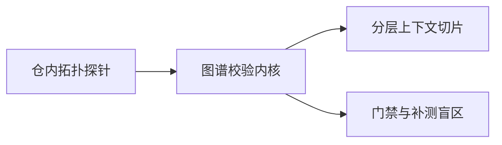

# Hierarchical feature-map v2 Topology, Schema Validation and Context Slicing — 功能设计规范（SPEC）

## 文档信息与变更概览

| 项目 | 内容 |
| --- | --- |
| 当前状态 | `approved`（`draft \| approved \| implementing \| in_review \| implemented \| superseded`） |
| 规划级别 | `L3`（Schema v2 扩展、拓扑校验门禁与跨技能上下文切片；未 `approved` 前不编码） |
| 创建 / 更新 | `2026-11-25` / `2026-11-25` |
| 分支 / Issue / PR | `feat/feature-map-v2-topology` / #185 / 未关联 |
| 负责人 / 内审状态 | planner-arch / `passed` |
| 规划态 | `interactive`（边界与契约已由总控 PRD 冻结，待拍板为零） |
| 关联 PRD / Todo | `docs/prd/261125-visual-arch-brief-prd-prd.md` / `docs/todo/261125-issue185-feature-map-v2-topology-todo.md` |

- **变更一句话**：将 `docs/feature-map.json` 升级至向后兼容的层次拓扑 v2（`domains[]`/`domain`/`dependsOn[]`/`actors[]`/`flows[]`），修复 `docAnchors[]` 清洗丢失、`verify-tools` 重复预填与 `handleClean` 剥除扩展字段缺陷，并将 `test-inventory.mjs`（792 行）读写逻辑迁入单源核心。

## 系统变更全景

| 模块 / 文件 | 变更性质 | 核心职责 |
| --- | --- | --- |
| `kit/skills/lib/feature-map-graph.mjs` (new) | 新增（`<= 800` 行，叶子模块） | 仅依赖 `node:*` 与 `kit/skills/lib/git-core.mjs`；v2 拓扑与 DFS 判环、`FORBIDDEN_TRACKED_KEYS`、规范化 SHA256、HTML 首行指纹核验、`buildFallbackDomains`、`sliceFeatureMapContext` |
| `kit/skills/lib/feature-map.mjs` | 改造 | 支持 `[1, 2]` 版本、修复 `sanitizeFeatureEntry` 保留 `docAnchors[]`/扩展字段、承接 v2 `readFeatureMapSafe`/`updateFeatureMapTestRefs`、保留 L203-204 注入锚点 |
| `kit/skills/lib/test-inventory.mjs` | 改造（`<= 798` 行） | 移除内联 `readFeatureMapSafe`/`updateFeatureMapTestRefs` 实现，改为从 `feature-map.mjs` 薄重导出并保持 v1/v2 无损 |
| `kit/skills/dev-explore/scripts/repo-map.mjs`、`repo-map-helpers.mjs` | 改造 | Layer-1 确定性 `domains[]` 与无环 `dependsOn[]` 自动推断（不覆写手工声明） |
| `kit/skills/dev-verify-tools/scripts/verify-tools.mjs`、`verify-tools-audit.mjs` | 改造 | 修复 L163-164 重复 `prefillFeatureMapFromRepoMap`、修复 L178 `handleClean` 丢弃 `domains[]`/`flows[]` 与 `version`、报告拓扑错误 |
| `kit/skills/lib/context-brief.mjs`、`handoff-package.mjs`、`kit/skills/dev-review/scripts/review-context.mjs` | 改造 | L0 `domainSummary` + 1-hop 上下游 + `matchedFlows` 角色加权切片（保持 `"contextBrief"` 单源） |
| `kit/skills/dev-flow/scripts/flow-lifecycle-hooks.mjs`、`kit/skills/lib/exit-codes.mjs` | 改造 | `BLOCKED_FEATURE_MAP_TOPOLOGY`（`EXIT.FACT` 退出码 `3`）登记与 finalize/Case 2 拓扑门禁 |
| `kit/skills/dev-govern/scripts/govern-checks-hygiene.mjs`、`kit/skills/dev-iterate/scripts/iterate.mjs`、`kit/skills/dev-iterate/scripts/iterate-plan.mjs` (new) | 改造 / 新增 | 拓扑对拍 + 非阻断 `suggestedCrossFeatureDeps`、跨 feature `flows[]` E2E 盲区补测（`iterate.mjs <= 790` 行） |

## 一、背景与边界声明

- **要改什么**：落地 `docs/feature-map.json` v2 分层拓扑结构与无上游循环依赖的叶子模块 `kit/skills/lib/feature-map-graph.mjs` (new)；将 `test-inventory.mjs`（当前 792 行）中的 `readFeatureMapSafe`/`updateFeatureMapTestRefs` 抽回 `feature-map.mjs` 并仅留薄重导出；修复 `sanitizeFeatureEntry` 抹除 `docAnchors[]`、`verify-tools.mjs` L163-164 重复调用以及 `verify-tools-audit.mjs` L178 `handleClean` 写死 `{ version: 1, features }` 的既有缺陷；升级全链路 `contextBrief` 切片与门禁。
- **不改什么**：不实现 HTML/SVG 视觉渲染器与 6 处 `isUiVisualFile` 替换（留待切片 2）；不实现 Living Visual Brief 与 `doc-plan` 视觉集成（留待切片 3）；不破坏 `kit/skills/lib/feature-map.mjs` 第 203-204 行 `FORBIDDEN_TRACKED_KEYS` 字面量与现有 v1 幂等读写契约。
- **本期不做**：不强制改写本仓现有 `docs/feature-map.json` 为 v2（本仓全量升级与自举留在切片 3）；不在 `dependencies` 中引入任何第三方库。
- **复用既有模块**：复用 `kit/skills/lib/feature-map.mjs`、`kit/skills/lib/git-core.mjs` / `git.mjs`（`sha256Text`、`writeJsonAtomic`、`readJsonSafe`）、`kit/skills/lib/exit-codes.mjs`（`BLOCK_CODE_TIERS`、`EXIT.FACT`）、`kit/skills/lib/context-brief.mjs`、`kit/skills/dev-review/scripts/review-context.mjs` 的跨文件 `import` 解析能力。
- **架构基线关系**：严格遵循 `kit/**` 仅引用 `node:*` 与 `kit/skills/` 内部相对路径，单文件 `<= 800` 行；`feature-map-graph.mjs` (new) 不导入 `static-gates.mjs` 或 `feature-map.mjs`，保证切片 2 `static-gates.mjs -> feature-map-graph.mjs` (new) 无环。

## 二、设计方案与契约变更

### 接口 / 数据结构变更

1. **`feature-map` v2 Schema 与叶子模块 `kit/skills/lib/feature-map-graph.mjs` (new)**：
   - **零循环依赖边界**：`feature-map-graph.mjs` (new) 仅导入 `node:crypto`、`node:fs`、`node:path` 与 `kit/skills/lib/git-core.mjs`（绝不导入 `kit/skills/lib/static-gates.mjs` 或 `kit/skills/lib/feature-map.mjs`）。
   - **版本策略**：`SUPPORTED_FEATURE_MAP_VERSIONS = [1, 2]`。`validateFeatureMap` 接受 `version === 1 || version === 2`；`sanitizeFeatureMap` 仅在显式指定 `version === 2` 或包含 `domains`/`flows` 或任一 feature 含 `domain`/`dependsOn`/`actors` 时输出 `version: 2`，纯 v1 输入保持 `version: 1` 幂等返回。
   - **新增结构**：
     - 根级 `domains[]`：`{ id, name, description?, entrypoints?, docAnchors? }`；
     - 根级 `flows[]`：`{ id, name, actors[], features[], steps?: [{ feature, action, actor? }], docAnchors? }`；
     - feature 级扩展：`domain`（string）、`dependsOn[]`（feature id 数组）、`actors[]`（string 数组）、`docAnchors[]`（显式保留不被 `sanitizeFeatureEntry` 抹除），并透传其他合法非易变自定义字段（如 `owner`）。
   - **图校验与规范化指纹**：
     - `validateFeatureMapTopology(raw)`：校验 `domains[].id`、`flows[].id` 唯一性，检查悬空 `feature.domain`、悬空 `feature.dependsOn[]`、悬空 `flows[].features[]` / `flows[].steps[].feature`，执行 DFS 三色法检测 `dependsOn[]` 有向环与自环；对 `domains[]`、`flows[]` 及其嵌套 `steps[]` 扫描 `FORBIDDEN_TRACKED_KEYS`。
     - `computeFeatureMapCanonicalSha256(raw)` 与 `verifyArchitectureMapHeader(repoRoot, fileRel)`：对净化后的规范化 JSON 计算确定性 SHA256 并比对 HTML 首行 `feature-map-sha256=<hex>`（供切片 2 `static-gates.mjs` 复用而零环路）。
     - `buildFallbackDomains(features)`：当 v1/无 `domains[]` 地图输入时按目录前缀或一级子包聚合成合成域视图。
     - `sliceFeatureMapContext(featureMap, matchedFeatures, { keywords, role })`：输出 `domainSummary`（L0 域统计）、1-hop `upstream` / `downstream`（仅 `{ id, name, domain, entrypoint, docAnchor }`，绝不展开邻域 `modules[]` / `testRefs[]`）及 `matchedFlows`（`[flow.id] (actors) f1 -> f2`）。
2. **`feature-map.mjs` 与 `test-inventory.mjs` 单源合并与兼容性修复**：
   - `sanitizeFeatureEntry` 显式保留 `docAnchors`、`domain`、`dependsOn`、`actors` 及合法扩展键；`kit/skills/lib/feature-map.mjs` 第 203-204 行原 `for (const key of FORBIDDEN_TRACKED_KEYS) { if (Object.prototype.hasOwnProperty.call(tool, key)) {` 字面量一字不动，保障 `I197` 故障注入锚点稳定。
   - **强制抽离 `test-inventory.mjs`（现 792 行）**：将 `readFeatureMapSafe`（L281-304）与 `updateFeatureMapTestRefs`（L307-361）的 v1/v2 无损实现迁入 `feature-map.mjs`（复用 `feature-map-graph.mjs` (new) 保留 `domains[]`/`flows[]`/`dependsOn[]`/`docAnchors[]` 与 `entryFiles`/`files`/`paths`/`entry` 别名），`test-inventory.mjs` 仅保留 `export { readFeatureMapSafe, updateFeatureMapTestRefs } from './feature-map.mjs'` 薄重导出，确保 `test-inventory.mjs` 显著低于 `798` 行（预期缩减约 70 行）。
3. **探索、验证、上下文、流转、治理与补测集成**：
   - `repo-map.mjs` + `repo-map-helpers.mjs`：Layer-1 确定性生成候选 `domains[]`（按 `kit/` / `scripts/` / workspace packages 分域）与基于跨 feature `import` 聚类的无环 `dependsOn[]`（若成环自动按边权剪枝保证无环），增量合并时不覆盖已有手工值。
   - `verify-tools.mjs` + `verify-tools-audit.mjs`：删除 `handleSync` 第 163-164 行重复的 `prefillFeatureMapFromRepoMap` 调用；修复 `verify-tools-audit.mjs` L178（`handleClean`）写死 `{ version: 1, features: cleanedFeatures }` 丢弃根级 `domains[]`/`flows[]` 与 `version` 的缺陷；`handleCreate`/`handleSync`/`handleClean` 使用完整保留 v2 字段的写回路径；`verify-tools audit` 报告 `topologyErrors`（悬空引用、环、重复域/流 ID）且避免将根级 `flows[]` 误算入 feature 级 `duplicateFlows`。
   - `context-brief.mjs` + `handoff-package.mjs` + `review-context.mjs`：在 `contextBrief.featureMap` 中保留 `locateTopSlicesForPaths` 的 `budgetLines = 48`（L170），并通过 `sliceFeatureMapContext` 注入 `domainSummary`、`upstream`、`downstream`、`matchedFlows`；在 `formatContextBriefLines`（L333）新增显式紧凑渲染上限（`maxDomains`、`maxNeighbors`、`maxFlows`），并在 `handoff-package.mjs` 与 `review-context.mjs` 按角色加权渲染（`explore`/`plan`/`critique` 重域界与流；`implementer`/`reviewer` 重下游波及面与工具），严守 `"contextBrief"` 唯一位置断言。
   - `flow-lifecycle-hooks.mjs` + `exit-codes.mjs`：在 `exit-codes.mjs` `FACT_CODES` 登记单一档位 `BLOCKED_FEATURE_MAP_TOPOLOGY`（`EXIT.FACT` 退出码 `3`，满足 `exit-code-parity.mjs` 单一档位要求，区别于 `BLOCKED_FEATURE_MAP_SYNC` 的 `EXIT.ACTION`）；当变更触及 `docs/feature-map.json` 或增删核心模块时，在 `checkFeatureMapSyncOnFinalize` 与 `checkCase2StructuralDriftOnVerify` 校验拓扑无环与无悬空引用。
   - `govern-checks-hygiene.mjs`：在 `runReconcileVerifyToolsAudit` 增加 v2 拓扑校验并基于源码 `import` 产出非阻断 `suggestedCrossFeatureDeps`。
   - `iterate.mjs`：识别 `flows[]` 跨多 feature 且缺少端到端 `testRefs` 的流转作为 `e2e` 补测候选，并提高高被依赖核心 feature 权重；将 `buildIterationPlan` 抽入 `kit/skills/dev-iterate/scripts/iterate-plan.mjs` (new)，确保 `iterate.mjs <= 790` 行。

### 数据与状态变更

- `docs/feature-map.json`：支持 `version: 1 | 2`，v2 新增根级 `domains[]`、`flows[]` 与 feature 级 `domain`、`dependsOn[]`、`actors[]`、`docAnchors[]`；三层均禁写 `FORBIDDEN_TRACKED_KEYS`。
- `kit/skills/lib/exit-codes.mjs`：`FACT_CODES` 新增唯一档位阻断码 `BLOCKED_FEATURE_MAP_TOPOLOGY`（`EXIT.FACT` = `3`）。

### 异常、回退与安全边界

- **非路径字段隔离**：`domain`、`dependsOn[]`、`actors[]`、`domains[].id`、`flows[].id` 为逻辑标识，严禁套用 `uniqPaths(..., { strictFeaturePath: true })`。
- **损坏 Fail-Closed / 只读 Fail-Soft**：损坏 JSON 写入继续由 `guardExistingFeatureMapForWrite` 阻断；`contextBrief` 读取异常静默降级为空切片不崩溃。

### 实现顺序

1. 新建叶子模块 `kit/skills/lib/feature-map-graph.mjs` (new)，实现 v2 校验、DFS 判环、规范化 SHA256、`buildFallbackDomains` 与 `sliceFeatureMapContext`。
2. 改造 `feature-map.mjs`（保留 L203-204 锚点与 `docAnchors[]`，承接 v2 `readFeatureMapSafe`/`updateFeatureMapTestRefs`）并将 `test-inventory.mjs` 精简为薄重导出（`<= 798` 行）；再更新 `repo-map*.mjs` 与 `verify-tools*.mjs`（含 `handleClean` L178 修复）。
3. 接入 `context-brief.mjs`（`formatContextBriefLines` 显式上限）、`handoff-package.mjs`、`review-context.mjs`、`flow-lifecycle-hooks.mjs`、`govern-checks-hygiene.mjs`、`iterate.mjs` + `iterate-plan.mjs` (new)（`iterate.mjs <= 790` 行）。
4. 运行 `node scripts/equip.mjs .`，补齐 `scripts/dev/fixtures-feature-map-v2.mjs` (new) 与 `scripts/dev/injections-data-verify-tools.mjs` 故障注入并全量跑绿。

## 三、备选方案与否决理由

| 方案 | 怎么做的 | 为什么没选 | 什么情况下该改回它 |
| --- | --- | --- | --- |
| 将 `readFeatureMapSafe`/`updateFeatureMapTestRefs` 留在 `test-inventory.mjs`（792 L）就地扩充 | 在仅剩 8 行的文件内加 v2 逻辑 | 极易突破 800 行硬红线且继续保留双套读写器分裂 | 永不改回 |
| 让 `feature-map-graph.mjs` (new) 导入 `feature-map.mjs` 或 `static-gates.mjs` | 复用上层函数 | 导致切片 2 `static-gates.mjs -> feature-map-graph.mjs` 形成循环导入 | 永不改回 |

## 四、改动清单与影响面

| 文件 / 目录 | 改动性质 | 改什么 | 谁会被影响 |
| --- | --- | --- | --- |
| `kit/skills/lib/feature-map-graph.mjs` (new) | 新增 | 叶子模块：v2 拓扑校验、判环、SHA256、HTML 首行核验、合成域与低 token 切片 | 切片 1 全模块及切片 2 `static-gates.mjs`/视觉引擎 |
| `kit/skills/lib/feature-map.mjs`、`test-inventory.mjs` | 修改 | `[1, 2]` 版本兼容、保留 `docAnchors[]`、迁移 `readFeatureMapSafe`/`updateFeatureMapTestRefs` 使 `test-inventory.mjs <= 798` 行 | `verify-tools`、`repo-map`、`iterate`、`govern` |
| `kit/skills/dev-explore/scripts/repo-map.mjs`、`repo-map-helpers.mjs` | 修改 | Layer-1 `domains[]` 与无环 `dependsOn[]` 自动推断 | `dev-explore` 与 `verify-tools sync` |
| `kit/skills/dev-verify-tools/scripts/verify-tools.mjs`、`verify-tools-audit.mjs` | 修改 | 修复 L163-164 重复调用与 L178 `handleClean` 丢根级键缺陷、保留 v2、输出拓扑错误 | `dev-verify-tools` 全命令 |
| `kit/skills/lib/context-brief.mjs`、`handoff-package.mjs`、`kit/skills/dev-review/scripts/review-context.mjs` | 修改 | 角色加权 v2 切片（`maxDomains`/`maxNeighbors`/`maxFlows`），保持 `"contextBrief"` 单源 | 全部 8 个上下文简报入口 |
| `kit/skills/dev-flow/scripts/flow-lifecycle-hooks.mjs`、`kit/skills/lib/exit-codes.mjs`、`govern-checks-hygiene.mjs`、`iterate.mjs`、`iterate-plan.mjs` (new) | 修改 / 新增 | `BLOCKED_FEATURE_MAP_TOPOLOGY`（`EXIT.FACT`）、建议依赖、跨流 E2E 盲区（`iterate.mjs <= 790` 行） | `flow finalize/verify`、`govern reconcile`、`iterate` |
| `.agents/skills/`、`scripts/dev/fixtures-feature-map-v2.mjs` (new)、`scripts/dev/injections-data-verify-tools.mjs` | 同步 / 新增 / 修改 | `equip.mjs .` 镜像同步、正反 fixture 与故障注入 | `preflight.mjs`、`fixtures.mjs`、`verify-injections.mjs` |

- **对外可见的变化**：`docs/feature-map.json` 支持 `version: 2`（`domains[]`、`flows[]`、`domain`、`dependsOn[]`、`actors[]`）；新增错误码 `BLOCKED_FEATURE_MAP_TOPOLOGY`（`EXIT.FACT` = `3`）；`contextBrief.featureMap` 新增 `domainSummary`/`upstream`/`downstream`/`matchedFlows`。
- **需要同步改的地方**：`.agents/skills/`（执行 `node scripts/equip.mjs .`）、`scripts/dev/fixtures.mjs` 调度器发现新 fixture。

## 五、冻结的验收标准

- [x] C1: `kit/skills/lib/feature-map-graph.mjs` (new)（叶子模块，仅依赖 `node:*` 与 `kit/skills/lib/git-core.mjs`）与 `kit/skills/lib/feature-map.mjs` 支持 `[1, 2]` 版本、`domains[]`/`domain`/`dependsOn[]`/`actors[]`/`docAnchors[]`/`flows[]`、DFS 无环与悬空引用校验、三层与 `domains`/`flows` 的 `FORBIDDEN_TRACKED_KEYS` 扫描（保留 `feature-map.mjs` L203-204 字面量）、`computeFeatureMapCanonicalSha256`、`buildFallbackDomains`、`sliceFeatureMapContext`，修复 `sanitizeFeatureEntry` 丢失 `docAnchors[]` 缺陷，并将 `test-inventory.mjs` 的 `readFeatureMapSafe`/`updateFeatureMapTestRefs` 迁入 `feature-map.mjs` 仅留薄重导出（`test-inventory.mjs <= 798` 行），经 `node scripts/dev/fixtures.mjs` 验证通过。
- [x] C2: `kit/skills/dev-explore/scripts/repo-map.mjs` 与 `repo-map-helpers.mjs` 确定性推断 Layer-1 `domains[]` 与无环 `dependsOn[]`（不覆盖已有手工值）；`kit/skills/dev-verify-tools/scripts/verify-tools.mjs` 修复 L163-164 重复调用 `prefillFeatureMapFromRepoMap`，`verify-tools-audit.mjs` 修复 L178 `handleClean` 丢弃 `domains[]`/`flows[]`/`version` 缺陷并报错拓扑缺陷，经 `node scripts/dev/fixtures.mjs` 验证通过。
- [x] C3: `kit/skills/lib/context-brief.mjs`、`kit/skills/lib/handoff-package.mjs` 与 `kit/skills/dev-review/scripts/review-context.mjs` 保持 `locateTopSlicesForPaths` `budgetLines = 48`（L170），并在 `formatContextBriefLines`（L333）使用 `maxDomains`/`maxNeighbors`/`maxFlows` 上限及全局单一 `"contextBrief"` 契约按角色权重注入渲染 `domainSummary`、1-hop 紧凑上下游与 `matchedFlows`，经 `node scripts/dev/fixtures.mjs` 验证通过。
- [x] C4: `kit/skills/dev-flow/scripts/flow-lifecycle-hooks.mjs`（含 `exit-codes.mjs` 单一 `EXIT.FACT` 档位 `BLOCKED_FEATURE_MAP_TOPOLOGY`，满足 `exit-code-parity.mjs`）、`kit/skills/dev-govern/scripts/govern-checks-hygiene.mjs`（拓扑对拍 + 非阻断 `suggestedCrossFeatureDeps`）与 `kit/skills/dev-iterate/scripts/iterate.mjs`（抽离 `iterate-plan.mjs` (new) 保持 `<= 790` 行，跨 feature `flows[]` 盲区）完成集成并执行 `node scripts/equip.mjs .`；`scripts/dev/fixtures-feature-map-v2.mjs` (new)、`scripts/dev/injections-data-verify-tools.mjs`、`node scripts/dev/preflight.mjs`、`node scripts/dev/fixtures.mjs` 与 `node scripts/dev/verify-injections.mjs --jobs 4` 全量通过。

## 六、高风险点、门型与回滚路径

- **门型与回滚路径**：`one-way`（涉及 `docs/feature-map.json` v2 Schema 与门禁错误码）；回滚采用 `git revert <commit-sha>` 并重跑 `node scripts/equip.mjs .`。
- **高风险路径**：改动 `kit/` 与 `scripts/dev/injections-data-verify-tools.mjs`，务必保持 `feature-map.mjs` L203-204 字面量与 `contextBrief` 既有键兼容。
- **故障注入预演**：在 `scripts/dev/injections-data-verify-tools.mjs` 新增「跳过 `dependsOn` 环路检查 / 跳过 `flows` `FORBIDDEN_TRACKED_KEYS` / 绕过 `BLOCKED_FEATURE_MAP_TOPOLOGY`」故障注入，经 `review-pack check-fault --phase fail` 与 `restore` 验证必红复绿。

## 七、上线与兼容策略

- **数据迁移**：v1 `docs/feature-map.json` 无需强制升版即可继续读取与同步；出现 v2 字段时写入 `version: 2`。
- **向后兼容**：`feature-map.mjs` 与 `test-inventory.mjs` 薄重导出同时识别 v1 `entryFiles`/`files`/`paths`/`entry` 别名与 v2 拓扑字段。

## 澄清与补充记录

- （无未决澄清；`feature-map.mjs` L203-204 锚点、`test-inventory.mjs` 抽离方案与 `EXIT.FACT` 单一档位已核实）

## 实现说明

- **实际落地摘要**：新增纯叶子图模块 `kit/skills/lib/feature-map-graph.mjs`（仅依赖 `node:*` 与 `git-core.mjs`），升级 `feature-map.mjs` 支持 `[1, 2]` 版本、保留 `docAnchors[]` 与 L203-204 注入锚点并承接 `test-inventory.mjs` 的 `readFeatureMapSafe`/`updateFeatureMapTestRefs`（`test-inventory.mjs` 降至 708 行）；`repo-map*.mjs` 与 `verify-tools*.mjs` 完成 Layer-1 拓扑推导、去重 `prefillFeatureMapFromRepoMap` 与 `handleClean` 无损保 v2；`context-brief.mjs`/`handoff-package.mjs`/`review-context.mjs` 接入角色加权分层切片；`flow-lifecycle-hooks.mjs`/`exit-codes.mjs`/`govern-checks-hygiene.mjs`/`iterate.mjs`+`iterate-plan.mjs` 完成门禁、建议依赖与跨流盲区集成。
- **与草案的差异**：同步将新增核心模块 `kit/skills/lib/feature-map-graph.mjs`、`kit/skills/dev-iterate/scripts/iterate-plan.mjs` 及 `scripts/dev/fixtures-feature-map-v2.mjs` 登记入本仓 `docs/feature-map.json`（保持 `version: 1`），满足 `checkFeatureMapSyncOnFinalize` 覆盖门禁。
- **关联同步文件**：`.agents/skills/`（含 `.pf-manifest.json`）、`docs/feature-map.json`、`scripts/dev/fixtures-feature-map-v2.mjs`、`scripts/dev/injections-data-verify-tools.mjs`。
