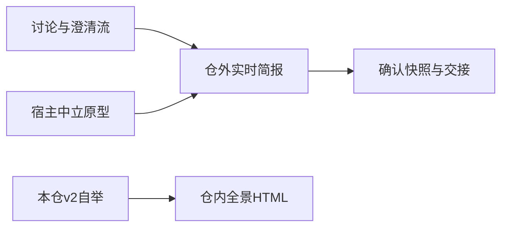

# Living Visual Brief Engine, Host-Neutral Prototype Mounting and Self-Dogfooding — 功能设计规范（SPEC）

## 文档信息与变更概览

| 项目 | 内容 |
| --- | --- |
| 当前状态 | `approved`（`draft \| approved \| implementing \| in_review \| implemented \| superseded`） |
| 规划级别 | `L3`（仓外活需求简报状态机、宿主中立原型挂载、预算内文档同步与本仓自举；未 `approved` 前不编码） |
| 创建 / 更新 | `2026-11-25` / `2026-11-25` |
| 分支 / Issue / PR | `feat/living-brief-and-dogfood` / #189 / 未关联 |
| 负责人 / 内审状态 | planner-arch / `passed` |
| 规划态 | `interactive`（边界、预算与自举标准已由总控 PRD 冻结，待拍板为零） |
| 关联 PRD / Todo | `docs/prd/261125-visual-arch-brief-prd-prd.md` / `docs/todo/261125-issue189-living-brief-and-dogfood-todo.md` |

- **变更一句话**：落地仓外单源实时投影的 Living Visual Brief 引擎与宿主中立 UI 原型挂载，强制瘦身 `doc-plan.mjs`（`796 -> < 790` 行）并严守预算同步契约、技能、TDD 与双语 README，完成 `project-forge` 自身 v2 架构图升级与真实浏览器视觉实证。

## 系统变更全景

| 模块 / 文件 | 变更性质 | 核心职责 |
| --- | --- | --- |
| `kit/skills/lib/visual-brief.mjs` (new) | 新增（`<= 800` 行） | 仓外 `briefs/` 读写、Single-Truth 现算投影（`workRoot` 优先于 `mainRoot`）、1:N `parentBriefKey` 迁移、`confirmedState: stale`、原型暂存（`<= 512 KB`）与 `pruneStaleBriefs` |
| `kit/skills/dev-plan/scripts/doc-plan-brief.mjs` (new) | 新增（`<= 800` 行） | 承接 `doc-plan.mjs` 抽离的 `note`/`brief` 等子命令实现（直接读取 `opts.title`、`opts.prototype`、`opts['select-prototype']`、`opts.confirm`、`opts['open-browser']`、`opts['source-skill']`、`opts.verdict`、`opts['affected-feature']`、`opts['flow-delta']`） |
| `session-state.mjs`、`doc-plan.mjs`（`< 790` 行）、`doc-plan-ops.mjs`、`doc-plan-clarify.mjs`、`doc-locate.mjs`、`repo-map.mjs`、`scripts/dev/cli-parity.mjs` | 改造 | 轻量 `briefKey` 指针、Case 3/4 自动刷新、`init`/`slice --prd` 迁移、4 处子命令/CLI 参数对拍、`doc-locate`/`repo-map --topic` 仅显式刷新 |
| `plan-next.mjs`、`flow-next.mjs`、`handoff-package.mjs` | 改造 | 全阶段暴露 `visualBrief` 并在 `buildPlanHandoff` 附确认快照 |
| `templates/agents-project.md`、`SKILL.md`、`kit/skills/*/SKILL.md`、`references/`、`docs/TDD.md`、`README*.md` | 改造 | 严守各自字节/行数预算完成规则、原型指引与双语目录同步 |
| `docs/feature-map.json`、`docs/architecture-map.html` (new)、`AGENTS.md`、`.agents/skills/`、`scripts/dev/fixtures-living-brief.mjs` (new) | 改造 / 新增 / 同步 | 本仓 22 个 feature 全量升级 v2、渲染提交全景 HTML、`compose-agents`/`equip` 同步、含 `stale`/`>512KB`/URI 负向用例与浏览器验收 |

## 一、背景与边界声明

- **要改什么**：实现仓外实时投影 Living Visual Brief（`visual-brief.mjs` (new) + `doc-plan-brief.mjs` (new)）及规划/流转/定位入口薄接线；强制将 `doc-plan.mjs`（796 行）中的子命令处理逻辑抽入 `doc-plan-brief.mjs` (new)/`doc-plan-ops.mjs` 使其显著低于 `790` 行；严格在预算内更新模板、技能、`docs/TDD.md`、`references/` 与双语 README；将 `project-forge` 自身升级为 `feature-map` v2 并生成提交 `docs/architecture-map.html` (new)。
- **不改什么**：不破坏 `session-state.mjs` 6144 B 主题配额（仅存轻量 `briefKey` 与快照指针）；不破坏 `doc-locate.mjs:38` 默认只读零写入不变量（仅显式传 `--topic` 时才写仓外 `anchors` 与刷新 Brief）；不在代码或文档中绑定任何特定 AI 宿主名称、私有路径或特定浏览器自动化驱动名。
- **本期不做**：不改变 `preflight-contracts.mjs` 既有必填关键词；不新增任何第三方依赖。
- **复用既有模块**：复用切片 2 的 `visual-layout.mjs` (new) 与 `visual-render.mjs` (new)、切片 1 的 `feature-map-graph.mjs` (new)、`kit/skills/lib/plan-next.mjs`（`evaluatePlanNextState`、`buildPlanHandoff`）、`kit/skills/lib/plan-index.mjs`（`indexPlanDocs`）、`kit/skills/lib/doc-slice-graph.mjs`（`buildSliceGraph`、`evaluateSliceGraph`）、`kit/skills/lib/session-state.mjs`、`kit/skills/lib/ledger.mjs`。
- **架构基线关系**：所有 `.mjs <= 800` 行（`doc-plan.mjs < 790` 行、`session-state.mjs <= 795` 行）；`AGENTS.md < 24576 B`（`templates/agents-project.md <= +500 B`）；根 `SKILL.md < 16384 B`（`<= +400 B`）；`kit/skills/*/SKILL.md < 14336 B` 且 `<= 180` 行。

## 二、设计方案与契约变更

### 接口 / 数据结构变更

1. **仓外 Living Visual Brief 引擎（`kit/skills/lib/visual-brief.mjs` (new) + `kit/skills/dev-plan/scripts/doc-plan-brief.mjs` (new)）**：
   - **存储落点**：`<gitCommonDir>/project-forge-flow/briefs/<briefKey>.json`、`<gitCommonDir>/project-forge-flow/briefs/<briefKey>.html` 与 `<gitCommonDir>/project-forge-flow/briefs/<briefKey>-prototypes/`（非 Git 目录回退 `.worktrees/.state/briefs/`），不污染工作区 `git status`。
   - **Single-Truth Live Projection（`workRoot` 优先）**：每次生成或刷新优先从隔离规划工作树 `workRoot` 读取 `docs/feature-map.json`（缺失时回退 `mainRoot`），合并 `evaluatePlanNextState`、`indexPlanDocs`、`buildSliceGraph`/`evaluateSliceGraph` 与任务账本现算投影，再与当前 `topic` 讨论缓冲及已挂载原型合成为 `25-60 KB` 交互 HTML（含架构关联图、决策/待拍板/切片进度、方案对比及原型沙盒预览）。
   - **1:N 迁移与确定性 `parentBriefKey`**：`doc-plan-ops.mjs` 中 `init --kind prd --multi-spec` 不建任务账本且会消费 `preInit`（L442, L467），因此总控 PRD Brief 需按 PRD 文件路径/slug 确定性映射 `briefKey`（并保留 `topicId` 迁移记录）；`slice --prd` 创建子切片时从 `related_prd` 与 PRD slug 确定性推导 `parentBriefKey`，写入子 Brief 与 `ledger.briefKey`。
   - **确认态防漂移**：`doc-plan.mjs brief --confirm` 记录当前内容指纹与确认快照；后续若关联文档或主题通过 `clarify` / `note` / 编辑发生变更，自动把 `confirmedState` 置为 `stale` 并高亮提醒重新确认。
   - **宿主中立 UI 原型挂载**：支持 `doc-plan.mjs brief --prototype <pathOrUrl> [--select-prototype <id>] [--title <标题>] [--source-skill <name>] [--verdict <text>] [--affected-feature <id>] [--flow-delta <text>] [--confirm] [--open-browser]`；本地文件校验体积 `<= 512 KB` 后复制暂存至 `-prototypes/`，远程链接仅允许 `http://`、`https://`、`file://` 协议白名单，拒绝 `> 512 KB` 文件及 `javascript:` / `data:` 等危险 URI，且禁止输出含 `homedir()` 的绝对路径。
   - **垃圾回收**：提供 `pruneStaleBriefs(mainRoot, { maxAgeDays })` 清理已终态归档或过期的孤立 Brief 文件。
2. **强制瘦身 `doc-plan.mjs`（796 -> `< 790` 行）与薄接入**：
   - **`doc-plan.mjs` 处理器抽离**：将原 `doc-plan.mjs` 内联的 `note`/`triage` 辅助封装与新增 `brief` 子命令处理全数抽入 `kit/skills/dev-plan/scripts/doc-plan-brief.mjs` (new) / `doc-plan-ops.mjs`，保证 `doc-plan.mjs` 瘦身至 `< 790` 行且所有 `opts.*` 读取均位于 `cli-parity.mjs:40` 的 `kit/skills/dev-plan/scripts` 扫描作用域内。
   - **CLI 对拍、防参数冲突与 `DARK_BASELINE`**：新增 `brief` 子命令并将浏览器打开标志命名为 `--open-browser`（避免与 `doc-plan.mjs:153` 已在 `multiFlags` 注册的 `note`/`triage --open <问题>` 冲突，防止 `cli.mjs:115,176-178` 报错或 `opts.open` 数组真值歧义）；将 `--prototype`、`--select-prototype`、`--confirm`、`--open-browser`、`--source-skill`、`--verdict`、`--affected-feature`、`--flow-delta` 全部注册进 `doc-plan.mjs`、写入 `printHelp()` 并在 `doc-plan-brief.mjs` (new) 通过 `opts.*` 读取；同步 `subcommand-meta.mjs`、JSDoc 头部、`printHelp()` 与 `SUBCOMMANDS` 4 处对拍；若 `brief` 帮助行声明 `[--title <标题>]`，则同步在 `scripts/dev/cli-parity.mjs:69` 从 `DARK_BASELINE['规划入口']` 剔除已亮出的 `'title'` 并确保 `doc-plan-brief.mjs` 直接读取 `opts.title`。
   - **`session-state.mjs`（现 769 行）**：仅在主题与 `session-state` 快照记录 `briefKey`、`briefUpdatedAt`、`confirmedState` 等轻量指针（`<= 25` 行增量）。
   - **自动刷新与零写入守卫**：`doc-plan-ops.mjs`（`init`/`slice` 迁移与 `ledger.briefKey`）、`doc-plan-clarify.mjs`（`clarify` 自动刷新并触发 `stale`）、`doc-locate.mjs`（保持默认零写入，`L38` 仅显式传入 `--topic` 时才写仓外 `anchors` 并刷新 Brief）、`repo-map.mjs`（L411 仅显式 `--topic` 时同步刷新 Brief）。
   - `plan-next.mjs`、`flow-next.mjs`、`handoff-package.mjs`：全阶段输出附带 `visualBrief`（含 `briefKey`、`htmlPath`、`confirmedState`、`prototypeCount`），并在 `buildPlanHandoff` 携带确认快照。
3. **契约、技能与文档预算内同步**：
   - `templates/agents-project.md`：增量 `<= +500 B`，确保 `node scripts/compose-agents.mjs .` 生成的 `AGENTS.md < 24576 B`（现 23108 B，余 1468 B）。
   - 根 `SKILL.md`：增量 `<= +400 B`，保持 `< 16384 B` 与 `<= 200` 行（现 14444 B / 101 行）。
   - `kit/skills/dev-plan/SKILL.md`：补充 Living Visual Brief 与宿主中立 UI 原型挂载引导（遇界面/交互原型需求时，调度当前可用前端/UI 能力产出静态原型再挂入 `doc-plan.mjs brief --prototype`），保持 `< 14336 B` 与 `<= 180` 行（现 11479 B / 90 行）。
   - `kit/skills/dev-verify-tools/SKILL.md`、`kit/skills/dev-explore/SKILL.md`、`kit/skills/dev-govern/SKILL.md`：补充 `render`、`v2` 拓扑与只读 `reconcile` 同步说明，全部严守 `< 14336 B` 与 `<= 180` 行。
   - `references/survey.md`、`references/collaboration.md`、`docs/TDD.md`：更新架构双模可视化、v2 拓扑、Living Brief 与 `isUiVisualFile` 策略。
   - `README.md` 与 `README.en.md`：成对同步介绍架构全景图与活需求简报能力，通过 `node scripts/sync-toc.mjs README.md README.en.md --check`。
4. **本仓自举（Self-Dogfooding）与实证**：
   - 将 `project-forge` 自身的 `docs/feature-map.json`（22 个 feature）全量升级为 `version: 2`，补齐 `domains[]`、各 feature 的 `domain`/`dependsOn[]`/`actors[]`/`docAnchors[]` 与核心跨模块 `flows[]`。
   - 运行渲染生成并提交 `docs/architecture-map.html` (new)，重跑 `compose-agents.mjs .` 与 `equip.mjs .`，新增 `scripts/dev/fixtures-living-brief.mjs` (new) 覆盖双向全场景（含 `post-confirm -> stale`、`> 512 KB` 与危险 URI 拒收、1:N `parentBriefKey`、`workRoot` 优先）。
   - 在真实浏览器打开渲染产物 `docs/architecture-map.html` (new) 与测试生成的 Living Visual Brief HTML，验证浅深色主题切换、缩放、搜索、`walk-bar` 与沙盒原型面板并附 `--artifact` 实证。

### 数据与状态变更

- 仓外目录 `<gitCommonDir>/project-forge-flow/briefs/` 新增 `<briefKey>.json`、`<briefKey>.html` 与 `<briefKey>-prototypes/`。
- `session-state.json` 主题节点新增 `briefKey` 与确认快照摘要字段；`ledger` 新增 `briefKey`。
- `project-forge` 本仓 `docs/feature-map.json` 升至 `version: 2`，新增受跟踪产物 `docs/architecture-map.html` (new)。

### 异常、回退与安全边界

- 任何超过 `512 KB` 的本地原型文件或非 `http://`/`https://`/`file://` 协议 URL 必须被 `visual-brief.mjs` (new) 拒绝，防止仓外目录膨胀或执行危险 URI（如 `javascript:` / `data:`）。
- `doc-plan.mjs`（现 796 行）必须通过抽离处理器至 `doc-plan-brief.mjs` (new)/`doc-plan-ops.mjs` 保持 `< 790` 行；`doc-locate.mjs` 与 `repo-map.mjs` 无 `--topic` 时严格保持默认零写入。

### 实现顺序

1. 新建 `kit/skills/lib/visual-brief.mjs` (new) 与 `kit/skills/dev-plan/scripts/doc-plan-brief.mjs` (new)。
2. 抽离 `doc-plan.mjs` 处理器使其 `< 790` 行，完成 `session-state.mjs`、`doc-plan.mjs`、`doc-plan-ops.mjs`、`doc-plan-clarify.mjs`、`doc-locate.mjs`、`repo-map.mjs`、`plan-next.mjs`、`flow-next.mjs`、`handoff-package.mjs`、`subcommand-meta.mjs` 与 `cli-parity.mjs` 薄接线。
3. 更新 `templates/agents-project.md`、`SKILL.md`、`kit/skills/*/SKILL.md`、`references/`、`docs/TDD.md`、`README.md`、`README.en.md`，运行 `compose-agents.mjs .`、`equip.mjs .` 与 `sync-toc.mjs`。
4. 升级本仓 `docs/feature-map.json` 至 v2 并渲染提交 `docs/architecture-map.html` (new)，补齐 `scripts/dev/fixtures-living-brief.mjs` (new)，跑通全套门禁与真实浏览器浅深色实证。

## 三、备选方案与否决理由

| 方案 | 怎么做的 | 为什么没选 | 什么情况下该改回它 |
| --- | --- | --- | --- |
| 将 Living Visual Brief JSON 完整存入 `session-state.json` | 复用单文件状态存储 | 会瞬间挤爆 `TOPIC_MAX_BYTES = 6144` 并导致 `BLOCKED_TOPIC_BUDGET_EXCEEDED` | 永不改回 |
| 在 `kit/skills/dev-plan/SKILL.md` 硬编码特定外部 UI 技能名与宿主全局目录 | 写死扩展目录路径 | 违反本仓「不绑定具体 AI 宿主」红线且极易过时 | 永不改回 |
| 让 `doc-locate` 无 `--topic` 时也隐式写仓外 Brief | 跳过显式 `--topic` 检查 | 破坏 `doc-locate.mjs` 只读零写入不变量 | 永不改回 |

## 四、改动清单与影响面

| 文件 / 目录 | 改动性质 | 改什么 | 谁会被影响 |
| --- | --- | --- | --- |
| `kit/skills/lib/visual-brief.mjs` (new)、`kit/skills/dev-plan/scripts/doc-plan-brief.mjs` (new) | 新增 | 仓外简报投影（`workRoot` 优先、`buildSliceGraph`）、1:N `parentBriefKey`、`stale` 判定、原型暂存（`<= 512 KB`）、`brief` 与抽离处理器 | `doc-plan` 与全规划周期 |
| `session-state.mjs`、`doc-plan.mjs`（`< 790` 行）、`doc-plan-ops.mjs`、`doc-plan-clarify.mjs`、`doc-locate.mjs`、`repo-map.mjs`、`plan-next.mjs`、`flow-next.mjs`、`handoff-package.mjs`、`subcommand-meta.mjs`、`cli-parity.mjs` | 修改 | 轻量 `briefKey` 指针、Case 3/4 自动刷新、4 处子命令/CLI 对拍、`DARK_BASELINE` 同步、`visualBrief` 透传 | 规划状态机与交接包 |
| `templates/agents-project.md`、`AGENTS.md`、`SKILL.md`、`kit/skills/*/SKILL.md`、`references/`、`docs/TDD.md`、`README.md`、`README.en.md` | 修改 | 预算内同步契约、宿主中立原型引导、架构说明与双语目录 | 全项目文档与契约门禁 |
| `docs/feature-map.json`、`docs/architecture-map.html` (new)、`.agents/skills/`、`scripts/dev/fixtures-living-brief.mjs` (new) | 升级 / 新增 / 同步 | 本仓 v2 自举、全景 HTML 渲染、`equip`/`compose-agents` 同步、双向与负向测试 | 全仓门禁与人类架构可视浏览 |

- **对外可见的变化**：新增 `doc-plan.mjs brief` 子命令与 `--prototype`/`--select-prototype`/`--confirm`/`--open-browser`/`--source-skill`/`--verdict`/`--affected-feature`/`--flow-delta` 选项；`note`/`triage`/`clarify`/`doc-locate --topic`/`repo-map --topic` 自动刷新仓外 Living Visual Brief；`next`/`handoff` 输出 `visualBrief`；本仓提交 `docs/feature-map.json` v2 与 `docs/architecture-map.html` (new)。
- **需要同步改的地方**：`.agents/skills/`（`node scripts/equip.mjs .`）、`AGENTS.md`（`node scripts/compose-agents.mjs .`）、`README.md`/`README.en.md`（`node scripts/sync-toc.mjs`）。

## 五、冻结的验收标准

- [x] C9: 新增 `kit/skills/lib/visual-brief.mjs` (new) 与 `kit/skills/dev-plan/scripts/doc-plan-brief.mjs` (new)，实现仓外 `<gitCommonDir>/project-forge-flow/briefs/<briefKey>.{json,html}` 与 `-prototypes/` Single-Truth 实时投影（`workRoot` `feature-map.json` 优先于 `mainRoot`，使用 `buildSliceGraph`/`evaluateSliceGraph`）、1:N `topicId -> taskId` 迁移与 `slice --prd` 确定性派生 `parentBriefKey`、确认后修改置 `confirmedState: stale`、原型暂存（拒绝 `> 512 KB` 文件及非 `http`/`https`/`file` URI）及 `pruneStaleBriefs`，经 `scripts/dev/fixtures-living-brief.mjs` (new) 正反与负向用例验证通过。
- [x] C10: 将 `doc-plan.mjs` 处理器抽入 `doc-plan-brief.mjs` (new)/`doc-plan-ops.mjs` 使其 `< 790` 行且全 `.mjs <= 800` 行，完成 `session-state.mjs`、`doc-plan.mjs`（Case 3/4 自动刷新、`brief` 使用 `--open-browser` 避免与 `multiFlags` `--open` 冲突、将 `--prototype`/`--select-prototype`/`--confirm`/`--open-browser`/`--source-skill`/`--verdict`/`--affected-feature`/`--flow-delta` 全部写入 `printHelp()` 并于 `doc-plan-brief.mjs` (new) 读取、完成 4 处对拍与 `cli-parity.mjs` `DARK_BASELINE` 同步）、`doc-plan-ops.mjs`、`doc-plan-clarify.mjs`、`doc-locate.mjs`（默认零写入，仅显式 `--topic` 时刷新）、`repo-map.mjs --topic`、`plan-next.mjs`、`flow-next.mjs` 与 `handoff-package.mjs` 接入（全阶段 `visualBrief` 与 `buildPlanHandoff` 确认快照），经 `preflight.mjs` 与 `fixtures.mjs` 验证通过。
- [x] C11: 在严守预算下完成文档与技能同步：`templates/agents-project.md` 增量 `<= +500 B` 且 `AGENTS.md < 24576 B`、根 `SKILL.md` 增量 `<= +400 B` 且 `< 16384 B`、`kit/skills/dev-plan/SKILL.md`（含宿主中立 UI 原型挂载指引）及 `kit/skills/dev-verify-tools/SKILL.md` / `kit/skills/dev-explore/SKILL.md` / `kit/skills/dev-govern/SKILL.md` 均 `< 14336 B` 且 `<= 180` 行、`references/survey.md` 与 `references/collaboration.md`、`docs/TDD.md`、双语 `README.md`+`README.en.md` 同步且通过 `sync-toc.mjs --check` 与 `compose-agents.mjs . --check`。
- [x] C12: 将本仓 `docs/feature-map.json` 升级为完整 v2 并渲染提交 `docs/architecture-map.html` (new)，运行 `equip.mjs .`，全绿通过 `preflight.mjs`、`fixtures.mjs`、`verify-injections.mjs --jobs 4`、`e2e-zip-harness.mjs`、`review.mjs .` 与 `govern-audit.mjs audit . --strict`，并在真实浏览器完成浅深色主题交互渲染实证（附 `--artifact` 截图）。

## 六、高风险点、门型与回滚路径

- **门型与回滚路径**：`one-way`（涉及 `docs/TDD.md`、核心契约预算、`doc-plan` CLI 与本仓 `docs/feature-map.json` v2 升级）；回滚通过 `git revert` 并重跑 `compose-agents.mjs .` 与 `equip.mjs .`。
- **高风险路径**：触及 `kit/`、`templates/`、`SKILL.md`、`AGENTS.md`；合前必须复验全部预算线、`preflight-contracts.mjs` 锚点及 `e2e-zip-harness.mjs` 真包沙盒链路。
- **故障注入预演**：通过 `review-pack check-fault --phase fail` / `restore` 验证「越权允许超 512 KB 或 `javascript:` URI 原型 / 破坏 `confirmedState: stale` 刷新」必被测试拦截。

## 七、上线与兼容策略

- **数据迁移**：本仓 `docs/feature-map.json` 在本切片一次性迁移至 `version: 2` 并同步生成 `docs/architecture-map.html` (new)；`session-state.json` 仍兼容历史主题结构。
- **向后兼容**：不使用 `brief` 子命令或 `no-architecture-html` 仓库维持原有纯文本工作流不受影响。

## 澄清与补充记录

- （无未决澄清；已核实 `doc-plan.mjs` 抽离方案、`DARK_BASELINE` 同步、`buildSliceGraph` 复用及 `doc-locate`/`repo-map --topic` 边界）

## 实现说明

- **实际落地摘要**：新增 `kit/skills/lib/visual-brief.mjs`（698 L）与 `kit/skills/dev-plan/scripts/doc-plan-brief.mjs`（314 L），将 `doc-plan.mjs` 瘦身至 699 L 并完成全部 9 处薄接线与 4 处子命令/CLI 对拍；同步预算内契约、技能、`references/`、`docs/TDD.md` 与双语 `README`；升级本仓 `docs/feature-map.json` 至 v2（5 域、22 个 feature、4 条端到端流）并生成提交 `docs/architecture-map.html`，新增 `scripts/dev/fixtures-living-brief.mjs` 双向及负向断言并完成无头浏览器浅深色渲染实证。
- **与草案的差异**：在 `kit/skills/lib/exit-codes.mjs` 登记原型校验退出码（`BLOCKED_UNSAFE_PROTOTYPE_URI`/`INVALID_PROTOTYPE`/`PROTOTYPE_NOT_FOUND`/`PROTOTYPE_ID_NOT_FOUND` 与 `BLOCKED_PROTOTYPE_TOO_LARGE`）并在 `kit/skills/dev-flow/scripts/flow-cleanup.mjs` 挂载 `pruneStaleBriefs`；`docs/architecture-map.html` 包含本仓 22 个 feature、5 个域、4 条流及完整内联视图与脚本，实测约 108 KB（远低于 256 KB 扫描上限）。
- **关联同步文件**：`.agents/skills/`（`equip.mjs .`）、`AGENTS.md`（`compose-agents.mjs .`）、`README.md`/`README.en.md`（`sync-toc.mjs`）、`docs/architecture-map.html`（`verify-tools.mjs render`）。
