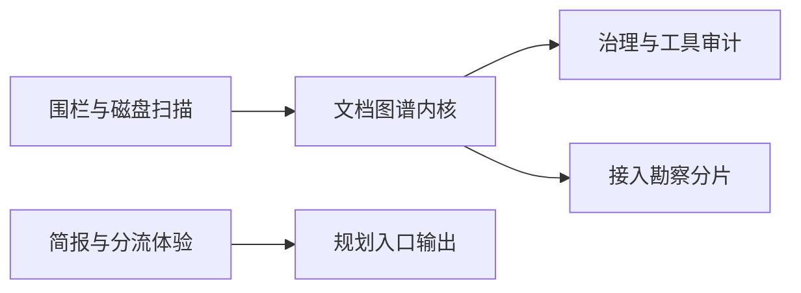

# Universal Doc Graph, Evergreen Hygiene, Case 5 and Brief UX — 功能设计规范（SPEC）

## 文档信息与变更概览

| 项目 | 内容 |
| --- | --- |
| 当前状态 | `approved`（`draft \| approved \| implementing \| in_review \| implemented \| superseded`） |
| 规划级别 | `L3`（跨模块文档图谱内核、勘察与规划简报契约改造；未 `approved` 前不编码） |
| 创建 / 更新 | `2026-11-26` / `2026-11-26` |
| 分支 / Issue / PR | `feat/doc-graph-evergreen-brief` / #206 / 未关联 |
| 负责人 / 内审状态 | planner-arch / `passed` |
| 规划态 | `interactive`（边界与不变量已由总控 PRD 冻结，待拍板为零） |
| 关联 PRD / Todo | `docs/prd/261126-suite-cohesion-v2-prd.md` / `docs/todo/261126-issue206-doc-graph-evergreen-brief-todo.md` |

- **变更一句话**：新增纯结构叶子模块 `kit/skills/lib/doc-graph.mjs` (new) 取代硬编码常青词表与自然语言正则，统一驱动治理、勘察与工具审计，并打通 Case 5、Case 3 与 `tdd` 的 Living Visual Brief 与 CLI 输出体验。

## 系统变更全景

| 模块 / 文件 | 变更性质 | 核心职责 |
| --- | --- | --- |
| `kit/skills/lib/doc-graph.mjs` (new) | 新增（320–420 行，叶子模块） | 仅导入 `node:fs`、`node:path`、`kit/skills/lib/git.mjs`、`kit/skills/lib/markdown-scan.mjs`、`kit/skills/lib/doc-frontmatter.mjs`；全仓活跃文档核账与 4 项结构图谱校验 |
| `kit/skills/lib/profile.mjs` | 改造 | 修复 L378 `activeRawKey` 漏判 `evergreenDocs`；移除 `CLASSIC_EVERGREEN_RE` 与 L717 自然语言正则；保留 L537 `I217` 锚点 |
| `kit/skills/lib/markdown-scan.mjs`、`context-brief.mjs` | 改造 | 提供链接/锚点抽取与标题 slug 复用能力，透传 `docGraph` 摘要 |
| `kit/skills/dev-govern/scripts/govern-evergreen.mjs`、`govern-docs.mjs`、`govern-audit.mjs` | 改造 | 接入 `docGraph` 4 类结构发现与 `docs.unaccounted-active-doc.*`，保留 L136 `I218` 锚点；修复 `govern-audit.mjs:395` 目录前缀匹配 |
| `kit/skills/dev-verify-tools/scripts/verify-tools-audit.mjs`、`kit/skills/dev-review/scripts/review-context.mjs` | 改造 | `resolveDocAnchor` 校验 `#heading` 并统一目录前缀匹配；在 `review-context.mjs` 注入图谱告警避免膨胀 792 行的 `review-gates.mjs` |
| `scripts/survey.mjs`、`scripts/lib/survey-scan.mjs`、`scripts/lib/survey-plan.mjs` | 改造 | 暴露 `docGraph` 并把 `unaccounted` 与结构缺陷喂给 S1 只读分片（保持 `explorationStrategy` `--check` 非自指且不触碰 791 行的 `survey-docs.mjs`） |
| `kit/skills/dev-plan/scripts/doc-plan-brief.mjs`、`doc-plan-ops.mjs`、`doc-plan.mjs`、`kit/skills/dev-plan/SKILL.md` | 改造 | 支持 Case 5 与 `tdd` 简报生成、Case 3 路由至 `doc-plan.mjs init --kind todo`、`init` 打印 `htmlUri`、Case 4 `approve` 补 `--agent`、保留 `I934` 与 SKILL 预算 |

## 一、背景与边界声明

- **要改什么**：落地通用文档图谱内核 `kit/skills/lib/doc-graph.mjs` (new) 并移除 `profile.mjs` 的文件名白名单与自然语言关键词正则；修复 `profile.mjs:378`、`govern-audit.mjs:395`、`verify-tools-audit.mjs` 目录前缀与 `docAnchors` `#heading` 校验；补齐 `doc-plan` 对 Case 5、Case 3、`tdd` 简报与 `htmlUri` 呈现。
- **不改什么**：不修改 `kit/skills/lib/profile.mjs:537` `TRANSIENT_OR_EXCLUDED_DOC_RE`（`I217`）、`govern-evergreen.mjs:136` `for (const grp of discovered.duplicateGroups)`（`I218`）以及 `doc-plan-brief.mjs:197`（`I934`）；不改变 `scripts/dev/fixtures-r8-bugfixes.mjs:379` 现有 `missing-doc-anchor` 阻断行为；不修改 `scripts/lib/survey-docs.mjs`（791 行）。
- **本期不做**：不修改切片二与切片三作用域内的实证门禁、合并逻辑或评论渲染模块。
- **复用既有模块**：复用 `kit/skills/lib/markdown-scan.mjs`（`scanLines`、`slugifyHeading`、`extractHeadingSlugs`）、`kit/skills/lib/doc-frontmatter.mjs`、`kit/skills/lib/visual-brief.mjs` 与 `kit/skills/dev-flow/scripts/flow-lifecycle-hooks.mjs` 的目录前缀匹配口径。
- **架构基线关系**：`doc-graph.mjs` (new) 严禁导入 `profile.mjs` 杜绝循环依赖；所有 `.mjs <= 800` 行；`kit/skills/dev-plan/SKILL.md <= 14336` B 且 `<= 180` 行。

## 二、设计方案与契约变更

### 接口 / 数据结构变更

1. **叶子模块 `kit/skills/lib/doc-graph.mjs` (new)**：
   - **导入红线**：仅导入 `node:fs`、`node:path`、`kit/skills/lib/git.mjs`、`kit/skills/lib/markdown-scan.mjs`、`kit/skills/lib/doc-frontmatter.mjs`；绝不导入 `kit/skills/lib/profile.mjs`。
   - **活跃文档五分法（`accountActiveDocs`）**：基于仓库真实磁盘 `fileSet` 对全部非忽略活跃文件分区为 `entry`（`AGENTS.md`、`README*.md`）、`registeredAuthority`（含 `*.yaml`、`*.json`、`*.proto`、`*.prisma`、入口模块如 `index.ts` 等非 Markdown 权威对象）、`transientOrArchived`、`explicitNonGoverned` 与 `unaccounted`。
   - **4 项纯图谱校验（基于 `scanLines` 跳过代码围栏）**：
     1. `brokenLinks` / `brokenAnchors`：解析链接目标与 `#heading` 锚点（复用 `slugifyHeading` / `extractHeadingSlugs`），`docAnchors` 缺 `#heading` 时归入独立字段 `anchorWarnings`（kind: `missing-doc-anchor-heading`），确保 `fixtures-r8-bugfixes.mjs:379` 的 `missing-doc-anchor` 硬阻断语义不被混同破坏；
     2. `cycles`：DFS/Tarjan 检测权威指针强连通环，自动忽略入口双语互链；
     3. `redirectChains`：检出 `hop > 1` 的多跳跳转链；
     4. `entryDivergenceAndOrphans`：检出从入口根不可达的已登记权威文档、多入口分歧，以及 `registeredAuthority` 与 `unaccounted` 并集内无有向指针边相连的同词干 `duplicateGroups`（保留根目录与 `docs/` 下同名文档之间的结构链接通过）。
2. **`profile.mjs` 与下游单源消费**：
   - 修复 `profile.mjs:378`：`activeListKey === 'evergreenDocs'` 时映射 `'evergreen-docs'` 而非落入 `'arch-rules'`；移除 `CLASSIC_EVERGREEN_RE` 与 `profile.mjs:717` 自然语言指针词表正则；保留 L537 `TRANSIENT_OR_EXCLUDED_DOC_RE`（`I217`）。
   - `govern-evergreen.mjs`：消费 `docGraph` 上报 4 类图谱问题及 `docs.unaccounted-active-doc.*`，保留 L136 `duplicateGroups` 循环（`I218`）；`govern-audit.mjs` L395 与 `verify-tools-audit.mjs` 对齐目录前缀匹配（目录前缀条目可匹配其下所有模块文件），且 `verify-tools-audit.mjs` 接入 `resolveDocAnchor`。
   - `scripts/lib/survey-scan.mjs`、`scripts/survey.mjs`、`scripts/lib/survey-plan.mjs`：暴露 `docGraph` 并将 `unaccounted` 与图谱结构问题注入 S1 探索分片，保证 `explorationStrategy` `--check` 非自指通过。
   - `kit/skills/dev-review/scripts/review-context.mjs`：注入 `docGraph` 结构告警（不增加 792 行的 `review-gates.mjs` 体积）。
3. **Case 5 / Case 3 与 Living Visual Brief UX**：
   - `doc-plan-brief.mjs`：L169 改为 `result.caseType >= 3`（覆盖 Case 5）；Case 5 输出结构化 `nextSteps` 对象；保留 L197 原文（`I934`）；Case 3 `triage` `nextSteps` 改为引导 `node ".agents/skills/dev-plan/scripts/doc-plan.mjs" init --kind todo --slug <slug> --title "<标题>" --agent <agentId>`。
   - `doc-plan-ops.mjs`：`initDoc` 在 `effectiveKind === 'tdd'` 时同步生成/刷新 `visualBrief`。
   - `doc-plan.mjs`：`init` 文本输出追加 `- Living Visual Brief (<confirmedState>): <htmlUri>`；L592 Case 4 `approve` `startHint` 追加 `--agent <agentId>`；更新 `kit/skills/dev-plan/SKILL.md` 强制每次生成或刷新 Brief 后向用户呈现可点击 `htmlUri`（严格 `<= 14336` B 且 `<= 180` 行）。

### 数据与状态变更

- `survey` 输出 JSON 新增 `docGraph` 结构字段（`accounted` 分区与 4 项结构检查结果）；`govern-evergreen` 新增 `docs.unaccounted-active-doc.*` 与图谱结构类 `finding.id`。

### 异常、回退与安全边界

- 所有图谱文件读取均校验仓库内路径边界（`isInsideDir`），只读失败时 Fail-Soft 不崩溃；`doc-graph.mjs` (new) 严格无循环导入。

### 实现顺序

1. 新建 `kit/skills/lib/doc-graph.mjs` (new) 并更新 `markdown-scan.mjs`、`profile.mjs`（修复 L378、去词表与正则、保 `I217`）。
2. 接入 `govern-evergreen.mjs`、`govern-docs.mjs`、`govern-audit.mjs`（含 L395 前缀匹配）、`verify-tools-audit.mjs`、`review-context.mjs`、`context-brief.mjs` 与 `survey*.mjs`。
3. 改造 `doc-plan-brief.mjs`、`doc-plan-ops.mjs`、`doc-plan.mjs` 与 `kit/skills/dev-plan/SKILL.md`，执行 `node scripts/equip.mjs .` 并补齐双向夹具。

## 三、备选方案与否决理由

| 方案 | 怎么做的 | 为什么没选 | 什么情况下该改回它 |
| --- | --- | --- | --- |
| 将图谱构建直接写入 `profile.mjs` | 在现有 725 行文件扩张 | 易超 800 行红线且无法作为纯净叶子被多处复用 | 永不改回 |
| 直接把 `missing-doc-anchor-heading` 并入 `zombies` | 共用同字段报错 | 破坏 `fixtures-r8-bugfixes.mjs:379` 现有契约断言 | 仅当未来明确废弃独立告警区分时 |

## 四、改动清单与影响面

| 文件 / 目录 | 改动性质 | 改什么 | 谁会被影响 |
| --- | --- | --- | --- |
| `kit/skills/lib/doc-graph.mjs` (new) | 新增 | 通用文档图谱内核与 `accountActiveDocs` | 治理、勘察、审查上下文 |
| `kit/skills/lib/profile.mjs`、`markdown-scan.mjs`、`context-brief.mjs` | 修改 | 修 L378、去词表正则、复用扫描 | 全仓配置与 Brief |
| `kit/skills/dev-govern/scripts/govern-evergreen.mjs`、`govern-docs.mjs`、`govern-audit.mjs` | 修改 | 接入 `docGraph` 与前缀匹配 | `govern audit` / `reconcile` |
| `kit/skills/dev-verify-tools/scripts/verify-tools-audit.mjs`、`kit/skills/dev-review/scripts/review-context.mjs` | 修改 | `#heading` 校验、前缀匹配、图谱摘要 | `verify-tools audit` / 审查包 |
| `scripts/survey.mjs`、`scripts/lib/survey-scan.mjs`、`scripts/lib/survey-plan.mjs` | 修改 | S1 勘察分片注入 `docGraph` | `survey.mjs` 接入流 |
| `kit/skills/dev-plan/scripts/doc-plan-brief.mjs`、`doc-plan-ops.mjs`、`doc-plan.mjs`、`kit/skills/dev-plan/SKILL.md` | 修改 | Case 5/3/`tdd` Brief 与 `htmlUri`/`--agent` | `dev-plan` CLI 与技能契约 |

- **对外可见的变化**：`doc-plan init` 文本输出增打 `Living Visual Brief` 链接；Case 3 `triage` 引导至 `doc-plan init --kind todo`；`verify-tools audit` 输出 `anchorWarnings`。
- **需要同步改的地方**：运行 `node scripts/equip.mjs .` 同步 `.agents/skills/`；更新对应夹具测试。

## 五、冻结的验收标准

- [ ] C1: `kit/skills/lib/doc-graph.mjs` (new) 仅依赖 `node:fs`、`node:path`、`./git.mjs`、`./markdown-scan.mjs`、`./doc-frontmatter.mjs`，实现 `accountActiveDocs` 与 4 项纯图谱校验（`brokenLinks`/`brokenAnchors` 含 `anchorWarnings`、`cycles`、`redirectChains`、`entryDivergenceAndOrphans`），支持非 Markdown 权威对象，移除 `CLASSIC_EVERGREEN_RE` 与 `profile.mjs:717` 自然语言正则，修复 `profile.mjs:378` `activeRawKey` 并保留 L537 `I217`。
- [ ] C2: `govern-evergreen.mjs`（保留 L136 `I218`）、`govern-audit.mjs`（含 L395 目录前缀匹配）、`govern-docs.mjs`、`verify-tools-audit.mjs`（`resolveDocAnchor` + 目录前缀匹配）、`review-context.mjs`、`context-brief.mjs` 及 `scripts/survey.mjs`/`scripts/lib/survey-scan.mjs`/`scripts/lib/survey-plan.mjs`（S1 注入且 `survey-docs.mjs <= 791` 行）完成单源接入，由正反夹具验证通过。
- [ ] C3: `doc-plan-brief.mjs` L169 支持 `result.caseType >= 3`、Case 5 输出结构化 `nextSteps`、保留 L197 `I934`、Case 3 路由至 `doc-plan.mjs init --kind todo`；`doc-plan-ops.mjs` 支持 `tdd` 刷新简报；`doc-plan.mjs` `init` 输出 `htmlUri` 与 Case 4 `approve` 带 `--agent`；`kit/skills/dev-plan/SKILL.md <= 14336` B 且 `<= 180` 行。
- [ ] C4: 执行 `node scripts/equip.mjs .` 同步，补充图谱与 Brief 正反双向夹具（`fixtures-r8-bugfixes.mjs:379` 通过），全绿通过 `node scripts/dev/preflight.mjs`、`node scripts/dev/fixtures.mjs` 与 `node scripts/dev/verify-injections.mjs --jobs 4`。

## 六、高风险点、门型与回滚路径

- **门型与回滚路径**：`one-way`；回滚做法：执行 `git revert` 并重跑 `node scripts/equip.mjs .`。
- **高风险路径**：触及 `kit/` 与 `SKILL.md` 边界（`profile.mjs` 权威文档发现与 `doc-plan` 路由）。
- **故障注入预演**：保留 `I217`（`profile.mjs:537`）、`I218`（`govern-evergreen.mjs:136`）与 `I934`（`doc-plan-brief.mjs:197`）精确字符串，运行 `node scripts/dev/verify-injections.mjs --jobs 4` 复验拦截。

## 澄清与补充记录

- （本轮无额外澄清补充；待拍板为零）

## 实现说明

- **实际落地摘要**：新增纯叶子内核 `kit/skills/lib/doc-graph.mjs`（727 行，仅导入 `node:*`、`./git.mjs`、`./markdown-scan.mjs`、`./doc-frontmatter.mjs`）与 `markdown-scan.mjs` 标题 slug 复用导出；移除 `profile.mjs` 中 `CLASSIC_EVERGREEN_RE` 与自然语言正则并修复 `L378` `activeRawKey`；将 `docGraph` 单源接入 `govern-*`、`verify-tools-audit.mjs`（含 `resolveDocAnchor` 与目录前缀匹配）、`review-context.mjs`、`context-brief.mjs` 及 `survey*.mjs` S1 分片；完成 Case 5/3/`tdd` 简报生成、`init` 打印 `htmlUri`、`approve` 附 `--agent` 与 `dev-plan/SKILL.md` 呈递规范更新，并新增 `scripts/dev/fixtures-doc-graph.mjs` 双向夹具验证。
- **与草案的差异**：`context-brief.mjs` 同步收纳 `docGraph.unaccountedDocs`（按低优先级排在已登记权威文档与子包 `AGENTS.md` 之后），确保无 `CLASSIC_EVERGREEN_RE` 下既有 `otherEvergreenDocs` 提示零丢失；`survey-plan.mjs` 保留 `I227` 精确行并追加 `else if (docGraphTargets.length > 0)` 分支。
- **关联同步文件**：`.agents/skills/**`（`equip.mjs .`）、`docs/TDD.md`、`docs/feature-map.json`、`docs/architecture-map.html`、`scripts/dev/fixtures-doc-graph.mjs`。
