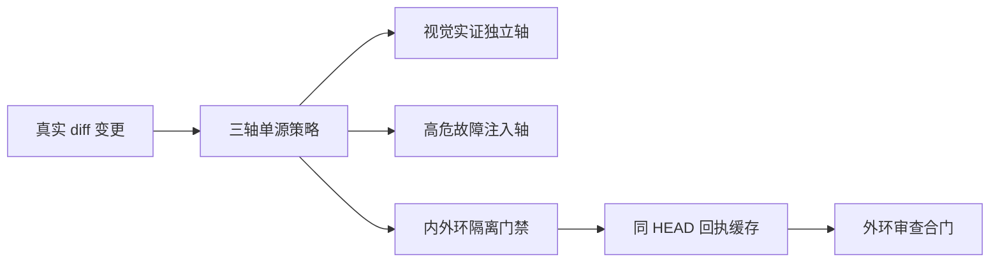

# 单源三轴正交策略、去重收口与静默防刷屏 — 功能设计规范（SPEC）

## 文档信息与变更概览

| 项目 | 内容 |
| --- | --- |
| 当前状态 | `approved`（`draft \| approved \| implementing \| in_review \| implemented \| superseded`） |
| 规划级别 | `L3`（跨模块策略核心重构，属高风险 `kit/` 路径；Wave 1，零上游依赖；未 `approved` 前不编码） |
| 创建 / 更新 | `2026-11-27` / `2026-11-27` |
| 分支 / Issue / PR | `feat/single-source-policy-core` / #214 / 未关联 |
| 负责人 / 内审状态 | plan-sandbox-v1 / `passed` |
| 规划态 | `interactive`（架构决策已全部拍板，零待决问题） |
| 关联 PRD / Todo | `docs/prd/261127-issue214-sandbox-dual-loop-v1-prd.md` / `docs/todo/261127-issue214-single-source-policy-core-todo.md` |

- **变更一句话**：将 `workflow-policy.mjs` 收敛为三轴正交唯一策略真源，硬拒内环 `inner: true` 证据偷渡外环，引入支持任务态与 headless 态的干净 HEAD 门禁回执缓存消除重复扫描与 `verifyArchitectureMapSync` 双跑，并消除探索/内环失败对远端工单的自动刷屏。

## 系统变更全景

| 模块 / 文件 | 变更性质 | 核心职责 |
| --- | --- | --- |
| `kit/skills/lib/gate-receipt.mjs` (new) | 新增 | 干净 HEAD 门禁执行回执读写/校验（支持任务态与 headless 无 `taskId` 态，严绑 6 维指纹键）与失败自动升级判定 `shouldAutoEscalateFailure` |
| `kit/skills/lib/workflow-policy.mjs` | 改造 | 三轴正交 `determineWorkflowPolicy`（UI 视觉解耦于 `high`、`isLow` 显式追加 `effectiveVisual.length === 0`、`faultInjectionRequired` 绑定 `high`/`one-way`/`Case>=4`）与外环 `validateVerificationEvidence` 硬拒 `inner: true` |
| `kit/skills/dev-review/scripts/review-empirical.mjs` | 改造 | 第 101-102 行原地替换为单源 `policy`（`faultRequired` 同步对齐 `review-locks.mjs:601` 的 `smokeExplicitNone` 边界），零净增行数 |
| `kit/skills/dev-review/scripts/review-empirical-state.mjs` | 改造 | `handleEmpiricalE2eFailure` 接入 `shouldAutoEscalateFailure`，探索/本地/沙箱默认不刷远端 Issue |
| `kit/skills/dev-review/scripts/review-locks.mjs` | 改造 | `evaluatePassBlockers` 在干净同 HEAD 下复用 `gate-receipt.mjs` (new) 的 `archRules`/`gateWeakening` 结单回执（缺失时实时运行并回填） |
| `kit/skills/dev-review/scripts/review-gates.mjs` | 改造 | 机械审查包在干净同 HEAD 下复用 `gate-receipt.mjs` (new) 结论，缺失时实时扫描并作为 `gateWeakening` 生产者落盘 |
| `kit/skills/dev-edit/scripts/edit-gate.mjs` | 改造 | `--final` 干净 HEAD 通过后写入 `gate-receipt.mjs` (new)（仅生产 `structuralHygiene`/`archRules`/`architectureMapSync`，不伪造 `gateWeakening`），完整保留 `I963` 校验语句 |
| `kit/skills/dev-flow/scripts/flow-lifecycle-hooks.mjs` | 改造 | `checkArchitectureMapSyncOnVerify` 先查 `gate-receipt.mjs` (new) 避免与刚跑完的 `edit-gate --final` 双跑，完整保留 `I962` 校验语句 |
| `kit/skills/dev-flow/scripts/flow-lifecycle-helpers.mjs` | 改造 | `handleVerifyE2eFailure` 接入 `shouldAutoEscalateFailure`；`recordVerifyEvidenceForFlow` 支持打标 `inner: true`；`collectTaskRuntimeSnapshot` 在干净 HEAD 产生 `gateWeakening` 回执 |
| `kit/skills/dev-iterate/scripts/iterate.mjs` | 改造 | 探索/沙箱运行默认 `escalate = false`，仅显式 `--escalate`（且非沙箱）才远端建单；同步更新第 67 行 `printHelp()` 文案 |
| `kit/skills/dev-govern/scripts/govern-checks.mjs` | 改造 | `--changed` 模式命中干净 HEAD 有效 `gate-receipt.mjs` (new) 时复用结构卫生与 `arch-rules` 结果（全仓 `audit .` 始终全扫） |
| `docs/feature-map.json`、`docs/architecture-map.html` | 改造 | 当波登记 `kit/skills/lib/gate-receipt.mjs` (new) 并执行 `verify-tools.mjs render` 单点重渲，保证 Wave 1 `finalize`/`verify` 零漂移 |

## 一、背景与边界声明

- **要改什么**：统一三轴正交策略判定（轴 1 视觉实证、轴 2 高危/单向门/Case>=4 两阶段故障注入、轴 3 内外环隔离与同 HEAD 去重），收口探索期测试失败的自动升级建单策略，并在当波同步更新全部受波及既有夹具、注入表与 `docs/feature-map.json`。
- **不改什么**：不新增 `flow.mjs promote` 或 `--sandbox` 工作树创建逻辑（归 Wave 2 切片 2 `sandbox-dual-loop-flow`）；不修改 `doc-plan.mjs triage` 路由算法、`templates/`、`AGENTS.md` 或 `SKILL.md` 文案（归 Wave 3 切片 3 `triage-brief-contract-parity`）。
- **本期不做**：不放宽 `BLOCKED_STALE_VERIFICATION`、`BLOCKED_INSUFFICIENT_VERIFICATION_TIER`、`BLOCKED_VISUAL_EVIDENCE_REQUIRED`、`detectGateWeakening` 或单测反作弊规则。
- **复用既有模块**：复用 `kit/skills/lib/workflow-policy.mjs` 的 `determineWorkflowPolicy` 与 `validateVerificationEvidence`、`kit/skills/lib/empirical-artifacts.mjs` 的 `evaluateStoredVisualEvidence`、`kit/skills/lib/architecture-map.mjs` 的 `verifyArchitectureMapSync`、`kit/skills/lib/static-gates.mjs` 的 `isUiVisualFile`/`scanStructuralHygiene`/`evaluateArchRules`/`detectGateWeakening`、`kit/skills/lib/git.mjs` 的 `canonicalPath`/`readJsonSafe`/`writeJsonAtomic`/`sha256Text`。
- **架构基线与紧文件行预算控法（严守 `<= 800` 行/文件）**：
  - `review-empirical.mjs`（当前 797L）：仅原地替换第 101-102 行，净增 `0` 行（目标 `<= 797L`）。
  - `fixtures-iterate-evolution.mjs`（当前 795L）：仅原地调整既有断言（净增 `<= 0` 行），全部新增正反双向用例放在 `scripts/dev/fixtures-policy-axes.mjs` (new)。
  - `review-gates.mjs`（762L）、`flow-lifecycle-helpers.mjs`（759L）、`workflow-policy.mjs`（755L）、`edit-gate.mjs`（750L）：所有回执键计算、无 `taskId` 路径解析、原子合并读写与升级策略判定全部封装进 `kit/skills/lib/gate-receipt.mjs` (new)，各调用点改动均严控在 `<= 15` 行以内（每份结果 `<= 780L`）。
  - 严格遵守 `docs/TDD.md` 零第三方依赖（仅 `node:*`）与 `kit/**` 禁引 `scripts/lib/**` / `scripts/dev/**`。

## 二、设计方案与契约变更

### 接口 / 数据结构变更

1. **`kit/skills/lib/workflow-policy.mjs` — `determineWorkflowPolicy` 三轴解耦与 `isLow` 兜底**：
   - **轴 1（UI 视觉实证独立）**：从 `high` 风险 `reasons` 中移除 `effectiveVisual.length > 0`（原第 187、191 行）。新增显式布尔字段 `visualCheckRequired: effectiveVisual.length > 0`。
   - **`isLow` 显式排除视觉文件（第 192-195 行）**：`const isLow = !isHigh && effectiveVisual.length === 0 && files.length > 0 && Number(caseType) < 4 && files.every(...)`，确保纯 `.html`/`.svg` 等 UI 视觉资产不会因为移出 `high` 而误跌进 `low` 免审档，而是准确落入 `riskTier === 'medium'` + `visualCheckRequired === true` + `faultInjectionRequired === false`。
   - **轴 2（故障注入精确绑定）**：`isHigh` 仅由 `highRiskHits`、`gwHits`、`Number(caseType) >= 4`、`oneWayBoundaryHits`、`nonExemptDoNotEdit` 驱动；`faultInjectionRequired: riskTier === 'high'`。
   - **轴 3（内环 `inner: true` 硬隔离）**：`validateVerificationEvidence({ policy, evidence, headSha, profile, explicitCmdUsed, allowInner = false })` 在 `!allowInner` 时前置拦截 `evidence.inner === true` 返回 `{ ok: false, code: 'BLOCKED_INNER_EVIDENCE_FORBIDDEN_IN_OUTER', exitCode: EXIT.FACT, reason: '...' }`；并在扫描 `evidence.gates`（`gate`/`full`/`smoke`/`quick`）时过滤掉任何 `g.inner === true` 的条目，杜绝顶层伪造 `inner: false` 夹带单条内环门禁偷渡。
2. **`kit/skills/dev-review/scripts/review-empirical.mjs` — 单源对齐与 `smokeExplicitNone` 边界**：
   - 第 101 行原地替换为：`const faultRequired = !isEmptyDiff && !isLowRiskPureDoc && Boolean(policy.faultInjectionRequired) && (runtimeTouched || smokeRequired) && !policy.smokeExplicitNone`（与 `review-locks.mjs:601` 的 `!isProfileExplicitNone(profile, 'smoke-verify')` 边界完全一致）。
   - 第 102 行原地替换为：`const visualCheckRequired = !isEmptyDiff && Boolean(policy.visualCheckRequired || behavioralGate?.empiricalVisualCheckRequired)`。
3. **`kit/skills/lib/gate-receipt.mjs` (new) — 跨进程六维回执键、Headless 兜底与唯一生产者契约**：
   - **双形态路径解析**：
     - 当 `taskId` 非空时：`<gitCommonDir>/project-forge-flow/tasks/<sanitizeTaskId(taskId)>/gate-receipt.json`。
     - 当 `taskId` 为空（独立运行的 `edit-gate --changed`、`govern-audit audit --changed` 等 headless 场景）时：`<gitCommonDir>/project-forge-flow/cache/gate-receipt-<sha256Text(canonicalPath(workTreeRoot)).slice(0, 12)>.json`；若非 Git 仓库或无 `gitCommonDir` 则直接降级返回 `null`（不读写磁盘）。
   - **六维确定性键 `computeGateReceiptKey({ workTreeRoot, dirty, headSha, baseSha, changedFiles, diffText, profile, extraHashes })`**：
     - 统一先由各调用方（含 `edit-gate.mjs`）复用 `gitStatusPorcelainZ` + `readHeadFast` + `resolveEffectiveBaseSha` 采集真实 `{ workTreeRoot: canonicalPath(workTreeRoot), dirty, headSha, baseSha }`。
     - 当 `dirty === true || !headSha || headSha === 'UNBORN'` 时，`computeGateReceiptKey` 直接返回 `{ valid: false, reason: 'dirty-or-unborn' }`，**严禁读/写任何放行回执**。
     - 干净 HEAD 下计算 `diffFingerprint = sha256Text(baseSha + '\n' + sortedChangedFiles + '\n' + diffText)` 与 `profileHash = sha256Text(archRules + highRisk + doNotEdit + featureMapSha + architectureMapSha)`，共同组成严格匹配键。
   - **每项检查的唯一生产者与消费契约（零虚构生产者）**：
     - `structuralHygiene`、`archRules`、`architectureMapSync`：由 `edit-gate.mjs --final`（干净 HEAD 且全部通过后）生产写入；由 `flow-lifecycle-hooks.mjs`（`architectureMapSync`）、`review-gates.mjs`（`structuralHygiene`/`archRules`）、`review-locks.mjs`（`archRules`）与 `govern-checks.mjs`（`--changed` 模式的 `structuralHygiene`/`archRules`）在全键匹配时复用。
     - `gateWeakening`：**不由 `edit-gate.mjs` 生产**；唯一在干净 HEAD 由 `flow-lifecycle-helpers.mjs`（`collectTaskRuntimeSnapshot`）或首次调用的 `review-gates.mjs` 实跑 `detectGateWeakening` 通过（命中数 `=== 0`）后写入；后续同干净 HEAD 的 `review-locks.mjs` (`evaluatePassBlockers`) 与 `flow-merge.mjs` 在全键匹配时复用（任何非零命中或脏树均实时报错不缓存）。
   - **严格保活 `injections-data-visual-engine.mjs` `I962/I963`**：
     - `edit-gate.mjs` 第 604-605 行保持 `const syncRes = verifyArchitectureMapSync(workTreeRoot)` 与 `if (!syncRes.ok) {` 原样不动，且仅在 `syncRes.ok === true && !dirty` 时向 `gate-receipt.json` 写入 `architectureMapSync: { ok: true }`。
     - `flow-lifecycle-hooks.mjs` 第 438-439 行保持 `const syncRes = verifyArchitectureMapSync(root)` 与 `if (!syncRes.ok) {` 原样不动，仅在其前增加 `if (canReuseArchitectureMapReceipt(...)) return { ok: true, skipped: true, reason: 'reused-gate-receipt', relPath: ARCHITECTURE_MAP_REL }`。由此当架构图发生漂移（`I962`/`I963` 故障注入场景）时，前置 `edit-gate` 不可能写出 `ok: true` 回执，两处 `if (!syncRes.ok)` 均必被触发，保证 `I962` 与 `I963` 100% 有效捕获。
   - **升级静默判定 `shouldAutoEscalateFailure({ stage, mode, ledger, opts })`**：
     - 当 `opts?.['no-escalate'] === true`、`opts?.inner === true`、`ledger?.sandboxMode === true`、`mode === 'local'`、`mode === 'staged'`、`mode === 'quick'` 时返回 `{ escalate: false, reason }`。
     - `stage === 'iterate'` 默认返回 `{ escalate: false, reason: 'iterate-default-silent' }`，仅当 `opts?.escalate === true` 且非沙箱时返回 `{ escalate: true, reason: 'explicit-escalate' }`；同步更新 `iterate.mjs:67` `printHelp()` 选项说明。
     - 外环 `stage === 'verify'`（`mode === 'smoke' | 'gate'` 且非沙箱）与外环 `stage === 'review'`（`mode === 'task' | 'pr'` 且非沙箱）或显式 `--escalate` 返回 `{ escalate: true, reason }`。

### 数据与状态变更

- 新增仓外可选缓存 `<gitCommonDir>/project-forge-flow/tasks/<taskId>/gate-receipt.json` 与 headless 缓存 `<gitCommonDir>/project-forge-flow/cache/gate-receipt-<hash>.json`，缺失或损坏自动实时重算，零存量迁移负担。
- `evidence.json` 新增可选布尔字段 `inner?: boolean`（缺省等价 `false`，向后兼容）。
- 当波更新 `docs/feature-map.json` 登记 `kit/skills/lib/gate-receipt.mjs` (new) 并执行 `verify-tools.mjs render` 更新 `docs/architecture-map.html`。

### 异常、回退与安全边界

- **防伪造与跨树污染**：六维键含 `canonicalPath(workTreeRoot)`、`dirty: false`、`headSha`、`baseSha`、`diffFingerprint`、`profileHash`（含 `feature-map` 与 `architecture-map` 哈希），且只允许 `ok === true` 写入缓存；任何单字节文件修改、工作树变脏或 `AGENTS.md` 规则变化均立即失效。
- **防内环偷渡**：外环 `validateVerificationEvidence` 默认 `allowInner: false`，同时拦截顶层 `evidence.inner === true` 与任一单门禁项 `gates[k].inner === true`。
- **防升级刷屏而不丢诊断**：静默模式下仍完整生成 `diagnostic`（Evidence/Unknowns/NextSteps）并写入本地 `appendGovernSignal` / `emitFlowSignal`，仅抑制远端平台 `escalateToBackend` 创建噪声 Issue。

### 实现顺序

1. 先写 Red-Green 失败测试 `scripts/dev/fixtures-policy-axes.mjs` (new)（覆盖 `C1` - `C4` 正反双向用例，含 headless 回执、UI 非 low/非 high、`smokeExplicitNone` 对齐、双跑计数与 Mock 远端静默断言）并注册到 `scripts/dev/fixtures.mjs`。
2. 新建 `kit/skills/lib/gate-receipt.mjs` (new)，改造 `kit/skills/lib/workflow-policy.mjs` 三轴解耦、`isLow` 排视觉与 `inner: true` 硬拒。
3. 改造 `review-empirical.mjs`、`review-empirical-state.mjs`、`review-locks.mjs`、`review-gates.mjs`、`edit-gate.mjs`、`flow-lifecycle-hooks.mjs`、`flow-lifecycle-helpers.mjs`、`iterate.mjs`（含第 67 行 `printHelp()`）、`govern-checks.mjs`。
4. 同步升级受波及既有夹具与故障注入：`fixtures-r6c-gates.mjs`、`injections-data-r6c.mjs`（`I502` 改为防回归「静默默认被误改为默认建单」）、`fixtures-e2e-gate.mjs`、`fixtures-w4-harness.mjs`、`fixtures-r8-bugfixes.mjs`、`fixtures-review-empirical.mjs`、`fixtures-iterate-evolution.mjs`（严格保持 `<= 800L`），并新增 `scripts/dev/injections-data-policy-axes.mjs` (new) 注册至 `scripts/dev/injections-data.mjs`。
5. 当波登记 `kit/skills/lib/gate-receipt.mjs` (new) 至 `docs/feature-map.json`，运行 `node .agents/skills/dev-verify-tools/scripts/verify-tools.mjs render` 更新 `docs/architecture-map.html`，运行 `node scripts/equip.mjs .` 同步 `.agents/skills/`，执行全量门禁与 `verify-injections.mjs --jobs 4` 全部全绿。

## 三、备选方案与否决理由

| 方案 | 怎么做的 | 为什么没选 | 什么情况下该改回它 |
| --- | --- | --- | --- |
| 仓外六维键 `gate-receipt.json`（含 headless 路径）+ 分项唯一生产者（已选） | 任务态落 `tasks/<id>/gate-receipt.json`，无 `taskId` 落 `cache/gate-receipt-<rootHash>.json`；`edit-gate` 仅产静态与架构图，`flow`/`review` 产 `gateWeakening` | 跨子进程共享、覆盖无 `taskId` 场景、零虚构生产者且 100% 保活 `I962/I963` | 仅当未来全部技能合并为单进程内存服务时可加一层进程内存缓存 |
| 仅用进程内变量去重（备选） | 只在 `flow-lifecycle.mjs` 内存中跳过 `checkArchitectureMapSyncOnVerify` | 无法跨越 `edit-gate` 子进程边界，也无法消除 `review`/`govern` 重复扫描 | 永不改回 |
| 给 UI 文件保留 `riskTier='high'` 但特判免故障注入（备选） | 保持 `visualFilesChanged -> high`，在 `faultInjectionRequired` 上加 `!onlyVisual` 例外 | 破坏三轴正交，导致 UI 改动仍误触 `humanApprovalRequired`、`merge-gate` 升档与 Case 4 误判 | 仅当项目把全部前端文件显式配进 `AGENTS.md` `high-risk:` 时，自然通过 `highRiskHits` 进入 `high` |

## 四、改动清单与影响面

| 文件 / 目录 | 改动性质 | 改什么 | 谁会被影响 |
| --- | --- | --- | --- |
| `kit/skills/lib/gate-receipt.mjs` (new) | 新增 | 六维干净 HEAD 门禁回执读写（任务态 + headless 态）+ `shouldAutoEscalateFailure` | `dev-edit`、`dev-flow`、`dev-review`、`dev-govern`、`dev-iterate` |
| `kit/skills/lib/workflow-policy.mjs` | 修改 | 解耦 `visualCheckRequired` 与 `riskTier='high'`；`isLow` 追加 `effectiveVisual.length === 0`；外环硬拒 `inner: true`（`<= 780L`） | 所有消费 `determineWorkflowPolicy` / `validateVerificationEvidence` 的技能 |
| `kit/skills/dev-review/scripts/review-empirical.mjs` | 修改 | 第 101-102 行原地对齐单源 `policy` 与 `smokeExplicitNone`（保持 `<= 797L`） | `review-pack check-empirical` / `check-fault` / `--include-diff` |
| `kit/skills/dev-review/scripts/review-empirical-state.mjs` | 修改 | 第 632 行按 `shouldAutoEscalateFailure` 控制远端自动建单 | `review-pack check-empirical` 失败处理 |
| `kit/skills/dev-review/scripts/review-locks.mjs` | 修改 | `evaluatePassBlockers` 干净 HEAD 复用 `gate-receipt.mjs` (new) | `review-pack record --enforce-gates` |
| `kit/skills/dev-review/scripts/review-gates.mjs` | 修改 | 机械审查包干净 HEAD 复用 `structuralHygiene`/`archRules` 并在缺失时生产 `gateWeakening` 回执（`<= 780L`） | `review-pack` |
| `kit/skills/dev-edit/scripts/edit-gate.mjs` | 修改 | `--final` 干净 HEAD 通过后写入 `structuralHygiene`/`archRules`/`architectureMapSync` 回执，保留 `I963` 锚点（`<= 770L`） | `edit-gate --final` 与 `flow verify` 前置钩子 |
| `kit/skills/dev-flow/scripts/flow-lifecycle-hooks.mjs` | 修改 | `checkArchitectureMapSyncOnVerify` 前置查回执避免双跑，保留 `I962` 锚点 | `flow verify` |
| `kit/skills/dev-flow/scripts/flow-lifecycle-helpers.mjs` | 修改 | `handleVerifyE2eFailure` 接入 `shouldAutoEscalateFailure`；`recordVerifyEvidenceForFlow` 写 `inner`；`collectTaskRuntimeSnapshot` 写 `gateWeakening` 回执（`<= 780L`） | `flow verify` / `submit` |
| `kit/skills/dev-iterate/scripts/iterate.mjs` | 修改 | 默认探索/沙箱 `escalate = false`，保留信号与诊断，支持显式 `--escalate`；同步第 67 行 `printHelp()` | `iterate run` |
| `kit/skills/dev-govern/scripts/govern-checks.mjs` | 修改 | `--changed` 干净 HEAD 复用 `gate-receipt.mjs` (new) 卫生与 `arch-rules` 结论（支持 headless 键） | `govern-audit audit --changed` |
| `docs/feature-map.json`、`docs/architecture-map.html` | 修改 | 当波登记 `kit/skills/lib/gate-receipt.mjs` (new) 并重渲架构图 | `checkFeatureMapSyncOnFinalize` / `verifyArchitectureMapSync` |
| `scripts/dev/fixtures-policy-axes.mjs` (new)、`scripts/dev/injections-data-policy-axes.mjs` (new) | 新增 | `C1` - `C4` 正反双向行为、去重计数与故障注入样本 | `fixtures.mjs`、`verify-injections.mjs` |
| `scripts/dev/fixtures.mjs`、`scripts/dev/injections-data.mjs` | 修改 | 注册上述新增测试与注入表 | 全量门禁 |
| `scripts/dev/fixtures-r6c-gates.mjs`、`scripts/dev/injections-data-r6c.mjs`、`scripts/dev/fixtures-e2e-gate.mjs`、`scripts/dev/fixtures-w4-harness.mjs`、`scripts/dev/fixtures-r8-bugfixes.mjs`、`scripts/dev/fixtures-review-empirical.mjs`、`scripts/dev/fixtures-iterate-evolution.mjs` | 修改 | 当波同步升级受三轴解耦、`faultRequired` 与 `iterate` 静默默认影响的既有夹具与 `I502` 注入断言（`fixtures-iterate-evolution.mjs <= 795L`） | 既有回归夹具与故障注入 |

- **对外可见的变化**：新增错误码 `BLOCKED_INNER_EVIDENCE_FORBIDDEN_IN_OUTER`（退出码 `3`）；`determineWorkflowPolicy` 新增 `visualCheckRequired` 字段；`iterate run` 默认探索期不再自动刷远端工单（需显式 `--escalate`，帮助文案同步更新）。
- **需要同步改的地方**：当波运行 `node scripts/equip.mjs .` 同步 `.agents/skills/`，并运行 `node .agents/skills/dev-verify-tools/scripts/verify-tools.mjs render` 更新 `docs/architecture-map.html`。

## 五、冻结的验收标准

- [x] C1: `determineWorkflowPolicy` 对仅改 UI 渲染文件（`.tsx`/`.css`/`.html` 仿真用例）且未触及 `high-risk`/`one-way`/`Case>=4` 的改动返回 `riskTier === 'medium'`（非 `high` 且非 `low`）、`visualCheckRequired === true`、`faultInjectionRequired === false`；对触及 `high-risk`/`one-way`/`Case>=4` 返回 `riskTier === 'high'` 且 `faultInjectionRequired === true`；`review-empirical.mjs` 的 `computeEmpiricalRequirements`（含 `smokeExplicitNone` 边界）与之完全一致（由 `fixtures-policy-axes.mjs` 与更新后的既有夹具正反双向实证）。
- [x] C2: `recordVerifyEvidenceForFlow` 在内环/沙箱模式下写入 `inner: true`；外环 `validateVerificationEvidence` 遇到顶层 `evidence.inner === true` 或单门禁项 `gates[k].inner === true` 时返回 `ok: false`、`code: 'BLOCKED_INNER_EVIDENCE_FORBIDDEN_IN_OUTER'`、`exitCode: 3`，外环全量验证覆写为 `inner: false` 后正常放行（由 `fixtures-policy-axes.mjs` 正反双向实证）。
- [x] C3: 单次 `flow verify` 中 `edit-gate --final` 写入干净 HEAD 的 `gate-receipt.json` 后，`flow-lifecycle-hooks.mjs` 的 `checkArchitectureMapSyncOnVerify` 命中回执返回 `reused-gate-receipt`（实测 `verifyArchitectureMapSync` 仅执行 1 次）；headless 无 `taskId` 场景（独立 `edit-gate` / `govern-audit --changed`）正常读写 `cache/gate-receipt-<hash>.json`；修改源码/配置文件/架构图或工作区变脏后回执立即失效重扫，且 `I962`/`I963` 故障注入 100% 捕获（由 `fixtures-policy-axes.mjs` 与 `verify-injections.mjs` 实证）。
- [x] C4: 沙箱/内环/`quick`/`--local` 验证或 `iterate run` 失败时，本地诊断包与治理信号正常落盘，Mock 远端客户端 `createIssue` 调用次数为 `0`；外环 `smoke`/`gate`/`task`/`pr` 失败或显式 `--escalate` 时仍按分级策略正常建单；`iterate.mjs` 帮助文案、`fixtures-r6c-gates.mjs` 与 `injections-data-r6c.mjs` (`I502`) 当波同步全绿（由 `fixtures-policy-axes.mjs` 与 `verify-injections.mjs` 双向实证）。

## 六、高风险点、门型与回滚路径

- **门型与回滚路径**：`one-way`（触碰 `kit/skills/lib/workflow-policy.mjs`、`kit/skills/dev-review/` 与 `kit/skills/dev-flow/` 门禁核心）；回滚做法：执行 `git revert` 还原切片提交并重跑 `node scripts/equip.mjs .` 同步 `.agents/skills/`。
- **高风险路径**：命中 `AGENTS.md` `high-risk` 的 `kit/` 目录，实施后须由独立审查者执行两阶段故障注入闭环。
- **故障注入预演**：复用 `scripts/dev/verify-injections.mjs`、更新后的 `injections-data-r6c.mjs` (`I502`)、既有 `injections-data-visual-engine.mjs` (`I962`/`I963`) 及新增 `scripts/dev/injections-data-policy-axes.mjs` (new)，对 `workflow-policy.mjs`（关闭 `inner: true` 拒收或漏排 `isLow` 视觉文件）、`review-empirical.mjs`（恢复旧 `faultRequired` 冲突）、`gate-receipt.mjs`（放行脏树伪造回执）与 `flow-lifecycle-helpers.mjs`（恢复内环乱建 Issue）执行双向注入，确认全部被捕获失败并在还原后复绿。

## 澄清与补充记录

- 已确认：单文件严格控制在 `<= 800` 行内；`review-empirical.mjs`（797L）与 `fixtures-iterate-evolution.mjs`（795L）零净增行；`gate-receipt.mjs` (new) 当波登记 `docs/feature-map.json` 并单点重渲 `docs/architecture-map.html`，保证 Wave 1 独立全绿。

## 实现说明

- **实际落地摘要**：新增 `kit/skills/lib/gate-receipt.mjs`（371L）实现六维干净 HEAD 回执缓存（支持任务态与 headless `cache/gate-receipt-<hash>.json`）及 `shouldAutoEscalateFailure` 统一升级静默判定；改造 `workflow-policy.mjs`（769L）完成三轴正交解耦（`visualCheckRequired` 独立、`isLow` 显式排除视觉、`faultInjectionRequired` 仅绑定 `high`/`one-way`/`Case>=4`）与外环 `validateVerificationEvidence` 对顶层及单门禁 `inner: true` 的硬拒；原地对齐 `review-empirical.mjs`（796L，0 净增行）并接入 `review-empirical-state.mjs`、`review-locks.mjs`、`review-gates.mjs`、`edit-gate.mjs`（保 `I963`）、`flow-lifecycle-hooks.mjs`（保 `I962`）、`flow-lifecycle-helpers.mjs`、`iterate.mjs`（同步 `printHelp()` 第 67-68 行）与 `govern-checks.mjs`。
- **与草案的差异**：同步在 `kit/skills/lib/exit-codes.mjs` `FACT_CODES` 登记新增阻断码 `BLOCKED_INNER_EVIDENCE_FORBIDDEN_IN_OUTER`（满足 `preflight` 退出码档位全登记门禁），并同步更新了受 UI 视觉解耦影响的 `scripts/dev/fixtures-flow-state.mjs` 第 48 行断言（原断言要求 `src/App.tsx` 判为 `high`，现对齐为 `riskTier === 'medium' && visualCheckRequired === true && faultInjectionRequired === false`）；`fixtures.mjs` 与 `injections-data.mjs` 已具备自动发现机制，无需修改索引源码。
- **关联同步文件**：`docs/feature-map.json`（登记 `kit/skills/lib/gate-receipt.mjs` 与新增夹具/注入）、`docs/architecture-map.html`（`verify-tools render` 单点重渲）、`.agents/skills/`（`equip.mjs .` 全量同步）。
