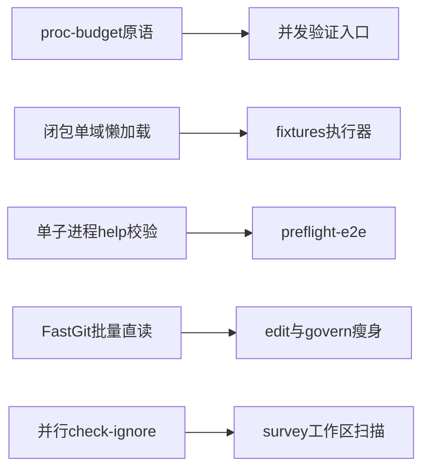

# 全仓脚本低 CPU 调度原语与热点瘦身 — 功能设计规范（SPEC）

## 文档信息与变更概览

| 项目 | 内容 |
| --- | --- |
| 当前状态 | `approved`（`draft \| approved \| implementing \| in_review \| implemented \| superseded`） |
| 规划级别 | `L3`（跨 `kit/`、`scripts/lib/` 与 `scripts/dev/` 的并发调度与热点重构；未 `approved` 前不编码） |
| 创建 / 更新 | `2026-11-27` / `2026-11-27` |
| 分支 / Issue / PR | `feat/multi-forge-worktree-perf-v1` / #227 / 未关联 |
| 负责人 / 内审状态 | plan-c-master / `passed` |
| 规划态 | `interactive`（逐题问到零拍板） |
| 关联 PRD / Todo | `docs/prd/261127-issue227-multi-forge-worktree-perf-v1-prd.md` / `docs/todo/261127-issue227-low-cpu-script-perf-todo.md` |

- **变更一句话**：建立零依赖进程并发预算与低优先级调度原语 `kit/skills/lib/proc-budget.mjs` (new)，实现 `fixtures.mjs` `--only`（含跨文件 `import` 闭包）与 `--domain` 懒加载、`sync-toc`/`update` 导出 `runCli` 支撑单子进程 `--help` 批量校验，以及 `readBlobBatch` 下沉 `git-fast-objects.mjs` 瘦身 `edit-gate.mjs`，在零弱化门禁前提下显著降低 CPU 峰值与总耗时。

## 系统变更全景

| 模块 / 文件 | 变更性质 | 核心职责 |
| --- | --- | --- |
| `kit/skills/lib/proc-budget.mjs` | 新增 | 零依赖并发预算与低优先级原语：`resolveWorkerConcurrency` 与 `applyLowPriority(pid)` |
| `kit/skills/lib/git-fast-objects.mjs` | 修改 | 新增单源 `readBlobBatch(repoRoot, rev, relPaths)`（先走 `readGitBlobTextFast`，缺失回退单次 `git cat-file --batch`，376 行 -> 约 430 行） |
| `scripts/sync-toc.mjs`、`scripts/update.mjs` | 修改 | 补齐标准 `export async function runCli(argv)` 并做直接执行判定，使 8 个顶层脚本统一支持单子进程 `--help` 批量校验 |
| `scripts/dev/verify-injections.mjs` | 修改 | 接入 `resolveWorkerConcurrency` 与子进程 `applyLowPriority`，消除 40~60 路普通优先级 Node 抢占 |
| `scripts/dev/fixtures.mjs` | 修改 | `--only` 解析 `DISCOVERED_FILES` 跨文件 `import` 闭包预筛懒加载 + `--domain` 单域懒加载（0 命中自动回退全量导入）+ 接入 `proc-budget` |
| `scripts/dev/fixtures-helpers.mjs` | 修改 | 补齐 `IN_PROCESS_CLI_SCRIPTS` 覆盖 5 个遗漏脚本，且进程内执行器兼容 `mod.runCli ?? mod.main` 使 `scripts/equip-ci.mjs` 真生效 |
| `scripts/dev/e2e-zip-harness.mjs`、`scripts/dev/merge-gate.mjs`、`kit/skills/dev-iterate/scripts/iterate.mjs` | 修改 | 接入 `resolveWorkerConcurrency`（默认留 2 核，`--jobs` 可覆盖）与 `applyLowPriority` |
| `scripts/dev/preflight-e2e.mjs` | 修改 | `checkHelps` 改为单子进程批量调用全部 8 个 `scripts/*.mjs` 的 `runCli(['--help'])`，省去 7 次 Node 冷启 |
| `kit/skills/dev-edit/scripts/edit-gate.mjs` | 修改 | 调用 `git-fast-objects.mjs` 的 `readBlobBatch` 替代循环内 `git cat-file -e`/`git show`/`git diff --quiet`，行数从 772 行净减至 `<= 755` 行 |
| `kit/skills/dev-govern/scripts/govern-checks.mjs`、`kit/skills/dev-govern/scripts/govern-checks-hygiene.mjs`、`kit/skills/dev-govern/scripts/govern-audit.mjs` | 修改 | 复用 `readBlobBatch` 并透传 `trackedSet`，消除重复 `git ls-files` 与逐文件 `git show` |
| `scripts/lib/survey-workspace.mjs`、`scripts/survey.mjs` | 修改 | 消除同步 `git check-ignore` 阻塞，并入并发探测链路提升 `survey`/`review(self)` 余量 |
| `scripts/dev/fixtures-perf-budget.mjs`、`scripts/dev/injections-data-perf-budget.mjs` | 新增 | 并发预算、优先级兜底、`--only` 闭包与 0 命中回退、`--domain` 懒加载、`mod.main` 进程内执行与批量 `git` 零回归的正反双向夹具与故障注入 |

## 一、背景与边界声明

- **要改什么**：统一全仓后台并发脚本的核数预留与进程优先级策略；优化 `fixtures.mjs`、`fixtures-helpers.mjs`、`preflight-e2e.mjs`（含补齐 `sync-toc.mjs`/`update.mjs` `runCli`）、`edit-gate.mjs`、`govern-checks*.mjs` 与 `survey-workspace.mjs` 的子进程派生与同步 I/O 热点。
- **不改什么**：不改变任何断言数量、门禁退出码、结构校验范围或测试覆盖语义；不触碰任何平台注册表/网络层（Wave 1B）及 `worktree-deps.mjs`/`exec.mjs`/`workflow-policy.mjs`（Wave 2），确保与 Wave 1B 写域 100% 零交集。
- **本期不做**：不修改 `docs/feature-map.json`、`docs/architecture-map.html` 或 `docs/TDD.md`（由 Wave 3 终态统一同步，避免与并行 Wave 1B 写域撞车）；不改动 `bench.mjs` 自身预算放宽基准。
- **复用既有模块**：`kit/skills/lib/git-fast-objects.mjs`（`readGitBlobTextFast`）、`kit/skills/lib/git-index-fast.mjs`（`readGitIndexPathsFast`）、`scripts/dev/preflight-e2e.mjs` 既有 `SMOKE_CHILD_CODE` 隔离执行模式。
- **架构基线关系**：`kit/skills/lib/proc-budget.mjs` (new) 置于 `kit/skills/lib/` 且仅导入 `node:os`，`readBlobBatch` 下沉 `kit/skills/lib/git-fast-objects.mjs` 供 `edit-gate.mjs` 与 `govern-checks.mjs` 单源复用，确保 `edit-gate.mjs` 净减至 `<= 755` 行（为 Wave 2 留足余量），严守 `arch-rules` 与单文件 `<= 800` 行红线（依据：`docs/TDD.md`）。

## 二、设计方案与契约变更

### 接口 / 数据结构变更

1. **`kit/skills/lib/proc-budget.mjs` (new)（预计 `<= 120` 行）**：
   - `export const DEFAULT_RESERVED_CORES = 2`
   - `export function resolveWorkerConcurrency({ requestedJobs = null, cap = Infinity, reservedCores = DEFAULT_RESERVED_CORES, cpuCount = os.availableParallelism() } = {})`：
     - 若显式传入合法正整数 `requestedJobs`（`>= 1`），优先尊重 `Math.min(requestedJobs, cap)`（保证 `--jobs` 显式覆盖始终生效）；
     - 否则返回 `Math.max(1, Math.min(cap, Math.floor(cpuCount) - reservedCores))`，在多核机上稳定留出至少 2 核前台余量，在 1-2 核 CI 上安全退化为 `1`。
   - `export function applyLowPriority(pid = process.pid, { priority = os.constants.priority.PRIORITY_BELOW_NORMAL } = {})`：
     - 校验 `Number.isInteger(pid) && pid > 0` 后调用 `os.setPriority(pid, priority)`，返回 `{ ok: true, pid, priority }`；
     - 捕获 `EPERM`/`EACCES`/`ESRCH`/`EINVAL` 等跨平台权限或瞬态退出异常并返回 `{ ok: false, pid, code }`，永不抛错打断主流程。
2. **`scripts/dev/fixtures.mjs` `--only` 跨文件 `import` 闭包预筛与 `--domain` 单域懒加载**：
   - 启动阶段扫描 `DISCOVERED_FILES` 的静态 `import ... from './fixtures-*.mjs'` 边构建反向依赖图（涵盖全部 6 处跨 `fixtures-*.mjs` 共享导入）；
   - **`--domain <name>`**：按域文件名映射直接定位对应子集及其静态 `import` 闭包，无需加载无关 80+ 文件；若该域解析出 0 用例则回退全量导入；
   - **`--only <substr>`**：先按不区分大小写子串预筛 `DISCOVERED_FILES`，同时自动纳入所有被命中文件直接/间接引用的兄弟文件，**并把静态被引用文件反向扩展到导入它的注册文件**（彻底根除「部分命中致动态模板用例漏检」风险）；若最终命中用例为 `0`（或显式传入 `--no-lazy`），无条件回退全量导入剩余全部 `DISCOVERED_FILES` 重筛。
3. **`scripts/dev/fixtures-helpers.mjs` 进程内脚本补齐与 `mod.runCli ?? mod.main` 兼容**：
   - 将 `verify-tools.mjs`、`doc-locate.mjs`、`edit-gate.mjs`、`iterate.mjs`、`equip-ci.mjs` 纳入 `IN_PROCESS_CLI_SCRIPTS`；
   - `runAbsAsync` 进程内分发点（原 `L226` 仅认 `typeof mod.runCli === 'function'`）升级为 `const entry = typeof mod.runCli === 'function' ? mod.runCli : (typeof mod.main === 'function' ? mod.main : null)`，使仅导出 `main` 的 `scripts/equip-ci.mjs` 真正命中进程内路径，同时在每次调用前后完整隔离并还原 `process.exitCode`、`process.cwd` 与标准输出捕获，需独立环境变量或超时强杀的用例维持子进程隔离。
4. **`scripts/sync-toc.mjs`、`scripts/update.mjs` 与 `scripts/dev/preflight-e2e.mjs` 单子进程 `checkHelps`**：
   - 为 `scripts/sync-toc.mjs`（435 行）与 `scripts/update.mjs`（712 行）补齐标准 `export async function runCli(argv)` 并保留直接执行入口守卫（`isDirectMain`），与其余 6 个 `scripts/*.mjs` 对齐；
   - `scripts/dev/preflight-e2e.mjs` 的 `checkHelps` 仿照同文件 `SMOKE_CHILD_CODE` 派生 1 个干净子进程，顺序导入并调用全部 8 个 `scripts/*.mjs` 的 `runCli(['--help'])`，逐个截获 `stdout`/`stderr`/退出码返回等价断言结果，省去 7 次 Node 冷启。
5. **`kit/skills/lib/git-fast-objects.mjs` 单源 `readBlobBatch` 与冗余 `git` 消除**：
   - 在 `kit/skills/lib/git-fast-objects.mjs`（376 行 -> 约 430 行）新增导出 `readBlobBatch(repoRoot, rev, relPaths)`：先逐项尝试 `readGitBlobTextFast`，把未命中条目（packfile/缺失）合并为单次 `git cat-file --batch` 批量读取并返回 `Map<relPath, string | null>`；
   - `kit/skills/dev-edit/scripts/edit-gate.mjs`（772 行 -> `<= 755` 行）与 `kit/skills/dev-govern/scripts/govern-checks.mjs`（649 行）统一改调 `readBlobBatch` 消除循环内 `git cat-file -e` / `git show` / `git diff --quiet`；
   - `kit/skills/dev-govern/scripts/govern-audit.mjs`（632 行）将已由 `readGitIndexPathsFast` 拿到的 `trackedSet` 透传给 `kit/skills/dev-govern/scripts/govern-checks-hygiene.mjs`（428 行）的 `auditUnignoredOutputDirs`，消除重复 2 次 `git ls-files` 派生；
   - `scripts/lib/survey-workspace.mjs`（737 行）与 `scripts/survey.mjs`（728 行）：将 `detectIgnoredGovernancePaths` 由同步 `spawnSync('git', ['check-ignore', ...])` 改为异步 `execFile` 并与 `detectGit`/文件扫描并行汇聚（无候选路径直接短路零派生）。

### 数据与状态变更

- 本次不涉及持久化文件格式或账本 Schema 变更。

### 异常、回退与安全边界

- `os.setPriority` 在受限容器或进程已退出时抛 `EPERM`/`ESRCH`：`applyLowPriority` 必须安全捕获并记录降级状态，绝不打断主流程。
- `fixtures.mjs --only` 与 `--domain` 预筛若因动态拼名导致 0 命中，必须触发全量回退导入，禁止静默返回 0 用例或漏跑注入验证。
- `readBlobBatch` 在浅克隆、repacked 对象或非 Git 目录命中缺失时回退单次 `git cat-file --batch`，结果与逐文件 `git show` 字节级等价。

### 实现顺序

1. 先新增 `scripts/dev/fixtures-perf-budget.mjs` (new) 编写失败回归测试（核数预留、`--jobs` 覆盖、低优先级兜底、`--only` 闭包与 0 命中回退、`--domain` 懒加载、`mod.main` 进程内执行、`readBlobBatch` 与 `checkHelps`）。
2. 实现 `kit/skills/lib/proc-budget.mjs` (new) 并接入 5 个并发入口，落地 `fixtures.mjs`、`fixtures-helpers.mjs`、`sync-toc.mjs`/`update.mjs` 与 `preflight-e2e.mjs`。
3. 下沉 `readBlobBatch` 至 `kit/skills/lib/git-fast-objects.mjs`，改造 `edit-gate.mjs`、`govern-checks*.mjs`、`govern-audit.mjs` 与 `survey-workspace.mjs`/`survey.mjs`。
4. 补齐 `scripts/dev/injections-data-perf-budget.mjs` (new)，执行 `node scripts/equip.mjs .`、全量 `bench.mjs`、`merge-gate.mjs` 与 `verify-injections.mjs` 实测对比。

## 三、备选方案与否决理由

| 方案 | 怎么做的 | 为什么没选 | 什么情况下该改回它 |
| --- | --- | --- | --- |
| 零依赖 `proc-budget.mjs` + 闭包预筛回退 + `readBlobBatch` 下沉（已选） | 纯 `node:os` + 静态 import 闭包预筛 + 单源批量 Git 直读 | 零外部依赖、架构零侵入、兼顾前台流畅度、零漏检与 `edit-gate.mjs` 净瘦身 | 若未来引入原生工作线程常驻池可在同原语上平滑扩展 |
| 直接在 `edit-gate.mjs` 内联写批量 `git cat-file` | 不下沉 `git-fast-objects.mjs` | `edit-gate.mjs` 已 772 行且 Wave 2 还需加钩子，极易超 800 行且与 `govern-checks.mjs` 重复造轮子 | 永不采用 |
| `fixtures.mjs --only` 仅靠单文件关键字匹配不做 import 闭包 | 仅导入文本命中的单个文件 | 跨 `fixtures-*.mjs` 共享构造或模板拼名在部分命中时会静默漏跑动态用例 | 永不采用 |

## 四、改动清单与影响面

| 文件 / 目录 | 改动性质 | 改什么 | 谁会被影响 |
| --- | --- | --- | --- |
| `kit/skills/lib/proc-budget.mjs` | 新增 | 并发预算 `resolveWorkerConcurrency` 与 `applyLowPriority` | 全部并发验证与迭代脚本 |
| `kit/skills/lib/git-fast-objects.mjs` | 新增导出 | 单源 `readBlobBatch`（先 `readGitBlobTextFast` 后批量 `git cat-file --batch`） | `edit-gate.mjs`、`govern-checks.mjs` |
| `scripts/sync-toc.mjs`、`scripts/update.mjs` | 修改 | 补齐 `export async function runCli` 与直接运行守卫 | `preflight-e2e.mjs` 单子进程 `checkHelps` |
| `scripts/dev/verify-injections.mjs` | 修改 | 接入并发预算与子进程低优先级 | 故障注入批跑 |
| `scripts/dev/fixtures.mjs` | 修改 | `--only` 跨文件 import 闭包预筛 + `--domain` 单域懒加载（含 0 命中回退）+ `proc-budget` | 全量及定向测试执行 |
| `scripts/dev/fixtures-helpers.mjs` | 修改 | 补齐 5 脚本进 `IN_PROCESS_CLI_SCRIPTS` 并兼容 `mod.runCli ?? mod.main` | 夹具执行耗时 |
| `scripts/dev/e2e-zip-harness.mjs`、`scripts/dev/merge-gate.mjs`、`kit/skills/dev-iterate/scripts/iterate.mjs` | 修改 | 接入 `resolveWorkerConcurrency` 与 `applyLowPriority` | 打包 E2E、合入门禁与压测迭代 |
| `scripts/dev/preflight-e2e.mjs` | 修改 | `checkHelps` 单子进程批量校验 8 脚本 `--help` | 每次 `preflight` 耗时 |
| `kit/skills/dev-edit/scripts/edit-gate.mjs` | 修改 | 改调 `readBlobBatch`，行数从 772 行净减至 `<= 755` 行 | 改码门禁 |
| `kit/skills/dev-govern/scripts/govern-checks.mjs`、`govern-checks-hygiene.mjs`、`govern-audit.mjs` | 修改 | 复用 `readBlobBatch` 并透传 `trackedSet` | 代码体检 |
| `scripts/lib/survey-workspace.mjs`、`scripts/survey.mjs` | 修改 | 消除同步 `git check-ignore` 阻塞 | `survey` 与 `review(self)` |
| `scripts/dev/fixtures-perf-budget.mjs`、`scripts/dev/injections-data-perf-budget.mjs` | 新增 | 正反双向夹具与故障注入 | `fixtures.mjs`、`verify-injections.mjs` |

- **对外可见的变化**：无破坏性 CLI 变更；`scripts/sync-toc.mjs` 与 `scripts/update.mjs` 新增编程导出 `runCli`；支持 `--jobs` 的脚本继续支持显式覆盖，默认并发改为 `max(1, availableParallelism() - 2)` 并降级后台 worker 优先级。
- **需要同步改的地方**：执行 `node scripts/equip.mjs .` 同步 `.agents/skills/`。

## 五、冻结的验收标准

<!-- criteria:start -->
- [ ] C1: `kit/skills/lib/proc-budget.mjs` (new) 导出 `resolveWorkerConcurrency`（默认 `max(1, availableParallelism() - 2)` 且 `--jobs` 可显式覆盖，1-2 核退化为 `1`）与 `applyLowPriority(pid)`（调用 `os.setPriority(..., PRIORITY_BELOW_NORMAL)` 且对权限/非法 PID 异常安全兜底），并在 `scripts/dev/verify-injections.mjs`、`scripts/dev/fixtures.mjs`、`scripts/dev/e2e-zip-harness.mjs`、`scripts/dev/merge-gate.mjs` 与 `kit/skills/dev-iterate/scripts/iterate.mjs` 全部接入生效。
- [ ] C2: `scripts/dev/fixtures.mjs` 实现 `--only` 跨文件 `import` 闭包预筛懒加载 + `--domain` 单域懒加载且 0 命中自动回退全量导入（实测冷启显著低于全量 325 ms 基线并逼近 ~15 ms，且跨文件引用与动态名用例 0 漏检）；`scripts/dev/fixtures-helpers.mjs` 补齐 `IN_PROCESS_CLI_SCRIPTS` 覆盖 `verify-tools.mjs`/`doc-locate.mjs`/`edit-gate.mjs`/`iterate.mjs`/`equip-ci.mjs` 并兼容 `mod.runCli ?? mod.main`；`scripts/sync-toc.mjs` 与 `scripts/update.mjs` 导出 `runCli` 且 `scripts/dev/preflight-e2e.mjs` `checkHelps` 以单子进程完成 8 个脚本 `--help` 校验。
- [ ] C3: `kit/skills/lib/git-fast-objects.mjs` 新增 `readBlobBatch` 供 `kit/skills/dev-edit/scripts/edit-gate.mjs`（行数净减至 `<= 755` 行）与 `kit/skills/dev-govern/scripts/govern-checks.mjs` 复用，`govern-audit.mjs` 透传 `trackedSet` 给 `govern-checks-hygiene.mjs`，`scripts/lib/survey-workspace.mjs`/`scripts/survey.mjs` 消除同步 `git check-ignore` 阻塞；新增 `scripts/dev/fixtures-perf-budget.mjs` (new) 与 `scripts/dev/injections-data-perf-budget.mjs` (new) 正反双向实证通过，`node scripts/dev/bench.mjs`、`node scripts/dev/preflight.mjs`、`node scripts/dev/merge-gate.mjs` 与 `node scripts/dev/verify-injections.mjs --jobs 4` 全部退出码 `0`。
<!-- criteria:end -->

## 六、高风险点、门型与回滚路径

- **门型与回滚路径**：`one-way`（涉及 `kit/` 共享原语、`git-fast-objects.mjs`、`edit-gate.mjs`、`scripts/lib/survey-workspace.mjs` 与全部验证运行器）；回滚做法：反向提交本切片 PR，重跑 `node scripts/equip.mjs .` 与 `node scripts/dev/preflight.mjs`。
- **高风险路径**：`kit/`、`scripts/lib/`。
- **故障注入预演**：至少注入 5 类退化故障——`resolveWorkerConcurrency` 吃满全核不留余量、`applyLowPriority` 对异常未兜底抛错、`fixtures.mjs --only` 丢弃跨文件 import 闭包或 0 命中未回退全量导入、`fixtures-helpers.mjs` 不兼容 `mod.main` 致 `equip-ci` 回退子进程、`checkHelps` 放行缺失 `--help` 脚本——全部由 `scripts/dev/injections-data-perf-budget.mjs` (new) 经 `verify-injections.mjs` 捕获。

## 澄清与补充记录

- 已确认：吸收 R1 独立审查意见，补充 `scripts/sync-toc.mjs`/`scripts/update.mjs` `runCli` 导出、`mod.runCli ?? mod.main` 兼容、跨文件 `import` 闭包与 `--domain` 懒加载，并将 `readBlobBatch` 下沉 `kit/skills/lib/git-fast-objects.mjs` 令 `edit-gate.mjs` 净减；与 Wave 1B 写域保持 100% 零交集。

## 实现说明

- **实际落地摘要**：
- **与草案的差异**：
- **关联同步文件**：
