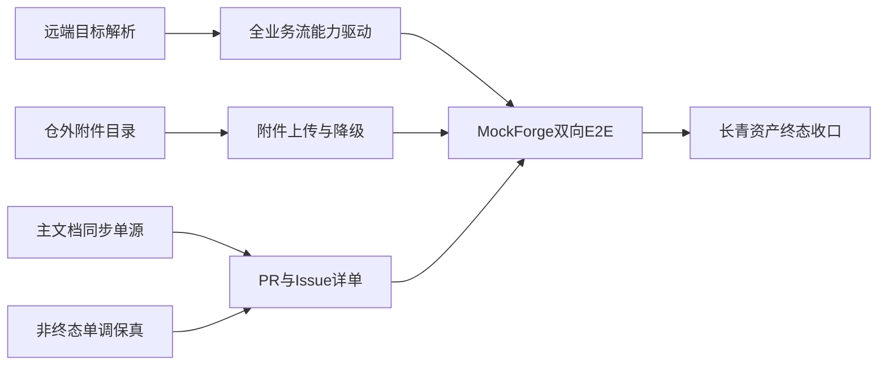

# 全业务流去 GitHub 硬假设、实证附件闭环、同步缺陷根治与多平台 E2E — 功能设计规范（SPEC）

## 文档信息与变更概览

| 项目 | 内容 |
| --- | --- |
| 当前状态 | `approved`（`draft \| approved \| implementing \| in_review \| implemented \| superseded`） |
| 规划级别 | `L3`（全业务流多平台切换、实证附件生命周期、三大同步缺陷根治与 Milestone C 终态收口；未 `approved` 前不编码） |
| 创建 / 更新 | `2026-11-27` / `2026-11-28` |
| 分支 / Issue / PR | `feat/multi-forge-flow-sync-e2e` / #227 / 未关联 |
| 负责人 / 内审状态 | plan-c-master / `passed` |
| 规划态 | `interactive`（逐题问到零拍板） |
| 关联 PRD / Todo | `docs/prd/261127-issue227-multi-forge-worktree-perf-v1-prd.md` / `docs/todo/261127-issue227-multi-forge-flow-sync-e2e-todo.md` |

- **变更一句话**：将全部研发流与渲染脚本统一切换至 `resolveRemoteTarget` 与 10 键 `capabilities` 驱动，建成仓外实证附件生命周期与原生上传/摘要降级，新增独立单源模块 `kit/skills/lib/master-criteria-sync.mjs` (new) 根治 PR `#215` 与 Issue `#219` 同步缺陷并压低全部紧文件至 `<= 780` 行，落地纯 Node Mock Forge E2E 与全仓长青资产收口。

## 系统变更全景

| 模块 / 文件 | 变更性质 | 核心职责 |
| --- | --- | --- |
| `kit/skills/lib/master-criteria-sync.mjs` | 新增 | 独立单源模块（约 180 行，不挤占 714 行 `doc-slice-graph.mjs`）：承载 `resolvePrimaryPlanDocOrder`、`filterBootstrapAutoAttachDocs` 与带 `includeSelf = false` 默认开关的 `collectMasterIssueCriteriaState` |
| `kit/skills/dev-flow/scripts/flow-*.mjs`、`review-{pr,sync}.mjs`、`plan-sync.mjs`、`escalation.mjs`、`task-graph.mjs`、`workflow-policy-next.mjs` | 修改 | 全量消除 `providerId === 'github'`（含 `plan-sync.mjs:508-520`）、`githubRepoFull`、`pull/<N>/head` 与 `gh-cli` 硬假设，切换为 `resolveRemoteTarget` + 10 键 `capabilities` + `mrRefPattern` |
| `scripts/survey.mjs`、`scripts/review.mjs`、`scripts/equip-ci.mjs`、`scripts/lib/navigation.mjs`、`scripts/lib/render.mjs` | 修改 | 下游全量改读 `capabilities` 取代 `onGithub` 硬判断（含修复 `scripts/lib/render.mjs:393`） |
| `kit/skills/lib/verify-state.mjs`、`kit/skills/lib/empirical-artifacts.mjs`、`flow-cleanup.mjs`、`flow-lifecycle.mjs`、`review-empirical.mjs` | 修改 | 落地 `<gitCommonDir>/project-forge-flow/artifacts/<taskId>/` 生命周期（`cleanup`/`abort` 联动销毁，零入 Git），将暂存/上传缓存封装在 `verify-state.mjs` 与 `empirical-artifacts.mjs` 使 `flow-lifecycle.mjs`/`review-empirical.mjs` 瘦身至 `<= 770` 行 |
| `kit/skills/lib/plan-sync.mjs`、`pr-template-hydrate.mjs`、`handoff-package.mjs`、`review-gates.mjs`、`flow-inspect.mjs`、`flow-merge-claim.mjs` | 修改 | 阻断 `flow-inspect.mjs` L616-617 与 L755-763 两处 bootstrap 自动挂载并瘦身至 `<= 770` 行；`collectMasterIssueCriteriaState` 迁出 `flow-merge-claim.mjs`；统一 PR/Issue 详单与 5 列附件表 |
| `scripts/dev/fixtures-empirical-cycle.mjs`、`scripts/dev/fixtures-issue-checklist-sync.mjs` | 修改 | 对齐 5 列实证附件表与 `includeSelf: false` / `preserveChecked` 双向回归 |
| `scripts/dev/fixtures-multi-platform.mjs`、`scripts/dev/injections-data-multi-platform.mjs`、`scripts/dev/live-forge-e2e.mjs` | 新增 | 离线纯 Node HTTP Mock Forge + `git init --bare` E2E、双向故障注入，以及 opt-in 环境变量驱动的一次性私有测试仓实测脚本 |
| `docs/TDD.md`、`docs/feature-map.json`、`docs/architecture-map.html`、`README.md`、`README.en.md` | 修改 | Milestone C 终态全仓长青文档、功能地图、零脏态架构图与双语 README 目录锁步同步 |

## 一、背景与边界声明

- **要改什么**：完成多平台内核向全业务与渲染脚本的全面接入、仓外实证附件闭环、三大同步缺陷单源根治、离线 Mock Forge + opt-in 真机 E2E 与 Milestone C 长青文档终态收口。
- **不改什么**：不重做 Wave 1B 协议内核与 `github-labels.mjs`（已在 Wave 1B 完成，不重复占写域），不重做 Wave 2 依赖池/安全执行引擎；不往 714 行的 `doc-slice-graph.mjs` 硬塞新逻辑；不破坏 `PR_SECTION_TITLES` 与 `scripts/dev/preflight-contract-rules.mjs` 既有模板对拍约束；绝不往仓内写入任何私域域名、组织名、账号或 Token。
- **本期不做**：不触碰外部生产业务仓库；不支持原生附件上传的平台不提供图床配置向导，直接降级摘要表。
- **复用既有模块**：Wave 1B `resolveRemoteTarget` / `RemoteApiBackend` / `probePlatformEnv`、`kit/skills/lib/verify-state.mjs`（仓外安全前缀模式）、`kit/skills/lib/empirical-artifacts.mjs`、`kit/skills/lib/pr-template-hydrate.mjs`、`kit/skills/lib/plan-sync.mjs`。
- **架构基线关系与紧文件外提瘦身预算（全部稳压 `<= 780` 行）**：
  - `kit/skills/lib/master-criteria-sync.mjs` (new) 独立承载主文档排序、bootstrap 过滤与 `collectMasterIssueCriteriaState`（约 180 行），`doc-slice-graph.mjs` 保持 714 行不膨胀；
  - `flow-inspect.mjs`（799 行 -> `<= 765` 行）：外提 bootstrap 文档挂载与远端目标解析逻辑至 `master-criteria-sync.mjs` 与 `flow-context.mjs`；
  - `flow-merge.mjs`（792 行 -> `<= 770` 行）：将多行 `originFull`/`githubRepoFull` 与合并状态拼接外提至 `flow-merge-claim.mjs`（自身因迁出 65 行 `collectMasterIssueCriteriaState` 从 628 行降至约 565 行，空间充裕）；
  - `flow-lifecycle.mjs`（788 行 -> `<= 765` 行）与 `review-empirical.mjs`（797 行 -> `<= 770` 行）：将附件暂存、上传去重缓存与摘要拼装统一收口进 `verify-state.mjs`（539 行 -> 约 630 行）与 `empirical-artifacts.mjs`（401 行 -> 约 530 行）；
  - 严守 `arch-rules` 单向依赖与零第三方依赖（依据：`docs/TDD.md`）。

## 二、设计方案与契约变更

### 接口 / 数据结构变更

1. **全业务流与渲染层去 `github`/`gh` 硬假设（`C10`）**：
   - 全部业务、同步与安装渲染脚本统一调用 `resolveRemoteTarget` 与 10 键 `capabilities`：
     - `flow-context.mjs`：移除 `providerId !== 'github'` 拒建可读 client，按 `target.capabilities.api` 构建 `RemoteApiBackend`，`targetRepo` 取 `target.repoSlug`；
     - `flow-inspect.mjs`、`review-pr.mjs`、`review-sync.mjs`：外部 PR/MR 拉取引用由硬编码 `pull/<N>/head` 改为按 `target.mrRefPattern`（GitHub/Gitee/Gitea 为 `refs/pull/<n>/head`，GitLab/GitCode 为 `refs/merge-requests/<n>/head`）；
     - `flow-lifecycle.mjs`、`flow-merge.mjs`、`flow-merge-claim.mjs`、`flow-batch.mjs`、`flow-cleanup.mjs`、`flow-issues.mjs`、`flow-intake.mjs`、`flow-next.mjs`、`flow-start-helpers.mjs`、`plan-sync.mjs`（显式清理 `L508-520` `providerId === 'github'` 与 `githubRepoFull`）、`escalation.mjs`、`task-graph.mjs`、`workflow-policy-next.mjs`：全量以 `target.capabilities` 与统一通道层 `isVerifiedTier` 驱动；
     - `scripts/survey.mjs`、`scripts/review.mjs`、`scripts/equip-ci.mjs`、`scripts/lib/navigation.mjs`、`scripts/lib/render.mjs`（显式修复 `L393` GitHub 硬编码）：下游统一读 `capabilities`（取代 `onGithub` 硬判断）。
2. **仓外实证附件目录与 `capabilities.uploadAttachment`（`C11`）**：
   - `kit/skills/lib/verify-state.mjs` 新增对称于 `scratch/` 的仓外附件原语：`resolveTaskArtifactsDir(repoRoot, taskId)`（落盘 `<gitCommonDir>/project-forge-flow/artifacts/<taskId>/`）、`isSafeTaskArtifactPath`（严格 canonical 前缀防越界）、`ensureTaskArtifactsDir`、`stageTaskArtifact`、`destroyTaskArtifactsDir`。
   - `kit/skills/lib/empirical-artifacts.mjs` 新增高层编排 `stageAndSyncTaskArtifacts({ repoRoot, taskId, evidencePath, artifacts, backend })` 供 `flow-lifecycle.mjs` 与 `review-empirical.mjs` 单行调用（瘦身调用方）：校验常规文件与 `ARTIFACT_MAX_BYTES`（50 MB）并暂存至 `artifacts/<taskId>/`，登记元数据进仓外 `evidence.json`（零进 Git 跟踪）；`flow-cleanup.mjs` 的 `handleCleanup` 与 `handleAbort` 联动调用 `destroyTaskArtifactsDir` 彻底清理。
   - 远端推送展示时检查 `backend.capabilities?.uploadAttachment === true`：
     - GitLab / GitCode：若该 artifact 尚未缓存同 `providerId` 的 `uploaded` 记录，则调 `backend.uploadAttachment` 经 `/uploads` 上传并把 `{ providerId, url, markdown }` 缓存回 `evidence.json` 防重复上传；
     - GitHub / Gitee / Gitea / LAN / 离线或上传失败：优雅降级输出客观摘要，**绝不询问用户配图床或上传 Git 分支**。
   - `kit/skills/lib/empirical-artifacts.mjs` 升级 `formatArtifactEvidenceLines` 单源输出 5 列表格：`| 实证附件 | 字节数 | 校验指纹 | 实证观察摘要 | 附件展示 |`（前三列标题保持向后兼容，同步扩充 `scripts/dev/fixtures-empirical-cycle.mjs` 校验全部 5 列与上传/降级形态）。
3. **独立单源模块 `kit/skills/lib/master-criteria-sync.mjs` (new) 根治三大同步缺陷（`C12`）**：
   - **修 PR `#215`（`planBootstrap` 主文档优先级与两处阻断）**：
     - 导出 `resolvePrimaryPlanDocOrder(ledger)`：`ledger?.planBootstrap === true` 时固定以 `['prd', 'spec', 'todo']`（仅 `prdFile` 优先）；普通切片维持 `['spec', 'todo', 'prd']`；
     - 导出 `filterBootstrapAutoAttachDocs(docs, { isBootstrap, explicitSpec, explicitTodo })`：`flow-inspect.mjs` 在 **`L616-617`（`dirtyDocs`）与 `L755-763`（`wtDocs`）两处**同时调用该函数，在 `isBootstrap === true` 且未显式传 `--spec`/`--todo` 时**严禁自动挂载**工作树内 `docs/specs/` 与 `docs/todo/`（仅自动挂载 `docs/prd/`）；
     - `pr-template-hydrate.mjs`（`resolveReadablePrTitle` 与 `hydratePrTemplateBody` 摘要提取）、`review-gates.mjs`（`parseAcceptanceCriteria`）与 `handoff-package.mjs` 全部改调 `resolvePrimaryPlanDocOrder`。
   - **修 Issue `#219`（`includeSelf = false` 防误勾 + 非终态单调保真 + 兼容显式反选）**：
     - 将 `collectMasterIssueCriteriaState` 从 `kit/skills/dev-flow/scripts/flow-merge-claim.mjs:211-275` 迁至 `kit/skills/lib/master-criteria-sync.mjs` (new)（`flow-merge-claim.mjs` 保留薄重导出保兼容），新增显式开关 `includeSelf = false`：
       - **非终态（`plan-sync.mjs` `plan-backfill`/`critique-*`/`approve`）传 `includeSelf: false`**：只聚合已归档/已实现兄弟切片（扫描 `docs/archive/todo/` 与已完成切片 SPEC 的 `[x] C*`），**绝不把当前尚未完成的 `isSelf` 切片 `C*` 误判为 `completedIds`**；
       - **终态（`flow-merge.mjs` / `flow-merge-claim.mjs` 合并收尾）传 `includeSelf: true`**：按既有语义把当前合并切片并入终态完成集；
     - `plan-sync.mjs:syncIssueCriteriaCheckboxes` **保持默认 `preserveChecked = false`**（100% 兼容 `scripts/dev/fixtures-issue-checklist-sync.mjs:158` 及 `clarify --drop-criterion` 显式反选），仅非终态 `plan-sync.mjs` 同步自动显式传入 `{ preserveChecked: true }`，确保兄弟已勾 `[x] C1..C8` 永不回退 `[ ]`。
   - **PR 详单表格与 Issue `pf:plan-summary` 单源一致**：
     - `pr-template-hydrate.mjs` 单源渲染：**变更摘要** + **验收清单进度表（复用 `critList`）** + **门禁与实证附件统一表（复用 `formatArtifactEvidenceLines`）**；保持 `PR_SECTION_TITLES` 与 `scripts/dev/preflight-contract-rules.mjs` 完全对齐；模板探测按序兼容 `.github/pull_request_template.md` 与目标仓 GitLab 默认 MR 模板（`.gitlab` 下 `merge_request_templates` 目录 `Default.md`）。
4. **多平台离线 Mock Forge E2E + Opt-In 私有测试仓入口 + 长青资产收口（`C13`）**：
   - 新增 `scripts/dev/fixtures-multi-platform.mjs` (new) 与 `scripts/dev/injections-data-multi-platform.mjs` (new)：内置纯 Node `node:http`（`127.0.0.1:0`）Mock Forge Server + 本地 `git init --bare`，离线覆盖 GitLab v4（含 `/uploads` multipart 真图上传、MR 创建/读/评/合、`mr.sha` 滞后但 `refs/merge-requests/1/head` 为真 SHA）、GitCode（4 字节字符返回 HTTP 500 守卫验证 + 脏列表客户端二次过滤）、Gitee/Gitea 摘要降级、LAN IP / 离线四态核验，以及 PR `#215`（两处挂载阻断）、Issue `#219`（`includeSelf: false` 防误勾 + `preserveChecked: true` 保真 + 显式反选）、`artifacts/<taskId>/` 清理回归。
   - 新增 `scripts/dev/live-forge-e2e.mjs` (new)（opt-in 人工执行入口，不进默认离线 CI）：仅从运行时环境变量读取 `PF_LIVE_FORGE_URL`、`PF_LIVE_FORGE_TOKEN`、`PF_LIVE_FORGE_NAMESPACE`、`PF_LIVE_FORGE_PROVIDER`，自动创建独立一次性私有测试仓 `pf-e2e-disposable-<ts>` 跑通全链路闭环并在 `finally` 中经 API 销毁临时仓，输出脱敏实证报告（零硬编码域名/凭据，绝不触碰生产仓）。
   - 同步更新 `docs/TDD.md`、`docs/feature-map.json`、干净零脏态 `docs/architecture-map.html`、`README.md`、`README.en.md`（并跑 `scripts/sync-toc.mjs --check`）与 `node scripts/equip.mjs .`。

### 数据与状态变更

- 新增仓外实证附件暂存目录 `<gitCommonDir>/project-forge-flow/artifacts/<taskId>/`（由 `cleanup`/`abort` 自动销毁，零入 Git）。
- `evidence.json` 单条 artifact 记录新增可选缓存字段 `uploaded: { providerId, url, markdown }`（向后兼容旧记录）。

### 异常、回退与安全边界

- `destroyTaskArtifactsDir` 必须先验证 `isSafeTaskArtifactPath` canonical 前缀，杜绝任意路径穿越删文件。
- `uploadAttachment` 网络失败/401/403/5xx 时仅记警告并回退本地实证摘要表，绝不阻塞 `submit` 或泄露令牌。
- `live-forge-e2e.mjs` 缺环境变量直接以退出码 `2` 友好提示退出，且目标仓名强制带 `pf-e2e-disposable-` 前缀防误删非临时仓。

### 实现顺序

1. 新增 `kit/skills/lib/master-criteria-sync.mjs` (new)，修复 `flow-inspect.mjs`（L616-617 & L755-763 两处阻断并瘦身）、`flow-merge-claim.mjs`、`plan-sync.mjs`（`includeSelf: false` + 非终态 `preserveChecked: true` + 去 L508-520 硬编码）、`pr-template-hydrate.mjs`、`review-gates.mjs` 与 `handoff-package.mjs`，先跑 `fixtures-issue-checklist-sync.mjs` 全绿。
2. 落地 `verify-state.mjs` 与 `empirical-artifacts.mjs` 的仓外 `artifacts/<taskId>/` 生命周期、`uploadAttachment` 缓存与 5 列统一表，瘦身接入 `flow-lifecycle.mjs`、`review-empirical.mjs` 与 `flow-cleanup.mjs`，同步对齐 `fixtures-empirical-cycle.mjs`。
3. 全量切换其余 `flow-*`/`review-*`/`escalation`/`task-graph`/`workflow-policy-next` 与 `scripts/{survey,review,equip-ci,navigation,render}` 至 `resolveRemoteTarget` + 10 键 `capabilities`，核查全部紧文件 `<= 780` 行。
4. 新增 `scripts/dev/fixtures-multi-platform.mjs` (new)、`scripts/dev/injections-data-multi-platform.mjs` (new) 与 `scripts/dev/live-forge-e2e.mjs` (new)，同步全部长青文档与 `equip.mjs .`，跑通全量 `merge-gate.mjs` 与 `verify-injections.mjs --jobs 4`。

## 三、备选方案与否决理由

| 方案 | 怎么做的 | 为什么没选 | 什么情况下该改回它 |
| --- | --- | --- | --- |
| 新增独立单源 `master-criteria-sync.mjs` + `includeSelf = false`（已选） | 独立承载主文档排序与兄弟切片进度聚合，非终态显式关闭 `includeSelf` | 避免 714 行 `doc-slice-graph.mjs` 超 800 行红线，且彻底杜绝非终态把当前未完成切片误勾为 `[x]` | 永不回退塞回 `doc-slice-graph.mjs` |
| 仓外 `artifacts/<taskId>/` + 原生 `/uploads` / 无原生降级摘要（已选） | 零入 Git，有原生 API 直接上传缓存，无原生直接渲染 5 列摘要表 | 零仓库膨胀、零图床依赖、不打断用户流程 | 若未来 GitHub 开放官方无分支 PR 附件上传 API 仅需把 `github.capabilities.uploadAttachment` 翻为 `true` |
| 将 `syncIssueCriteriaCheckboxes` 默认 `preserveChecked` 改为 `true` | 任何调用永不允许取消勾选 | 会破坏 `fixtures-issue-checklist-sync.mjs:158` 与 `clarify --drop-criterion` 显式反选场景 | 永不采用，必须默认 `false` 仅非终态同步显式传 `true` |

## 四、改动清单与影响面

| 文件 / 目录 | 改动性质 | 改什么 | 谁会被影响 |
| --- | --- | --- | --- |
| `kit/skills/lib/master-criteria-sync.mjs` | 新增 | `resolvePrimaryPlanDocOrder`、`filterBootstrapAutoAttachDocs`、`collectMasterIssueCriteriaState(..., { includeSelf = false })` | `flow-inspect`、`flow-merge-claim`、`plan-sync`、`pr-template-hydrate`、`review-gates`、`handoff-package` |
| `kit/skills/dev-flow/scripts/flow-*.mjs`、`review-{pr,sync}.mjs`、`plan-sync.mjs`、`escalation.mjs`、`task-graph.mjs`、`workflow-policy-next.mjs` | 修改 | 消除全部 `github`/`gh` 硬假设并瘦身紧文件（`flow-inspect`/`flow-merge`/`flow-lifecycle` 均 `<= 770` 行） | 全部多平台研发流 |
| `scripts/survey.mjs`、`scripts/review.mjs`、`scripts/equip-ci.mjs`、`scripts/lib/navigation.mjs`、`scripts/lib/render.mjs` | 修改 | 改读 `capabilities` 取代 `onGithub`（含修复 `render.mjs:393`） | 安装、勘察、渲染与交付体检 |
| `kit/skills/lib/verify-state.mjs`、`empirical-artifacts.mjs`、`flow-cleanup.mjs`、`review-empirical.mjs` | 修改 | 仓外 `artifacts/<taskId>/` 生命周期 + `uploadAttachment` 缓存与 5 列统一表，瘦身 `review-empirical.mjs <= 770` 行 | 实证采集、提审与清理 |
| `kit/skills/lib/pr-template-hydrate.mjs`、`handoff-package.mjs`、`review-gates.mjs` | 修改 | 根治 PR `#215`，统一 PR/Issue 详单与 GitLab MR 模板兼容 | 规划引导、`1:N` 同步与 PR 渲染 |
| `scripts/dev/fixtures-empirical-cycle.mjs`、`fixtures-issue-checklist-sync.mjs` | 修改 | 对齐 5 列实证附件表与 `includeSelf`/`preserveChecked` 双向回归 | 既有核心测试套件 |
| `scripts/dev/fixtures-multi-platform.mjs`、`injections-data-multi-platform.mjs`、`live-forge-e2e.mjs` | 新增 | 离线 Mock Forge 双向 E2E、故障注入与 opt-in 一次性私有测试仓验证脚本 | 全仓测试与多平台实证 |
| `docs/TDD.md`、`docs/feature-map.json`、`docs/architecture-map.html`、`README.md`、`README.en.md` | 修改 | Milestone C 终态全仓长青资产锁步更新 | 文档与功能地图自洽 |

- **对外可见的变化**：全套件支持 5 方言与局域网/离线仓库无感协作；PR/MR 详单自动包含验收清单进度表与实证附件 5 列表（支持目标仓 GitLab 默认 MR 模板（`.gitlab` 下 `merge_request_templates` 目录 `Default.md`））；新增 opt-in 真机验证脚本 `scripts/dev/live-forge-e2e.mjs` (new)。
- **需要同步改的地方**：`node scripts/equip.mjs .`、`node scripts/sync-toc.mjs README.md README.en.md --check`、`node .agents/skills/dev-verify-tools/scripts/verify-tools.mjs render .` 与 `node scripts/review.mjs .`。

## 五、冻结的验收标准

<!-- criteria:start -->
- [x] C10: 全量消除 `kit/skills/dev-flow/scripts/flow-*.mjs`、`kit/skills/dev-review/scripts/review-{pr,sync}.mjs`、`kit/skills/lib/plan-sync.mjs`（L508-520）、`kit/skills/lib/escalation.mjs`、`kit/skills/lib/task-graph.mjs`、`kit/skills/lib/workflow-policy-next.mjs` 与 `scripts/survey.mjs`、`scripts/review.mjs`、`scripts/equip-ci.mjs`、`scripts/lib/navigation.mjs`、`scripts/lib/render.mjs`（L393）中的 `github`/`gh` 硬假设，统一切换为 `resolveRemoteTarget`、`mrRefPattern` 与 10 键 `capabilities` 驱动。
- [x] C11: 落地仓外实证附件目录 `<gitCommonDir>/project-forge-flow/artifacts/<taskId>/` 生命周期（`verify-state.mjs` 安全前缀原语 + `empirical-artifacts.mjs` 5 列统一渲染与 `stageAndSyncTaskArtifacts` + `flow-cleanup.mjs` `cleanup`/`abort` 联动销毁，零入 Git），对接 `capabilities.uploadAttachment`（GitLab/GitCode 原生 `/uploads` 内嵌图且缓存防重传，GitHub/Gitee/Gitea/LAN 直接降级输出文件名 + 字节数 + 校验指纹 + 观察摘要，不询问图床），并确保 `flow-lifecycle.mjs`/`review-empirical.mjs` 瘦身至 `<= 780` 行。
- [x] C12: 新增独立单源模块 `kit/skills/lib/master-criteria-sync.mjs` (new) 根治 3 大同步缺陷并统一 PR/Issue 详单：（1）阻断 `flow-inspect.mjs` L616-617 与 L755-763 两处 `planBootstrap` 自动挂载子切片 SPEC/Todo（并瘦身 `flow-inspect.mjs <= 770` 行），`resolvePrimaryPlanDocOrder` 在 `flow-inspect`/`pr-template-hydrate`/`review-gates`/`handoff-package` 统一优先 `prdFile`（修 PR `#215`）；（2）`collectMasterIssueCriteriaState` 迁入 `master-criteria-sync.mjs` 并增 `includeSelf = false` 默认开关（非终态 `plan-backfill`/`approve` 仅聚合已归档兄弟切片绝不误勾当前未完成切片，`flow-merge` 终态传 `includeSelf: true`），`syncIssueCriteriaCheckboxes` 默认 `preserveChecked = false`（仅非终态 `plan-sync` 显式传 `preserveChecked: true`，完整兼容 `scripts/dev/fixtures-issue-checklist-sync.mjs` 与 `clarify --drop-criterion`，修 Issue `#219`）；（3）PR 详单表格（变更摘要 + 验收清单进度表 + 门禁与 5 列实证附件表，对齐 `scripts/dev/fixtures-empirical-cycle.mjs`、目标仓 GitLab 默认 MR 模板（`.gitlab` 下 `merge_request_templates` 目录 `Default.md`）与 `PR_SECTION_TITLES`）与 Issue `pf:plan-summary` 单源一致。
- [x] C13: 新增 `scripts/dev/fixtures-multi-platform.mjs` (new) 与 `scripts/dev/injections-data-multi-platform.mjs` (new)（纯 Node HTTP Mock Forge + `git init --bare` 全覆盖 GitLab v4 `/uploads` & `refs/merge-requests/1/head` 真 SHA、GitCode 4 字节守卫 & 客户端过滤、Gitee/Gitea 降级、LAN IP / 离线四态核验），提供零硬编码凭据的 opt-in 一次性私有测试仓入口 `scripts/dev/live-forge-e2e.mjs` (new)，并同步 `docs/TDD.md`、`docs/feature-map.json`、零脏态 `docs/architecture-map.html`、`README.md`/`README.en.md` 与 `node scripts/equip.mjs .`，全量 `node scripts/dev/merge-gate.mjs` 与 `node scripts/dev/verify-injections.mjs --jobs 4` 退出码 `0`。
<!-- criteria:end -->

## 六、高风险点、门型与回滚路径

- **门型与回滚路径**：`one-way`（全业务流跨模块切换、`1:N` 同步单调性、实证附件销毁路径与全仓长青资产终态收口）；回滚做法：反向提交本切片 PR，重跑 `node scripts/equip.mjs .` 与 `node scripts/dev/preflight.mjs`。
- **高风险路径**：`kit/`、`scripts/lib/`。
- **故障注入预演**：至少注入 7 类退化故障——`flow-inspect` L616-617 或 L755-763 `planBootstrap` 重新自动挂载子切片 SPEC、`collectMasterIssueCriteriaState` 非终态误把 `includeSelf` 置 `true` 误勾未完成切片、`plan-sync` 非终态未传 `preserveChecked: true` 刷回 `[x]`、`destroyTaskArtifactsDir` 放行越界路径、`flow-inspect` 外部 MR 拉取写死 `pull/<N>/head`、`uploadAttachment` 重复上传未命中缓存、`pr-template-hydrate` 丢失 `PR_SECTION_TITLES` 对齐——全部由 `scripts/dev/injections-data-multi-platform.mjs` (new) 经 `verify-injections.mjs` 捕获。

## 澄清与补充记录

- 已确认：吸收 R1 独立审查意见，新建独立 `kit/skills/lib/master-criteria-sync.mjs` (new) 避免 714 行 `doc-slice-graph.mjs` 超 800 行，补齐 `includeSelf = false` 防非终态误勾与默认 `preserveChecked = false` 兼容显式反选，显式阻断 `flow-inspect.mjs` 两处 bootstrap 挂载点并给出全部紧文件瘦身至 `<= 780` 行路径，补齐 `plan-sync.mjs:508-520`、`scripts/lib/render.mjs:393` 与 `fixtures-empirical-cycle.mjs` 对齐。

## 实现说明

- **实际落地摘要**：全量完成 `C10..C13`：（1）将 `flow-*.mjs`、`review-{pr,sync,gates,empirical}.mjs`、`plan-sync.mjs`、`escalation.mjs`、`task-graph.mjs`、`workflow-policy-next.mjs` 与 `scripts/{survey,lib/navigation,lib/render}.mjs` 切换至 `resolveRemoteTarget`、`mrRefPattern`、`isVerifiedTier` 与 10 键 `capabilities` 驱动；（2）在 `verify-state.mjs` 与 `empirical-artifacts.mjs` 落地仓外 `<gitCommonDir>/project-forge-flow/artifacts/<taskId>/` 生命周期（`flow-cleanup.mjs` `cleanup`/`abort` 联动销毁）、`capabilities.uploadAttachment` 上传去重缓存与 5 列统一实证附件表；（3）新增独立 `kit/skills/lib/master-criteria-sync.mjs`（260 行，保持 `doc-slice-graph.mjs` 713 行不变）根治 PR `#215` 与 Issue `#219` 并统一 PR/Issue 详单（含 `PR_TEMPLATE_PATHS` 单源兼容 `.github/pull_request_template.md` 与 GitLab 默认 MR 模板），全部紧文件瘦身稳压 `<= 775` 行（`flow-inspect` 760L、`flow-lifecycle` 757L、`flow-merge` 726L、`review-empirical` 752L）；（4）新增 `scripts/dev/fixtures-multi-platform.mjs`（8 项纯 Node HTTP Mock Forge + `git init --bare` E2E）、`scripts/dev/injections-data-multi-platform.mjs`（`I_MP1..I_MP8`）与 opt-in 环境变量脚本 `scripts/dev/live-forge-e2e.mjs`，并完成全仓长青资产终态收口。
- **与草案的差异**：为严守平台锁门禁，将跨平台 PR/MR 模板探测路径常量 `PR_TEMPLATE_PATHS` 收口于平台内核 `kit/skills/lib/platform-registry.mjs` 单源导出，`pr-template-hydrate.mjs` 与双语 README 保持平台品牌中性表述；`filterBootstrapAutoAttachDocs` 在存在 `docs/prd/` 引导时阻断子切片自动挂载，同时兼容无 PRD 的单切片 `--allow-plan-bootstrap` 用例。
- **关联同步文件**：`kit/skills/lib/master-criteria-sync.mjs`、`kit/skills/lib/platform-registry.mjs`、`kit/skills/lib/platform.mjs`、`kit/skills/lib/github-client.mjs`、`kit/skills/lib/verify-state.mjs`、`kit/skills/lib/empirical-artifacts.mjs`、`kit/skills/lib/plan-sync.mjs`、`kit/skills/lib/pr-template-hydrate.mjs`、`kit/skills/lib/handoff-package.mjs`、`kit/skills/lib/escalation.mjs`、`kit/skills/lib/task-graph.mjs`、`kit/skills/lib/workflow-policy-next.mjs`、`kit/skills/dev-flow/scripts/flow-*.mjs`、`kit/skills/dev-review/scripts/review-{pr,sync,gates,empirical}.mjs`、`scripts/{survey,lib/navigation,lib/render}.mjs`、`scripts/dev/{fixtures-multi-platform,injections-data-multi-platform,live-forge-e2e,injections-data-gates,injections-data-conv-s1}.mjs`、`docs/TDD.md`、`docs/feature-map.json`、`docs/architecture-map.html`、`README.md`、`README.en.md`、`.agents/skills/`（`equip.mjs .` 全量同步）。
