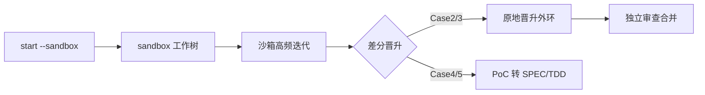

# 隔离沙箱双环工作树与真实差分晋升流水线 — 功能设计规范（SPEC）

## 文档信息与变更概览

| 项目 | 内容 |
| --- | --- |
| 当前状态 | `approved`（`draft \| approved \| implementing \| in_review \| implemented \| superseded`） |
| 规划级别 | `L3`（新增隔离沙箱工作树生命周期、多代理登记与真实差分晋升流水线；Wave 2，依赖 `single-source-policy-core`） |
| 创建 / 更新 | `2026-11-27` / `2026-11-27` |
| 分支 / Issue / PR | `feat/sandbox-dual-loop-v1` / 未关联 / 未关联 |
| 负责人 / 内审状态 | plan-sandbox-v1 / `passed` |
| 规划态 | `interactive`（架构决策已全部拍板，零待决问题） |
| 关联 PRD / Todo | `../prd/261127-issue214-sandbox-dual-loop-v1-prd.md` / `../todo/261127-sandbox-dual-loop-flow-todo.md` |

- **变更一句话**：通过新增 `sandbox-scope.mjs` (new) 与 `flow-sandbox.mjs` (new) 在 `dev-flow` 落地 `.worktrees/sandbox-<id>/` 隔离沙箱工作树、账本 `implementers[]`（支持单常驻或互不重叠 `writeScope` 并行子代理并锁死改审分离）以及基于真实 `git diff <baseRef>...HEAD` 的确定性 `flow.mjs promote` 晋升分类器。

## 系统变更全景

| 模块 / 文件 | 变更性质 | 核心职责 |
| --- | --- | --- |
| `kit/skills/lib/sandbox-scope.mjs` (new) | 新增 | 承接 `SANDBOX_STATUSES`、`registerImplementer`、`checkWriteScopeOverlap`、`normalizeWriteScope`、`isInnerVerifyMode`，防止 `ledger.mjs` 与 `flow-lifecycle.mjs` 超 800 行 |
| `kit/skills/dev-flow/scripts/flow-sandbox.mjs` (new) | 新增 | 沙箱启动 `handleSandboxStart`、`guardSandboxPreSubmitOrFinalize`、`resolveSandboxVerifyMode`、`handlePromote` 真实 `git diff <baseRef>...HEAD` 确定性分类器（含 `Case 2/3` 晋升衔接与 `Case 5` TDD 冲突拦截） |
| `kit/skills/lib/ledger.mjs` | 改造 | 仅增可选沙箱字段、`PRE_SUBMIT_STATUSES`/`OPEN_TASK_STATUSES` 补录沙箱三态、`collectImplementerHistory` 聚合 `implementers[]`、`resolveTaskContext` 识别 `sandbox-`（`<= 785L`） |
| `kit/skills/lib/harness-context.mjs` | 改造 | `enforceSlotBoundary` 放行 `.worktrees/sandbox-<id>/` 隔离位，同时保持 `mainRoot` 脏仓/原地硬拦截 `BLOCKED_MAIN_SLOT_VIOLATION` |
| `kit/skills/lib/mutability.mjs` | 改造 | 将 `sandbox-iterating`、`sandbox-ready-to-promote`、`sandbox-needs-spec` 纳入 `OPEN` 可编辑态 |
| `kit/skills/lib/subcommand-meta.mjs` | 改造 | 在 `SUBCOMMAND_META.flow.subcommands` 注册 `entry('promote', true)` |
| `kit/skills/lib/workflow-policy-next.mjs` | 改造 | `evaluateNextState` 与 `inferCandidatePhaseAndMutability` 增加沙箱三态路由与单一可执行命令 |
| `kit/skills/dev-flow/scripts/flow.mjs` | 改造 | 同步文件头第 6 行 `子命令：`、`printHelp()`、`CONTENT_BODY_SUBCOMMANDS`（补入 `promote` 允许 `--body`/`--body-file`）与 CLI 参数注册（`booleanFlags` 含 `--sandbox`/`--inner`/`--conflicts-tdd`，`valueFlags` 含 `--write-scope` 及 `promote` 的 `--issue`/`--issues`/`--body`/`--body-file`/`--todo`/`--no-issue`/`--reason`），通过 `subcommand-parity.mjs` 与 `cli-parity.mjs` |
| `kit/skills/dev-flow/scripts/flow-inspect.mjs` | 改造 | `handleStart` 命中 `opts.sandbox` 时 3 行薄委托至 `handleSandboxStart`（透传已解析 `linkedIssues`，保持 `<= 799L`） |
| `kit/skills/dev-flow/scripts/flow-start-helpers.mjs` | 改造 | `evaluateIssueBindingExemption` 新增无显式 Issue 时的 `sandbox` 豁免分支；`resolveOrBindStartIssue` 参数化 `commandName = 'start' \| 'promote'` 使 `promote` 报错指引准确指向 `flow.mjs promote` |
| `kit/skills/dev-flow/scripts/flow-lifecycle.mjs` | 改造 | 薄调用 `flow-sandbox.mjs` (new) 的 `resolveSandboxVerifyMode`（覆盖 `isExplicitNone` 与主分支两处）与 `guardSandboxPreSubmitOrFinalize`（保持 `<= 795L`） |
| `kit/skills/dev-flow/scripts/flow-lifecycle-hooks.mjs` | 改造 | `checkLifecyclePreconditions` 仅当 `isInnerVerifyMode(ledger, opts)` 为真时豁免内环沙箱快检的 `claimedAt`/`explored` 阻断，外环保持 100% 严格 |
| `kit/skills/dev-flow/scripts/flow-lifecycle-finalize.mjs` | 改造 | 调用 `guardSandboxPreSubmitOrFinalize` 拦截未晋升沙箱执行 `finalize`（`BLOCKED_SANDBOX_PROMOTE_REQUIRED`），杜绝提前 `git mv` 归档 |
| `kit/skills/dev-flow/scripts/flow-merge.mjs` | 改造 | 复核 `implementerSet` 通过 `collectImplementerHistory` 覆盖全部 `ledger.implementers[]`（零超行，保持 `<= 795L`） |
| `docs/feature-map.json`、`docs/architecture-map.html` | 改造 | 当波登记 `kit/skills/lib/sandbox-scope.mjs` (new) 与 `kit/skills/dev-flow/scripts/flow-sandbox.mjs` (new) 并执行 `verify-tools.mjs render` |

## 一、背景与边界声明

- **要改什么**：落地隔离沙箱双环工作树（`.worktrees/sandbox-<id>/`）、多代理参与改码登记与写域防碰撞、沙箱内环免误拦快检、真实 `git diff` 驱动的确定性 `flow.mjs promote`（含晋升后外环闭环衔接与 `Case 5` 阻断）、`flow next` 沙箱状态机路由，以及当波 CLI 对拍与 `feature-map` 同步。
- **不改什么**：不修改 Wave 1 的 `workflow-policy.mjs` 三轴核心判定与 `gate-receipt.mjs`（直接消费其导出）；不修改 Wave 3 的 `doc-plan.mjs triage` 规则、`templates/`、`AGENTS.md` 或 `SKILL.md` 文案；不改动 `kit/skills/dev-review/scripts/review-ledger.mjs`（798L，其第 200 行已调用 `collectImplementerHistory(baseLedger)`，升级 `ledger.mjs` 即可自动零增量生效）。
- **本期不做**：不新增独立于外环的第二套合并命令；沙箱绝不具备绕过外环 `verify`/`review`/`merge` 直接合入 `main` 的能力。
- **复用既有模块**：复用 Slice 1 的 `determineWorkflowPolicy` 与 `validateVerificationEvidence`、既有 `worktree-deps.mjs` 的 `mountSharedDeps`/`unmountSharedDeps`、`flow-start-helpers.mjs` 的 `checkStartMainCleanAndSlot`/`resolveOrBindStartIssue`/`inheritExploredCredentials`、`ledger.mjs` 的 `collectImplementerHistory`/`createExploredEvidence`/`resolveTaskContext`/`updateTaskLedger`、`tdd-parity.mjs` 的 `checkTddSyncParity`、`git.mjs` 的 `ensureWorktreesIgnored`/`gitRun`/`gitDiffNameStatusZ`。
- **架构基线与紧文件行预算控法（严守 `<= 800` 行/文件）**：
  - 所有新增复杂逻辑均放进 `kit/skills/lib/sandbox-scope.mjs` (new) 与 `kit/skills/dev-flow/scripts/flow-sandbox.mjs` (new)。
  - `ledger.mjs`（756L -> `<= 785L`）：只加字段默认值、状态集合 3 项与 `collectImplementerHistory` 3 行聚合，不放 `registerImplementer`/`writeScope` 逻辑。
  - `flow-inspect.mjs`（795L -> `<= 799L`）：仅 3 行薄委托 `if (opts.sandbox) return handleSandboxStart(...)`。
  - `flow-lifecycle.mjs`（784L -> `<= 795L`）：通过 `flow-sandbox.mjs` (new) 统一 helper 封装 `isInnerVerify`（覆盖 `isExplicitNone` 与主分支）与 `guardSandboxPreSubmitOrFinalize`，总增量 `<= 10` 行。
  - `flow-merge.mjs`（789L -> `<= 795L`）与 `review-ledger.mjs`（798L，零改动）。

## 二、设计方案与契约变更

### 接口 / 数据结构变更

1. **`kit/skills/lib/sandbox-scope.mjs` (new) — 写域冲突校验与内环判据**：
   - 导出 `SANDBOX_STATUSES = ['sandbox-iterating', 'sandbox-ready-to-promote', 'sandbox-needs-spec']`。
   - 导出 `registerImplementer(ledger, { actor, writeScope = [], phase = 'sandbox' })`：
     - 校验非空合法 `actor`（拒绝 `coordinator`/`reviewer`/`critic` 角色）。
     - 规范化 `writeScope` 路径前缀/通配清单；若新 `actor` 与已有不同 `actor` 的 `writeScope` 存在目录前缀包含或通配重叠（含空 `writeScope` 全仓写域与另一并行子代理共存），返回 `{ ok: false, code: 'BLOCKED_SANDBOX_WRITE_SCOPE_OVERLAP', exitCode: EXIT.FACT, conflicts }`；同一常驻 `actor` 续写幂等放行并合并其 `writeScope`。
   - 导出 `isInnerVerifyMode(ledger, opts = {})`：当 `Boolean(ledger?.sandboxMode === true || opts?.inner === true)` 且当前子命令为 `verify` 时返回 `true`（`finalize`/`submit`/`merge` 永不为 `true`）。
2. **`kit/skills/lib/ledger.mjs` — 轻量状态与历史聚合扩展**：
   - 第 28-29 行 `PRE_SUBMIT_STATUSES` 与 `OPEN_TASK_STATUSES` 补入 `'sandbox-iterating'`、`'sandbox-ready-to-promote'`、`'sandbox-needs-spec'`（保证 `resolveTaskContext` 与 `classifyTaskLiveness` 正确识别活跃沙箱任务）。
   - `createDefaultLedger` 新增可选字段：`sandboxMode: false`、`sandboxWorktreePath: null`、`promotedFromSandbox: false`、`promotedAt: null`、`pocStatus: null`、`implementers: []`。
   - `collectImplementerHistory(ledger)` 自动合并 `ledger.implementers[].actor`；`resolveTaskContext` 的工作树目录名正则扩展为 `/^(?:impl|review|sandbox)-(.+)$/`。
3. **`kit/skills/dev-flow/scripts/flow-lifecycle-hooks.mjs` — 沙箱内环快检前置豁免**：
   - `checkLifecyclePreconditions(ledger, opts)` 当且仅当 `opts._stage === 'verify' && isInnerVerifyMode(ledger, opts)` 时，跳过 `BLOCKED_UNCLAIMED_TASK`（第 163 行）与 `BLOCKED_UNEXPLORED_TASK`（第 172 行），使沙箱内环秒级快检不被外环认领/探索锁卡死；外环 `verify`/`finalize`/`submit`（`sandboxMode === false`）保持 100% 既有硬拦不变。
4. **`kit/skills/dev-flow/scripts/flow-sandbox.mjs` (new) — 沙箱启动、Issue 优先级与真实差分晋升闭环**：
   - `handleSandboxStart({ opts, roots, state, taskId, slug, baseBranch, baseSha, role, providerId, linkedIssues = [] })`：
     - 复用 `checkStartMainCleanAndSlot` 保护主仓干净（`BLOCKED_DIRTY_MAIN` / `BLOCKED_MAIN_SLOT_VIOLATION` 绝不放松）。
     - 创建分支 `sandbox/<slug>`（或 `--branch`）与工作树 `.worktrees/sandbox-<taskId>/`，调用 `mountSharedDeps` 并经 `recordMountedDepsInLedger` 记入 `mountedDepsByWorktree`。
     - 若任务已处于 `sandboxMode: true` 且再次调用 `start --sandbox --task <id> --agent <impl2> --write-scope <glob,...>`，调用 `registerImplementer` 完成多代理并行登记（写域重叠即拦截 `BLOCKED_SANDBOX_WRITE_SCOPE_OVERLAP`），并合并新传入的 `--issue`/`--issues` 而不覆写已有绑定。
     - **沙箱启动期 Issue 优先级**：若显式传入 `--issue <N>` 或 `--issues`（`linkedIssues.length > 0`），保留并写入 `ledger.linkedIssues` 且记 `issueBinding: { mode: 'reused', source: 'args', issues: linkedIssues, at: now }`，确保晋升时绝不被遗忘或覆盖；**仅当未传入任何 Issue 时**才写入 `issueBinding: { mode: 'exempt', exemptKind: 'sandbox', reason: '沙箱探索阶段暂不强制建单', at: now }`，不提前创建远端 Issue。
   - `handlePromote(opts, roots)`（对应 `flow.mjs promote --task <id> [--issue <N>] [--issues <a,b>] [--body <text>] [--body-file <path>] [--todo <path>] [--no-issue --reason <text>] [--conflicts-tdd]`）：
     - 前置校验：任务须存在且 `ledger.sandboxMode === true`（否则报 `BLOCKED_NOT_SANDBOX_TASK`）；工作树须干净（`dirty === 0`，否则报 `BLOCKED_DIRTY_WORKTREE`）且相对 `effectiveBaseSha` 存在真实改动（空 diff 报 `BLOCKED_SANDBOX_EMPTY_DIFF`）。
     - **Step A — 真实差分与 `Case 5` 冲突闸门**：计算 `git diff --name-status -z <baseSha>...HEAD`、`detectGateWeakening` 与 `checkTddSyncParity(workRoot, changedFiles, ledger, ...)`（复用其真实返回字段 `{ docParityReminder, tddDateStale, authoritativeTddPath, missingModulesInTdd, staleModulesInTdd, changedExportsOrCli, tddSyncWarning }`）。仅当 `(parity?.staleModulesInTdd?.length ?? 0) > 0`（删除/破坏已在 `docs/TDD.md` 登记的既有架构模块，**明确不对正常新增文件的 `missingModulesInTdd` 误触发**）或 `Boolean(opts['conflicts-tdd'])` 时，阻断并返回 `BLOCKED_CASE_5_TDD_CONFLICT`（`status: 'sandbox-needs-spec'`, `pocStatus: 'needs-tdd'`, `exitCode: EXIT.FACT`），**不提前新建 Issue**（保留已有 `linkedIssues`），强制先修订并批准 `docs/TDD.md`。
     - **Step B — 单源三轴策略分类**：调用 Slice 1 `determineWorkflowPolicy` 计算 `policy` 并统计跨越的独立核心源码域数：
       - **命中 `Case 4`（`sandbox-needs-spec`）**：`policy.riskTier === 'high'`（含 `highRiskHits`、`oneWayBoundaryHits`、`gateWeakeningHits`、`nonExemptDoNotEdit`）或跨越 `>= 3` 个独立核心源码域且触及导出契约。更新账本为 `status: 'sandbox-needs-spec'`, `pocStatus: 'needs-spec'`, `promotedPolicy: policy`；**严禁在此阶段提前创建远端 Issue**（若沙箱启动时或 `promote` 显式已绑定 `--issue` 则原样保留，否则延后至 `SPEC`/`1:N PRD` 经 `audit` + Critique + `approve` 后由外环开工统一建单），输出 `SANDBOX_PROMOTE_NEEDS_SPEC` 与单一 `[NEXT STEP]`（引导 `doc-plan.mjs init --kind pair` 或 `--kind prd --multi-spec` -> 独立 Critic -> `approve`）。
       - **落入 `Case 2 / Case 3`**（可逆局部改动，含纯 UI 样式/组件调整）：原地晋升为外环实施态（`sandboxMode: false`, `promotedFromSandbox: true`, `pocStatus: 'in-place-promoted'`, `caseType: resolvedCase`, `status: 'started'`, `verifiedHead: null` 强制清零内环快检绑定），并完成三项外环闭环衔接：
         1. **单一 Issue 绑定与真实 Diff 自动合成正文**：先合并 `ledger.linkedIssues` 与 `promote` 传入的 `--issue`/`--issues` 及可选 `--todo`；`resolveOrBindStartIssue` 新增 `commandName = 'start' | 'promote'` 参数（`flow-start-helpers.mjs` 保持模块化 `<= 720L`），使错误提示与恢复命令准确指向 `flow.mjs promote`。若存在已有 Issue 则直接复用不重复建单；若命中豁免（`no-auto-issue` / `contributor-fork` / `clone-readonly` / `--no-issue --reason`）则合规豁免；**若无既有 Issue、非豁免且未传 `--body`/`--body-file`/`--todo`**，由 `flow-sandbox.mjs` (new) 基于沙箱真实 `git diff <baseRef>...HEAD`（提交主题 `git log --format=%s <baseSha>..HEAD`、真实改动文件列表与 `determineWorkflowPolicy` 风险/视觉/测试摘要）自动合成满足 `flow-issues.mjs` 中 `buildAndValidateIssueBody` 全部质量段落要求的 Markdown 正文，经 `resolveOrBindStartIssue({ ..., commandName: 'promote', opts: { ...opts, body: synthesizedBody } })` 自动建单并回写 `ledger.linkedIssues`（彻底消除无预设文档/正文时的 `BLOCKED_MISSING_ISSUE_BINDING` 死锁）；后续 `Case 3` 执行 `doc-plan.mjs init --kind todo --issue <boundIssue>` 直接复用该单一 Issue，绝不重复建第二张单。
         2. **`claimedAt` 与 `explored` 连续性**：若账本缺 `claimedAt`，自动以当前活跃沙箱实施者（非协调者）回填 `claimedAt` 与 `claimedBy`；对 `Case 3` 优先调用 `inheritExploredCredentials`，若仍缺则基于本次真实 `git diff` 路径写入 `createExploredEvidence({ source: 'sandbox-promote', tier: 'sandbox-diff', symbolCount: changedFiles.length, by: primaryImplementer })`，避免晋升后在 `finalize`/`verify` 卡死于 `BLOCKED_UNCLAIMED_TASK` 或 `BLOCKED_UNEXPLORED_TASK`。
         3. **`Case 3` `docs/todo/` 作者与实施者分离**：若 `resolvedCase === 3` 且尚未绑定 `docs/todo/`，`promote` 输出确定性 `[NEXT STEP]` 指示由非实施者角色（如规划/协调代理，而非 `ledger.implementers[]` 中任一成员；单会话宿主则经 `--host-mode single-session --human-approved`）运行 `doc-plan.mjs init --kind todo --task <id> --issue <boundIssue> --in-place --agent <nonImplOwner>` 冻结最终 `C1..Cn`，确保外环 `submit` 100% 通过 `checkAuthorIsNotImplementer`（`BLOCKED_AUTHOR_IS_IMPLEMENTER`）而不削弱作者分离铁锁。
5. **`kit/skills/lib/workflow-policy-next.mjs` & `kit/skills/dev-flow/scripts/flow.mjs`**：
   - `evaluateNextState` 在 `t.sandboxMode === true` 时精确路由 `sandbox-needs-spec`、`sandbox-ready-to-promote`、`sandbox-iterating` 三态。
   - `flow.mjs` 同步更新文件头第 6 行 `子命令：`、`printHelp()`（含 `promote` 及其 `--issue`/`--issues`/`--body`/`--body-file`/`--todo`/`--no-issue`/`--reason`/`--conflicts-tdd` 与 `start --sandbox`/`--write-scope`、`verify --inner`）、`CONTENT_BODY_SUBCOMMANDS`（补入 `'promote'` 使 `--body`/`--body-file` 合法通过）、`booleanFlags`（补入 `'sandbox'`、`'inner'`、`'conflicts-tdd'`）/`valueFlags`（补入 `'write-scope'`）注册与 `promote` 分发，100% 通过 `scripts/dev/subcommand-parity.mjs` 与 `scripts/dev/cli-parity.mjs`。

### 数据与状态变更

- 任务账本 `.worktrees/.state/tasks/<taskId>.json` 扩展 `sandboxMode`、`sandboxWorktreePath`、`promotedFromSandbox`、`promotedAt`、`pocStatus`、`implementers[]`，完全向后兼容既有账本。
- 工作树目录新增 `.worktrees/sandbox-<taskId>/` 命名约定，位于 `.gitignore` 忽略目录内，`cleanup`/`abort` 自动经 `unmountSharedDeps` 安全解绑。
- 当波更新 `docs/feature-map.json` 登记 `kit/skills/lib/sandbox-scope.mjs` (new) 与 `kit/skills/dev-flow/scripts/flow-sandbox.mjs` (new)，运行 `verify-tools.mjs render` 更新 `docs/architecture-map.html`。

### 异常、回退与安全边界

- **主仓绝对干净**：`flow.mjs start --sandbox` 严守 `enforceSlotBoundary`，`mainRoot` 有脏文件报 `BLOCKED_DIRTY_MAIN`，绝不允许在主仓原地启动沙箱。
- **改审分离与作者分离双重不可绕过**：全部沙箱参与改码者记入 `ledger.implementers[]`；晋升入外环后，`review-pack record` 拦截任何 `reviewerId ∈ implementers[]`（`SELF_REVIEW_REJECTED`），`flow.mjs merge` 拦截任何实施者自合（`BLOCKED_SELF_MERGE`），`Case 3` Todo 严格保持非实施者署名通过 `BLOCKED_AUTHOR_IS_IMPLEMENTER`。
- **防未晋升偷渡**：沙箱态下 `finalize`、`submit` 与外环 `validateVerificationEvidence` 三道门同时拦截。

### 实现顺序

1. 先写 Red-Green 失败测试 `scripts/dev/fixtures-sandbox-dual-loop.mjs` (new) 并注册到 `scripts/dev/fixtures.mjs`（覆盖 `C5` - `C8` 正反双向用例，含沙箱内环 `verify` 免误拦、多代理写域冲突、`promote` `Case 2/3` 外环 `finalize->verify->submit->review->merge` 完整闭环、以及 `Case 4` / `Case 5` 分流）。
2. 新建 `kit/skills/lib/sandbox-scope.mjs` (new)，更新 `ledger.mjs`（`<= 785L`）、`harness-context.mjs`、`mutability.mjs`、`subcommand-meta.mjs`、`workflow-policy-next.mjs`。
3. 新建 `kit/skills/dev-flow/scripts/flow-sandbox.mjs` (new)，薄接入 `flow.mjs`（含第 6 行注释与 `printHelp()` 对拍）、`flow-inspect.mjs`（`<= 799L`）、`flow-start-helpers.mjs`、`flow-lifecycle.mjs`（`<= 795L`）、`flow-lifecycle-hooks.mjs`、`flow-lifecycle-finalize.mjs`、`flow-merge.mjs`（`<= 795L`）。
4. 新增故障注入表 `scripts/dev/injections-data-sandbox-flow.mjs` (new) 并注册入 `scripts/dev/injections-data.mjs`；当波登记 `sandbox-scope.mjs` (new) 与 `flow-sandbox.mjs` (new) 至 `docs/feature-map.json`，重渲 `docs/architecture-map.html`，执行 `node scripts/equip.mjs .` 同步 `.agents/skills/` 后跑通全量门禁与故障注入。

## 三、备选方案与否决理由

| 方案 | 怎么做的 | 为什么没选 | 什么情况下该改回它 |
| --- | --- | --- | --- |
| 拆出 `sandbox-scope.mjs` (new) + `flow-sandbox.mjs` (new) 保持紧文件 `<= 800L`（已选） | 写域与状态纯函数归 `kit/skills/lib/sandbox-scope.mjs` (new)，工作树启动与晋升编排归 `kit/skills/dev-flow/scripts/flow-sandbox.mjs` (new) | 彻底避免 `ledger.mjs`(756L)、`flow-inspect.mjs`(795L)、`flow-lifecycle.mjs`(784L) 触发 800 行红线，且可独立单测 | 永不改回 |
| 所有沙箱晋升一律销毁重建新 `impl` 工作树（备选） | 每次 `promote` 都导出 patch 再建新 `.worktrees/impl-<id>/` | 对局部 Bugfix / UI 微调增加不必要的共享依赖重挂与上下文割裂，且易产生 patch 冲突 | 仅在 `Case 4` 拆 1:N 多切片并行落地时，由各切片各自建立干净 `impl-<slice>` 工作树 |
| 在 `review-ledger.mjs` 单独加字段判断 `implementers[]`（备选） | 在 `review-ledger.mjs` 与 `flow-merge.mjs` 各自手写遍历 `ledger.implementers` | `review-ledger.mjs` 已 798 行且易导致多处校验分叉；收敛进 `ledger.mjs` 的 `collectImplementerHistory` 单源最稳 | 永不改回，坚持单源聚合 |

## 四、改动清单与影响面

| 文件 / 目录 | 改动性质 | 改什么 | 谁会被影响 |
| --- | --- | --- | --- |
| `kit/skills/lib/sandbox-scope.mjs` (new) | 新增 | `SANDBOX_STATUSES`、`registerImplementer`、`checkWriteScopeOverlap`、`isInnerVerifyMode` | `ledger.mjs`、`flow-sandbox.mjs` (new)、`flow-lifecycle*.mjs` |
| `kit/skills/dev-flow/scripts/flow-sandbox.mjs` (new) | 新增 | 沙箱启动、并行写域登记、`guardSandboxPreSubmitOrFinalize`、`resolveSandboxVerifyMode`、真实 `git diff` 确定性 `handlePromote` | `flow.mjs start --sandbox`、`flow.mjs promote`、`flow verify/finalize/submit` |
| `kit/skills/lib/ledger.mjs` | 修改 | `PRE_SUBMIT_STATUSES`/`OPEN_TASK_STATUSES` 补录沙箱三态、新增可选字段、`collectImplementerHistory` 聚合 `implementers[]`、`resolveTaskContext` 识别 `sandbox-`（`<= 785L`） | 所有读取任务账本与校验改审分离的技能 |
| `kit/skills/lib/harness-context.mjs` | 修改 | `enforceSlotBoundary` 放行 `.worktrees/sandbox-<id>/` 隔离位并保留主仓拦截 | `flow start` / `verify` / `submit` / `merge` |
| `kit/skills/lib/mutability.mjs` | 修改 | 沙箱三态归入 `OPEN` | `flow next` 与并发任务调度 |
| `kit/skills/lib/subcommand-meta.mjs` | 修改 | `flow` 子命令单源清单新增 `promote` | `flow.mjs`、`triage-rules.mjs`、`doc-verify.mjs`、子命令对拍门禁 |
| `kit/skills/lib/workflow-policy-next.mjs` | 修改 | `evaluateNextState` 增加 `sandbox-iterating`/`sandbox-ready-to-promote`/`sandbox-needs-spec` | `flow.mjs next` |
| `kit/skills/dev-flow/scripts/flow.mjs` | 修改 | 第 6 行 `子命令：` 注释、`printHelp()`、`CONTENT_BODY_SUBCOMMANDS`（加 `promote`）、`booleanFlags` 注册 `--sandbox`/`--inner`/`--conflicts-tdd`、`valueFlags` 注册 `--write-scope` 及 `promote` 参数并分发 `promote` | `flow.mjs` CLI 入口与 `subcommand-parity`/`cli-parity` 门禁 |
| `kit/skills/dev-flow/scripts/flow-inspect.mjs` | 修改 | `handleStart` 3 行薄委托 `opts.sandbox` 至 `handleSandboxStart`（透传 `linkedIssues`，保持 `<= 799L`） | `flow.mjs start` |
| `kit/skills/dev-flow/scripts/flow-start-helpers.mjs` | 修改 | `evaluateIssueBindingExemption` 增加无显式 Issue 时的 `sandbox` 豁免；`resolveOrBindStartIssue` 支持 `commandName: 'start' \| 'promote'` 准确提示 | `flow.mjs start --sandbox` 与 `flow.mjs promote` |
| `kit/skills/dev-flow/scripts/flow-lifecycle.mjs` | 修改 | 薄接入 `resolveSandboxVerifyMode`（`explicitNone` + 主分支）与 `guardSandboxPreSubmitOrFinalize`（保持 `<= 795L`） | `flow.mjs verify` / `submit` |
| `kit/skills/dev-flow/scripts/flow-lifecycle-hooks.mjs` | 修改 | `checkLifecyclePreconditions` 仅对沙箱内环 `verify` 豁免 `claimedAt`/`explored` 阻断，外环不变 | 沙箱内环 `flow verify` |
| `kit/skills/dev-flow/scripts/flow-lifecycle-finalize.mjs` | 修改 | `finalize` 拦截未晋升沙箱 `BLOCKED_SANDBOX_PROMOTE_REQUIRED` | `flow.mjs finalize` |
| `kit/skills/dev-flow/scripts/flow-merge.mjs` | 修改 | 复核 `implementerSet` 覆盖 `ledger.implementers[]`（保持 `<= 795L`） | `flow.mjs merge` |
| `docs/feature-map.json`、`docs/architecture-map.html` | 修改 | 当波登记 `sandbox-scope.mjs` (new) 与 `flow-sandbox.mjs` (new) 并重渲架构图 | `checkFeatureMapSyncOnFinalize` / `verifyArchitectureMapSync` |
| `scripts/dev/fixtures-sandbox-dual-loop.mjs` (new)、`scripts/dev/injections-data-sandbox-flow.mjs` (new) | 新增 | `C5` - `C8` 全链路正反双向回归测试与故障注入样本 | `fixtures.mjs`、`verify-injections.mjs` |
| `scripts/dev/fixtures.mjs`、`scripts/dev/injections-data.mjs` | 修改 | 注册上述新增测试与注入表 | 全量门禁 |

- **对外可见的变化**：新增子命令 `flow.mjs promote --task <id> [--conflicts-tdd]`、选项 `flow.mjs start --sandbox [--write-scope <glob,...>]` 与 `flow.mjs verify --inner`；新增错误码 `BLOCKED_SANDBOX_PROMOTE_REQUIRED`、`BLOCKED_SANDBOX_WRITE_SCOPE_OVERLAP`、`BLOCKED_NOT_SANDBOX_TASK`、`BLOCKED_SANDBOX_EMPTY_DIFF`、`BLOCKED_CASE_5_TDD_CONFLICT` 与状态码 `SANDBOX_PROMOTE_NEEDS_SPEC`。
- **需要同步改的地方**：当波运行 `node scripts/equip.mjs .` 同步 `.agents/skills/`，并运行 `node .agents/skills/dev-verify-tools/scripts/verify-tools.mjs render` 更新 `docs/architecture-map.html`。

## 五、冻结的验收标准

- [ ] C5: `flow.mjs start --sandbox --task <id> --agent impl-a` 在干净主仓创建 `.worktrees/sandbox-<id>/` 并挂载共享依赖；**双向 Issue 优先级**：显式传 `--issue <N>` 时原样保留于 `ledger.linkedIssues` 且记 `issueBinding.mode === 'reused'` 并贯穿到 `promote`，未传 Issue 时才记 `issueBinding: { mode: 'exempt', exemptKind: 'sandbox' }` 豁免预建；脏主仓启动被 `BLOCKED_DIRTY_MAIN` 拦下；未晋升前调用 `finalize` 或 `submit` 均返回 `BLOCKED_SANDBOX_PROMOTE_REQUIRED`（退出码 `3`）且零 `git mv` 副作用；`flow.mjs` 子命令头、`CONTENT_BODY_SUBCOMMANDS` 与 `printHelp()` 通过 `subcommand-parity` 与 `cli-parity` 门禁（由 `fixtures-sandbox-dual-loop.mjs` 与 `preflight.mjs` 双向实证）。
- [ ] C6: 同一沙箱支持单常驻代理续写，也支持多个子代理以互不重叠 `--write-scope` 并行登记至 `ledger.implementers[]`（由 `sandbox-scope.mjs` (new) 校验）；重叠 `writeScope` 被 `BLOCKED_SANDBOX_WRITE_SCOPE_OVERLAP` 拦下；晋升入外环后，任一曾登记在 `implementers[]` 中的代理尝试 `review-pack record` 报 `SELF_REVIEW_REJECTED`，尝试 `flow.mjs merge` 报 `BLOCKED_SELF_MERGE`（由 `fixtures-sandbox-dual-loop.mjs` 双向实证）。
- [ ] C7: `flow.mjs promote --task <id>`（支持 `--issue`/`--issues`/`--body`/`--body-file`/`--todo`/`--no-issue`/`--reason`/`--conflicts-tdd` 且 `resolveOrBindStartIssue` 按 `commandName: 'promote'` 输出指引）基于真实 `git diff <baseRef>...HEAD` 经 `determineWorkflowPolicy` 与 `checkTddSyncParity` 确定性分类：当 `(parity?.staleModulesInTdd?.length ?? 0) > 0` 或 `--conflicts-tdd` 命中时阻断 `BLOCKED_CASE_5_TDD_CONFLICT` 且不提前建单（纯新增 `missingModulesInTdd` 不误触发 Case 5）；局部源码/纯 UI 样式改动原地晋升为 `Case 2/3`（`sandboxMode: false`, `promotedFromSandbox: true`, 清除 `verifiedHead`, 自动衔接 `claimedAt`/`explored`）：**正反三态实证**（a）启动时带 `--issue <N>` 经 `promote` 原样复用不重复建单，（b）启动时无 Issue 且 `promote` 未传 `--body`/`--todo` 时自动从真实 `git diff` 合成通过 `buildAndValidateIssueBody` 的合规正文建单并绑定 1 个 Issue（零 `BLOCKED_MISSING_ISSUE_BINDING` 死锁，后续 `Case 3` 非实施者署名 `docs/todo/` 直接复用该单并通过 `BLOCKED_AUTHOR_IS_IMPLEMENTER`），（c）触及 `high-risk`/迁移/鉴权/CI/公共契约返回 `SANDBOX_PROMOTE_NEEDS_SPEC`、状态置为 `sandbox-needs-spec` 且**严禁提前新建 Issue**（由 `fixtures-sandbox-dual-loop.mjs` 双向实证）。
- [ ] C8: `flow.mjs next` 对沙箱任务准确输出 `sandbox-iterating`、`sandbox-ready-to-promote`、`sandbox-needs-spec` 三态与单一可执行命令；沙箱内 `flow verify` 经 `flow-lifecycle-hooks.mjs` 内环豁免不卡死并自动打标 `inner: true`（被外环 `submit` 硬拒），晋升并重跑外环 `verify` 后完整走通 `finalize -> verify -> submit -> review -> merge -> cleanup --confirm --preview-hash`（由 `fixtures-sandbox-dual-loop.mjs` 实证）。

## 六、高风险点、门型与回滚路径

- **门型与回滚路径**：`one-way`（涉及 `ledger.mjs` 账本结构、`harness-context.mjs` 槽位门禁、`subcommand-meta.mjs` CLI 契约、`flow-lifecycle-hooks.mjs` 前置校验与 `flow-merge.mjs` 合并护栏）；回滚做法：`git revert` 还原切片提交并重跑 `node scripts/equip.mjs .`。
- **高风险路径**：触及 `kit/` 核心路径，须经独立审查者执行两阶段故障注入闭环。
- **故障注入预演**：复用 `scripts/dev/verify-injections.mjs` 与 `scripts/dev/injections-data-sandbox-flow.mjs` (new)，注入绕过 `BLOCKED_SANDBOX_PROMOTE_REQUIRED`、放行重叠 `writeScope`、跳过 `collectImplementerHistory` 中的 `implementers[]`、错误放宽外环 `checkLifecyclePreconditions` 的 `claimedAt` 拦截、以及 `promote` 对 `one-way` 变更误放行 `Case 3` 等 5 类故障，验证全部被阻断且还原复绿。

## 澄清与补充记录

- 已确认：本切片排在 Wave 2，显式声明 `depends_on: [single-source-policy-core]`，抽离 `sandbox-scope.mjs` (new) 与 `flow-sandbox.mjs` (new) 严控全部紧文件 `<= 800` 行，并当波登记 `docs/feature-map.json` 与重渲 `docs/architecture-map.html` 保证独立全绿。

## 实现说明

- **实际落地摘要**：
- **与草案的差异**：
- **关联同步文件**：
