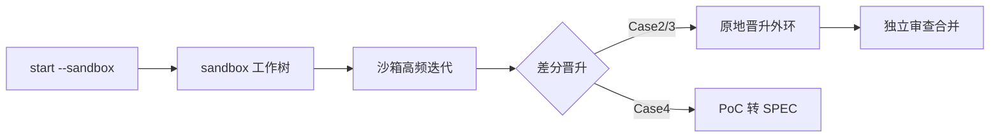

# 隔离沙箱双环工作树与真实差分晋升流水线 — 功能设计规范（SPEC）

## 文档信息与变更概览

| 项目 | 内容 |
| --- | --- |
| 当前状态 | `draft`（`draft \| approved \| implementing \| in_review \| implemented \| superseded`） |
| 规划级别 | `L3`（新增隔离沙箱工作树生命周期、多代理登记与真实差分晋升流水线；Wave 2，依赖 `single-source-policy-core`） |
| 创建 / 更新 | `2026-11-27` / `2026-11-27` |
| 分支 / Issue / PR | `feat/sandbox-dual-loop-v1` / 未关联 / 未关联 |
| 负责人 / 内审状态 | plan-sandbox-v1 / `pending` |
| 规划态 | `interactive`（架构决策已全部拍板，零待决问题） |
| 关联 PRD / Todo | `docs/prd/261127-sandbox-dual-loop-v1-prd.md` / `docs/todo/261127-sandbox-dual-loop-flow-todo.md` |

- **变更一句话**：在 `dev-flow` 引入 `.worktrees/sandbox-<id>/` 隔离沙箱工作树、账本 `implementers[]`（支持单常驻或互不重叠 `writeScope` 并行子代理并锁死改审分离）以及基于真实 `git diff <baseRef>...HEAD` 的确定性 `flow.mjs promote` 晋升分类器。

## 系统变更全景

| 模块 / 文件 | 变更性质 | 核心职责 |
| --- | --- | --- |
| `kit/skills/dev-flow/scripts/flow-sandbox.mjs` (new) | 新增 | 沙箱启动 `handleSandboxStart`、多代理 `writeScope` 冲突校验与登记、`handlePromote` 真实 `git diff <baseRef>...HEAD` 确定性分类器 |
| `kit/skills/lib/ledger.mjs` | 改造 | 账本新增 `sandboxMode`、`implementers[]`（含 `writeScope`）、`promotedFromSandbox`、`pocStatus`；`collectImplementerHistory` 聚合 `implementers[]` |
| `kit/skills/lib/harness-context.mjs` | 改造 | `enforceSlotBoundary` 放行 `.worktrees/sandbox-<id>/` 隔离位，同时保持 `mainRoot` 脏仓/原地硬拦截 `BLOCKED_MAIN_SLOT_VIOLATION` |
| `kit/skills/lib/mutability.mjs` | 改造 | 将 `sandbox-iterating`、`sandbox-ready-to-promote`、`sandbox-needs-spec` 纳入 `OPEN` 可编辑态 |
| `kit/skills/lib/subcommand-meta.mjs` | 改造 | 在 `SUBCOMMAND_META.flow.subcommands` 注册 `entry('promote', true)` |
| `kit/skills/lib/workflow-policy-next.mjs` | 改造 | `evaluateNextState` 与 `inferCandidatePhaseAndMutability` 增加沙箱三态路由与单一可执行命令 |
| `kit/skills/dev-flow/scripts/flow.mjs` | 改造 | 注册 `--sandbox`、`--inner`、`--write-scope` 参数并分发 `promote` 子命令至 `flow-sandbox.mjs` (new) |
| `kit/skills/dev-flow/scripts/flow-inspect.mjs` | 改造 | `handleStart` 命中 `opts.sandbox` 时薄委托至 `handleSandboxStart`（严守 `<= 800` 行） |
| `kit/skills/dev-flow/scripts/flow-start-helpers.mjs` | 改造 | `evaluateIssueBindingExemption` 新增 `sandbox` 豁免分支，沙箱期不提前强制建 Issue |
| `kit/skills/dev-flow/scripts/flow-lifecycle.mjs` | 改造 | 沙箱内 `verify` 自动传 `inner: true`；`submit` 拦截未晋升沙箱（`BLOCKED_SANDBOX_PROMOTE_REQUIRED`） |
| `kit/skills/dev-flow/scripts/flow-lifecycle-finalize.mjs` | 改造 | 拦截未晋升沙箱执行 `finalize`（`BLOCKED_SANDBOX_PROMOTE_REQUIRED`），杜绝提前 `git mv` 归档 |
| `kit/skills/dev-flow/scripts/flow-merge.mjs` | 改造 | 确保自合与独立审查校验复用 `collectImplementerHistory`（覆盖全部 `implementers[]`） |

## 一、背景与边界声明

- **要改什么**：落地隔离沙箱双环工作树（`.worktrees/sandbox-<id>/`）、多代理参与改码登记与写域防碰撞、真实 `git diff` 驱动的确定性 `flow.mjs promote`、以及 `flow next` 沙箱状态机路由。
- **不改什么**：不修改 Wave 1 的 `workflow-policy.mjs` 三轴核心判定与 `gate-receipt.mjs` (new)（直接消费其导出）；不修改 Wave 3 的 `doc-plan.mjs triage` 规则、`templates/`、`AGENTS.md` 或 `SKILL.md` 文案；不改动 `review-ledger.mjs`（它第 200 行已调用 `collectImplementerHistory(baseLedger)`，升级 `ledger.mjs` 即可自动零增量生效，同时保护 798 行的 `review-ledger.mjs` 不超限）。
- **本期不做**：不新增独立于外环的第二套合并命令；沙箱绝不具备绕过外环 `verify`/`review`/`merge` 直接合入 `main` 的能力。
- **复用既有模块**：复用 Slice 1 的 `determineWorkflowPolicy` 与 `validateVerificationEvidence`、既有 `worktree-deps.mjs` 的 `mountSharedDeps`/`unmountSharedDeps`、`flow-start-helpers.mjs` 的 `checkStartMainCleanAndSlot`/`resolveOrBindStartIssue`、`ledger.mjs` 的 `collectImplementerHistory`/`resolveTaskContext`/`updateTaskLedger`、`git.mjs` 的 `ensureWorktreesIgnored`/`gitRun`/`gitDiffNameStatusZ`。
- **架构基线关系**：严格遵循 `docs/TDD.md` 零第三方依赖、`<= 800` 行/文件红线（当前 `flow-inspect.mjs` 795L、`flow-merge.mjs` 789L、`flow-lifecycle.mjs` 784L、`ledger.mjs` 756L；全部沙箱启动与晋升逻辑集中在新建 `flow-sandbox.mjs` (new)，原文件控制在 3-15 行薄委托）。

## 二、设计方案与契约变更

### 接口 / 数据结构变更

1. **`kit/skills/lib/ledger.mjs` — 沙箱与多代理账本字段**：
   - `createDefaultLedger` 新增可选字段（向后兼容旧账本缺省值）：
     - `sandboxMode: Boolean(partial.sandboxMode)`（默认 `false`）
     - `sandboxWorktreePath: partial.sandboxWorktreePath ?? null`（格式 `.worktrees/sandbox-<taskId>`）
     - `promotedFromSandbox: Boolean(partial.promotedFromSandbox)`（默认 `false`）
     - `promotedAt: partial.promotedAt ?? null`
     - `pocStatus: partial.pocStatus ?? null`（枚举 `null | 'needs-spec' | 'in-place-promoted'`）
     - `implementers: Array<{ actor: string, writeScope: string[], registeredAt: string, phase: 'sandbox' | 'impl' }>`（规范化去重保序）
   - 新增导出 `registerImplementer(ledger, { actor, writeScope = [], phase = 'sandbox' })`：
     - 校验非空合法 `actor`（拒绝 `coordinator`/`reviewer`/`critic` 角色）。
     - 若新 `actor` 与已有不同 `actor` 声明的 `writeScope` 存在路径前缀或通配重叠（如某目录前缀与其子文件路径重叠，或空 `writeScope` 全仓写域与另一并行子代理共存），返回 `{ ok: false, code: 'BLOCKED_SANDBOX_WRITE_SCOPE_OVERLAP', exitCode: EXIT.FACT, conflicts }`；同一常驻 `actor` 续写幂等放行。
   - 更新 `collectImplementerHistory(ledger)`：除 `implementerId`、`claimedBy`、`previousImplementers` 外，自动将 `ledger.implementers[].actor` 全部并入返回集合；`resolveTaskContext` 的工作树目录名正则扩展为 `/^(?:impl|review|sandbox)-(.+)$/`。
2. **`kit/skills/dev-flow/scripts/flow-sandbox.mjs` (new) — 沙箱启动与真实差分晋升**：
   - `handleSandboxStart({ opts, roots, state, taskId, slug, baseBranch, baseSha, role, providerId })`：
     - 复用 `checkStartMainCleanAndSlot` 保护主仓干净（`BLOCKED_DIRTY_MAIN` / `BLOCKED_MAIN_SLOT_VIOLATION` 绝不放松）。
     - 创建分支 `sandbox/<slug>`（或 `--branch`）与工作树 `.worktrees/sandbox-<taskId>/`，调用 `mountSharedDeps` 并记入 `mountedDepsByWorktree`（保证 `cleanup` 安全解绑防删穿）。
     - 若任务已处于 `sandboxMode: true` 且再次调用 `start --sandbox --task <id> --agent <impl2> --write-scope <glob,...>`，则走并行子代理登记：执行 `registerImplementer`，校验写域互不重叠并原子更新账本。
     - 写入账本：`sandboxMode: true`, `status: 'sandbox-iterating'`, `issueBinding: { mode: 'exempt', exemptKind: 'sandbox' }`，不提前创建远端 Issue，不提前要求 `SPEC`/`Todo`。
   - `handlePromote(opts, roots)`（对应 `flow.mjs promote --task <id>`）：
     - 前置校验：任务须存在且 `ledger.sandboxMode === true`（否则报 `BLOCKED_NOT_SANDBOX_TASK`）；工作树须干净（`dirty === 0`，否则报 `BLOCKED_DIRTY_WORKTREE`）且相对 `effectiveBaseSha` 存在真实改动（空 diff 报 `BLOCKED_SANDBOX_EMPTY_DIFF`）。
     - 计算真实三点差分：`git diff --name-status -z <baseSha>...HEAD` 与 `detectGateWeakening`，送入 Slice 1 单源 `determineWorkflowPolicy` 计算 `policy`（含 `riskTier`、`highRiskHits`、`oneWayBoundaryHits`、`visualCheckRequired`、`runtimeFilesTouched`），并结合独立跨顶层模块域数（`>= 3` 个非测试顶层模块域）及 `checkTddSyncParity` 判定最终 `resolvedCase`：
       - **命中 `Case 4` 条件**：`policy.riskTier === 'high'`（含 `highRiskHits`、`oneWayBoundaryHits`、`gateWeakeningHits`、`nonExemptDoNotEdit`）或跨多域耦合（改动跨越 `>= 3` 个独立核心源码域且触及导出契约）。此时不强行原地提 PR，将账本更新为 `status: 'sandbox-needs-spec'`, `pocStatus: 'needs-spec'`, `promotedPolicy: policy`，输出 `SANDBOX_PROMOTE_NEEDS_SPEC` 与单一 `[NEXT STEP]`（引导 `doc-plan.mjs init --kind pair` 或 `--kind prd --multi-spec` -> 独立 Critic -> `approve`）。
       - **落入 `Case 2 / Case 3` 条件**（可逆局部改动，含纯 UI 样式/组件调整）：将原沙箱工作树原地晋升为外环实施态（`sandboxMode: false`, `promotedFromSandbox: true`, `pocStatus: 'in-place-promoted'`, `caseType: resolvedCase`, `status: 'started'`, `verifiedHead: null` 强制清零内环快检绑定），一次性调用 `resolveOrBindStartIssue` 完成单一 Issue 绑定（尊重 `no-auto-issue` / `--no-issue --reason` / `--issue` / `--body`），并输出下一步 `doc-plan init --kind todo`（Case 3 若无 Todo）或 `flow.mjs verify`（外环全量实证）。
3. **`kit/skills/lib/workflow-policy-next.mjs` — 沙箱态状态机路由**：
   - 当 `t.sandboxMode === true` 时：
     - `t.status === 'sandbox-needs-spec'` -> `phase: 'sandbox-needs-spec'`, `ownerRole: 'coordinator'`, `command: 'node ".agents/skills/dev-plan/scripts/doc-plan.mjs" init --kind pair --slug <slug> ...'`。
     - `rt.dirty === 0 && (rt.commitsAheadOfBase ?? 0) > 0` -> `phase: 'sandbox-ready-to-promote'`, `ownerRole: 'coordinator'`, `command: 'node ".agents/skills/dev-flow/scripts/flow.mjs" promote --task <id>'`。
     - 其余（脏工作区或尚无提交）-> `phase: 'sandbox-iterating'`, `ownerRole: 'implementer'`, `command: 'node ".agents/skills/dev-flow/scripts/flow.mjs" verify --task <id> --mode quick --inner'`。
4. **`flow-lifecycle.mjs` 与 `flow-lifecycle-finalize.mjs` 守卫**：
   - `handleFinalize` 与 `handleSubmit` 入口检测 `ledger.sandboxMode === true` 时直接返回 `BLOCKED_SANDBOX_PROMOTE_REQUIRED`（退出码 `3`），提示先运行 `flow.mjs promote --task <id>`。
   - `handleVerify` 检测到 `ledger.sandboxMode === true || opts.inner === true` 时，自动向 `recordVerifyEvidenceForFlow` 传入 `inner: true`，允许沙箱期只跑秒级 `quick` 快检（跳过外环 `edit-gate --final` / `govern` 重钩子），且不把 `status` 标为外环可提审 `verified`。

### 数据与状态变更

- 任务账本 `.worktrees/.state/tasks/<taskId>.json` 扩展 `sandboxMode`、`sandboxWorktreePath`、`promotedFromSandbox`、`promotedAt`、`pocStatus`、`implementers[]`，完全向后兼容既有账本。
- 工作树目录新增 `.worktrees/sandbox-<taskId>/` 命名约定，位于已被 `.gitignore` 忽略的 `.worktrees/` 下，`flow.mjs cleanup` 与 `abort` 自动识别 `worktreePath` 并先经 `unmountSharedDeps` 解绑共享依赖。

### 异常、回退与安全边界

- **主仓绝对干净**：`flow.mjs start --sandbox` 严守 `enforceSlotBoundary`，`mainRoot` 有脏文件报 `BLOCKED_DIRTY_MAIN`，绝不允许在主仓原地启动沙箱。
- **改审分离不可绕过**：无论沙箱内是 1 个常驻代理连续迭代，还是 3 个并行子代理按 `writeScope` 协同改码，全部 `actor` 写入 `ledger.implementers[]`；晋升进入外环后，`review-pack record` 拦截任何 `reviewerId ∈ implementers[]`（`SELF_REVIEW_REJECTED`），`flow.mjs merge` 拦截任何实施者自合（`BLOCKED_SELF_MERGE`）。
- **防未晋升偷渡**：沙箱态下 `finalize`、`submit` 与外环 `validateVerificationEvidence` 三道门同时拦截，不经 `promote` 与外环全量 `verify` 绝不可能开 PR 或合入 `main`。

### 实现顺序

1. 先写 Red-Green 失败测试 `scripts/dev/fixtures-sandbox-dual-loop.mjs` (new) 并注册到 `scripts/dev/fixtures.mjs`（覆盖 `C5` - `C8` 正反双向用例）。
2. 更新 `ledger.mjs`、`harness-context.mjs`、`mutability.mjs`、`subcommand-meta.mjs`。
3. 新增 `kit/skills/dev-flow/scripts/flow-sandbox.mjs` (new)，并在 `flow.mjs`、`flow-inspect.mjs`、`flow-start-helpers.mjs`、`flow-lifecycle.mjs`、`flow-lifecycle-finalize.mjs`、`flow-merge.mjs`、`workflow-policy-next.mjs` 完成薄接入。
4. 新增故障注入表 `scripts/dev/injections-data-sandbox-flow.mjs` (new) 并注册入 `scripts/dev/injections-data.mjs`，执行 `node scripts/equip.mjs .` 同步 `.agents/skills/` 后跑通全量门禁与故障注入。

## 三、备选方案与否决理由

| 方案 | 怎么做的 | 为什么没选 | 什么情况下该改回它 |
| --- | --- | --- | --- |
| 原地晋升 Case 2/3 + PoC 转 SPEC 走 Case 4（已选） | `promote` 读取真实 `git diff <baseRef>...HEAD`，局部可逆直接复用原沙箱工作树进入外环，高危/跨契约保留沙箱作 PoC 并引导 `SPEC` + Critic | 兼顾局部改动零重复建树效率与高危工程的严谨外审，且始终只有一条外环合门 | 无需改回；若未来需要支持 `promote --copy-to-impl` 新建干净工作树，可作可选参数扩展 |
| 所有沙箱晋升一律销毁重建新 `impl` 工作树（备选） | 每次 `promote` 都导出 patch 再建新 `.worktrees/impl-<id>/` | 对局部 Bugfix / UI 微调增加不必要的共享依赖重挂与上下文割裂，且易产生 patch 冲突 | 仅在 `Case 4` 拆 1:N 多切片并行落地时，由各切片各自建立干净 `impl-<slice>` 工作树 |
| 在 `review-ledger.mjs` 单独加字段判断 `implementers[]`（备选） | 在 `review-ledger.mjs` 与 `flow-merge.mjs` 各自手写遍历 `ledger.implementers` | `review-ledger.mjs` 已 798 行且易导致多处校验分叉；收敛进 `ledger.mjs` 的 `collectImplementerHistory` 单源最稳 | 永不改回，坚持单源聚合 |

## 四、改动清单与影响面

| 文件 / 目录 | 改动性质 | 改什么 | 谁会被影响 |
| --- | --- | --- | --- |
| `kit/skills/dev-flow/scripts/flow-sandbox.mjs` (new) | 新增 | 沙箱启动、并行 `writeScope` 登记、真实 `git diff` 确定性 `handlePromote` | `flow.mjs start --sandbox`、`flow.mjs promote` |
| `kit/skills/lib/ledger.mjs` | 修改 | 新增沙箱与 `implementers[]` 字段、`registerImplementer`、`collectImplementerHistory` 聚合、`resolveTaskContext` 识别 `sandbox-` | 所有读取任务账本与校验改审分离的技能 |
| `kit/skills/lib/harness-context.mjs` | 修改 | `enforceSlotBoundary` 放行 `.worktrees/sandbox-<id>/` 隔离位并保留主仓拦截 | `flow start` / `verify` / `submit` / `merge` |
| `kit/skills/lib/mutability.mjs` | 修改 | 沙箱三态归入 `OPEN` | `flow next` 与并发任务调度 |
| `kit/skills/lib/subcommand-meta.mjs` | 修改 | `flow` 子命令单源清单新增 `promote` | `flow.mjs`、`triage-rules.mjs`、`doc-verify.mjs`、子命令对拍门禁 |
| `kit/skills/lib/workflow-policy-next.mjs` | 修改 | `evaluateNextState` 增加 `sandbox-iterating`/`sandbox-ready-to-promote`/`sandbox-needs-spec` | `flow.mjs next` |
| `kit/skills/dev-flow/scripts/flow.mjs` | 修改 | 注册 `--sandbox`、`--inner`、`--write-scope` 并分发 `promote` | `flow.mjs` CLI 入口 |
| `kit/skills/dev-flow/scripts/flow-inspect.mjs` | 修改 | `handleStart` 薄委托 `opts.sandbox` 至 `handleSandboxStart`（严控增量 `<= 5` 行，保持 `<= 800L`） | `flow.mjs start` |
| `kit/skills/dev-flow/scripts/flow-start-helpers.mjs` | 修改 | `evaluateIssueBindingExemption` 增加 `sandbox` 豁免 | `flow.mjs start --sandbox` |
| `kit/skills/dev-flow/scripts/flow-lifecycle.mjs` | 修改 | `verify` 传 `inner` 标志、`submit` 拦截未晋升沙箱（严控 `<= 800L`） | `flow.mjs verify` / `submit` |
| `kit/skills/dev-flow/scripts/flow-lifecycle-finalize.mjs` | 修改 | `finalize` 拦截未晋升沙箱 `BLOCKED_SANDBOX_PROMOTE_REQUIRED` | `flow.mjs finalize` |
| `kit/skills/dev-flow/scripts/flow-merge.mjs` | 修改 | 复核 `implementerSet` 覆盖 `ledger.implementers[]` 并附带沙箱晋升审计信息（保持 `<= 800L`） | `flow.mjs merge` |
| `scripts/dev/fixtures-sandbox-dual-loop.mjs` (new) | 新增 | `C5` - `C8` 全链路正反双向回归测试 | `node scripts/dev/fixtures.mjs` |
| `scripts/dev/injections-data-sandbox-flow.mjs` (new) | 新增 | 沙箱双环、写域冲突、改审分离、晋升分类与未晋升拦截的双向故障注入样本 | `node scripts/dev/verify-injections.mjs` |
| `scripts/dev/fixtures.mjs`、`scripts/dev/injections-data.mjs` | 修改 | 注册上述新增测试与注入表 | 全量门禁 |

- **对外可见的变化**：新增子命令 `flow.mjs promote --task <id>`、选项 `flow.mjs start --sandbox [--write-scope <glob,...>]` 与 `flow.mjs verify --inner`；新增错误码 `BLOCKED_SANDBOX_PROMOTE_REQUIRED`、`BLOCKED_SANDBOX_WRITE_SCOPE_OVERLAP`、`BLOCKED_NOT_SANDBOX_TASK`、`BLOCKED_SANDBOX_EMPTY_DIFF` 与状态码 `SANDBOX_PROMOTE_NEEDS_SPEC`。
- **需要同步改的地方**：运行 `node scripts/equip.mjs .` 同步 `.agents/skills/`；Wave 3 同步更新 `AGENTS.md`、模板、文档与 `SKILL.md`。

## 五、冻结的验收标准

- [ ] C5: `flow.mjs start --sandbox --task <id> --agent impl-a` 在干净主仓创建 `.worktrees/sandbox-<id>/` 并挂载共享依赖，豁免预建 Issue；脏主仓启动被 `BLOCKED_DIRTY_MAIN` 拦下；未晋升前调用 `finalize` 或 `submit` 均返回 `BLOCKED_SANDBOX_PROMOTE_REQUIRED`（退出码 `3`）且零 `git mv` 副作用（由 `fixtures-sandbox-dual-loop.mjs` 实证）。
- [ ] C6: 同一沙箱支持单常驻代理续写，也支持多个子代理以互不重叠 `--write-scope` 并行登记至 `ledger.implementers[]`；重叠 `writeScope` 被 `BLOCKED_SANDBOX_WRITE_SCOPE_OVERLAP` 拦下；晋升入外环后，任一曾登记在 `implementers[]` 中的代理尝试 `review-pack record` 报 `SELF_REVIEW_REJECTED`，尝试 `flow.mjs merge` 报 `BLOCKED_SELF_MERGE`（由 `fixtures-sandbox-dual-loop.mjs` 双向实证）。
- [ ] C7: `flow.mjs promote --task <id>` 基于真实 `git diff <baseRef>...HEAD` 经 `determineWorkflowPolicy` 确定性分类：局部源码/纯 UI 样式改动（未触及 `high-risk`/`one-way`）原地晋升为 `Case 2/3`（`sandboxMode: false`, `promotedFromSandbox: true`, 清除 `verifiedHead` 并完成 Issue 绑定）；触及 `high-risk`/迁移/鉴权/CI/公共契约时返回 `SANDBOX_PROMOTE_NEEDS_SPEC` 且状态置为 `sandbox-needs-spec`（由 `fixtures-sandbox-dual-loop.mjs` 双向实证）。
- [ ] C8: `flow.mjs next` 对沙箱任务准确输出 `sandbox-iterating`、`sandbox-ready-to-promote`、`sandbox-needs-spec` 三态与单一可执行命令；沙箱内 `flow verify` 写入 `inner: true`（被外环 `submit` 硬拒），晋升并重跑外环 `verify` 后顺利走通 `submit -> review -> merge -> cleanup --confirm --preview-hash`（由 `fixtures-sandbox-dual-loop.mjs` 实证）。

## 六、高风险点、门型与回滚路径

- **门型与回滚路径**：`one-way`（涉及 `ledger.mjs` 账本结构、`harness-context.mjs` 槽位门禁、`subcommand-meta.mjs` CLI 契约与 `flow-merge.mjs` 合并护栏）；回滚做法：`git revert` 还原切片提交并重跑 `node scripts/equip.mjs .`。
- **高风险路径**：触及 `kit/` 核心路径，须经独立审查者执行两阶段故障注入闭环。
- **故障注入预演**：复用 `scripts/dev/verify-injections.mjs` 与 `scripts/dev/injections-data-sandbox-flow.mjs` (new)，注入绕过 `BLOCKED_SANDBOX_PROMOTE_REQUIRED`、放行重叠 `writeScope`、跳过 `collectImplementerHistory` 中的 `implementers[]`、以及 `promote` 对 `one-way` 变更误放行 `Case 3` 等 4 类故障，验证全部被阻断且还原复绿。

## 澄清与补充记录

- 已确认：本切片排在 Wave 2，显式声明 `depends_on: [single-source-policy-core]`，确保 `promote` 分类器与 `inner: true` 校验直接建立在 Wave 1 单源三轴策略之上，且同波零文件重叠。

## 实现说明

- **实际落地摘要**：
- **与草案的差异**：
- **关联同步文件**：
