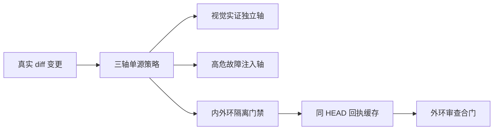

# 单源三轴正交策略、去重收口与静默防刷屏 — 功能设计规范（SPEC）

## 文档信息与变更概览

| 项目 | 内容 |
| --- | --- |
| 当前状态 | `draft`（`draft \| approved \| implementing \| in_review \| implemented \| superseded`） |
| 规划级别 | `L3`（跨模块策略核心重构，属高风险 `kit/` 路径；未 `approved` 前不编码） |
| 创建 / 更新 | `2026-11-27` / `2026-11-27` |
| 分支 / Issue / PR | `feat/sandbox-dual-loop-v1` / 未关联 / 未关联 |
| 负责人 / 内审状态 | plan-sandbox-v1 / `pending` |
| 规划态 | `interactive`（架构决策已全部拍板，零待决问题） |
| 关联 PRD / Todo | `docs/prd/261127-sandbox-dual-loop-v1-prd.md` / `docs/todo/261127-single-source-policy-core-todo.md` |

- **变更一句话**：将 `workflow-policy.mjs` 收敛为三轴正交唯一策略真源，硬拒内环 `inner: true` 证据偷渡外环，引入干净 HEAD 门禁回执缓存消除重复扫描与 `verifyArchitectureMapSync` 双跑，并消除探索/内环失败对远端工单的自动刷屏。

## 系统变更全景

| 模块 / 文件 | 变更性质 | 核心职责 |
| --- | --- | --- |
| `kit/skills/lib/gate-receipt.mjs` (new) | 新增 | 干净 HEAD 门禁执行回执读写/校验（`headSha` + `diffFingerprint` + `profileHash`）与失败自动升级判定 `shouldAutoEscalateFailure` |
| `kit/skills/lib/workflow-policy.mjs` | 改造 | 三轴正交 `determineWorkflowPolicy`（UI 视觉解耦于 `high`、`faultInjectionRequired` 绑定 `high`/`one-way`/`Case>=4`）与外环 `validateVerificationEvidence` 硬拒 `inner: true` |
| `kit/skills/dev-review/scripts/review-empirical.mjs` | 改造 | `computeEmpiricalRequirements` 的 `faultRequired` 与 `visualCheckRequired` 改读单源 `policy`，消除与 `workflow-policy.mjs` 冲突 |
| `kit/skills/dev-review/scripts/review-empirical-state.mjs` | 改造 | `handleEmpiricalE2eFailure` 接入 `shouldAutoEscalateFailure`，探索/本地/沙箱默认不刷远端 Issue |
| `kit/skills/dev-review/scripts/review-locks.mjs` | 改造 | `evaluatePassBlockers` 在干净同 HEAD 下复用 `gate-receipt.mjs` 的 `arch-rules` 与 `detectGateWeakening` 结单回执 |
| `kit/skills/dev-review/scripts/review-gates.mjs` | 改造 | 复用 `gate-receipt.mjs` 减少同 HEAD 重复 `scanStructuralHygiene`/`evaluateArchRules`/`detectGateWeakening` |
| `kit/skills/dev-edit/scripts/edit-gate.mjs` | 改造 | `--final` 干净 HEAD 通过时写入 `gate-receipt.mjs`（含 `architectureMapSyncOk`、`archRulesOk`、`structuralHygieneOk`） |
| `kit/skills/dev-flow/scripts/flow-lifecycle-hooks.mjs` | 改造 | `runLifecycleGovernHook(stage='verify')` 核验 `gate-receipt.mjs`，避免与刚跑完的 `edit-gate --final` 双跑 `verifyArchitectureMapSync` |
| `kit/skills/dev-flow/scripts/flow-lifecycle-helpers.mjs` | 改造 | `handleVerifyE2eFailure` 接入 `shouldAutoEscalateFailure`；`recordVerifyEvidenceForFlow` 支持打标 `inner: true` |
| `kit/skills/dev-iterate/scripts/iterate.mjs` | 改造 | 探索/沙箱运行默认不自动向远端建单，仅显式 `--escalate` 或外环模式才建单 |
| `kit/skills/dev-govern/scripts/govern-checks.mjs` | 改造 | `--changed` 模式命中干净 HEAD 有效 `gate-receipt.mjs` 时复用结构卫生与 `arch-rules` 结果（全仓 `audit .` 始终全扫） |

## 一、背景与边界声明

- **要改什么**：统一三轴正交策略判定（轴 1 视觉实证、轴 2 高危/单向门/Case>=4 两阶段故障注入、轴 3 内外环隔离与同 HEAD 去重），并收口探索期测试失败的自动升级建单策略。
- **不改什么**：不新增 `flow.mjs promote` 或 `--sandbox` 工作树创建逻辑（归 Wave 2 切片 2 `sandbox-dual-loop-flow`）；不修改 `doc-plan.mjs triage` 路由算法、`templates/`、`AGENTS.md` 或 `SKILL.md` 文案（归 Wave 3 切片 3 `triage-brief-contract-parity`）。
- **本期不做**：不放宽 `BLOCKED_STALE_VERIFICATION`、`BLOCKED_INSUFFICIENT_VERIFICATION_TIER`、`BLOCKED_VISUAL_EVIDENCE_REQUIRED`、`detectGateWeakening` 或单测反作弊规则。
- **复用既有模块**：复用 `kit/skills/lib/workflow-policy.mjs` 的 `determineWorkflowPolicy` 与 `validateVerificationEvidence`、`kit/skills/lib/empirical-artifacts.mjs` 的 `evaluateStoredVisualEvidence`、`kit/skills/lib/architecture-map.mjs` 的 `verifyArchitectureMapSync`、`kit/skills/lib/static-gates.mjs` 的 `isUiVisualFile`/`scanStructuralHygiene`/`evaluateArchRules`/`detectGateWeakening`、`kit/skills/lib/git.mjs` 的 `readJsonSafe`/`writeJsonAtomic`/`sha256Text`。
- **架构基线关系**：严格遵守 `docs/TDD.md` 零第三方依赖（仅 `node:*`）、`kit/**` 禁引 `scripts/lib/**` 与 `scripts/dev/**`、`<= 800` 行/文件红线（当前 `review-empirical.mjs` 为 797 行、`workflow-policy.mjs` 为 755 行、`flow-lifecycle-helpers.mjs` 为 759 行、`review-gates.mjs` 为 762 行，`edit-gate.mjs` 为 750 行，须通过 `gate-receipt.mjs` (new) 承接新增逻辑确保所有文件严守 `<= 800` 行）。

## 二、设计方案与契约变更

### 接口 / 数据结构变更

1. **`kit/skills/lib/workflow-policy.mjs` — `determineWorkflowPolicy` 返回对象扩展与三轴解耦**：
   - **轴 1（UI 视觉实证独立）**：从 `high` 风险 `reasons` 中移除 `effectiveVisual.length > 0`（原第 187、191 行）。新增显式布尔字段 `visualCheckRequired: effectiveVisual.length > 0`。仅改纯前端组件或样式文件（`.tsx`/`.css` 等）且未命中 `highRiskGlobs`、`oneWayBoundaryHits`、`gateWeakeningHits`、`nonExemptDoNotEdit` 且 `caseType < 4` 时：`riskTier === 'medium'`、`visualCheckRequired === true`、`faultInjectionRequired === false`。若同次改动也触及高风险/单向门或 `caseType >= 4`，则 `riskTier === 'high'` 且三轴同时生效。
   - **轴 2（故障注入精确绑定）**：`isOneWay = oneWayBoundaryHits.length > 0 || highRiskHits.length > 0 || gwHits.length > 0 || nonExemptDoNotEdit.length > 0 || Number(caseType) >= 4`，保持 `riskTier = isOneWay ? 'high' : (isLow ? 'low' : 'medium')` 与 `faultInjectionRequired: riskTier === 'high'`。
   - **轴 3（内环 `inner: true` 硬隔离）**：`validateVerificationEvidence({ policy, evidence, headSha, profile, explicitCmdUsed, allowInner = false })` 新增前置检查：当 `!allowInner` 时，若 `evidence.inner === true`，直接返回 `{ ok: false, code: 'BLOCKED_INNER_EVIDENCE_FORBIDDEN_IN_OUTER', exitCode: EXIT.FACT, reason: '...' }`；同时在遍历 `evidence.gates`（`gate`/`full`/`smoke`/`quick`）时跳过任何 `g.inner === true` 的条目，即使顶层 `evidence.inner` 被设为 `false`，单门禁条目仍不可冒充外环实证。
2. **`kit/skills/dev-review/scripts/review-empirical.mjs` — 消除 `faultRequired` 冲突**：
   - 第 101 行改为：`const faultRequired = !isEmptyDiff && !isLowRiskPureDoc && Boolean(policy.faultInjectionRequired) && (runtimeTouched || smokeRequired)`（仅 1 行精简替换，确保 `review-empirical.mjs` 维持 `<= 797` 行）。
   - 第 102 行改为：`const visualCheckRequired = !isEmptyDiff && Boolean(policy.visualCheckRequired || behavioralGate?.empiricalVisualCheckRequired)`。
3. **`kit/skills/lib/gate-receipt.mjs` (new) — 干净 HEAD 门禁回执与升级静默判定**：
   - 回执落盘路径：`<gitCommonDir>/project-forge-flow/tasks/<taskId>/gate-receipt.json`（仅仓外 `.git/` 状态目录，零污染工作树）。
   - 导出 API：
     - `computeGateReceiptKey({ headSha, changedFiles, diffText, profile })`：返回 `{ headSha, diffFingerprint: sha256Text(...), profileHash: sha256Text(...) }`。
     - `readValidGateReceipt({ gitCommonDir, taskId, key, dirty })`：若 `dirty === true` 或无 `headSha` 或任一指纹键不匹配，强制返回 `null`（永不误复旧回执）。
     - `writeGateReceiptCheck({ gitCommonDir, taskId, key, checkName, ok, meta })`：原子合并写入单项门禁结论（`architectureMapSync` / `structuralHygiene` / `archRules` / `gateWeakening`），**仅当 `ok === true && !dirty`** 时缓存放行结论（失败结果永不缓存放行）。
     - `shouldAutoEscalateFailure({ stage, mode, ledger, opts })`：判定规则——当 `opts?.['no-escalate'] === true`、`opts?.inner === true`、`ledger?.sandboxMode === true`、`mode === 'local'`、`mode === 'staged'`、`mode === 'quick'` 时返回 `{ escalate: false, reason }`；当 `opts?.escalate === true` 或外环 `stage === 'verify'`（`mode === 'smoke' | 'gate'` 且非沙箱）或外环 `stage === 'review'`（`mode === 'task' | 'pr'` 且非沙箱）时返回 `{ escalate: true, reason }`；`stage === 'iterate'` 默认 `{ escalate: false }`，仅显式 `--escalate` 且非沙箱时返回 `{ escalate: true }`。
4. **单点 `verifyArchitectureMapSync` 与 4 处静态门禁去重**：
   - `edit-gate.mjs`（`--final` 且工作区干净）通过后写入 `gate-receipt.json` 中的 `architectureMapSync`、`structuralHygiene`、`archRules`。
   - `flow-lifecycle-hooks.mjs` 的 `checkArchitectureMapSyncOnVerify` 在进入 `verifyArchitectureMapSync(root)` 前先查 `readValidGateReceipt(..., 'architectureMapSync')`：若本次 `flow verify` 中 `edit-gate --final` 刚刚在同一干净 HEAD 验过且 `ok === true`，则直接返回 `{ ok: true, skipped: true, reason: 'reused-gate-receipt' }`；若工作区脏、`edit-gate` 未安装或 HEAD/diff 变动，仍实时执行 `verifyArchitectureMapSync(root)`。
   - `review-locks.mjs`、`review-gates.mjs` 与 `govern-checks.mjs`（仅 `--changed` 模式）在干净 HEAD 命中有效回执时复用 `archRules` / `structuralHygiene` / `gateWeakening` 结果；`review-pack` 若处于 `--local`/`--staged` 脏工作区或 `govern-audit audit .` 全仓体检，仍全量实时扫描。

### 数据与状态变更

- 新增仓外可选缓存文件 `<gitCommonDir>/project-forge-flow/tasks/<taskId>/gate-receipt.json`，缺失或损坏时自动降级为实时执行，不要求任何存量迁移。
- `evidence.json` 新增可选布尔字段 `inner?: boolean`（缺省等价于 `false`，完全向后兼容既有任务账本与实证记录）。

### 异常、回退与安全边界

- **防伪造回执**：`gate-receipt.json` 严格绑定 `headSha` + `diffFingerprint`（含变更文件状态与 diff 文本哈希）+ `profileHash`（含 `arch-rules`/`high-risk`/`do-not-edit` 哈希），且只允许在 `dirty === false` 且 `ok === true` 时命中；任何改一行代码或改一条 `AGENTS.md` 规则都会令回执瞬间失效。
- **防内环偷渡**：`validateVerificationEvidence` 在外环默认 `allowInner: false`，既拦顶层 `evidence.inner === true`，也过滤任何单个 `gates[tier].inner === true`，保证沙箱快测绝对无法顶替外环 `full`/`smoke`/`gate`。
- **防升级刷屏而不丢诊断**：静默模式下仍完整生成 `diagnostic`（Evidence/Unknowns/NextSteps）并写入本地 `appendGovernSignal` / `emitFlowSignal`，仅抑制远端平台 `escalateToBackend` 创建噪声 Issue。

### 实现顺序

1. 先写 Red-Green 失败测试 `scripts/dev/fixtures-policy-axes.mjs` (new)（覆盖 `C1` - `C4` 正反双向用例）并注册到 `scripts/dev/fixtures.mjs`。
2. 新建 `kit/skills/lib/gate-receipt.mjs` (new)，实现回执指纹键、原子读写与 `shouldAutoEscalateFailure`。
3. 改造 `kit/skills/lib/workflow-policy.mjs` 三轴正交解耦与 `inner: true` 硬拒。
4. 改造 `review-empirical.mjs`、`review-empirical-state.mjs`、`review-locks.mjs`、`review-gates.mjs`、`edit-gate.mjs`、`flow-lifecycle-hooks.mjs`、`flow-lifecycle-helpers.mjs`、`iterate.mjs`、`govern-checks.mjs`。
5. 同步更新受旧 `faultRequired` / 静默升级语义影响的既有测试（`fixtures-r8-bugfixes.mjs`、`fixtures-review-empirical.mjs`、`fixtures-iterate-evolution.mjs`）及对应故障注入表（`scripts/dev/injections-data-policy-axes.mjs` (new) 与 `scripts/dev/injections-data.mjs`），执行 `node scripts/equip.mjs .` 同步 `.agents/skills/` 并全绿验收。

## 三、备选方案与否决理由

| 方案 | 怎么做的 | 为什么没选 | 什么情况下该改回它 |
| --- | --- | --- | --- |
| 仓外三键绑定 `gate-receipt.json`（已选） | 在 `.git/project-forge-flow/tasks/<id>/gate-receipt.json` 按 `headSha + diffFingerprint + profileHash` 缓存干净 HEAD 门禁通过结论 | 跨进程（`edit-gate` 子进程 -> `flow verify` -> `review-pack`）共享，零工作区污染，脏树或改配置立即失效 | 几乎无需改回；仅当未来所有技能合并为单进程内存常驻服务时可加内存层 |
| 仅用进程内变量去重（备选） | 只在 `flow-lifecycle.mjs` 内存中跳过 `checkArchitectureMapSyncOnVerify` | 无法解决 `edit-gate`（独立 Node 子进程）与 `flow`/`review`/`govern` 之间 4 处重复扫描 | 若某天移除 `edit-gate` 子进程边界改为同进程直调，可作为补充而非替代 |
| 给 UI 文件保留 `riskTier='high'` 但特判免故障注入（备选） | 保持 `visualFilesChanged -> high`，在 `faultInjectionRequired` 上加 `!onlyVisual` 例外 | 破坏三轴正交，导致 UI 改动仍误触 `humanApprovalRequired`、`merge-gate` 升档与 Case 4 误判 | 仅当项目把全部前端文件显式配进 `AGENTS.md` `high-risk:` 时，自然通过 `highRiskHits` 进入 `high` |

## 四、改动清单与影响面

| 文件 / 目录 | 改动性质 | 改什么 | 谁会被影响 |
| --- | --- | --- | --- |
| `kit/skills/lib/gate-receipt.mjs` (new) | 新增 | 干净 HEAD 门禁回执缓存 + `shouldAutoEscalateFailure` | `dev-edit`、`dev-flow`、`dev-review`、`dev-govern`、`dev-iterate` |
| `kit/skills/lib/workflow-policy.mjs` | 修改 | 解耦 `visualCheckRequired` 与 `riskTier='high'`；外环硬拒 `inner: true`（`BLOCKED_INNER_EVIDENCE_FORBIDDEN_IN_OUTER`） | 所有消费 `determineWorkflowPolicy` / `validateVerificationEvidence` 的技能 |
| `kit/skills/dev-review/scripts/review-empirical.mjs` | 修改 | 第 101-102 行 `faultRequired` 与 `visualCheckRequired` 对齐单源 `policy` | `review-pack check-empirical` / `check-fault` / `--include-diff` |
| `kit/skills/dev-review/scripts/review-empirical-state.mjs` | 修改 | 第 632 行按 `shouldAutoEscalateFailure` 控制远端自动建单 | `review-pack check-empirical` 失败处理 |
| `kit/skills/dev-review/scripts/review-locks.mjs` | 修改 | `evaluatePassBlockers` 干净 HEAD 复用 `gate-receipt.mjs` | `review-pack record --enforce-gates` |
| `kit/skills/dev-review/scripts/review-gates.mjs` | 修改 | 机械审查包干净 HEAD 复用 `gate-receipt.mjs` | `review-pack` |
| `kit/skills/dev-edit/scripts/edit-gate.mjs` | 修改 | `--final` 干净 HEAD 通过后写入 `gate-receipt.mjs` | `edit-gate --final` 与 `flow verify` 前置钩子 |
| `kit/skills/dev-flow/scripts/flow-lifecycle-hooks.mjs` | 修改 | `checkArchitectureMapSyncOnVerify` 查 `gate-receipt.mjs` 避免单次 `flow verify` 双跑 | `flow verify` |
| `kit/skills/dev-flow/scripts/flow-lifecycle-helpers.mjs` | 修改 | `handleVerifyE2eFailure` 接入 `shouldAutoEscalateFailure`；`recordVerifyEvidenceForFlow` 写入 `inner` 标记 | `flow verify` |
| `kit/skills/dev-iterate/scripts/iterate.mjs` | 修改 | 默认探索/沙箱不自动建远端 Issue，保留信号与诊断，支持显式 `--escalate` | `iterate run` |
| `kit/skills/dev-govern/scripts/govern-checks.mjs` | 修改 | `--changed` 干净 HEAD 复用 `gate-receipt.mjs` 卫生与 `arch-rules` 结论 | `govern-audit audit --changed` |
| `scripts/dev/fixtures-policy-axes.mjs` (new) | 新增 | `C1` - `C4` 正反双向行为与去重计数断言 | `node scripts/dev/fixtures.mjs` |
| `scripts/dev/injections-data-policy-axes.mjs` (new) | 新增 | `C1` - `C4` 故障注入复验样本（拦截 UI 误升 high、普通 medium 误注故障、inner 偷渡、双跑与刷屏） | `node scripts/dev/verify-injections.mjs` |
| `scripts/dev/fixtures.mjs` | 修改 | 注册 `fixtures-policy-axes.mjs` (new) | 全量回归测试入口 |
| `scripts/dev/injections-data.mjs` | 修改 | 注册 `injections-data-policy-axes.mjs` (new) | 全量故障注入入口 |
| `scripts/dev/fixtures-r8-bugfixes.mjs`、`scripts/dev/fixtures-review-empirical.mjs`、`scripts/dev/fixtures-iterate-evolution.mjs` | 修改 | 将依赖旧 `faultRequired`/默认自动建单的测试断言对齐新三轴正交与静默升级契约 | 既有回归夹具 |

- **对外可见的变化**：新增错误码 `BLOCKED_INNER_EVIDENCE_FORBIDDEN_IN_OUTER`（退出码 `3`）；`determineWorkflowPolicy` 新增 `visualCheckRequired` 字段；`iterate run` 默认探索期不再自动刷远端工单（需显式 `--escalate`）。
- **需要同步改的地方**：运行 `node scripts/equip.mjs .` 将 `kit/skills/` 同步至 `.agents/skills/`（本仓自举字节级一致门禁）。

## 五、冻结的验收标准

- [ ] C1: `determineWorkflowPolicy` 对仅改 UI 渲染文件（`.tsx`/`.css` 仿真用例）且未触及 `high-risk`/`one-way`/`Case>=4` 的改动返回 `riskTier === 'medium'`、`visualCheckRequired === true`、`faultInjectionRequired === false`；对触及 `high-risk`/`one-way`/`Case>=4` 返回 `riskTier === 'high'` 且 `faultInjectionRequired === true`；`review-empirical.mjs` 的 `computeEmpiricalRequirements` 与之完全一致（由 `fixtures-policy-axes.mjs` 正反双向实证）。
- [ ] C2: `recordVerifyEvidenceForFlow` 在内环/沙箱模式下写入 `inner: true`；外环 `validateVerificationEvidence` 遇到顶层 `evidence.inner === true` 或单门禁项 `gates[k].inner === true` 时返回 `ok: false`、`code: 'BLOCKED_INNER_EVIDENCE_FORBIDDEN_IN_OUTER'`、`exitCode: 3`，外环全量验证覆写为 `inner: false` 后正常放行（由 `fixtures-policy-axes.mjs` 正反双向实证）。
- [ ] C3: 单次 `flow verify` 中 `edit-gate --final` 写入干净 HEAD 的 `gate-receipt.json` 后，`flow-lifecycle-hooks.mjs` 的 `checkArchitectureMapSyncOnVerify` 命中回执返回 `reused-gate-receipt`（实测 `verifyArchitectureMapSync` 仅执行 1 次）；修改源码/配置文件或工作区变脏后回执立即失效并触发实时重扫（由 `fixtures-policy-axes.mjs` 实证）。
- [ ] C4: 沙箱/内环/`quick`/`--local` 验证或 `iterate run` 失败时，本地诊断包与治理信号正常落盘，Mock 远端客户端 `createIssue` 调用次数为 `0`；外环 `smoke`/`gate`/`task`/`pr` 失败或显式 `--escalate` 时仍按分级策略正常建单（由 `fixtures-policy-axes.mjs` 正反双向实证）。

## 六、高风险点、门型与回滚路径

- **门型与回滚路径**：`one-way`（触碰 `kit/skills/lib/workflow-policy.mjs`、`kit/skills/dev-review/` 与 `kit/skills/dev-flow/` 门禁核心）；回滚做法：执行 `git revert` 还原切片提交并重跑 `node scripts/equip.mjs .` 同步 `.agents/skills/`。
- **高风险路径**：命中 `AGENTS.md` `high-risk` 的 `kit/` 目录，实施后须由独立审查者执行两阶段故障注入闭环。
- **故障注入预演**：复用 `scripts/dev/verify-injections.mjs` 与新增 `scripts/dev/injections-data-policy-axes.mjs` (new)，对 `workflow-policy.mjs`（关闭 `inner: true` 拒收）、`review-empirical.mjs`（恢复旧 `faultRequired` 冲突）、`gate-receipt.mjs`（放行脏树伪造回执）与 `flow-lifecycle-helpers.mjs`（恢复内环乱建 Issue）执行双向注入，确认全部被 `fixtures-policy-axes.mjs` 捕获失败并在还原后复绿。

## 澄清与补充记录

- 已确认：单文件严格控制在 `<= 800` 行内，`review-empirical.mjs`（当前 797 行）只做最小单源替换，新增逻辑全部归口 `kit/skills/lib/gate-receipt.mjs` (new)。

## 实现说明

- **实际落地摘要**：
- **与草案的差异**：
- **关联同步文件**：
