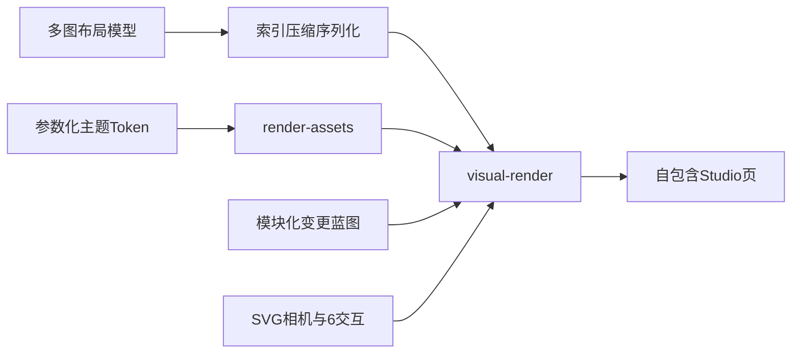

# 第一性原理 Studio 交互界面与纯矢量懒渲染引擎 — 功能设计规范（SPEC）

## 文档信息与变更概览

| 项目 | 内容 |
| --- | --- |
| 当前状态 | `draft`（`draft \| approved \| implementing \| in_review \| implemented \| superseded`） |
| 规划级别 | `L3`（前端渲染架构推翻重做、多文件模块拆分与全仓长青资产收口；未 `approved` 前不编码） |
| 创建 / 更新 | `2026-11-27` / `2026-11-27` |
| 分支 / Issue / PR | `feat/visual-studio-archify-v2` / 未关联 / 未关联 |
| 负责人 / 内审状态 | `plan-studio-b` / `pending` |
| 规划态 | `interactive`（逐题问到零拍板） |
| 关联 PRD / Todo | `docs/prd/261127-visual-studio-archify-v2-prd.md` / `docs/todo/261127-studio-ux-lazy-renderer-todo.md` |

- **变更一句话**：推翻旧 AI 模板 DOM 渲染，交付纯矢量 SVG `viewBox` 相机画布、单源索引压缩 JSON 懒渲染、模块化非文字墙 Change Blueprint、6 项 Studio 交互升级与真浏览器浅/深色实证闭环。

## 系统变更全景

| 模块 / 文件 | 变更性质 | 核心职责 |
| --- | --- | --- |
| `kit/skills/lib/visual-render-svg.mjs` | 新增 | 纯矢量 SVG 图元生成器（支持 10 类图表首屏与纯 SVG 导出）与单源索引压缩 JSON 序列化器 |
| `kit/skills/lib/visual-render-client.mjs` | 新增 | 客户端脚本模块：纯 SVG `viewBox` 平移/缩放相机、非当前 Tab 按需 SVG 懒渲染、6 项 Studio 交互与 `.svg`/`2x .png` 导出 |
| `kit/skills/lib/visual-brief-store.mjs` | 新增 | 从 `visual-brief.mjs`（现 796 行）拆出 sidecar 规范化、原型暂存与过期清理逻辑，确保双方均 `<= 600` 行 |
| `kit/skills/lib/visual-render.mjs` | 修改 | 重构顶栏、三级按钮权重、动态激活 Tab 栏（零空 Tab）与单源 HTML 壳层装配 |
| `kit/skills/lib/visual-render-assets.mjs` | 修改 | 参数化浅/深色 WCAG AA 主题 Token 与无 AI 模板感样式系统；彻底移除 `.is-panning { will-change: transform }` |
| `kit/skills/lib/visual-render-panels.mjs` | 修改 | 重做模块化 Change Blueprint（决策概览条、分域变更卡 + 改前->改后对比、独立下游波及块）、Semantic Passport 与意图芯片 Q&A 弹窗 |
| `kit/skills/lib/visual-brief.mjs` | 修改 | 瘦身并接入 `static-analyzer`/`diff-materiality`、`?from=` 父子简报互链、修复第 407 行导览步进全部硬绑 `modifiedFeatureIds[0]` 的缺陷 |
| `kit/skills/lib/architecture-map.mjs` | 修改 | 接通 Wave 1 静态分析与 Wave 2 10 类图证据，渲染干净常青 Studio 架构图（零临时 diff 态） |
| `kit/skills/dev-verify-tools/scripts/verify-tools.mjs`、`kit/skills/dev-plan/scripts/doc-plan-brief.mjs` | 修改 | 透传可选遥测 span / 3-dot PR diff 与父子简报导航元数据 |
| `scripts/dev/fixtures-visual-engine.mjs`、`scripts/dev/fixtures-living-brief.mjs`、`scripts/dev/injections-data-visual-engine.mjs` | 修改 | 升级为纯 SVG 相机、懒渲染 `< 180 KB` 预算、零模糊静态锁、6 项交互与导览真目标回归断言及故障注入 |
| `docs/TDD.md`、`docs/feature-map.json`、`docs/architecture-map.html`、`README.md`、`README.en.md` | 修改 | 全仓长青架构文档、双语说明与干净基线架构图锁步收口 |

## 一、背景与边界声明

- **要改什么**：从零重做 Studio HTML/CSS/SVG/JS 渲染与交互层，解决拖拽文字模糊、AI 模板按钮均权、文字墙 Change Blueprint、双重序列化体积膨胀与导览硬绑首节点五大沉疴。
- **不改什么**：保留离线 `file://` 零外链自包含协议、保留 `<!-- @generated by project-forge ... feature-map-sha256=... -->` 首行指纹契约、保留原型 `<= 512 KB` 与 `http:`/`https:`/`file:` 安全白名单及 `homedir()` 零泄露不变量。
- **本期不做**：不引入任何前端框架或打包器（React/Vue/Tailwind/Vite 等），不依赖在线字体 CDN。
- **复用既有模块**：Wave 1（`static-analyzer.mjs`、`static-evidence.mjs`、`diff-materiality.mjs`）、Wave 2（`visual-layout.mjs`、`visual-router.mjs`、`visual-geometry-check.mjs`）及 `kit/skills/lib/empirical-artifacts.mjs`。
- **架构基线关系**：单文件严格 `<= 800` 行，零第三方依赖，满足 `arch-rules` 与 `preflight` 预算门禁（依据：`docs/TDD.md`）。

## 二、设计方案与契约变更

### 第一性原理 UI/UX 结构不变量（与参数化主题 Token 解耦）

> 具体色彩与排版方向在进入本切片 `approve` 前由用户经 `oil-ui-pro` 3 方向同屏对比页拍板后注入 `--pf-*` CSS 自定义属性，不改变以下结构与交互契约。

1. **严格三级按钮权重与尺寸分层**：
   - **Primary（主动作，全栏唯一）**：如顶栏唯一主按钮「向 AI 提问」与蓝图主入口，实色强调底 + 明确高度与字重。
   - **Secondary（视图/模式切换）**：Tab 分段器、域筛选与 Reach/Route 切换，轻量边框或底面层级，激活态清晰且不受 `:hover` 同权覆写。
   - **Icon / Ghost（辅助工具与低频操作）**：缩放 `+`/`-`/适配、主题切换、导出 `.svg`/`.png`、重置视角，紧凑图标或文字幽灵按钮，视觉退居二线。
2. **纯矢量 SVG `viewBox` 相机引擎（根治拖拽文字模糊）**：
   - 画布层全部以原生 `<svg>` 元素渲染（域分组、节点卡片、矢量文字、圆角正交路径与箭头标记），彻底取消被 CSS `scale()` 缩放的含文字 HTML DOM `.pf-stage`。
   - 平移与缩放仅更新 `<svg viewBox="vx vy vw vh">` 数值（以鼠标指针为缩放锚点），**源码静态断言严禁对任何画布或含文字缩放容器使用 `will-change: transform`**。
   - 浮层工具条与 Semantic Passport / 选区悬浮按钮坐标统一按 `Math.round(v * dpr) / dpr` 对齐设备物理像素。
3. **模块化非文字墙 Change Blueprint**：
   - **顶部决策概览条**：状态徽标、核心一句话结论、四态统计计数筛选（新增/修改/拟移除/受波及）与「在架构图中高亮改动」主按钮。
   - **按域 / 1:N 切片分块的变更卡片**：结构化呈现「改前 -> 改后」语义对比或移除替代关系、关联源码与 3-dot 有界 diff hunk 折叠预览；与架构画布节点双向悬浮高亮联动。
   - **独立下游波及与依赖链区块**：将上游变更与下游 `impacted` 传导链分层展示，避免冗长纯文本段落墙。
4. **消除双重序列化 + 客户端懒渲染（`< 180 KB` 预算）**：
   - HTML 内仅嵌入一份索引压缩 JSON（字符串表去重重复域/路径前缀、路径用紧凑点列表示），仅预渲染默认激活首屏 Tab 的 SVG（`architecture-map` 默认 `architecture`，`visual-brief` 默认 `brief`）。
   - 其余已激活的 Tier 1/2/3 Tab 在首次点击切换时由客户端 `visual-render-client.mjs` 从同一份 JSON 按需即时构造纯 SVG DOM 并缓存；无静态证据的 Tab 根本不写入 DOM，实现零空标签页。
5. **6 项 Studio 交互升级与导览根修**：
   - **Hash / 历史导航与父子串跳**：双向同步 `#tab=&focus=&reach=&route=`，监听 `popstate` 与 `Alt+←` 回退上一视角；`master-prd` Brief 点击子切片带 `?from=<parentBriefKey>` 参数打开子切片 Brief，子切片顶部自动呈现「返回总控 PRD 简报」返回条（纯相对路径，离线 `file://` 可用）。
   - **Semantic Passport（语义护照）**：点击任意节点滑出/展示紧凑语义护照，显示职责摘要、耦合指标（`fanIn` / `fanOut` / `inCycle` 环告警与环成员）、Git 热度及经本地验真的源码/测试/文档锚点路径。
   - **多跳 Reach 与双节点 Route Probe（`R`）**：有向 BFS 计算当前焦点节点的前驱与后继多跳波及集合并高亮；按 `R` 或点击探测按钮进入双节点模式，选择起止节点后计算最短有向依赖链并支持逐步高亮回放。
   - **Walkthrough 分步导览修复**：彻底修复 `kit/skills/lib/visual-brief.mjs:407-414` 所有导览步骤都绑定 `modifiedFeatureIds[0]` 的缺陷——每步按其关联模块/切片/锚点精确解析独立 `targetId` 与所属 `tab`，切换步骤时自动切 Tab 并居中聚焦对应真实节点。
   - **带图上下文的意图芯片问答**：Q&A 弹窗内置 4 枚意图芯片（`解释边界` / `查波及面` / `补测试` / `拆分方案`），点击自动拼接当前聚焦节点语义护照、当前 Reach 波及链或 Route 最短路径，保留三级剪贴板降级。
   - **纯矢量 `.svg` 与 `2x .png` 导出**：直接序列化当前 `<svg>` 并内联已解析的浅/深色主题样式变量生成可编辑独立 `.svg` 下载；基于同份 `.svg` 绘制 `2x` Offscreen/Canvas 生成高清 `.png` 导出。

### 数据与状态变更

- `visual-brief.mjs` 拆出 `visual-brief-store.mjs`，不改变 `<gitCommonDir>/project-forge-flow/briefs/<key>.json` 的 `BRIEF_SCHEMA_VERSION = 1` 兼容性；新增可选渲染元数据字段 `parentBriefHref` 与 `childBriefLinks`（仅相对文件名，零绝对路径泄露）。

### 异常、回退与安全边界

- 所有 SVG 文本与 JSON 序列化继续通过 `escapeXml` / `escapeHtml` / `escapeJsonForScript` 转义，阻断 `</script>` 与 SVG `<script>`/`onload` XSS 注入。
- `2x .png` 导出在受限沙盒浏览器（Canvas taint）下优雅降级提示用户改用纯矢量 `.svg` 导出，绝不抛未捕获异常。
- 客户端脚本通过 `new Function` / `vm.Script` 静态语法校验纳入回归夹具，确保无 ES 语法错误或未定义 CSS 变量。

### 实现顺序

1. 落地 `oil-ui-pro` 3 方向同屏对比页并按用户拍板选定方向固化主题 Token。
2. 拆分 `kit/skills/lib/visual-brief-store.mjs` 并修复 `visual-brief.mjs` 导览步进与 `?from=` 父子串跳。
3. 实现 `visual-render-svg.mjs`、`visual-render-client.mjs`，重构 `visual-render.mjs`、`visual-render-assets.mjs` 与 `visual-render-panels.mjs`，接通 `architecture-map.mjs`、`verify-tools.mjs` 与 `doc-plan-brief.mjs`。
4. 更新视觉回归夹具与故障注入，执行真浏览器 `shoot.mjs` 浅/深色全量交互截图自检与迭代打磨。
5. 同步更新 `docs/TDD.md`、`docs/feature-map.json`、零脏态 `docs/architecture-map.html`、`README.md`/`README.en.md` 与 `equip.mjs .`，全量门禁收口。

## 三、备选方案与否决理由

| 方案 | 怎么做的 | 为什么没选 | 什么情况下该改回它 |
| --- | --- | --- | --- |
| 纯 SVG `viewBox` 相机 + 单源压缩 JSON 客户端懒渲染（已选） | 所有画布全矢量渲染，仅预渲首屏，其余 Tab 点击现算 | 根治缩放拖拽模糊、消灭双重序列化、一键导出可编辑 `.svg` 且 HTML `< 180 KB` | 若单图超 1000 节点引发 SVG DOM 帧率瓶颈，可按视口做虚拟裁剪 |
| HTML5 Canvas 2D 绘制画布 | 所有节点与连线画在 `<canvas>` 位图上 | 丧失无障碍键盘焦点、文本选择与原生纯矢量 `.svg` 导出能力 | 仅当节点规模超万级时考虑 |
| 在旧 DOM `.pf-stage` 上仅删掉 `will-change: transform` | 保留旧 CSS `scale()` DOM 节点层小修小补 | 依然存在双份序列化膨胀、无法导纯矢量 SVG 且保留 AI 模板堆砌感 | 永不回退 |

## 四、改动清单与影响面

| 文件 / 目录 | 改动性质 | 改什么 | 谁会被影响 |
| --- | --- | --- | --- |
| `kit/skills/lib/visual-render-svg.mjs` | 新增 | 10 类图纯矢量 SVG 生成与单源压缩 JSON 序列化 | `visual-render.mjs` |
| `kit/skills/lib/visual-render-client.mjs` | 新增 | `viewBox` 相机、客户端懒渲染、6 项交互与 `.svg`/`2x .png` 导出 | `visual-render.mjs` |
| `kit/skills/lib/visual-brief-store.mjs` | 新增 | sidecar 读写、原型暂存与过期清理抽离 | `visual-brief.mjs` |
| `kit/skills/lib/visual-render.mjs` | 修改 | 新 Studio HTML 壳层、动态 Tab、单源数据装配 | `architecture-map.mjs`、`visual-brief.mjs` |
| `kit/skills/lib/visual-render-assets.mjs` | 修改 | 参数化主题 Token、三级按钮体系、移除 `will-change: transform` | 所有渲染产物 |
| `kit/skills/lib/visual-render-panels.mjs` | 修改 | 模块化 Change Blueprint、Semantic Passport、意图芯片弹窗 | Brief 与 Architecture Map |
| `kit/skills/lib/visual-brief.mjs` | 修改 | 瘦身、导览真目标解析、`?from=` 父子串跳、接入分析与 3-dot diff | `doc-plan-brief.mjs`、`doc-plan-ops.mjs` |
| `kit/skills/lib/architecture-map.mjs` | 修改 | 接通 Wave 1/2 产物输出干净常青 Studio 架构图 | `verify-tools.mjs`、`flow`、`survey` |
| `kit/skills/dev-verify-tools/scripts/verify-tools.mjs`、`kit/skills/dev-plan/scripts/doc-plan-brief.mjs` | 修改 | 透传遥测/diff/父子简报参数 | `dev-verify-tools`、`dev-plan` |
| `scripts/dev/fixtures-visual-engine.mjs`、`scripts/dev/fixtures-living-brief.mjs`、`scripts/dev/injections-data-visual-engine.mjs` | 修改 | 升级预算、零模糊静态锁、懒渲染与 6 项交互双向断言与注入 | 全仓 CI 门禁 |
| `docs/TDD.md`、`docs/feature-map.json`、`docs/architecture-map.html`、`README.md`、`README.en.md` | 修改 | 全仓长青资产、双语 README 目录与干净架构图同步 | 文档与自检门禁 |

- **对外可见的变化**：`docs/architecture-map.html` 与仓外 Living Visual Brief 升级为多图零空 Tab Studio 界面；客户端 URL 支持 `#tab=&focus=&reach=&route=` 与 `?from=`。
- **需要同步改的地方**：`node scripts/equip.mjs .`、`node scripts/sync-toc.mjs README.md README.en.md`、`docs/TDD.md`、`docs/feature-map.json`、`docs/architecture-map.html`。

## 五、冻结的验收标准

<!-- criteria:start -->
- [ ] C9: `kit/skills/lib/visual-render.mjs`、`visual-render-svg.mjs`、`visual-render-assets.mjs`、`visual-render-client.mjs`（每文件 `<= 800` 行）实现三级按钮权重分层、参数化浅/深色 WCAG AA 主题 Token 与纯矢量 SVG `viewBox` 相机缩放平移；静态与回归断言确认含文字缩放容器零 `will-change: transform`、浮层按 `Math.round(v * dpr) / dpr` 对齐物理像素、拖拽全程文字清晰无模糊。
- [ ] C10: `kit/skills/lib/visual-render-panels.mjs` 与拆分后的 `visual-brief.mjs` + `visual-brief-store.mjs` 实现模块化非文字墙 Change Blueprint（顶部决策条、分域变更卡与改前->改后对比、独立下游波及块、画布双向悬浮高亮）与单份索引压缩 JSON + 非当前 Tab 客户端懒渲染，典型项目 HTML 严格 `< 180 KB` 且保持零外链/XSS/512KB/白名单/`homedir` 安全红线。
- [ ] C11: 6 项 Studio 交互升级与导览修复全部通过自动化与真浏览器实证：Hash/历史导航（`#tab=&focus=&reach=&route=`、`Alt+←`）与 `?from=` 父子 Brief 返回条、Semantic Passport（含 `fanIn`/`fanOut`/入环耦合与验真链接）、有向 BFS Reach 与双节点 Route Probe（`R`）、Walkthrough 每步绑定独立真实目标节点、意图芯片自动注入活跃路径、纯矢量 `.svg` 与 `2x .png` 导出。
- [ ] C12: 产出真浏览器浅/深色多状态实证截图（全景、拖拽清晰度、多 Tab 懒渲染、Reach/Route 与 Change Blueprint）作为 `--artifact`；同步更新 `docs/TDD.md`、`docs/feature-map.json`、零脏态 `docs/architecture-map.html`、`README.md`/`README.en.md`、`scripts/dev/fixtures-visual-engine.mjs`、`scripts/dev/fixtures-living-brief.mjs`、`scripts/dev/injections-data-visual-engine.mjs` 与 `equip.mjs .`，执行 `node scripts/dev/merge-gate.mjs` 与 `node scripts/dev/verify-injections.mjs --jobs 4` 退出码 `0`。
<!-- criteria:end -->

## 六、高风险点、门型与回滚路径

- **门型与回滚路径**：`one-way`（全面重构视觉渲染引擎、升级回归契约与常青文档）；回滚做法：反向提交本切片 PR，重跑 `node scripts/equip.mjs .` 与 `node scripts/dev/merge-gate.mjs`。
- **高风险路径**：`kit/`（特别是 `visual-render*.mjs`、`visual-brief.mjs`、`architecture-map.mjs` 及 `scripts/dev/injections-data-visual-engine.mjs` `I961..I964` 既有防线）。
- **故障注入预演**：除保持既有 `I961..I964` 全绿外，新增 4 类注入——回流 `will-change: transform` 到缩放画布、泄露双份首屏 SVG 致体积超标、Walkthrough 退化为全绑首节点、`verifyArchitectureMapSync` 放行脏态——全部由 `verify-injections.mjs` 捕获。

## 澄清与补充记录

- 已确认：落地生产代码前须通过 `oil-ui-pro` 3 方向同屏对比页确认具体视觉主题 Token，并经真浏览器浅/深色多轮截图自纠（`shoot.mjs`）后提交独立盲审。

## 实现说明

- **实际落地摘要**：
- **与草案的差异**：
- **关联同步文件**：
