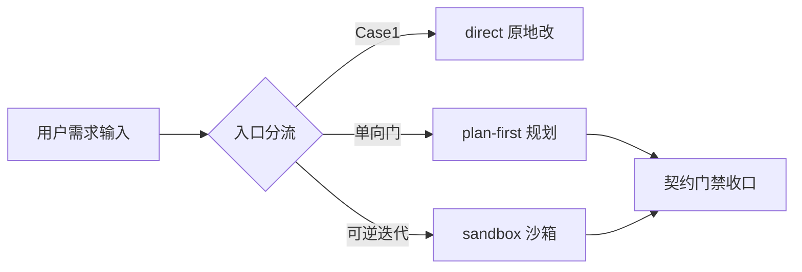

# 确定性入口分流、契约对拍与异构仓库双向实证 — 功能设计规范（SPEC）

## 文档信息与变更概览

| 项目 | 内容 |
| --- | --- |
| 当前状态 | `draft`（`draft \| approved \| implementing \| in_review \| implemented \| superseded`） |
| 规划级别 | `L3`（入口分流算法、全仓契约/模板/技能同构与 7 类异构栈 E2E 验证；Wave 3，依赖切片 1 与切片 2） |
| 创建 / 更新 | `2026-11-27` / `2026-11-27` |
| 分支 / Issue / PR | `feat/sandbox-dual-loop-v1` / 未关联 / 未关联 |
| 负责人 / 内审状态 | plan-sandbox-v1 / `pending` |
| 规划态 | `interactive`（架构决策已全部拍板，零待决问题） |
| 关联 PRD / Todo | `docs/prd/261127-sandbox-dual-loop-v1-prd.md` / `docs/todo/261127-triage-brief-contract-parity-todo.md` |

- **变更一句话**：升级 `doc-plan.mjs triage` 输出确定性三出口 `recommendedEntry` 并仅移除 `fileCount >= 6` 钝化悬崖（保留 `fileCount >= 12` PRD 判据），统筹 `doc-plan-brief.mjs` 两处按需 Brief 触发，完成全仓模板、契约、文档、5 份技能说明与自举门禁同构对拍，并在 7 类异构仿真仓库上完成全链路双向实证。

## 系统变更全景

| 模块 / 文件 | 变更性质 | 核心职责 |
| --- | --- | --- |
| `kit/skills/dev-plan/scripts/triage-rules.mjs` | 改造 | 新增 `resolveRecommendedEntry` 与 `shouldAutoTriggerBrief`（承接分流与 Brief 规则，保证 `doc-audit.mjs <= 785L`） |
| `kit/skills/dev-plan/scripts/doc-audit.mjs` | 改造 | `triageTask` 输出 `recommendedEntry`、`sandboxPocAllowed`、`briefRecommended`；仅移除第 165 行 `fileCount >= 6 -> Case 4` 钝化悬崖，明确保留第 86、161、169 行 `fileCount >= 12` 的 `prdNeed` 判据；强化 `Case 5` 与 `PRD` 严格正交 |
| `kit/skills/dev-plan/scripts/doc-plan-brief.mjs` | 改造 | 按 `recommendedEntry` 输出单一 `[NEXT STEP]`；统筹第 66-70 行（`handleNoteSubcommand`）与第 169 行（`handleTriageSubcommand`）两处按需 Brief 触发逻辑并兼容多轮讨论 |
| `references/collaboration.md`、`templates/agents-project.md`、`AGENTS.md` | 改造 | 同构更新沙箱双环、`promote` 晋升、三轴策略与确定性入口规则，通过 `compose-agents.mjs . --check`（`<= 30 KB`） |
| `templates/pull-request-template.md`、`.github/pull_request_template.md` | 改造 | 对齐三轴实证与故障注入适用范围（`high`/`one-way`/`Case>=4`），保持 `REVIEW_FIELDS` 与 `PUSH_TIER_RULE` 契约 |
| `kit/skills/dev-plan/SKILL.md`、`kit/skills/dev-flow/SKILL.md`、`kit/skills/dev-review/SKILL.md`、`kit/skills/dev-edit/SKILL.md`、`kit/skills/dev-iterate/SKILL.md` | 改造 | 同步双环命令、三轴策略与静默升级约定，每份严守 `<= 14,336 B` 且 `<= 180` 行（同步更新受 `kit/skills/dev-iterate/SKILL.md` 影响的 `fixtures-r6d-contracts.mjs`） |
| `scripts/dev/preflight-contract-rules.mjs`、`scripts/dev/preflight-contracts.mjs`、`scripts/dev/preflight-suite.mjs` | 改造 | 新增双环契约同构核对（逻辑归口 `preflight-contract-rules.mjs`，保护 `preflight-suite.mjs <= 795L`） |
| `scripts/dev/fixtures-heterogeneous-dual-loop.mjs` (new) | 新增 | 7 类异构仿真仓库（空仓、Node/TS、Python/Go/Rust、Prisma/SQL、UI 前端、非 JS 通用、`generic-git`）全链路双向实证 |
| `scripts/dev/injections-data-triage-parity.mjs` (new) | 新增 | `triage` 三出口、去 `fileCount>=6` 钝化、`Case 5` 正交与契约对拍的双向故障注入样本 |
| `docs/TDD.md`、`docs/feature-map.json`、`docs/architecture-map.html`、`README.md`、`README.en.md` | 改造 | 同步常青架构文档与双语 README；对前两波已自登记的 `docs/feature-map.json` 与 `docs/architecture-map.html` 做最终全局一致性核验与按需刷新 |

## 一、背景与边界声明

- **要改什么**：收口需求分流确定性入口、统筹两处按需 Brief 触发、完成全仓模板/文档/技能/门禁/注入表同构，并通过 7 类异构仿真仓库验证全仓零项目定制补丁的通用兼容性。
- **不改什么**：不回改 Wave 1 的 `workflow-policy.mjs` / `gate-receipt.mjs` (new) 与 Wave 2 的 `sandbox-scope.mjs` (new) / `flow-sandbox.mjs` (new) / `ledger.mjs` 核心逻辑（除非异构实证暴露真实边界缺陷）；不修改 `SKILL.md` 的预算红线或放松任何现有 `preflight` 规则；不触碰第二期 `visual-studio-archify-v2` 的前端画布/蓝图 UI 改造。
- **本期不做**：不重写 `visual-render.mjs` 的 Studio 视觉样式（归 Milestone B）。
- **复用既有模块**：复用 `kit/skills/dev-plan/scripts/triage-rules.mjs` 的 `extractTriageSignals`/`facesOf`/`evaluatePureDocCheck`、`kit/skills/lib/static-gates.mjs` 的 `classifyDoorType`、`scripts/compose-agents.mjs`、`scripts/equip.mjs`、`scripts/sync-toc.mjs`、`scripts/review.mjs`、`scripts/dev/fixtures-helpers.mjs` 的仿真仓库构造器与 `kit/skills/dev-verify-tools/scripts/verify-tools.mjs` 的 `render`。
- **架构基线与紧文件行预算控法（严守 `<= 800` 行/文件）**：
  - `doc-audit.mjs`（当前 777L）：删除第 165 行 1 行，新增仅 4 行调用 `resolveRecommendedEntry`/`shouldAutoTriggerBrief`（主体实现归 `triage-rules.mjs` 当前 269L），确保 `doc-audit.mjs <= 785L`。
  - `preflight-suite.mjs`（当前 790L）：新增双环契约校验函数全部归口 `preflight-contract-rules.mjs`（当前 465L）与 `preflight-contracts.mjs`（当前 549L），`preflight-suite.mjs` 仅加 1 行调度（`<= 792L`）。
  - 紧盯 `kit/skills/dev-flow/SKILL.md`（13,327B/85L）与 `kit/skills/dev-plan/SKILL.md`（13,286B/93L），通过精炼替代冗句严守 `<= 14,336 B / <= 180 L`。

## 二、设计方案与契约变更

### 接口 / 数据结构变更

1. **`kit/skills/dev-plan/scripts/triage-rules.mjs` & `doc-audit.mjs` — 确定性三出口与精确阈值边界**：
   - **仅移除 `doc-audit.mjs:165` 的钝化悬崖**：删除 `isContract` 中的 `(!docOnly && fileCount !== undefined && fileCount >= 6)`；**明确保留** `doc-audit.mjs:86,161,169` 的 `assessPrdNeed`（含 `fileCount >= 12` 触发 `prdNeed.required`，作为「一份 SPEC 装不下需拆 1:N 总控 PRD」的结构判据）以及 `touchesContract`、`contractRe`、`isCrossCutting`（`faces.length >= 3`）、`isGovernance` 与 `one-way` 路径信号。
   - 新增导出 `resolveRecommendedEntry({ caseType, doorType, prdRequired, isConflict })`：
     - `isConflict || caseType === 5` -> `recommendedEntry: 'plan-first'`（阻断并先改 `docs/TDD.md`，与 `prdRequired` 严格正交：`caseType === 5` 时 `prdRequired: false`）。
     - `caseType === 4 || doorType === 'one-way' || prdRequired` -> `recommendedEntry: 'plan-first'`，同时附带 `sandboxPocAllowed: true`（提示强模型可用 `flow.mjs start --sandbox` 先做 PoC 探路，但合并前仍须补齐 SPEC + Critic + `approve`）。
     - `caseType === 1` -> `recommendedEntry: 'direct'`。
     - `caseType === 2 || caseType === 3`（可逆局部代码改动或效果待看真页面收敛）-> `recommendedEntry: 'sandbox'`。
   - 新增导出 `shouldAutoTriggerBrief({ caseType, doorType, prdRequired, summary, hasPrototype, isMultiTurnNote = false, hasExistingBrief = false })`：
     - `triage` 入口（`doc-plan-brief.mjs:169`）：仅当 `caseType >= 4 || doorType === 'one-way' || prdRequired || hasPrototype || /(?:多方向|原型对比|visual\s*brief|prototype)/i.test(summary)` 时返回 `true`；普通局部可逆 `Case 2/3` 改动默认 `briefRecommended: false`（直接进沙箱看真页面/真代码，不额外生成 Brief HTML）。
     - `note` 入口（`doc-plan-brief.mjs:66-70`）：统一调用 `shouldAutoTriggerBrief` —— 已关联 `briefKey`、命中 `caseType >= 4` / `one-way` / `prdRequired` / 原型关键词、或**未锁定低档（`exactTopicCase !== 1 && exactTopicCase !== 2`）的多轮讨论（`hadPriorTurn === true`）**时自动生成/刷新仓外 Living Visual Brief，既消除单轮局部可逆 `Case 3` 的无谓开销，又完整兼容 `scripts/dev/fixtures-living-brief.mjs:75` 的多轮 `note` 自动触发契约（并同步更新该夹具覆盖按需 `Case 3` 零开销负向断言）。
2. **`kit/skills/dev-plan/scripts/doc-plan-brief.mjs` — 单一 `[NEXT STEP]` 输出**：
   - `handleTriageSubcommand` 按 `result.recommendedEntry` 输出唯一确定性 `[NEXT STEP]`：
     - `direct`：`flow.mjs start --task <id> --case 1 ...` 或原地微调并跑对应校验；
     - `sandbox`：`node ".agents/skills/dev-flow/scripts/flow.mjs" start --sandbox --task <id> --slug <slug> --agent <id>`；
     - `plan-first`（Case 5）：`doc-plan.mjs init --kind tdd ...`；
     - `plan-first`（Case 4）：`doc-plan.mjs init --kind prd --multi-spec ...`（`prdRequired` 时）或 `init --kind pair ...`。
3. **跨文档与自举门禁同构**：
   - 同步更新 `references/collaboration.md`（权威源，保持全部 `PUSH_TIER_RULE`、`FINISH_STEPS`、`FINISH_REQUIRED` 锚点完整）、`templates/agents-project.md`、`AGENTS.md`（通过 `node scripts/compose-agents.mjs .` 渲染，禁手工脱节编辑）、`templates/pull-request-template.md`、`.github/pull_request_template.md` 及 5 份 `kit/skills/*/SKILL.md`（同步 `.agents/skills/` via `node scripts/equip.mjs .`），并同步更新因 `kit/skills/dev-iterate/SKILL.md` 文案变化受影响的 `scripts/dev/fixtures-r6d-contracts.mjs`（第 252-254 行断言）。
   - 在 `scripts/dev/preflight-contract-rules.mjs` 与 `scripts/dev/preflight-contracts.mjs` 增加静态同构断言：核对 `subcommand-meta.mjs`、`references/collaboration.md`、`templates/agents-project.md`、`AGENTS.md` 均包含沙箱双环核心不变量（隔离沙箱不污染主仓、外环硬拒 `inner: true`、三轴正交、`promote` 真实差分路由），且 `GENERIC_E2E_CONTRACT_PATHS` 零外部 E2E 驱动工具名硬编码。
4. **7 类异构仿真仓库双向实证（`scripts/dev/fixtures-heterogeneous-dual-loop.mjs` (new)）**：
   - 构造并测试 7 类无任何仓库定制补丁的临时仿真仓库：
     1. 空/极简仓库（无包清单，仅 `README.md` + 单脚本）；
     2. Node/TS 单包与 Monorepo（含 `pnpm-workspace.yaml` 与子包 `node_modules` 共享挂载）；
     3. Python / Go / Rust 后端仓库（`pyproject.toml` / `go.mod` / `Cargo.toml`，验证无 Node 包清单时三轴策略与沙箱正常运转）；
     4. Prisma / SQL 数据重型仓库（改动仿真 SQL 迁移文件 -> 真实 `diff` 触发 `one-way` -> `promote` 强制走 `SANDBOX_PROMOTE_NEEDS_SPEC` 且外环要求故障注入）；
     5. UI 重型前端仓库（仿真前端组件 `.tsx` 与 `.css` 样式改动 -> `triage` 给 `sandbox`，`promote` 原地晋升 `Case 3`，`riskTier='medium'`、`visualCheckRequired=true`、`faultInjectionRequired=false`）；
     6. 无清单非 JS 通用仓库（Makefile + Shell/C 脚本，验证 `smoke-verify` 与 `quick-test` 兼容）；
     7. `generic-git` 非 GitHub 远端仓库（本地 bare remote，验证 `start --sandbox -> promote -> outer verify -> submit -> merge` 离线/通用 Git 降级闭环）。

### 数据与状态变更

- `doc-plan.mjs triage --json` 新增稳定字段：`recommendedEntry`（`'direct' | 'sandbox' | 'plan-first'`）、`sandboxPocAllowed`（boolean）、`briefRecommended`（boolean）；保持所有既有字段完全向后兼容。
- 核验 Wave 1 已登记的 `kit/skills/lib/gate-receipt.mjs` (new) 与 Wave 2 已登记的 `kit/skills/lib/sandbox-scope.mjs` (new) / `kit/skills/dev-flow/scripts/flow-sandbox.mjs` (new) 在 `docs/feature-map.json` 与 `docs/architecture-map.html` 中的最终拓扑一致性，并同步 `docs/TDD.md`、`README.md`、`README.en.md`。

### 异常、回退与安全边界

- **防弱化既有契约**：`preflight.mjs` 全部既有校验项（`PUSH_TIER_RULE`、`FINISH_STEPS`、`GENERIC_E2E_CONTRACT_PATHS`、`PROCESS_ARTIFACT_FILENAME_RE`、无 emoji、零第三方依赖、预算上限）保持 100% 严格，只增不减。
- **防旧故障注入漂移**：逐条核对并保持全绿：`scripts/dev/injections-data-adaptive.mjs`（`I170-I178`）、`scripts/dev/injections-data-w4-harness.mjs`（`I398-I408`）、`scripts/dev/injections-data-empirical-cycle.mjs`（`I260-I265`）、`scripts/dev/injections-data-conv-s1.mjs`、`scripts/dev/injections-data-conv-s2.mjs`、`scripts/dev/injections-data-conv-s3.mjs`、`scripts/dev/injections-data-r6a.mjs`、`scripts/dev/injections-data-r7.mjs`、`scripts/dev/injections-data-visual-engine.mjs`（`I961-I964`），严禁删除或削弱任何注入项，并新增 `scripts/dev/injections-data-triage-parity.mjs` (new)。

### 实现顺序

1. 先写失败的 Red-Green 测试：`scripts/dev/fixtures-heterogeneous-dual-loop.mjs` (new)（覆盖 `C9` - `C11` 正反双向断言）并注册入 `scripts/dev/fixtures.mjs`。
2. 改造 `triage-rules.mjs`、`doc-audit.mjs`（`<= 785L`）、`doc-plan-brief.mjs`（统筹两处 Brief 触发），同步更新 `scripts/dev/fixtures-doc-triage.mjs` 与 `scripts/dev/fixtures-living-brief.mjs`。
3. 同构更新 `references/collaboration.md`、`templates/agents-project.md`、`templates/pull-request-template.md`、`.github/pull_request_template.md`、5 份 `kit/skills/*/SKILL.md` 及 `scripts/dev/fixtures-r6d-contracts.mjs`；运行 `node scripts/compose-agents.mjs .` 与 `node scripts/equip.mjs .`。
4. 更新 `scripts/dev/preflight-contract-rules.mjs`、`scripts/dev/preflight-contracts.mjs`、`scripts/dev/preflight-suite.mjs`（`<= 792L`），新增 `scripts/dev/injections-data-triage-parity.mjs` (new) 并注册入 `scripts/dev/injections-data.mjs`。
5. 同步 `docs/TDD.md`、核验 `docs/feature-map.json` 与 `docs/architecture-map.html`、成对更新 `README.md` 与 `README.en.md` 并跑 `node scripts/sync-toc.mjs README.md README.en.md`；最后跑通全部 10 项仓内门禁 + `verify-injections.mjs --jobs 4` + `e2e-zip-harness.mjs` + `git archive` 用户包校验。

## 三、备选方案与否决理由

| 方案 | 怎么做的 | 为什么没选 | 什么情况下该改回它 |
| --- | --- | --- | --- |
| 三出口机械路由 `direct \| sandbox \| plan-first`（已选） | `triage` 结合 `caseType` 与 `doorType` 确定性输出唯一入口与单一 `[NEXT STEP]` | 管住弱模型不靠临场猜路由，同时为强模型保留 `--sandbox` 探路能力 | 无需改回 |
| 保留 `fileCount >= 6 -> Case 4` 仅调高到 `>= 10`（备选） | 继续以裸文件数直接触发 `Case 4` | 纯重构重命名或局部 UI 组件拆 6-8 个文件仍会误触 Critic；保留 `fileCount >= 12` 仅作 1:N PRD 容器判据最合理 | 若未来发现某类多文件局部改动高频出事故，应增加精准风险信号而非恢复盲目文件数悬崖 |
| 仅测本仓 Node 形态，不做 7 类异构仿真夹具（备选） | 仅靠本仓自举验收 | 极易遗漏无 `package.json` 仓、SQL 迁移仓或 `generic-git` 远端的路径/命令假设 | 永不改回，全栈通用性是核心产品契约 |

## 四、改动清单与影响面

| 文件 / 目录 | 改动性质 | 改什么 | 谁会被影响 |
| --- | --- | --- | --- |
| `kit/skills/dev-plan/scripts/triage-rules.mjs` | 修改 | 新增 `resolveRecommendedEntry` 与 `shouldAutoTriggerBrief` | `doc-plan.mjs triage` / `note` |
| `kit/skills/dev-plan/scripts/doc-audit.mjs` | 修改 | 仅移除第 165 行 `fileCount >= 6` 悬崖（保留 `:86,161,169` `fileCount >= 12` `prdNeed`），输出三出口字段与 `Case 5`/`PRD` 正交校验（`<= 785L`） | `doc-plan.mjs triage` / `audit` |
| `kit/skills/dev-plan/scripts/doc-plan-brief.mjs` | 修改 | 按 `recommendedEntry` 输出单一 `[NEXT STEP]`；统筹第 66-70 行与第 169 行两处按需 Brief 触发 | `doc-plan.mjs triage` / `note` / `brief` |
| `references/collaboration.md`、`templates/agents-project.md`、`AGENTS.md` | 修改 | 同步双环、三轴、确定性入口与 `promote` 规范（`AGENTS.md` 经 `compose-agents.mjs .` 生成） | 所有接入项目与本仓日常协作 |
| `templates/pull-request-template.md`、`.github/pull_request_template.md` | 修改 | 对齐三轴实证与故障注入适用范围 | PR 正文生成与审单模板 |
| `kit/skills/dev-plan/SKILL.md`、`kit/skills/dev-flow/SKILL.md`、`kit/skills/dev-review/SKILL.md`、`kit/skills/dev-edit/SKILL.md`、`kit/skills/dev-iterate/SKILL.md` | 修改 | 精炼更新技能说明并同步 `.agents/skills/`（严守 `<= 14,336 B / <= 180 L`） | AI 宿主技能加载与日常路由 |
| `scripts/dev/preflight-contract-rules.mjs`、`scripts/dev/preflight-contracts.mjs`、`scripts/dev/preflight-suite.mjs` | 修改 | 新增双环契约同构核对（保持 `preflight-suite.mjs <= 792L`） | `node scripts/dev/preflight.mjs` |
| `scripts/dev/fixtures-heterogeneous-dual-loop.mjs` (new)、`scripts/dev/injections-data-triage-parity.mjs` (new) | 新增 | 7 类异构仿真仓库全链路双向验证与分流/契约故障注入样本 | `fixtures.mjs`、`verify-injections.mjs` |
| `scripts/dev/fixtures.mjs`、`scripts/dev/injections-data.mjs`、`scripts/dev/fixtures-doc-triage.mjs`、`scripts/dev/fixtures-living-brief.mjs`、`scripts/dev/fixtures-r6d-contracts.mjs` | 修改 | 注册新夹具/注入表并校准受重构影响的分流、Brief 与 `kit/skills/dev-iterate/SKILL.md` 断言 | 全量测试与故障注入 |
| `docs/TDD.md`、`docs/feature-map.json`、`docs/architecture-map.html`、`README.md`、`README.en.md` | 修改 | 同步常青架构文档、终验功能地图与离线架构图、成对更新双语 README | 维护者文档、用户首页与交棒体检 |

- **对外可见的变化**：`doc-plan.mjs triage` 新增 `recommendedEntry`、`sandboxPocAllowed`、`briefRecommended` 与单一 `[NEXT STEP]`；`README.md` / `README.en.md` / `AGENTS.md` / 5 份 `SKILL.md` 同步更新。
- **需要同步改的地方**：运行 `node scripts/compose-agents.mjs .`、`node scripts/equip.mjs .`、`node scripts/sync-toc.mjs README.md README.en.md` 与 `node .agents/skills/dev-verify-tools/scripts/verify-tools.mjs render`。

## 五、冻结的验收标准

- [ ] C9: `doc-plan.mjs triage` 对 Case 1 输出 `recommendedEntry: 'direct'`，对局部可逆代码/UI 改动（含 7 个可逆前端组件文件）输出 `recommendedEntry: 'sandbox'` 且不再因 `fileCount >= 6` 钝化升 Case 4（保留 `fileCount >= 12` 的 `prdNeed` 判据），对 `one-way`/Case 4/Case 5 输出 `recommendedEntry: 'plan-first'`，Case 5 严格保持 `prdRequired: false` 与 `PRD` 正交；`doc-plan-brief.mjs` 两处入口统筹按需触发（局部可逆默认 `briefRecommended: false` 零开销，多轮讨论 `note` 仍正常触发）（由 `fixtures-doc-triage.mjs`、`fixtures-living-brief.mjs` 与 `fixtures-heterogeneous-dual-loop.mjs` 双向实证）。
- [ ] C10: `templates/agents-project.md`、`templates/pull-request-template.md`、`.github/pull_request_template.md`、`AGENTS.md`、`references/collaboration.md`、5 份 `kit/skills/*/SKILL.md`（含同步 `fixtures-r6d-contracts.mjs`）与 `scripts/dev/preflight*` 同构一致；实测每份 `SKILL.md <= 14,336 B` 且 `<= 180` 行、`AGENTS.md <= 30 KB`、`node scripts/compose-agents.mjs . --check`、`node scripts/equip.mjs . --check` 与 `node scripts/dev/preflight.mjs` 均退出 `0`。
- [ ] C11: `scripts/dev/fixtures-heterogeneous-dual-loop.mjs` (new) 在全部 7 类异构仿真仓库（空/极简仓、Node/TS 单包与 Monorepo、Python/Go/Rust、Prisma/SQL、UI 重型前端、无清单非 JS 通用、`generic-git`）上双向跑通 `triage -> start --sandbox -> verify(inner) -> promote -> outer verify/review/merge` 且零定制补丁。
- [ ] C12: 完成 `docs/TDD.md`、`docs/feature-map.json`、`docs/architecture-map.html`、`README.md`、`README.en.md` 终验对齐及新增/既有故障注入样本全绿；执行 `preflight.mjs`、`gap-coverage.mjs`、`fixtures.mjs`、`verify-injections.mjs --jobs 4`、`compose-agents.mjs . --check`、`equip.mjs . --check`、`review.mjs .`、`sync-toc.mjs README.md README.en.md --check`、`govern-audit.mjs audit .`、`e2e-zip-harness.mjs` 以及 `git archive` 导出包 `preflight --package` 全部退出 `0`。

## 六、高风险点、门型与回滚路径

- **门型与回滚路径**：`one-way`（涉及 `templates/`、`AGENTS.md`、`kit/skills/*/SKILL.md` 与 `scripts/dev/preflight*` 门禁本身）；回滚做法：`git revert` 撤销合入并重跑 `node scripts/compose-agents.mjs . && node scripts/equip.mjs .`。
- **高风险路径**：触碰 `templates/`、`AGENTS.md`、`kit/`、`scripts/dev/preflight*`，合入前须由独立审查者完成两阶段故障注入闭环。
- **故障注入预演**：复用 `scripts/dev/verify-injections.mjs` 与 `scripts/dev/injections-data-triage-parity.mjs` (new)，注入恢复 `fileCount >= 6` 悬崖、破坏 `recommendedEntry` 路由、绕过双环 `preflight` 契约校验、以及破坏 Case 5 与 PRD 正交性，验证全部被阻断且还原复绿。

## 澄清与补充记录

- 已确认：本切片作为 Wave 3 收口切片，也是总控 PRD 的最后一片；合并时须同步核对并勾选主 PRD 的 `C1..C12` 以触发 `1:N` 总控 PRD 自动归档闭环。

## 实现说明

- **实际落地摘要**：
- **与草案的差异**：
- **关联同步文件**：
