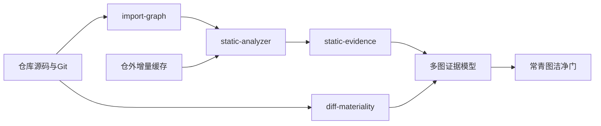

# 零 Token 增量静态分析与多图证据抽取引擎 — 功能设计规范（SPEC）

## 文档信息与变更概览

| 项目 | 内容 |
| --- | --- |
| 当前状态 | `draft`（`draft \| approved \| implementing \| in_review \| implemented \| superseded`） |
| 规划级别 | `L3`（跨模块公共库契约新增与高风险路径 `kit/` 演进；未 `approved` 前不编码） |
| 创建 / 更新 | `2026-11-27` / `2026-11-27` |
| 分支 / Issue / PR | `feat/visual-studio-archify-v2` / 未关联 / 未关联 |
| 负责人 / 内审状态 | `plan-studio-b` / `pending` |
| 规划态 | `interactive`（逐题问到零拍板） |
| 关联 PRD / Todo | `docs/prd/261127-visual-studio-archify-v2-prd.md` / `docs/todo/261127-zero-token-static-analyzer-todo.md` |

- **变更一句话**：提供零 LLM Token、纯 Node 18+ 的增量静态分析器、3 层 10 类图表证据抽取器、3-dot PR Materiality 差分过滤器及常青架构图零脏态校验，为 Wave 2 布局引擎与 Wave 3 Studio UI 提供统一实证数据底座。

## 系统变更全景

| 模块 / 文件 | 变更性质 | 核心职责 |
| --- | --- | --- |
| `kit/skills/lib/import-graph.mjs` | 新增 | 从 `static-gates.mjs` 下沉多语言导入解析（JS/TS/Python/Go/Rust/Java/Kotlin），供门禁与静态分析器单一真源共用 |
| `kit/skills/lib/static-analyzer.mjs` | 新增 | 统一增量静态分析器：构建模块导入图、复用 Tarjan SCC 算耦合度（`fanIn`/`fanOut`/cycles）与 Git 热度，增量缓存至仓外 `analysis-cache.json` |
| `kit/skills/lib/static-evidence.mjs` | 新增 | 3 层证据驱动 10 类图表抽取：Tier 1 常驻，Tier 2 6 类按阈值激活（无证据零空 Tab），Tier 3 `waterfall` 仅实测 span 激活 |
| `kit/skills/lib/diff-materiality.mjs` | 新增 | 3-dot `merge-base(base, HEAD)...HEAD` Materiality 过滤 + 1-hop 邻域并集 + 有界 `-`/`+` hunk |
| `kit/skills/lib/static-gates.mjs` | 修改 | 改为从 `import-graph.mjs` 导入 `resolveGoModules` 与 `extractImportsForArch`，行数从 788 行降至约 650 行 |
| `kit/skills/lib/doc-graph.mjs` | 修改 | 导出既有内部 Tarjan SCC 函数 `findSccs`，避免重复实现 |
| `kit/skills/lib/architecture-map.mjs` | 修改 | 在 `verifyArchitectureMapSync` 中增加常青图零临时 diff 脏态校验，阻断 `modified`/`impacted` 残留 |
| `scripts/dev/fixtures-static-analyzer.mjs` | 新增 | 7 类异构仓库栈正反双向行为断言（覆盖 `C1..C4`） |
| `scripts/dev/injections-data-static-analyzer.mjs` | 新增 | 静态分析缓存、Tier 2 阈值、Materiality 过滤与常青脏态门禁故障注入 |
| `docs/feature-map.json`、`docs/architecture-map.html` | 修改 | 登记新增库模块并刷新干净常青架构图，保证本波次自洽全绿 |

## 一、背景与边界声明

- **要改什么**：在 `kit/skills/lib/` 建立零第三方依赖、MIT Clean-Room 静态分析与多图证据层，并收紧常青 `docs/architecture-map.html` 洁净门禁。
- **不改什么**：本波次不改动 `visual-layout.mjs` 的坐标排布算法，不改动 `visual-render*.mjs` 的 HTML/CSS/JS 前端界面，也不改动 `dev-flow` 沙箱状态机。
- **本期不做**：不做跨语言类型推导或完整编译器 AST；不引入外部解析器依赖；不渲染任何图表 SVG/HTML（由 Wave 2 与 Wave 3 承接）。
- **复用既有模块**：`kit/skills/lib/static-gates.mjs`、`kit/skills/lib/static-gates-lexer.mjs`、`kit/skills/lib/doc-graph.mjs`、`kit/skills/lib/symbol-index.mjs`、`kit/skills/lib/git.mjs`、`kit/skills/lib/git-core.mjs`、`kit/skills/lib/git-fast.mjs`、`kit/skills/lib/feature-map.mjs`、`kit/skills/lib/feature-map-graph.mjs`。
- **架构基线关系**：严格遵守 `arch-rules`（`kit/**` 仅导入 `node:*` 与 `kit/skills/lib/**`，零反向依赖 `scripts/lib/**` 或 `scripts/dev/**`），单文件严格 `<= 800` 行（依据：`docs/TDD.md`）。

## 二、设计方案与契约变更

### 接口 / 数据结构变更

1. **`kit/skills/lib/import-graph.mjs`（预计 `<= 220` 行）**：
   - 导出 `resolveGoModules(repoRoot)`、`extractImportsForArch(relFile, text, goModules)` 与 `resolveLocalImportTarget(candidates, fileSet)`，完整保留既有 `static-gates.mjs` 语义并扩展相对/模块路径到仓内 `relPath` 的精确解析。
2. **`kit/skills/lib/static-analyzer.mjs`（预计 `<= 420` 行）**：
   - 导出 `resolveAnalysisCachePath(repoRoot)`：解析 `<gitCommonDir>/project-forge-flow/analysis-cache.json`（非 Git 仓回退 `<repoRoot>/.worktrees/.state/analysis-cache.json`）。
   - 导出 `analyzeRepoStatic(repoRoot, { useCache = true, includeGitChurn = true, maxChurnCommits = 200 } = {})`：
     - 遍历受跟踪或工作区源码文件（复用 `COMMON_SKIP_DIRS` 与 `isMacOsJunkPath`）。
     - 增量缓存键为 `relPath -> { blobSha, mtimeMs, size, imports, symbols, metrics }`：Git 仓优先比对索引/对象 `blobSha`（回退 `mtimeMs + size`），命中则跳过磁盘读取与词法解析，变更文件局部重算后通过 `writeJsonAtomic` 原子回写。
     - 调用 `findSccs`（来自 `doc-graph.mjs`）计算有向依赖图强连通分量，输出 `{ nodes, edges, coupling: { [id]: { fanIn, fanOut, inCycle, sccId } }, cycles, churn: { [relPath]: { commits, lastAt } }, tags, merges, cacheStats: { hits, misses, cachePath } }`。
3. **`kit/skills/lib/static-evidence.mjs`（预计 `<= 520` 行）**：
   - 导出 `DIAGRAM_TIERS` 与 `extractMultiDiagramEvidence(repoRoot, { analysis, featureMap, telemetrySpans = null } = {})`，返回 `{ activeTabs, skippedTabs, diagrams }`：
     - **Tier 1 常驻**：`architecture`、`workflow`、`tree`（永远提供有效结构，即使空仓也返回空态摘要而非崩溃）。
     - **Tier 2 静态证据按需激活（低于阈值一律归入 `skippedTabs` 并附 `reason`，绝不生成空 Tab）**：
       - `erd`：扫描 `*.prisma`、`*.sql`（`CREATE TABLE` / `REFERENCES` / `FOREIGN KEY`）与常见 ORM 模型定义（TypeORM/Drizzle/SQLAlchemy/GORM/Diesel），至少 `>= 1` 个实体且存在字段或关系时激活。
       - `class`：跨 TS/JS（`extends`/`implements`）、Python（`class A(B):`）、Go（struct 嵌套与方法集）、Rust（`impl Trait for Struct`）、Java/Kotlin（`extends`/`implements`）提取类型关系，**严格 `>= 3` 条继承或接口边**才激活。
       - `sequence`：沿路由/CLI 入口 -> 服务 -> 存储/子模块静态调用边展开跨参与者链路，**严格 `>= 3` 跳**跨参与者调用链才激活。
       - `lifecycle`：识别状态枚举常量/类型与状态迁移赋值或映射表（`from -> to`），存在 `>= 2` 个状态与 `>= 1` 条迁移边时激活。
       - `dataflow`：解析 `.github/workflows/*.{yml,yaml}` 中 `jobs.<id>.needs` 与步骤顺序，或显式 ETL/管道阶段定义，存在 `>= 2` 个阶段或依赖边时激活。
       - `timeline`：读取 `git log` 标签与合并里程碑，**严格 `tags.length + merges.length >= 2`** 才激活。
     - **Tier 3 可选实测遥测**：
       - `waterfall`：仅当显式传入非空真实实测 `telemetrySpans`（每项含 `id`/`label`/`startMs`/`durationMs` 且均为有限非负数）时激活，绝不伪造估算耗时。
4. **`kit/skills/lib/diff-materiality.mjs`（预计 `<= 280` 行）**：
   - 导出 `classifyDiffMateriality(entries)`、`extractBoundedHunks(diffText, { maxLinesPerFile = 40, maxTotalLines = 240 } = {})` 与 `computePrDiffContext(repoRoot, { baseRef = 'main', headRef = 'HEAD', analysis = null, featureMap = null } = {})`：
     - 严格计算 `git merge-base <baseRef> <headRef>` 后以 `<mergeBase>...<headRef>` 3-dot 差异驱动。
     - Materiality 规则：Schema/迁移文件（`*.prisma`、`*.sql`、`migrations/**`、`schema.*`）**必触发**；纯文档（`*.md`/`*.txt`）、锁文件（复用 `LOCKFILE_NAMES`）与 100% 相似度纯重命名（`R100`）自动判为 `non-material` 跳过。
     - 对实质变更文件按导入图与 `feature-map` 依赖求 **1-hop 邻域并集**，附有界 `-`/`+` hunk 摘要。
5. **`kit/skills/lib/architecture-map.mjs` 洁净门禁（保持 `renderArchitectureMapFromRepo` 既有契约 + 单点由 `verifyArchitectureMapSync` 拦脏图）**：
   - `renderArchitectureMapFromRepo` 保持既有参数契约（若调用方显式传入 `changedFiles`/`diffOverlay` 仍照常渲染，不新增未登记阻断码，也不静默剥离参数，确保 `flow-lifecycle-finalize.mjs:231-234` 既有无参渲染、`I986` 故障注入与 `[Sandbox-C8]` 以及 `checkExitCodeParity` 全部 100% 有效）。
   - 常青 `docs/architecture-map.html` 的零临时 diff 洁净门禁单点收敛于 `verifyArchitectureMapSync`（复用已登记阻断码 `BLOCKED_ARCHITECTURE_MAP_DRIFT`、`exitCode: EXIT.FACT`、`reason: 'dirty-diff-overlay'`），分两层校验且无视 `` 与 `` 块后，扫描渲染元素属性与类名是否残留 `pf-diff-(added|modified|removed|impacted)` 或 `data-diff-state="(added|modified|removed|impacted)"`。
     - 任一命中即返回 `{ ok: false, code: 'BLOCKED_ARCHITECTURE_MAP_DRIFT', exitCode: EXIT.FACT, reason: 'dirty-diff-overlay' }`。

### 数据与状态变更

- 新增仓外缓存文件 `<gitCommonDir>/project-forge-flow/analysis-cache.json`（含 `schemaVersion: 1`、`files` 映射表），不进入 Git 跟踪，删除可自动重建。

### 异常、回退与安全边界

- 非 Git 仓库或浅克隆无 `baseRef` 时，`analyzeRepoStatic` 与 `computePrDiffContext` 优雅降级返回空 Git 热度 / 空 3-dot 差异与显式 `degradedReason`，不抛出未捕获异常。
- 损坏的 `analysis-cache.json` 读取失败时自动忽略并全量重算覆写，不阻断渲染流程。
- 跳过超 `512 KB` 单文件与二进制文件，防止大制品拖垮扫描。

### 实现顺序

1. 从 `static-gates.mjs` 提取 `kit/skills/lib/import-graph.mjs` 并导出 `doc-graph.mjs` 的 `findSccs`，先跑 `fixtures.mjs --domain core` 与 `preflight.mjs` 确认既有门禁零回归。
2. 实现 `static-analyzer.mjs`、`static-evidence.mjs` 与 `diff-materiality.mjs`，并在 `architecture-map.mjs` 加上常青图零脏态校验。
3. 编写 7 栈异构仓库双向夹具 `scripts/dev/fixtures-static-analyzer.mjs` 与故障注入 `scripts/dev/injections-data-static-analyzer.mjs`。
4. 更新 `docs/feature-map.json`、刷新干净 `docs/architecture-map.html` 并执行 `node scripts/equip.mjs .` 收口。

## 三、备选方案与否决理由

| 方案 | 怎么做的 | 为什么没选 | 什么情况下该改回它 |
| --- | --- | --- | --- |
| 统一纯 Node 词法抽取 + 仓外增量缓存（已选） | 复用 `import-graph` / `symbol-index` / Tarjan SCC，按 `blobSha/mtime` 缓存于仓外 | 满足零 npm 依赖、秒级增量与 7 栈通用性 | 若未来允许引入 WASM 解析器作为可选加速层可在同一接口下平滑替换 |
| 引入 tree-sitter 或 TypeScript Compiler API | 依赖原生包做全量语义 AST 解析 | 违反 `project-forge` 零第三方依赖铁律且安装体积极大 | 仅当项目放弃零依赖不变量时才考虑 |
| 在 `static-analyzer.mjs` 拷贝 `extractImportsForArch` | 直接复制多语言导入正则 | 违反单一真相源，导致 `arch-rules` 与静态图解析分叉 | 永不采用 |

## 四、改动清单与影响面

| 文件 / 目录 | 改动性质 | 改什么 | 谁会被影响 |
| --- | --- | --- | --- |
| `kit/skills/lib/import-graph.mjs` | 新增 | 多语言导入解析与仓内相对路径目标映射 | `static-gates.mjs`、`static-analyzer.mjs` |
| `kit/skills/lib/static-analyzer.mjs` | 新增 | 增量静态分析器、耦合指标、Tarjan 环、Git 热度与仓外缓存 | `static-evidence.mjs`、Wave 2/3 |
| `kit/skills/lib/static-evidence.mjs` | 新增 | 3 层 10 类图表静态证据抽取与激活门控 | Wave 2 布局引擎、Wave 3 渲染器 |
| `kit/skills/lib/diff-materiality.mjs` | 新增 | 3-dot PR 实质性差分过滤、1-hop 邻域与有界 hunk | Wave 3 Brief 与 PR 审阅视图 |
| `kit/skills/lib/static-gates.mjs` | 修改 | 复用 `import-graph.mjs`，删去重复实现瘦身 | `dev-edit`、`dev-review`、`dev-govern` |
| `kit/skills/lib/doc-graph.mjs` | 修改 | 导出既有 `findSccs` | `static-analyzer.mjs` |
| `kit/skills/lib/architecture-map.mjs` | 修改 | `verifyArchitectureMapSync` 增加常青图零脏态校验 | `verify-tools`、`edit-gate`、`flow` |
| `scripts/dev/fixtures-static-analyzer.mjs` | 新增 | 7 栈异构仓库正反双向测试 | `scripts/dev/fixtures.mjs` |
| `scripts/dev/injections-data-static-analyzer.mjs` | 新增 | 本波次关键门禁故障注入条目 | `scripts/dev/verify-injections.mjs` |
| `docs/feature-map.json`、`docs/architecture-map.html` | 修改 | 注册新增模块并刷新干净架构图 | 全仓治理与自检 |

- **对外可见的变化**：无破坏性 CLI 参数变更；`verifyArchitectureMapSync` 新增 `dirty-diff-overlay` 漂移原因拦截。
- **需要同步改的地方**：`node scripts/equip.mjs .` 同步 `.agents/skills/`；更新 `docs/feature-map.json` 与 `docs/architecture-map.html`。

## 五、冻结的验收标准

<!-- criteria:start -->
- [ ] C1: `kit/skills/lib/static-analyzer.mjs` 复用 `import-graph.mjs` 与 `doc-graph.mjs` 的 `findSccs`，在 `<gitCommonDir>/project-forge-flow/analysis-cache.json` 实现按 `relPath + blobSha/mtime` 的增量缓存，准确输出依赖图、`fanIn`/`fanOut`/cycles 与 Git 热度，工作区 `git status --porcelain` 保持为空（`node scripts/dev/fixtures.mjs --domain static-analyzer` 通过）。
- [ ] C2: `kit/skills/lib/static-evidence.mjs` 对 10 类图表严格执行 3 层证据门控（Tier 1 常驻，Tier 2 中 `erd`/`class >= 3`/`sequence >= 3 跳`/`lifecycle`/`dataflow`/`timeline >= 2` 缺证据不激活且返回空 Tab 为 0，Tier 3 `waterfall` 仅真实实测 span 激活），正反双向断言全过。
- [ ] C3: `kit/skills/lib/diff-materiality.mjs` 基于 `merge-base(base, HEAD)...HEAD` 3-dot 差异精确识别 Schema/迁移必触发、纯文档/锁文件/纯重命名跳过，输出 1-hop 邻域与有界 hunk；`architecture-map.mjs` 保持 `renderArchitectureMapFromRepo` 既有参数契约（保 `I986` 与 `checkExitCodeParity` 有效），并单点由 `verifyArchitectureMapSync` 解析 `pf-visual-data` JSON 与剥离 `<style>`/`<script>` 后以既有 `BLOCKED_ARCHITECTURE_MAP_DRIFT`（`reason: 'dirty-diff-overlay'`）精准拦截含脏 diff 节点的常青 `docs/architecture-map.html`。
- [ ] C4: `scripts/dev/fixtures-static-analyzer.mjs` 与 `scripts/dev/injections-data-static-analyzer.mjs` 覆盖 7 类异构仓库栈正反双向验证并全量捕获注入故障；同步更新 `docs/feature-map.json`、`docs/architecture-map.html` 与 `node scripts/equip.mjs . --check`，`node scripts/dev/preflight.mjs` 与 `node scripts/dev/fixtures.mjs --domain static-analyzer` 退出码 `0`。
<!-- criteria:end -->

## 六、高风险点、门型与回滚路径

- **门型与回滚路径**：`one-way`（涉及 `kit/skills/lib/` 共享门禁与公共分析内核）；回滚做法：反向提交本切片 PR，重跑 `node scripts/equip.mjs .` 与 `node scripts/dev/preflight.mjs`。
- **高风险路径**：`kit/`（特别是 `kit/skills/lib/static-gates.mjs` 与 `kit/skills/lib/architecture-map.mjs`）。
- **故障注入预演**：至少注入 4 类退化故障——缓存命中漏失效、Tier 2 阈值放宽产出空 Tab、3-dot Materiality 放行纯锁文件或漏掉 Schema 迁移、`verifyArchitectureMapSync` 放行脏 diff 常青架构图——全部由 `verify-injections.mjs` 证伪捕获。

## 澄清与补充记录

- 已确认：多语言导入解析直接从 `kit/skills/lib/static-gates.mjs` 下沉至 `kit/skills/lib/import-graph.mjs`，同步把 `static-gates.mjs` 行数压低至安全线以下，杜绝两份正则分叉。

## 实现说明

- **实际落地摘要**：
- **与草案的差异**：
- **关联同步文件**：
