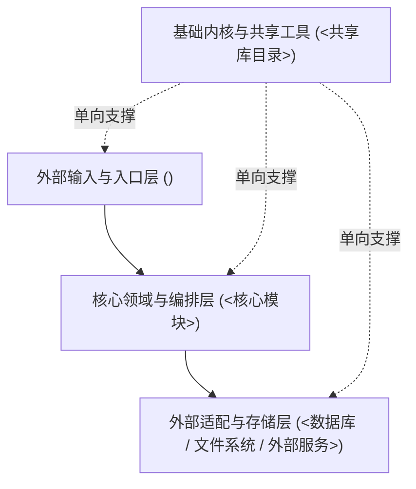
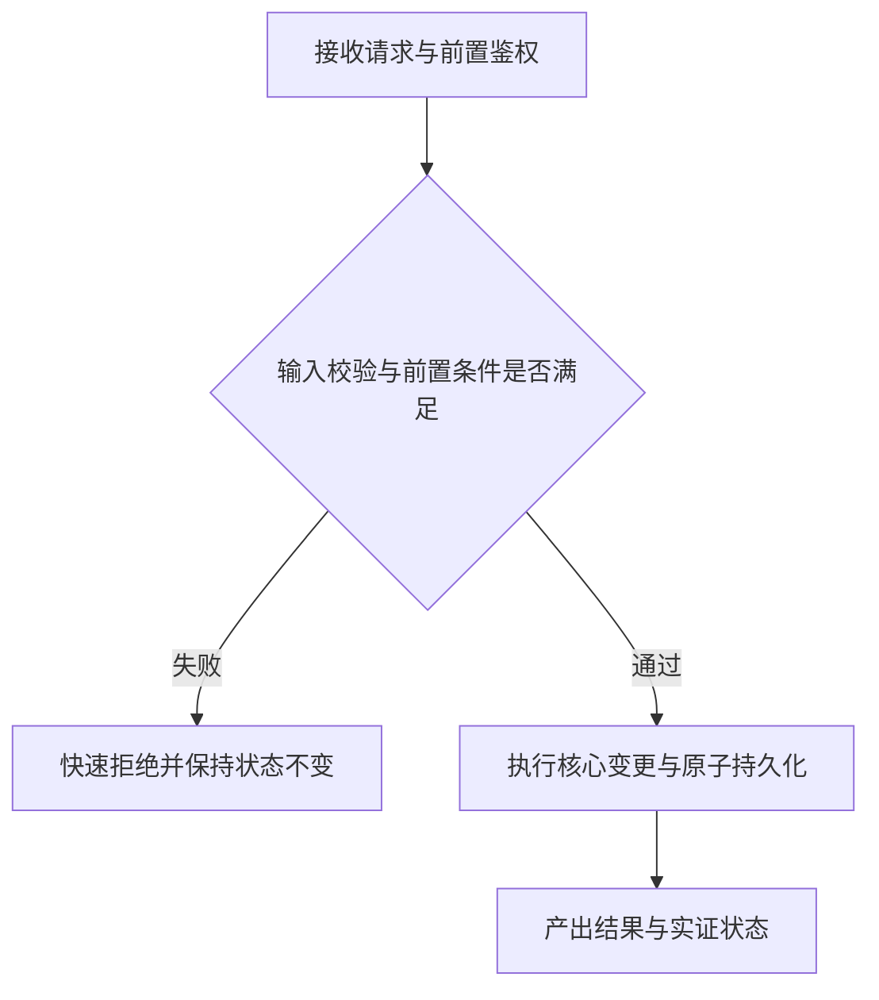
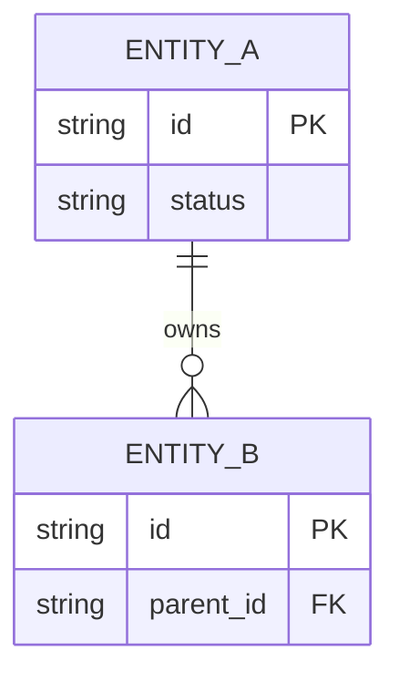
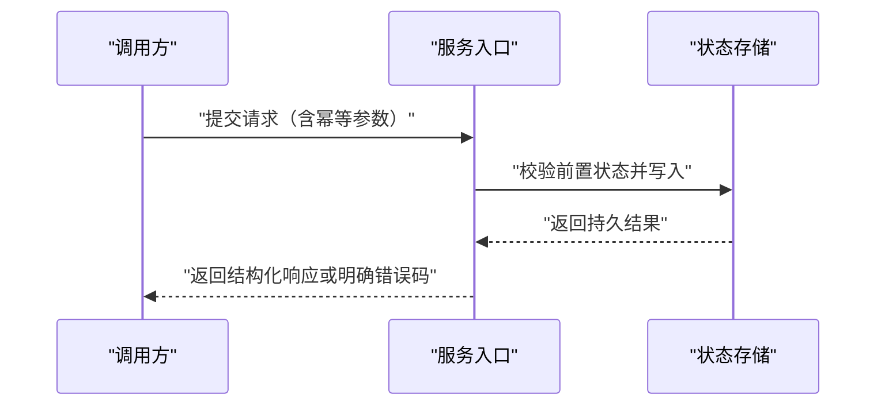

# <项目名称> — 技术设计与架构契约（TDD）

<!-- 本文档是项目常青架构权威，面向人类维护者与 AI 会话。写作与校准准则：
1. 只描述系统当前真实结构、边界与不变量，不写修改履历、任务流水账或个人日记。
2. 所有文件路径、模块名、命令与接口必须来自真实代码勘察，严禁保留「<...>」「待补充」占位文本。
3. 标有「[按需保留，不适用整节删除]」的章节若不适用于本项目，整节直接删除，不留空壳。
4. 完成改写或校准后，删除这些 HTML 提示注释，并同步更新「目录」链接与锚点。 -->

## 目录

- [背景与非目标](#背景与非目标)
- [术语表](#术语表)
- [系统架构全景](#系统架构全景)
- [核心流程与状态流转](#核心流程与状态流转)
- [核心不变量与安全红线](#核心不变量与安全红线)
- [数据模型与持久化契约（按需保留）](#数据模型与持久化契约-按需保留不适用整节删除)
- [对外接口与交互时序（按需保留）](#对外接口与交互时序-按需保留不适用整节删除)
- [部署与环境差异（按需保留）](#部署与环境差异-按需保留不适用整节删除)

## 背景与非目标

- **核心定位**：<一句话说明本系统解决的核心问题与服务对象>
- **架构目标与关键取舍**：<例如性能、可靠性、零依赖、向后兼容或安全隔离边界>
- **明确非目标（Non-Goals）**：
  - <明确不承担的能力范围 1，防止后续需求越界>
  - <明确不承担的能力范围 2>
- **关键运行约束**：<运行环境版本、硬件/权限前置条件、合规与安全底线>

## 术语表

| 术语 | 系统内定义 | 代码或配置中的对应载体 |
| --- | --- | --- |
| `<领域术语或核心概念 1>` | `<清晰、无歧义的语义界定>` | `<对应类型、目录或配置字段>` |
| `<领域术语或核心概念 2>` | `<状态、角色或契约对象界定>` | `<对应模块或文件位置>` |

## 系统架构全景

<!-- 节点标签含括号、斜杠或冒号时必须使用双引号包裹 -->



### 模块与目录职责

| 模块 / 目录 | 核心职责 | 允许依赖 / 禁止反向引用 | 核心入口文件 |
| --- | --- | --- | --- |
| `<模块或目录 A>` | `<对外提供的唯一职责>` | `<仅依赖基础层，不引用上层>` | `<对应入口文件路径>` |
| `<模块或目录 B>` | `<业务编排或状态管理职责>` | `<可依赖基础层与适配层，禁止跨领域直连>` | `<对应入口文件路径>` |

### 分层禁引规则（arch-rules）

<!-- 与 AGENTS.md Dev Profile 中的 arch-rules 键保持一致；单层小型项目写 none -->

```yaml
arch-rules: <fromGlob> -> <toGlob>
```

- `<约束说明：为何禁止该方向依赖，越界应如何通过共享抽象或端口反转解耦>`

### 功能与入口地图（Feature Map）

| 功能 / 能力域 | 源码入口（文件与关键符号） | 本地验证命令（`quick-test` / `smoke-verify`） |
| --- | --- | --- |
| `<核心能力 1>` | `<入口文件路径>` | `<可本地执行的单测或冒烟命令>` |
| `<核心能力 2>` | `<入口文件路径>` | `<可本地执行的单测或冒烟命令>` |

## 核心流程与状态流转



- **正常主链路**：<简述核心数据流与关键状态迁移条件>
- **失败与回退语义**：<校验失败、外部超时或部分失败时如何保障状态可恢复或零污染>
- **并发与幂等约定**：<重复执行、并发写入或重试时的锁与幂等键机制>

## 核心不变量与安全红线

1. **数据与状态一致性**：<任何场景下不能破坏的单一真相源、原子写入或事务边界>
2. **权限与访问边界**：<身份识别、鉴权最小权限、只读隔离与敏感凭据防泄露约束>
3. **输入与外部边界**：<不可信输入校验、命令注入防护或供应链执行隔离规则>
4. **高风险路径同步约定**：修改 `<核心协议、构建配置或权限边界路径>` 时，须同步校准本文与对应测试，并在同一分支接受独立审查。

## 数据模型与持久化契约 [按需保留，不适用整节删除]

<!-- 无持久化模型或状态机存储时整节删除 -->



- **存储载体与生命周期**：<表结构 / 状态文件位置、版本迁移策略、备份与清理边界>

## 对外接口与交互时序 [按需保留，不适用整节删除]

<!-- 无跨端 RPC、HTTP API、Webhook 或复杂多方时序时整节删除 -->



| 接口 / 命令 / 事件 | 输入与关键参数 | 成功返回与错误 / 退出码语义 |
| --- | --- | --- |
| `<接口或命令 1>` | `<必填参数与约束>` | `<正常输出与典型阻断码>` |

## 部署与环境差异 [按需保留，不适用整节删除]

<!-- 无多环境配置差异、容器部署或跨平台运行差异时整节删除 -->

- **运行环境与最低版本**：<对照清单文件声明，不凭记忆猜版本号>
- **环境变量与密钥边界**：<仅列配置键名与默认值，严禁写入真实密钥；明确禁止提交 `.env`>
- **跨平台或环境差异**：<开发、测试、生产及不同操作系统间的路径、权限或构建差异>
